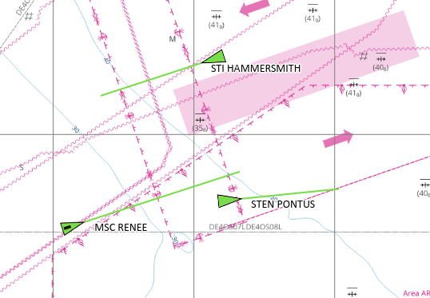
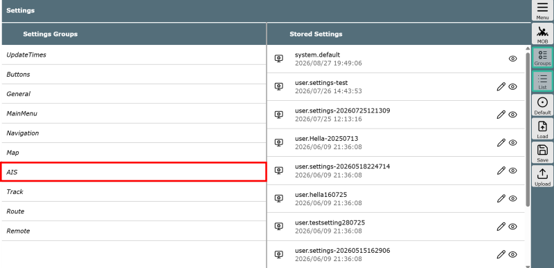
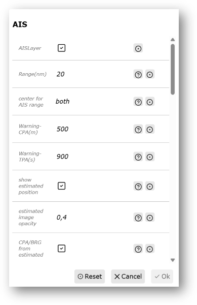
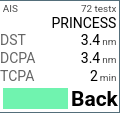
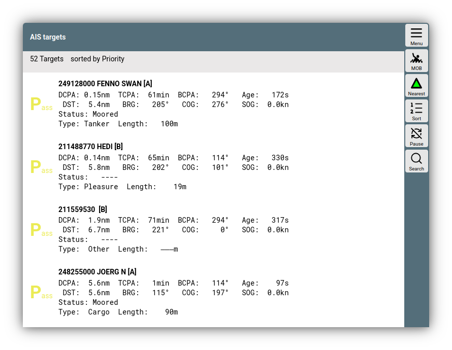
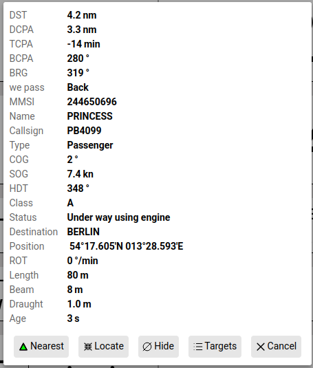
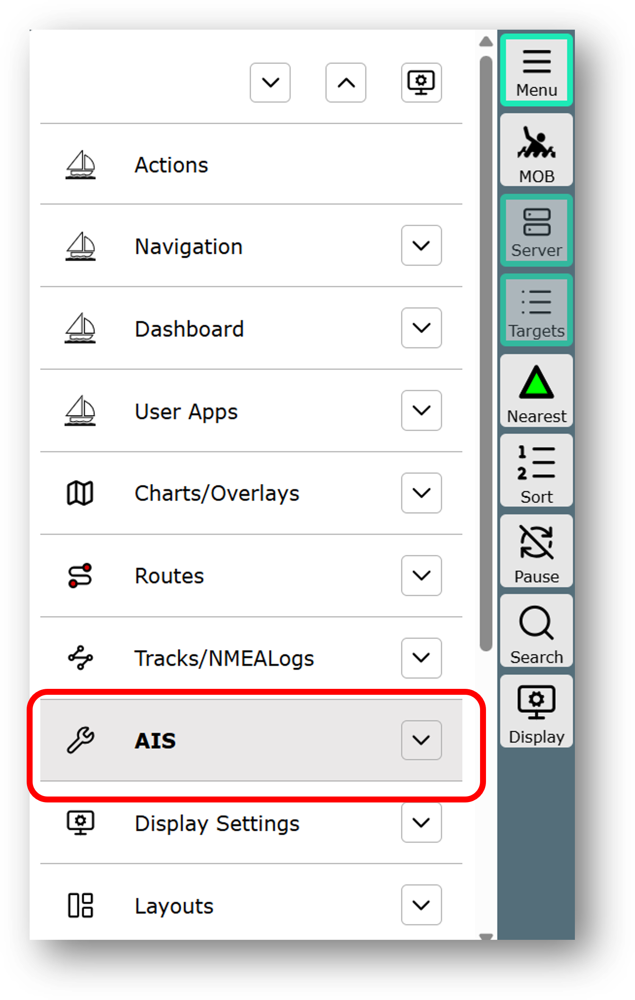

---
  tags:
    - AIS
---

# AIS

Auf der [Navigationsseite](navpage.md) werden neben der Karte, den Anzeigen (Widgets) und den Navigations-Informationen auch AIS-Objekte und zugehörige Informationen angezeigt. Das erfordert natürlich, dass AvNav entsprechende [NMEA0183 Datensätze](../special/nmeadata.md) (AIVDO,AIVDM) oder AIS-Daten von [SignalK](../special/signalk.md) empfängt.

Neben der Darstellung auf der Karte erfolgt auch eine Berechnung der voraussichtlichen Positionen mit minimaler Entfernung.

## Anzeige von Objekten

In der Kartendarstellung werden andere Schiffe oder AIS-Objekte als grüne Dreiecke dargestellt. 

Die vorauseilende, grüne Linie ist der sogenannte Kursvektor, der zeigt, wohin sich das jeweilige AIS-Objekt bewegt und wo es in der vorab eingestellten Zeit sein wird. Die Standardeinstellng beträgt 10min. 

Diese und andere Einstellungen können im Menüpunk *Settings* und dort in den *SettingsGroups* im Bereich *AIS* vorgenommen werden.

Äußerst wichtig bei der Navigation ist es, zu bedenken, dass nicht alle Schiffe in der Umgebung ein AIS-Signal aussenden. Ein regelmäßiger Ausguck ist totz der AIS-Darstellung in der digitalen Karte daher unerlässlich.

## Widget-Funktionen

Um einen aktuellen Überblick zu bekommen, welche AIS-Targets unter Umständen eine Kollisionsgefahr hervorrufen können, lässt sich das AIS-Widget in der Kartendarstellung nutzen. Dort wird in der Regel das AIS-Objekt dargestellt, das der eigenen Position am nähesten ist.

Für eine schnelle visuelle Information sorgt das farbige Rechteck unten: Ist es grün, droht vom dargestellten AIS-Objekt keine Gefahr. Ist es rot, kann es bei gleichbleibenden Bedingungen zu einer Kollision kommen.

| Abkürzung |  Bedeutung |
| :--- | :--- | 
| DST | Aktueller Abstand zum angezeigten AIS-Objekt |
| DCPA | Entfernung zur größten Annäherung |
|  TCPA  | Zeit bis zur größten Annäherung  |

**Back** und **Front** zeigen die relative Lage des AIS-Objektes zum eigenen Boot.

Ein Klick auf das AIS-Widget öffnet die AIS-Targets-Liste:

## AIS-targets-Liste

Mit der Liste der *AIS targets* bekommt man unabhängig von der Kartendarstellung eine Übersicht, welche Schiffe in der Umgebunug sind, die AIS-Signale ausstrahlen. Die Liste enthält eine Reihe interessanter weiterer Details zu jedem Schiff.

Für eine frühzeitige Reaktion auf mögliche Annäherungen ist die Locate-Funktion sehr geeignet. Mit ihr holt man das ausgewählte AIS-Ziel quasi "zur Beobachtung" in das AIS-Widget. 

Dort wird nun das "located"-AIS-Ziel statt des nächstliegenden Ziels im Widget dargestellt, solange kein anderes Ziel auf Kollisionskurs ist.

Diese Funktion kann sehr hilfreich sein, um zum Beispiel Fähren im Blick z behalten, die in den gleichen Hafen einlaufen werden und eigene Manöver dann beeinflussen können.

## AIS-Menü

Die AIS-Funktionen lassen sich nut nur über die Kartendarstellung, sondern auch über das Menü und dort über den Menüpunkt *AIS* erreichen.

## Details
Für Darstellungs- und Berechnungsdetails rund um AIS siehe die [ausführliche Informationen](../special/ais.md) im Bereich *Details*.
