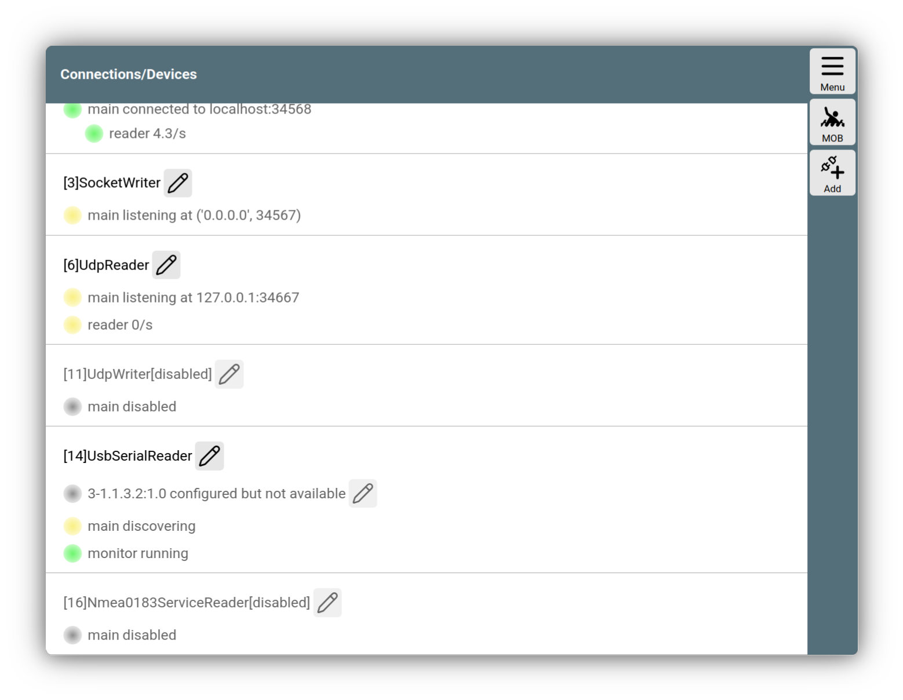
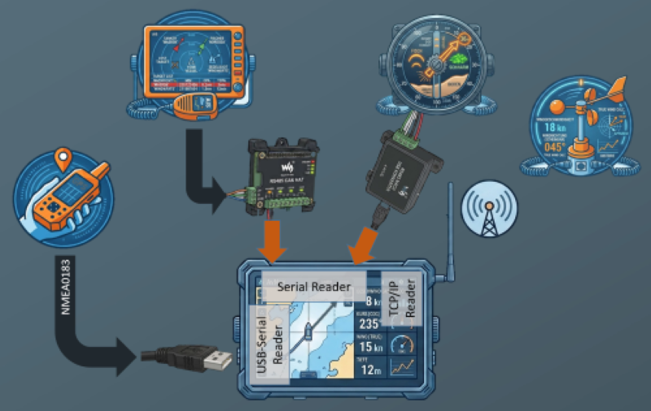
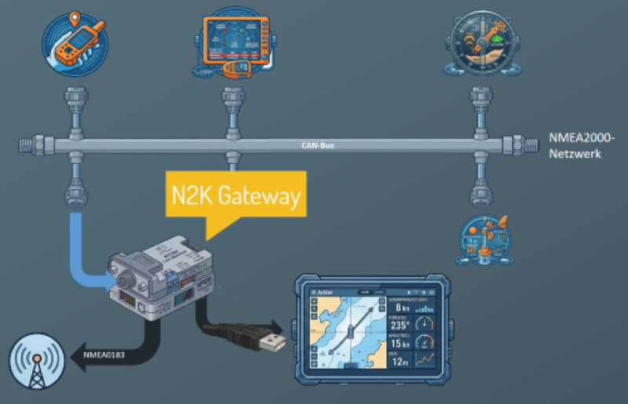
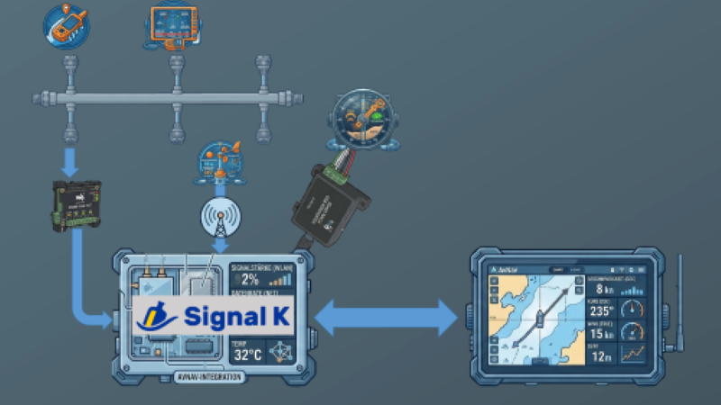
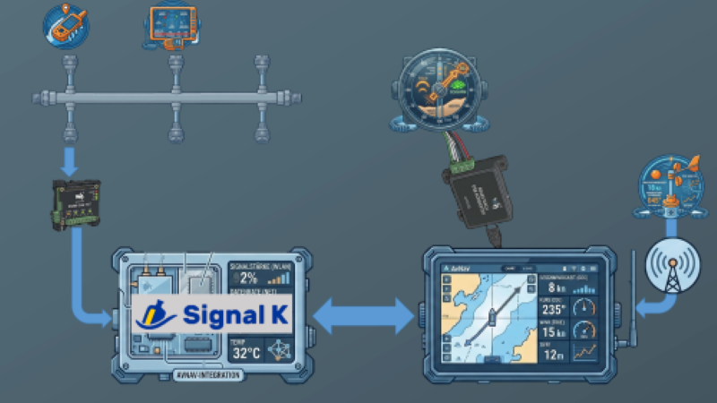

---
  tags:
    - NMEA
    - NMEA0183
    - NMEA2000
    - Datenfluss
---

# Datenflüsse 

{{VIDEO("Hier","dataflow")}} geht es zum Einführungsvideo zum Thema "Datenflüsse".

Damit eine Navigationssoftware wie AvNav arbeiten kann, braucht sie notwendigerweise Daten.

In diesem Abschnitt geht es darum, welche Navigationsdaten wie von AvNav verarbeitet werden. Es richtet sich an Einsteiger und Benutzer, die geläufige Szenarien für den Datenverkehr mit AvNav an Bord verstehen und aufbauen wollen.

Tatsächlich kann die Verarbeitung von Daten mit AvNav eine komplexe Angelegenheit werden, die profunde Einarbeitung benötigt, wenn man auch die letzten Ecken und Möglichkeiten ausloten möchte. Dazu dienen die entsprechenden [Artikel](../special/connections.md) im Bereich "Details".

## Datenlieferanten

Beginnen wir mit der Frage, welche Geräte in der Regel an Bord Navigationsdaten für AvNav liefern können und sollen.

Das dürfte zuerst einmal GPS sein, um vor allem Position, SOG und Uhrzeit zu liefern. Dann erhalten wir die Wassertiefe von einem Echolotgeber, Daten für die relative Windgeschwindigkeit und den relativen Windwinkel von einem Windsensor und die Positionsdaten anderer Schiffe, die über das AIS-System übermittelt werden.

AvNav kann nicht nur eingehende Daten verarbeiten, sondern auch prozessierte Daten wieder ausgeben. Das ist vor allem relevant für die Beschickung von Autopiloten oder Tochteranzeigen.
Das soll erst einmal die Mindestdatenmenge beschreiben, die hier zugrunde gelegt wird.

## Datenformate

Die beschriebenen Geräte liefern ihre Daten in unterschiedlichen Formaten an. In der Regel sind das **NMEA0183**, **NMEA2000** und **Seatalk**. Um die Daten in den unterschiedlichen Formaten für AvNav verfügbar zu machen, braucht man Hardware, genauer sogenannte Wandler oder Schnittstellen, denn je nachdem, auf welchem Rechner AvNav läuft, müssen die Daten irgendwie AvNav erreichen.

## Datenfluss nur über AvNav

### NMEA0183 per USB

Betrachten wir zu Beginn den einfachsten Fall: GPS-Daten einer GPS-Maus sollen AvNav erreichen:

Wir nutzen eine GPS-Maus, die NMEA0183-Daten liefert. Damit ist das Format geklärt. Am Ende des Kabels sitzt ein USB-Stecker. Damit ist auch die Schnittstelle geklärt, es handelt sich um USB, also eine serielle Schnittstelle. 

AvNav erkennt auf Linux-Systemen automatisch, wenn an einer der seriellen Schnittstellen  Daten auflaufen, und richtet über 

{{MM("MMchannelspage")}}

sogenannte Reader ein. 

Sie regeln auf der Softwareseite, dass die NMEA0183-Daten AvNav erreichen und dort zur Navigation genutzt werden können. 

Auf Android Systemen ist die Einrichtung über ein internes GPS noch einfacher - auch hier erfolgt die Einrichtung wieder über

{{MM("MMchannelspage")}}

### NMEA0183 per seriellem Wandler

Bei einem Echolot, das NMEA0183-Daten liefert, oder einem Seefunkgerät, das AIS-Daten sendet, sieht es etwas anders aus, weil man bei diesen Geräten meistens nur offene Kabelenden finden wird. Diese Geräte bedienen in der Regel die RS485-oder die RS 232-Schnittstelle. Sie sind wie USB ebenfalls serielle Schnittstellen. 

Als Hardware gibt es sie als Aufsatzplatine oder HAT für einen Raspberrry oder als  USB-Adapter. Hier wird es also etwas komplizierter, weil Hardware eingebaut werden muss. Wie das geht, kann man in den Dokumenten des jeweilgen Geräts nachlesen.

### NMEA0183 per WLAN

Ein dritter Weg ist der über ein WLAN, wie ihn zum Beispiel der Open Source Windsensor “Yachta” vom Open Boat Project nutzt. Das setzt aber ein Bord-Netzwerk voraus, das ein WLAN zur Verfügung stellt. 

Zwei Dinge sind an dieser Stelle wichtig: 

Einmal: Daten im NMEA0183-Format können nur direkt von Gerät zu Gerät übertragen werden, das heißt, jedes sendende Gerät braucht einen eigenen Wandler oder einen Eingang beim Empfänger, also dem AvNav-Rechner. Oder eben eine eigene Netzwerkadresse im Netz. 

Und dann muss man wissen, dass AvNav selbst nur NMEA0183-Daten verarbeitet. 

### NMEA 2000

Allerdings werden heutzutage auf den meisten Freizeit-Booten sogenannte NMEA2000-Netzwerke verwendet. Auf dem dort verwendeten sogenannten CAN-Bus kann jedes angeschlossene Gerät Sender und Empfänger sein.

Um also einen AvNav-Rechner in ein solches CAN-Bus-System zu bringen, braucht man in jedem Fall einen Wandler, der aus Daten im NMEA200-Format NMEA0183 für AvNav macht und umgekehrt.

Hierbei ist es anders als bei NMEA0183 egal, wieviele Geräte am NMEA2000-Bus hängen.

Als Wandler kommen verschiedene Typen in Frage: Einmal das speziell für AvNav entwickelte N2K-Gateway, das die NMEA2000-Daten konvertiert und per WLAN und USB versendet. Mit einem aufsteckbaren Zusatzmodul können die Daten auch auf RS485 gewandelt werden. 

Diese Hardware-Variante eignet sich gut, auch ein auf Android laufendes AvNav in ein NMEA2000-Netzwerk einzubinden.

Dann können Wandler verschiedener anderer Hersteller mit unterschiedlichen Funktionalitäten verwendet werden. 

Einen kleinen Überblick liefert die Webseite vom [Open Boat Project](https://open-boat-projects.org/de/nmea2k-wlan-bridge-eine-marktuebersicht/).

Es können auch CAN-Adapter eingebunden werden, wie sie auf HAT-Platinen für Raspberrys oder USB-Devices z.B. von Actisense zu finden sind, die nicht selbst nach NMEA0183 konvertieren. Über eine Zusatzsoftware auf den Headless-AvNav-Images, das sogenannte [*CanBoat*](../special/nmea2000.md), wird dann die Konvertierung nach NMEA0183 und zurück durchgeführt.

Je nach Datenformat und verwendeter Hardware können bestimmte Daten AvNav auch wieder verlassen: Über die NMEA2000-Wandler und -Adapter, über serielle Schnittstellen oder LAN und WLAN stellt AvNav NMEA0183-Daten vor allem für die Versorgung eines Autopiloten zur Verfügung. 

Welche Datensätze das im Einzelnen sind, findet sich in Abschnitt [Details](../special/nmeadata.md).

## SignalK

Wenn man mehr Flexibilität im Umgang mit Daten möchte und vor allem mehr als nur Autopilot-Daten versenden will, kommt ein zweiter mächtiger Spieler auf das Parkett, der Teil des Headless- Images ist: Der [SignalK-Server](../special/signalk.md). 

Der ist bereits datentechnisch mit AvNav verbunden und kann durch seine PlugIns eine Menge weiterer Funktionalität in das gesamte System bringen. Er läuft  leider nicht auf Android-Systemen.

Wer sich intensiver mit dem SignalK-Server befassen möchte, liest bitte in entsprechenden [Manuals](https://demo.signalk.org/documentation/) nach.

Nur soviel zu SignalK und AvNav, und das macht die ganze Sache dann recht komplex:

AvNAv und SignalK sind über mehrere Datenformate miteinander verknüpft. Zudem können im Zusammenspiel von AvNav und SignalK Datenflüsse entstehen, die auf der einen Seite viel Freiheit bieten, auf der anderen Seite auch Konfigurationsfehler provozieren können.

## Datenfluss nur über SignalK (OpenPlotter-Variante)

Man kann alle eben beschriebenen Datenverbindungen auch dem SignalK-Sever zuordnen und von dort konfigurieren. 

So wird es auf dem Open Source-System Openplotter gemacht.  

Dann allerdings muss man damit leben, dass ein Ausfall des SignalK-Servers auch die Datenverbindungen zu AvNav mitreißt.

## Datenfluss über AvNav und SignalK (Misch-Variante)

Es sind auch gemischte Konfigurationen möglich, das bedeutet, man kann einen Teil der Daten direkt in AvNav einspeisen und einen anderen Teil über den SignalK-Server. 

Das kann interessant werden, wenn Alarmmeldungen im SignalK-Server generiert werden und über AvNav ausgegeben werden sollen. 

Ebenso können Apps wie NodeRED oder KIP, die über den SignalK-Server installiert  werden, zur Aufbereitung und Anzeige von Daten verwendet werden. Die Daten dafür können dann von AvNav kommen oder zu AvNav gesendet werden.

Bei solchen Mischsystemen ist es äußerst wichtig, den erzeugten Datenfluss so aufzubauen, dass man keinen Kreisverkehr erzeugt - sprich, dass die gleichen Daten zwischen SignalK und AvNav immer wieder hin- und her gesendet werden. Das würde das Gesamtsystem ordentlich ausbremsen.

Wenn man also so etwas vorhast, kann man mit Filtern arbeiten. Mit Filtern kann  das Senden oder Empfangen von Daten beeinflusst werden. Das geht sowohl im SignalK-Server, als auch in AvNav. Man sollte also genau wissen, was man tut. 

In den [Details](../special/connections.md) findet man dazu weitere Hinweise zur Konfiguration der Verbindungen von AvNav von und zu Bord-Netzwerken.
