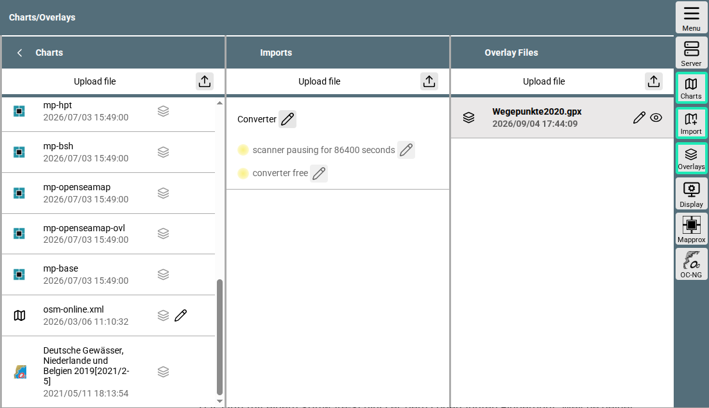

---
  tags:
    - Charts
---
# Charts

{{VIDEO("Here","charts")}} is an introductory video on the subject of "Charts" in AvNav.

## Formats {: #formats}

AvNav supports various chart formats, for example:

### Raster charts
  Formats: GEMF, MBTiles and PMTiles
  
  Freely available raster charts are provided by sources such as OpenSeaMap and FreeNauticalChart. 
  Raster charts from various sources can also be created manually and uploaded to AvNav or generated using the Mapproxy app. More details on this can be found in the [details](../special/charts.md).
  Using the tool [Mobile Atlas Creator](https://mobac.sourceforge.io/) charts from various online sources can be downloaded and subsequently installed in AvNav. Information on this can be found under [Mobile Atlas Creator](../special/mapsources.md).
  You can also find other tools on the internet that enable the downloading of charts.

### Vector charts

AvNav primarily uses vector charts from *O-Charts* with the appropriate [plug-in](../special/ochartsng.md). 
  With O-Charts, all common maritime areas in Europe can be covered at affordable prices. They are based on official charts from the respective countries and contain all the information required for navigation with pleasure craft. Unfortunately, O-Charts do not run on Windows systems.
  
  In addition, vector charts of inland waterways in iENC format and vector charts from NOAA can be downloaded free of charge.

### Online chart sources
  These charts require an internet connection. This would be, for example, 
  OpenSeaMap again in the online version without prior download.

### Plugins
  With the appropriate plugins, additional chart formats, such as 
  vector tiles, can be used. However, this requires some preparatory work. You can find further support for this in the [details](../special/charts.md#insertingdefs).

## Management {: #management}

With the installation of AvNav, several charts, e.g., from the BSH or OpenSeaMap, are already provided. You can reach the overview of existing charts directly from the navigation page via the {{BT("NavSelectChart")}} button. Using the "Select Charts" dialog, you can see all already installed charts.

In the area 

{{MM("MMchartspage")}}

you can manage the charts.

///caption
Charts page
///

Here, too, you can see the already installed charts in the "Charts" column. 

Via "Upload File" {{SB("Upload")}} in this column, you can upload charts in the supported formats to the AvNav server.

The "Import" column is intended for charts that need to be converted beforehand. You can read about how this process works in detail in the [details](../special/charts.md#converter). 

And the right column “Overlays” is described in a separate [chapter](overlays.md).

In the button bar at the bottom, you will see the OC-NG button 
{: .inline-image }.

It is responsible for the installation of O-Charts. In the {{VIDEO("Video","charts")}} the installation of O-Charts is shown; for further reading, you can use the [detailed documentation](../special/ochartsng.md).

## Links
* [Details on charts and chart types](../special/charts.md)
* [Mobile Atlas Creator sources](../special/mapsources.md)