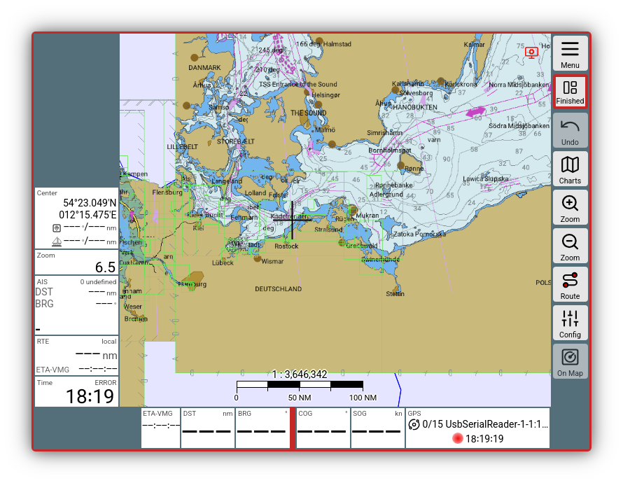
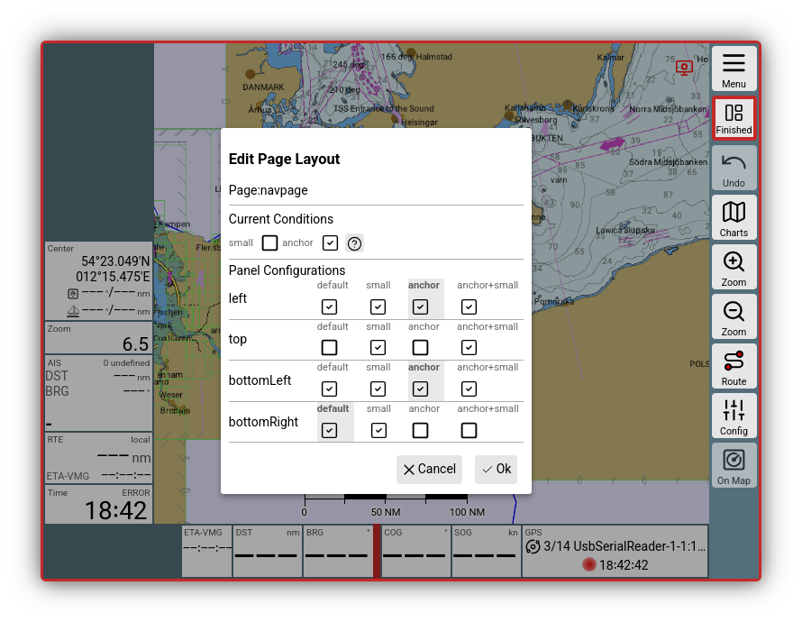
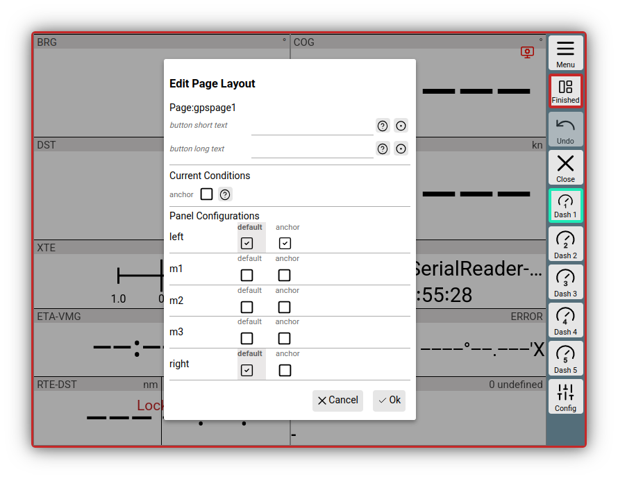
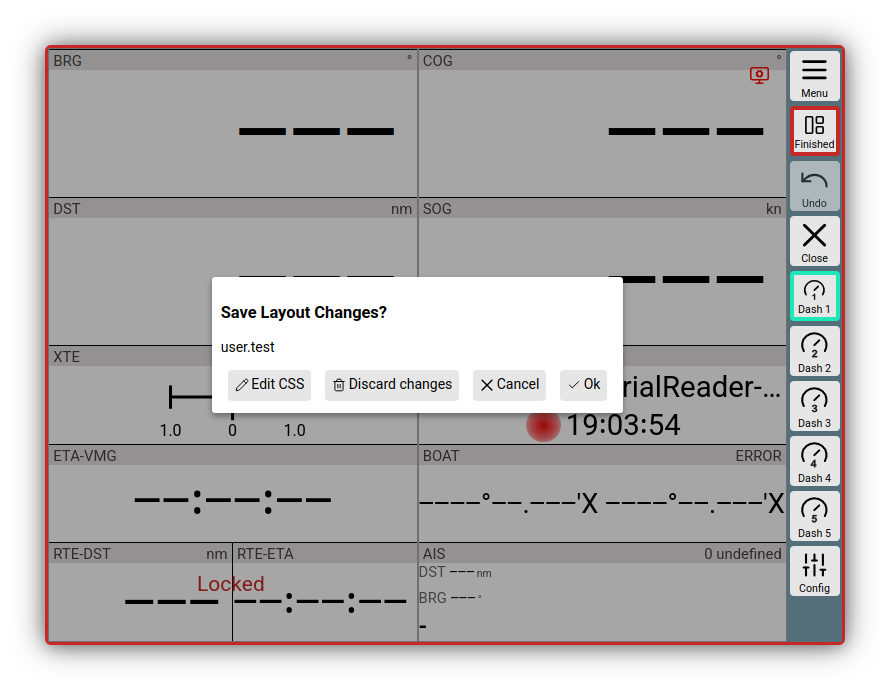

---
  tags:
    - Layout
    - Layout editor
---
# Layout

{{VIDEO("Hier","layouts")}} you will find a video explaining the most important layout functions.

Layouts in AvNav determine how the displays ([widgets](navpage.md#widgets)) are arranged on the navigation page and the dashboard pages. AvNav comes with predefined layouts, but you can create and customize as many additional layouts as you like.
You can select a layout for each display device—this allows you to assemble different displays as needed.

When starting AvNav for the first time in a new browser (display device), you will be asked which layout you would like to use.

The layouts are stored as (json) files on the AvNav server (see also the [details](../special/layout.md#save) on this).

## Layout page

To manage or edit layouts, switch to the Layout page.

{{MM("MMlayoutspage")}}.

Only the current layout can be edited. This is displayed prominently in the first line.

At the moment, the layout *user.test* is activated. The list below contains all other saved layouts.

The prefix "user" indicates that this is a layout created by the user. Layouts with the prefix "system" are preset and cannot be edited.

[Plugins](../special/plugins.md) can also provide layouts. These are recognizable by the "plugin" prefix and are also not editable.

You can start editing the active layout using the Edit button. A short dialog offers the option to enter a new name if it is a system layout. Otherwise, clicking *Edit* starts editing the current layout.

Now, the NavPage appears slightly smaller with a red border to indicate that edit mode is active; in addition, the button bar on the right has changed.

///caption
Layout editor navigation page
///

You can see how to use the layout editor very well in the {{VIDEO("Video","layouts")}}.

## Editing the navigation page {: #navpage }
Here are a few functions in brief, in case you don't want to watch the entire video.

A reminder: the goal now is only to adjust the widgets around the chart display on the navigation page or the widgets on the dashboard pages.

If you click directly on a widget, you can make changes. The most important line is likely "New Widget," as this is where you can select a different widget.

A click on the current name opens a selection list of all available widgets.

As an example, *COG* is selected. If you now click directly on "Update," you change the current widget that was previously selected.

**Important:** Use the *Before* and *After* buttons to add a new COG widget before or after the current one. The active one remains unchanged.

If you want to insert a new widget from the start, click in the empty area next to the chart and you will be guided through the setup of a new widget.

Other important setting options for the edited widget are (depending on the widget):

  * "Caption":
    This is the text visible next to the displayed value in the widget.
  * "Formatter":
    Here, the representation of the value is defined together with the *Unit* line. The format is usually already specified.

The top line, "Panel," determines where the widget is placed on the page.
Depending on the page (navigation page/dashboard pages), there are different areas where widgets can be placed.

### Page configuration {: #config-nav }
The {{BT("EditPage")}} button opens a configuration dialog.

///caption
Layout configuration navigation page
///

Here you can define exactly which areas around the map should contain widgets.

In addition, different conditions for the display can be set. Depending on which condition is currently met, you can place different widgets. This is useful, for example, when the anchor watch is running—then you can display the anchor watch data instead of the waypoint information (this is used in the system layouts).

For the navigation page, two conditions are available:

  * small

    If the display device used can switch between horizontal and vertical orientation, for example, it makes sense to configure different widgets for the vertical orientation (="small" - i.e., small display) than for the horizontal mode.
    The value of the screen width (in pixels) at which "small" becomes active can be set in the settings
    {{MM("MMsettingspage")}}->"General"->"portrait layout below"
    .

  * anchor

    Becomes active as soon as you activate the [anchor watch](../special/anchorwatch.md).

While working in the layout editor, these conditions are **not automatically** set—i.e., rotating the display does not activate "small" mode. To activate the conditions, you must use the configuration dialog.

Under "Panel Configurations," you will find the list of available panels that can contain widgets. The checkboxes indicate whether the panel is displayed in the mode. The gray background indicates whether the panel has its own configuration for the mode.

In the example image, this means:

  1. Condition "anchor" is active, "small" is inactive
  2. Panel "left" and "bottomLeft" have a separate configuration for the condition
  3. Panel "top" is not displayed
  4. Panel "bottomRight" has no special configuration - i.e., the configuration without conditions is used

When the configuration is complete, you can exit the dialog with {{DB("DBOk")}}.

**Note:** Depending on the selected conditions, you are now editing the panels for these conditions!

### Moving widgets

You can move widgets using drag and drop in the layout editor. This works both within a panel and between them.

### Undo

With the {{BT("RevertLayout")}} button, you can gradually undo the last changes.

## Dashboard pages

Use 
{{MM("MMgpspage")}} 
to switch to the dashboard pages in the layout editor. Editing the widgets is identical to editing on the [navigation page](#navpage).

### Page configuration {: #config-gps}

The {{BT("EditPage")}} button opens the configuration dialog again.

///caption
Page configuration dashboard
///

Condition handling is performed as on the [navigation page](#config-nav). However, only the "anchor" condition is supported on the dashboard pages.

In the configuration dialog, you can also specify texts for the button that opens the current dashboard page. The "button short text" is displayed on the button (max. 7 characters), the "button long text" as a tooltip or in the main menu. These texts are also saved in the layout.

In the default layout, 5 dashboard pages are available. Pages without widgets do not appear as buttons outside the layout editor.

You can increase this number up to 10:

{{MM("MMsettingspage")}}->"General"->"number of bashboards".

If this setting is to be saved in the layout, you must change it in the layout editor mode (see [details](../special/layout.md#display-settings)).

## Exiting the editor

The {{BT("LayoutFinished")}} button terminates layout editing.

///caption
Finish dialog
///

You can decide here once more whether to discard all changes made. With {{DB("DBOk")}}, the layout is saved on the server and also activated locally.

The use of {{DB("DBEditCss")}} is described in the [details](../special/layout.md#layoutcss).

## Further details

Some special notes on layouts—including how to import and export them—can be found [here](../special/layout.md).