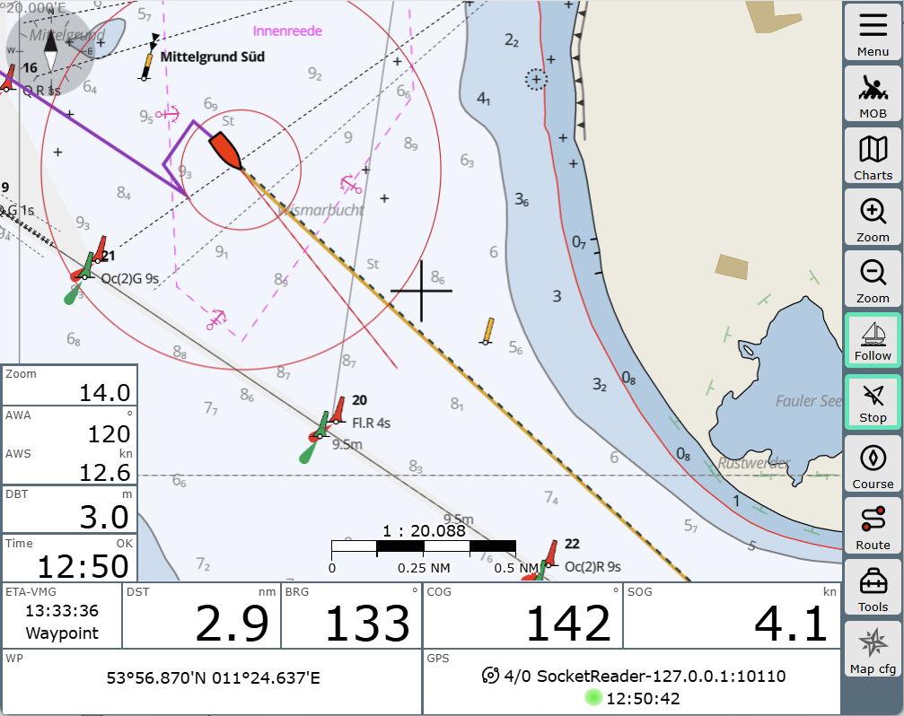
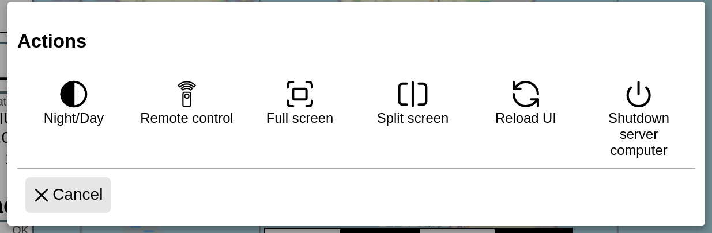
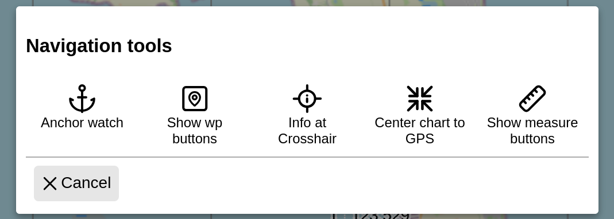
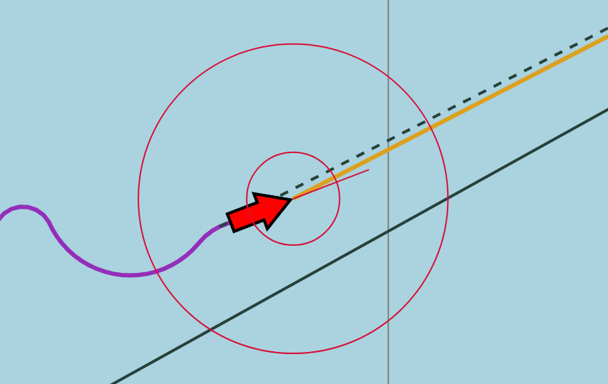
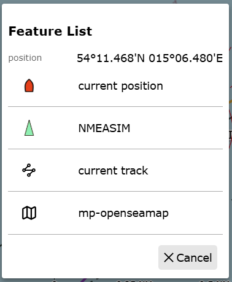
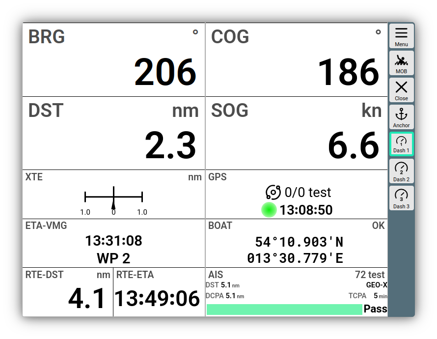

---
  tags:
    - Navigation
    - Button Bar
    - Dashboard
---

# Navigation Page

 Part of the contents of this section is also introduced in the **{{VIDEO("Video here","navigation")}}**

 When starting AvNav, you land immediately in the navigation view,
 where the last used chart is loaded. If this cannot be determined, you will be prompted to select a chart.

## Widgets
 The program window is designed so that all relevant data and display values are quickly accessible. This is ensured by the so-called "widgets". The widgets can appear at the top and bottom as well as on the left of the navigation page. To provide space for further displays, there are also the dashboard pages. All widgets can be freely configured to keep your preferred information in view at all times. How this works in detail and what the dashboard pages are about is covered in the chapter on editing [Layouts](layout.md).

## Button Bar
In the right sidebar is the button bar, which provides the most important functions of the respective AvNav page. 

| Button | Function |
| ------ | -------- |
| {{BT("MainNav",False)}} | One of the most fundamental innovations in 2026 is the ["Main Menu"](../special/mainmenu.md) in the top right, which opens an overview of the available AvNav function areas when clicked. These can be selected directly or expanded via {{ICON("MNCollapsed")}}. By expanding a function area, you can see the relevant buttons, but here with longer and more meaningful text.    The "Actions" function area opens a special menu that triggers specific actions that should be reachable across all function areas. More on this [below](#actions-buttons).    Via [Settings/Main Menu](settings.md) or directly in the menu via the {{ICON("Settings")}} button, you can shorten the menu to make it easier to handle for navigation tasks on the go, as many function areas are unlikely to be needed daily. |
| {{BT("MOB",False)}} |The MOB button is always in the same position on every page. Clicking it first triggers a loud alarm, provided a sound-emitting element is connected to the device. There is also a visual alarm. The current position is jumped to and clearly marked. In the relevant widgets, the distance and course to the MOB are displayed. Another click on MOB deactivates the MOB alarm again.  |
| {{BT("ChartsView")}} |By clicking on the Charts button, previously uploaded charts can be activated. More on this in the section [Charts and Overlays](charts.md). In addition to chart selection, AvNav offers the possibility to add different overlays. With overlays, additional elements can be displayed in the map view besides the pure chart. These can be satellite images, tracks already traveled, additional charts, or files with buoy positions. This is particularly helpful if you are navigating in the border area of two charts, for example, and do not want to keep switching charts.|
| {{BT("ZoomIn")}} {{BT("ZoomOut")}} | These are used to zoom the map section in and out. Unlike using the mouse wheel, your own boat remains centered.|
| {{BT("LockPos")}} | With the Follow button, you ensure that the chart always remains fixed to the boat's position and follows it. The button gets a green border when active. The boat's position can be fixed centrally (at the crosshair) or at any point on the screen. You can set your own preference in [Settings/Map](settings.md).|
| {{BT("WpGoto")}} |If you click on Start, a waypoint is set at the position of the crosshair. Information appears immediately in the widget about how far it is to this point, what course it can be reached with, and approximately how long it will take. This function can therefore be used to navigate quickly and effectively to a specific point, an approach, a specific buoy, or simply to get information about the route there. However, this does not replace the route function. This means that while there is an approach alarm, there is no automatic deactivation of the point when it is reached. This only works via the route function; more on this in the section [Routes](routes.md).|
| {{BT("CourseUp")}} | This button is used to align the map orientation either to the boat's current course or to North. Clicking it leads to course-related alignment. The default setting is alignment to North.|
| {{BT("ShowRoutePanel",False)}} |One of the most important tools in AvNav is the route management, which can be reached with this button. It allows you to plan complex routes, set and change waypoints, save and start routes. More on this topic in the next chapter [Routes](routes.md)|
|{{BT("NavActions",False)}} |Another innovation in AvNav 2026 is the Tools button. It displays additional tools that are not constantly needed via a dialog. |
| {{BT("Dim",False)}} |**Android only:** the screen is dimmed to save power. This is a different function from the Night/Day function, which calls up a different color scheme.|

## Actions Buttons

The buttons in the *Action* menu trigger special actions that should be reachable across all function areas. 

| Button | Function |
| ------ | -------- |
| {{BT("Night",True)}} | A very dark color scheme, primarily based on red tones, is activated or deactivated, which is suitable for night sailing.  |
| {{BT("RemoteChannel",True)}} | Allows changing the remote control channel and mode. This offers the possibility to remotely control the display of one device from another device or from the server. This *specials* topic is explained [here](../special/remotecontrol.md).|
| {{BT("FullScreen",True)}} | If supported by the browser, this button switches full-screen mode on or off.|
| {{BT("Split",True)}} | Here, the Split Mode can be switched on and off. Simply put, two AvNav instances run side by side on the display in this operating mode. There are special notes and instructions [here](../special/splitmode.md). |
| {{BT("ReloadUI",True)}} | Reloads the browser window with the data from the AvNav server|
| {{BT("StatusShutdown", True)}} | If the system is running on a Raspberry image, this button starts the orderly shutdown of the system. |
|  {{BT("MainExit",True)}} | **Android only**: Exits the [AvNav App](../installation/android.md) or puts it into background mode. |

## Navigation Tools Buttons

| Button | Function |
| ------ | -------- |
| {{BT("AnchorWatch",True)}} | With Anchorwatch, you start the internal AvNav [anchor watch](../special/anchorwatch.md). |
| {{BT("ABShowWpButtons",True)}} | *Show wp buttons* starts a small additional button bar that is displayed directly in the bottom right of the map view and offers additional tools related to active waypoints.|
| {{BT("CenterAction", True)}} | With *Info at Crosshair*, various information about the selected map position can be displayed. 
| {{BT("GpsCenter",True)}} | *Center Chart GPS* centers the map, visualized by the crosshair, on the current GPS position, if available.|
| {{BT("ABShowMeasure",True)}} | With *Show Measure Buttons*, you can display a toolbox with instruments for measuring distances. This button is only active if the Follow button (see above) is not active.|

## Representations on the map {: #vectors}

By default, the boat is displayed on the map as { .inline-image } as soon as a GPS signal is available (the icon can be [customized](../special/usericons.md)). It marks your own position and direction of movement. 

In addition, there are a number of lines: they denote distances, directions, and vectors. The most important ones:

* the red circles are distance circles, by default at 300 and 1000 meters
* the red line in front of the tip of the arrow is the course vector to COG. Its length indicates how far you will move within 10 minutes at the current speed
* the purple line is the track - the path you have traveled
* the black dashed line marks the direction to the waypoint, which was calculated when activating route calculation or starting to a single waypoint
* the ocher-colored line is the direction to the active waypoint
* the dark green line represents the saved route

In [Settings / Navigation](settings.md), the parameters of these representations can be widely influenced and changed.

## Map objects: Feature List and Feature Info

With a click or touch on the map, additional information about objects at this location can be requested. If rough conditions make an exact click difficult, you can also shift the map so that the desired point is in the crosshair, and then start the query using the {{BT("CenterAction", True)}} button from the *Navigation Tools*.

The displayed list contains all objects at this location for which AvNav can offer further [actions or information](../special/featureinfo.md) after selection (depending on the type). In this example, these are your own position, an AIS object, the current track, and the map itself. 

## Dashboards

Via 

{{MM("MMgpspage")}}

or by clicking on the widgets (except in the lower left bar), you get to the dashboard pages.

///caption
Dashboard
///

The displays on the dashboards can be flexibly configured via the [Layout Editor](layout.md). The image shows the "system.modern" layout.

On the dashboard pages, you can activate the [anchor watch](../special/anchorwatch.md) directly via the {{BT("AnchorWatch")}} button.