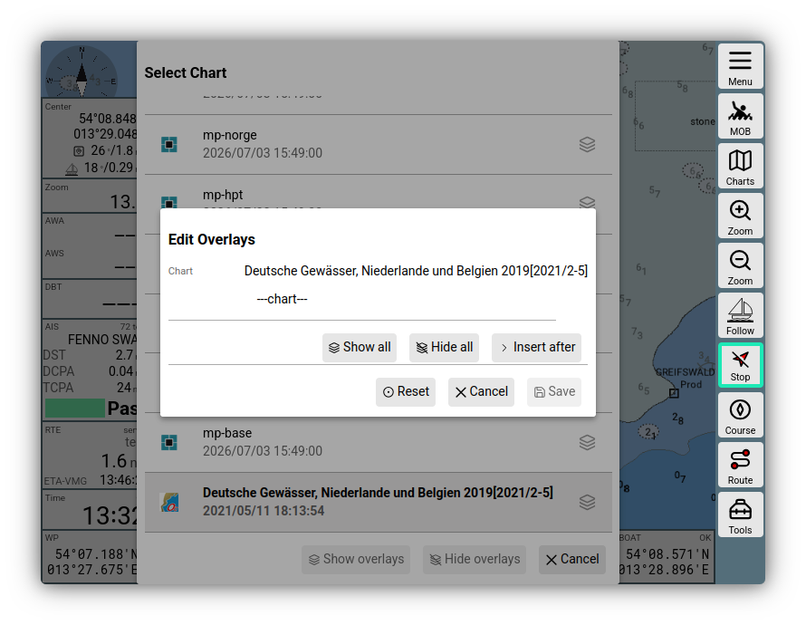
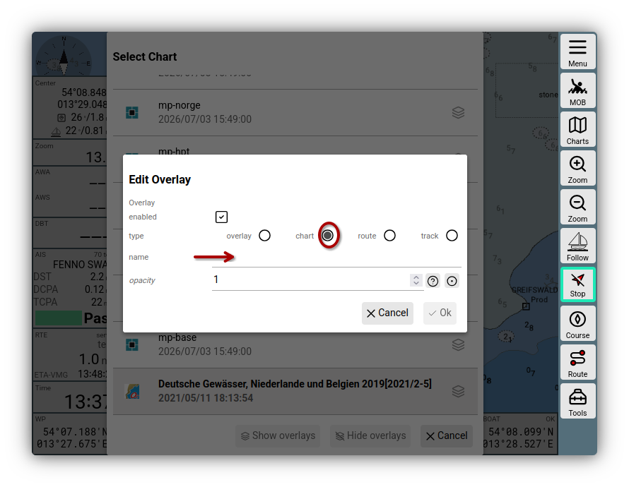
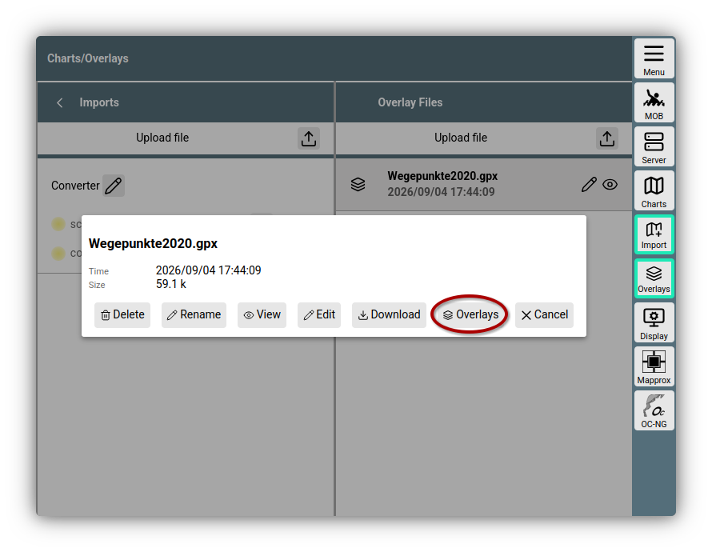
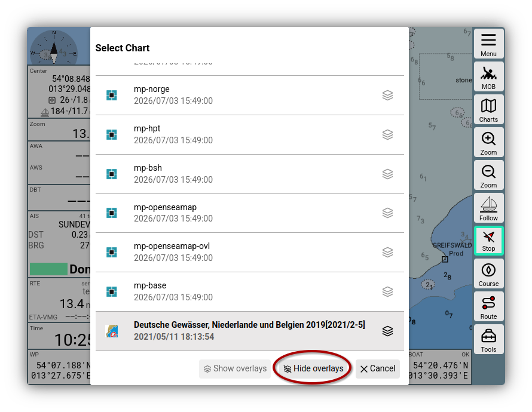
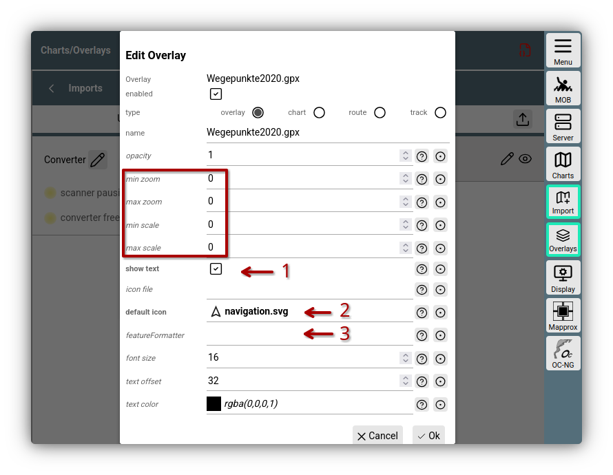

---
  tags:
    - Overlay

---

# Overlays

{{VIDEO("Here","overlays")}} you will find a video that explains the basic functions.

## Introduction

Overlays are used to supplement maps in AvNav with additional information.
This means that maps are layered with additional data and visual representations in order to display extra information on the map or to usefully expand the current map.

An example is the use of a map for Germany - but the sailing area is the border region between Germany and Denmark in the Flensburg Fjord.

This would mean having to switch back and forth between a Danish and a German map depending on the course and position. To avoid this, you can add another map as an overlay to a map in AvNav. This makes both maps visible in the navigation view and creates a seamless transition.

Likewise, you can download information from other sources to display a waypoint list on the map or, for example, a directory of Danish mooring buoys and much more.

It is also possible to bring routes and tracks into the map to compare them or use them as a template for a new route to be created.

Satellite images can also be superimposed on AvNav maps, although this requires a source for satellite maps and some preparation.

## Assignment {: #assign}

How are overlays assigned to specific maps?
To overlay two maps that are present in the system, you can choose a very fast way, namely directly from the navigation page via the button {{BT("NavSelectChart")}}.

For one of the maps you want to layer, click the *Overlay* button on the right. This opens the *Edit Overlays* dialog.

///caption
Overlay Dialog
///

There, click the {{DB("DBInsertAfter")}} button to add another map to the base map.

Another dialog will open where you select the "chart" option and click on the "name" line. Now you can choose from one of the installed maps.

///caption
Map as overlay
///

After clicking {{DB("DBOk")}}, you will return to the original *Edit Overlay* dialog and confirm the new overlay with {{DB("DBSave")}}.

In the map list, you can recognize the overlay by the blackened icon to the right of the map name.

To insert a route, a waypoint list, or a buoy directory as an overlay, you must first download the corresponding files and insert them into AvNav. AvNav accepts such files in GPX, KML, KMZ, and GEOJSON formats.

After the source files have been saved on the computer, go to the section in AvNav:

{{MM("MMchartspage")}}

In the "Overlays" column, you can then upload the files.
As an example, the waypoint list of the NV-Verlag is used here, which is available for free download.

Click on {{BT("Upload")}}, select the file, and check if it becomes visible in the list under *Overlay*. Now you can follow the same path as just described for the maps.

Since you are already in the Charts/Overlays area anyway, you can assign a file to a map directly from the overlay list, which is the reverse of the way described above.
To do this, click on the pen icon next to the selected file, then click on *Overlays* and search for the map you want to assign the overlay to via the pop-up dialog.

///caption
Waypoints as overlay
///

These should of course match. The buoys of the Danish Tursejler Association will hardly be found on a German or Dutch map...

After assignment, you will receive a dialog that allows you to make various settings for the overlay. For some notes on this, see [below](#parameters).

Once the assignment of overlay to map has been created, confirm in the *Edit Overlay* dialog with {{DB("DBSave")}}.

In the map list on the navigation page, you will now find the active overlay icon next to the newly assigned map.

The settings of an overlay can be adjusted at any time by clicking on the {{SB("Edit")}} icon of an overlay in the *Edit Overlay* dialog.

This concludes the demonstration of both ways in which maps and overlays can be combined and edited.

## Hiding and Showing

A brief note on handling overlays, for example during a trip. It can often happen that the information superimposed by overlays interferes with the map display. To be able to switch off the overlays quickly, you have the option directly on the navigation page via the Charts button and the displayed map list by clicking on "Hide Overlays".

///caption
Hiding overlays
///

*Show Overlays* would then quickly reactivate the overlays of the selected map. To avoid confusion, only the respective option is active, while the other is grayed out.

## Settings {: #parameters}

///caption
Overlay settings
///

When [assigning](#assign) overlays or by clicking on the {{SB("Edit")}} icon in the overlay dialog, you get the opportunity to adjust settings for the display of the overlay on the selected map. If you assign an overlay to multiple maps, you can make separate settings for each.

The displayed values depend on the type of the overlay and each has a help function that describes its function.

The `opacity` can be adjusted in decimal steps from 0-1.

The (boxed) values `min zoom` and `max zoom` control the resolution range in which the overlay becomes visible.

`min scale` and `max scale` control the size of icons. At resolutions smaller than `min scale`, the icons are scaled down; at resolutions larger than `max scale`, they are scaled up.
`show text` (1) controls whether labels are visible on the map.

With `default icon` (2), you can select an icon to be used for points that do not have their own icon defined in the overlay file, or if the defined icon is not available in AvNav. You can also use `icon file` to choose a (ZIP) file that contains symbols for an overlay. This must first be uploaded to the overlay files in AvNav.

For further information, including the description of `feature formatter`(3), see the [detailed descriptions](../special/overlays.md).