---
  tags:
    - Route
    - Disconnected
    - Waypoint
---
# Routes
This chapter covers the route function. The processes are shown **{{VIDEO("in this video","routes")}}**.

## The Route Editor {: #editor }

The easiest way to create a route is directly from the [navigation page](navpage.md) using the {{BT("ToRoute")}} button. 

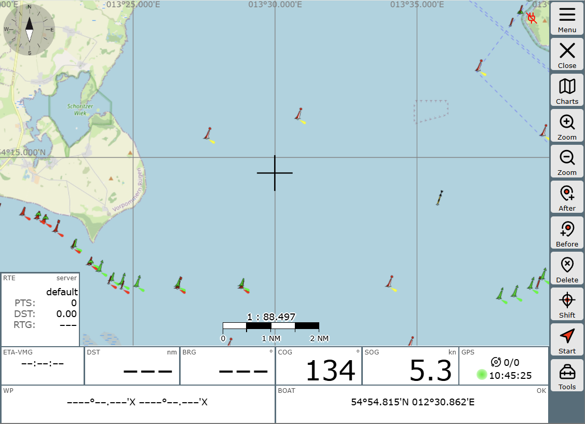

The map view remains, but the button bar on the right has changed. 

- ### New Route  
Click into the route widget (RTE) at the bottom left and create a new route by clicking on {{BT("DBNewRoute")}}, giving the route a new name (e.g., "Test"), and confirming twice with {{BT("DBOk")}}.  

Subsequently, the dialog in the widget shows that the route "Test" is now loaded and contains no waypoints yet. 
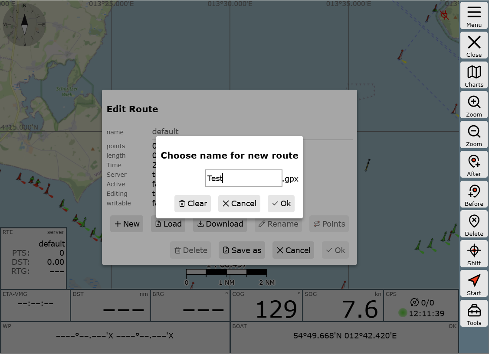

- ### Setting Waypoints   
Waypoints are set in AvNav by moving the crosshair to the position where the waypoint should be placed. This is done by clicking on {{BT("NavAddAfter")}}. 'After' and 'Before' refer to the currently activated waypoint. 

The active waypoint is highlighted in red on the map and in bold in the RTE widget's WP list. In this example, you create the route WP1->WP2->WP3 at the crosshair using the {{BT("NavAddAfter")}} button. Consequently, the button {{BT("NavAdd")}} creates the route WP1->WP3->WP2  
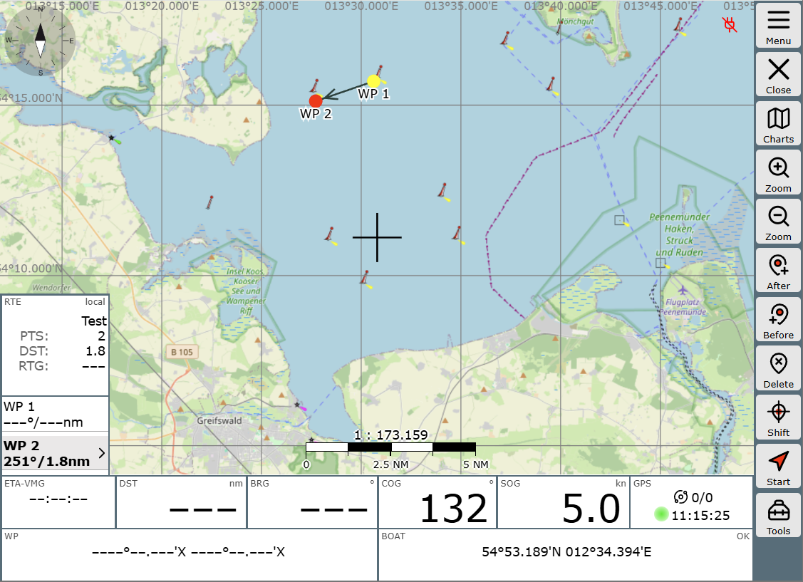

- ### Editing Waypoints
To move a waypoint, it must first be selected directly. This is done either by clicking on the map or by selecting its list entry in the RTE widget. Then, place the desired position under the crosshair and move the waypoint with {{BT("NavToCenter")}}. 

Analogously, you can delete the waypoint—use the {{BT("NavDelete")}} button for this. 

Working with the crosshair might feel a bit cumbersome at first compared to direct clicks on the touchscreen. However, in situations with a heavily moving ship, on a smaller screen, and with cold fingers, you will learn to appreciate this type of operation.

## Saving and Loading Routes {: #management}
Changes to routes are generally saved immediately on the AvNav server. If this system behavior is undesirable, for example, because you are editing the currently active route, the so-called *disconnected* mode is suitable: changes remain local in the browser and are not synchronized to the server for the time being. 

This separation is achieved by deactivating the *connected* mode via the {{BT("DBConnect")}} button in the display of the "Routes" functional area. Changes remain local until you re-activate the *connected* mode—then you will be asked what should happen with the changes; they can be applied or discarded.

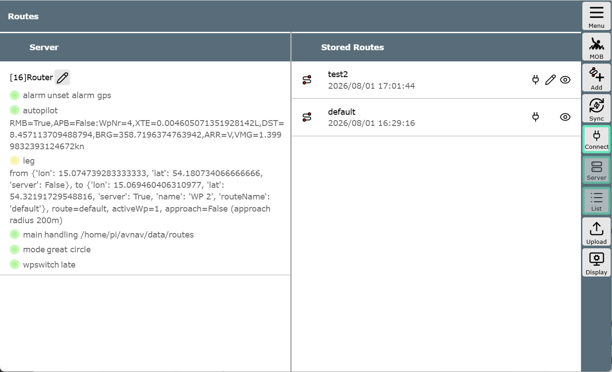

The saved routes are listed in the second column. There, you can, among other things, delete, copy, download, import from *.gpx files, or edit them. On narrow screens, this second column might not be visible—you can access it by swiping.

## WP Buttons {: #wp-buttons}
When editing, but also when using a route, further options become available if you click the {{BT("NavActions",False)}} button and, in "Navigation tools", {{BT("ABShowWpButtons", True)}}. 

The buttons {{BT("WpNext",False)}} and {{BT("WpPrevious",False)}} move the selection from waypoint to waypoint if working in the widget or on the map is felt to be less convenient.

 Via {{BT("Edit",False)}}, each individual waypoint can be edited, for instance, to assign a new name. 
 
 With {{BT("WpLocate",False)}}, you can quickly bring the selected waypoint back into the map window if the map was moved elsewhere for any reason. However, this can also be done by clicking on the waypoint in the RTE widget. 

## Activating a Route
Once all entries are complete, the route can be activated. This is done by clicking the start button {{BT("NavGoto",False)}}. Before that happens, you should check once more which waypoint is currently active—the route will start there. So we set WP 1 as the first leg from our position and click on {{BT("NavGoto",False)}}.  

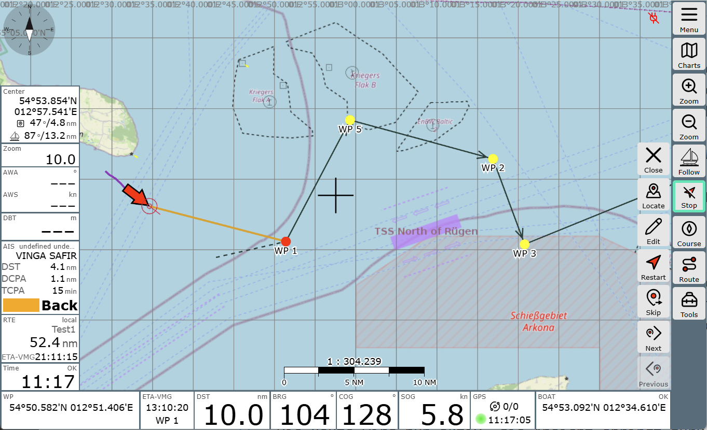

The route is now active, and the view jumps back to the normal navigation window. {{BT("NavGoto",False)}} becomes {{BT("StopNav",False)}}. This allows you to cancel the activation of the route. You can also tell that the route is active by the fact that the direction to the WP is shown as an ochre-colored line and the widgets contain route-related values, i.e., the distance to the next waypoint (DST), the bearing (BRG) to it, and in the RTE widget, the length of the route and the ETA.   

The [WP Buttons](#wp-buttons) also offer useful functions while traveling the route. If you decide spontaneously to skip a waypoint without wanting to change the sequence of the route immediately, {{BT("NavNext",False)}} is the right choice: if you click it, the route jumps to the next waypoint. This can be helpful if you pass a waypoint at such a distance that the system does not automatically acknowledge reaching the waypoint.   

The course to the next waypoint is updated automatically and is displayed as an ochre-colored line by default. The course determined at the beginning of the leg is shown as a [dashed black line](./navpage.md#vectors). The {{BT("NavRestart",False)}} button performs a new initial calculation (e.g., after moving the waypoint while underway)—XTE is reset in the process: the dashed and the ochre-colored lines lie together again.

## Details

### Waypoint Advancement {: #nextwp}

For automatic advancement to the next waypoint in a
route, two conditions must always be met:

1. The boat must be in the approach area of the waypoint. 
   The distance is set under 
   {{MM("MMroutepage")}} -> {{BT("ShowSettings")}} -> "Approach" 
   Reaching the approach area is indicated by a triggered
   waypoint alarm and a red display in the Route widget.

2. Depending on the mode set under   {{MM("MMroutepage")}} -> "Router" {{SB("Edit")}} -> "nextWpMode"
    - "late" The distance to the current waypoint no longer decreases, but the distance to the next waypoint decreases. (Default setting and older versions)  
     - "90": The waypoint is "abeam" (more precisely: the boat has crossed a line +/-
   90° to the original waypoint course)  
     - "early": After the waypoint alarm, the advancement occurs after a (configurable) time without further conditions.

It is important to note that automatic advancement only occurs if both criteria (1. and 2.) are met. 

If manual advancement is desired, you can display the waypoint buttons at any time by clicking on the widgets at the bottom left or via {{BT("NavActions")}}->{{BT("ABShowWpButtons",True)}} and use the {{BT("NavNext")}} button.  

### Route Mode {: #mode }

#### [great circle](https://en.wikipedia.org/wiki/Great_circle)

Here, a route is calculated such that you have the shortest path between start
and destination. The disadvantage is that the course changes permanently throughout the route. Such a route is not a straight line on the map, but a curve.  
In older versions, AvNav always calculated *great circle* routes, but displayed them (incorrectly) as straight lines.  
For shorter distances (< 100nm), this does not practically matter.

#### [rhumb line](https://en.wikipedia.org/wiki/Rhumb_line)

Here, the route is calculated so that a constant course can be steered. The map representation is a straight line.

Switching is done via

{{MM("MMroutepage")}}->"Router"->{{SB("Edit")}}->"useRhumbLine" 

For the {{BT("Measure")}} tool, the mode can be set separately in the web app settings:

{{MM("MMsettingspage")}}->"Navigation"->"Measure rhumbLine"

This allows the two paths to be easily compared.

### Disconnected Mode {: #disconnected}

AvNav makes it possible to edit or change routes while a route is currently active. Thus, for example, a navigator can create and compare different alternatives while the helmsman can undisturbed follow the current route.

The so-called "Disconnected" mode is used for this. In this mode, all route functions occur only locally on the display device (browser). Most write operations to the server are suppressed in this mode.

Via

{{MM("MMroutepage")}}->{{BT("Connected")}} 

this mode can be activated and deactivated: (1) in the image. The button is green when the mode is switched off (i.e., when routes are edited on the server).

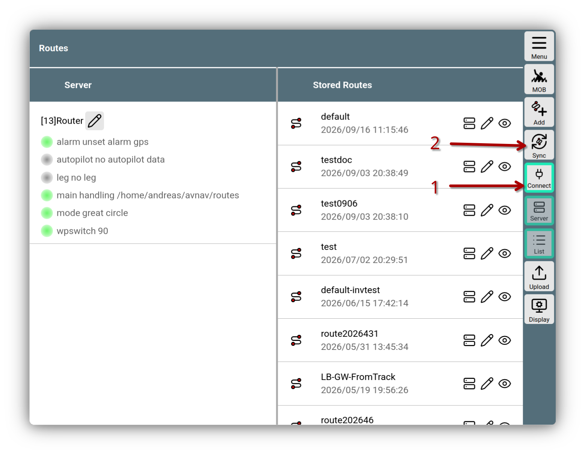
///caption
Route Disconnected
///

Via the {{BT("SyncRoutes")}} button (2), the routes can be [synchronized](#sync) with the server.

When "Disconnected" mode is active, this is indicated by a red icon in the title bar.

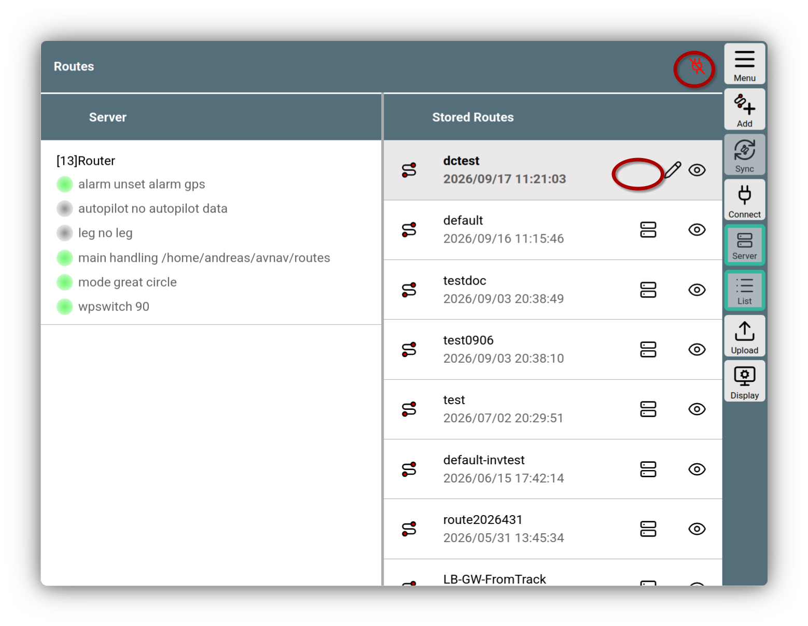
///caption
Route Disconnected active
///

In this mode, routes that are saved on the server {{ICON("Server")}} cannot be edited. You can recognize this by the missing {{ICON("Edit")}} on such routes. However, you can create a copy and then edit it.

In the route editor (and also during navigation), the route widget displays whether it is a local route.

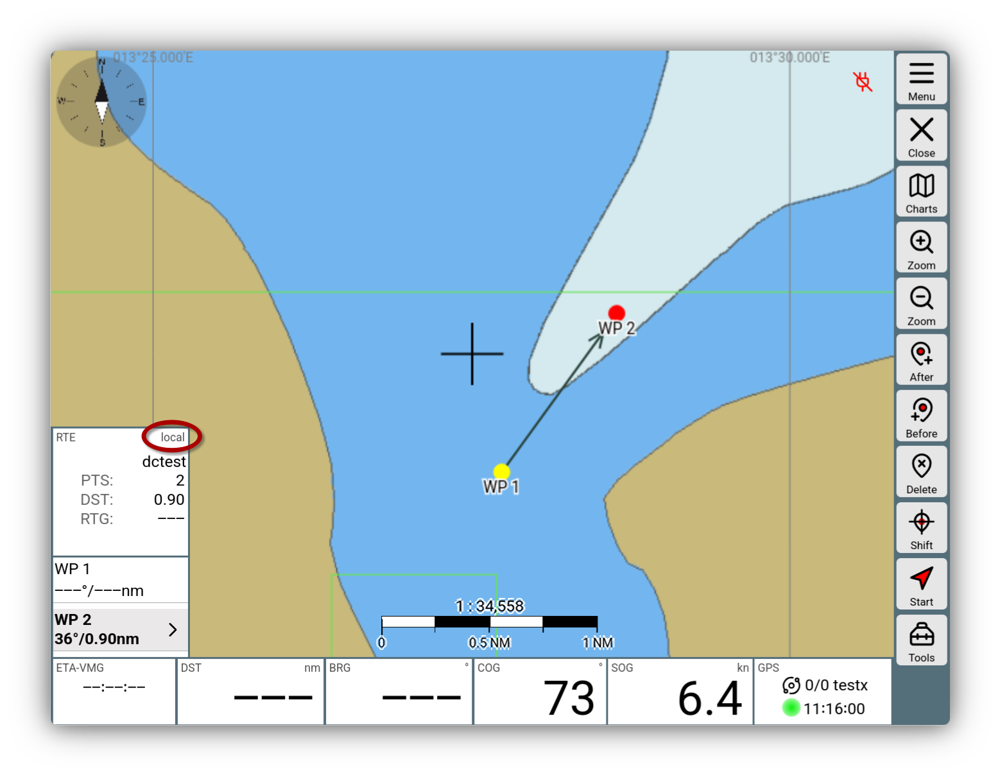
///caption
Local route
///

You can start such a local route normally—and all route functions are available. However, there are the following limitations:

  * no output of RMB and APB records, no transfer of the route to SignalK
  * no waypoint alarm

#### Synchronizing Routes {: #sync}

Via the {{ICON("Disconnect")}} icon in the title bar or via

{{MM("MMroutepage")}}->{{BT("Connected")}}

you can leave the "Disconnected" mode again. 

AvNav then compares the locally saved routes with those currently present on the server and offers synchronization.

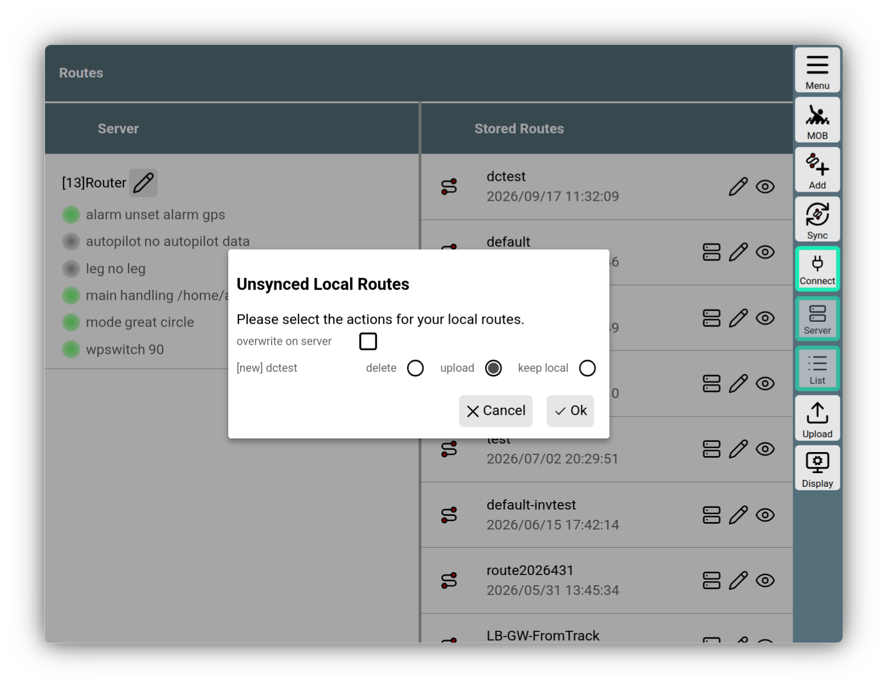
///caption
Route Synchronization
///

For each local route, the possible options are offered:

  * **delete**: Deletes the local route
  * **upload**: Uploads the route to the server
  * **keep local**: Keeps the local route

`upload` is only offered if the route does not exist on the server—or `overwrite on server` has been activated.

With the {{BT("SyncRoutes")}} button, you can trigger this synchronization again at any time.

### Combining Routes

If you want to add parts of one route to another, you can do this by configuring the route from which you want to add parts as an [Overlay]() on the current map.

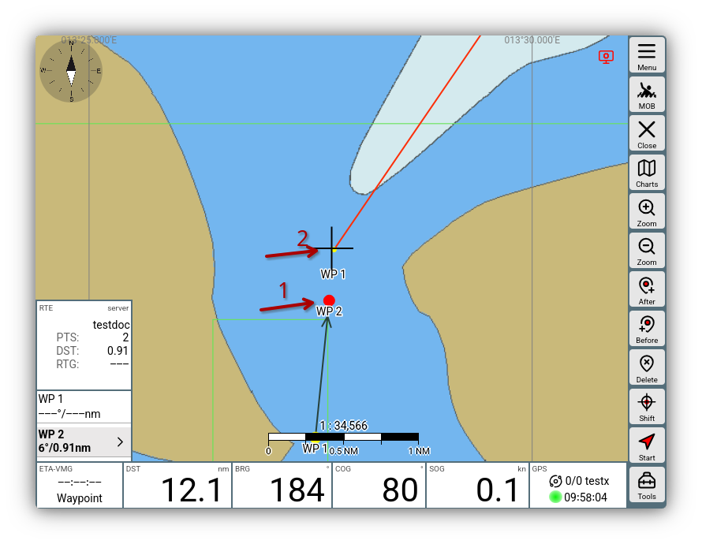

Afterwards, switch to the [Route Editor](#editor), activate the point of the route (1) after which you want to insert the other route, and click on the point of the overlay route (2) from which you want to insert.

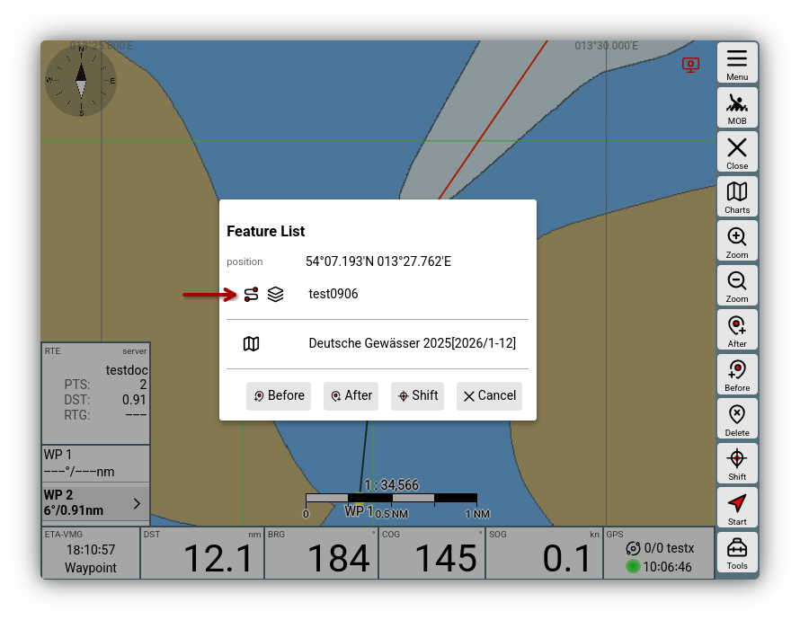

After clicking on the overlay route, you can then insert the route with {{DB("DBInsertRouteAfter")}}.

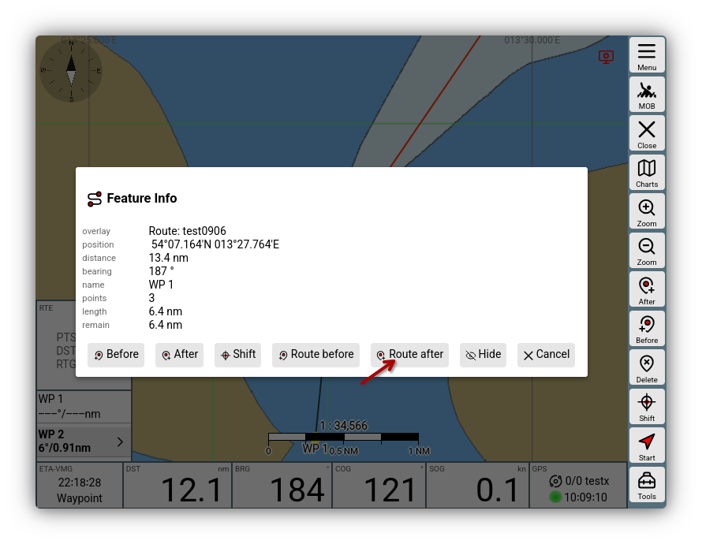

The points of the overlay route are then copied into the current route.