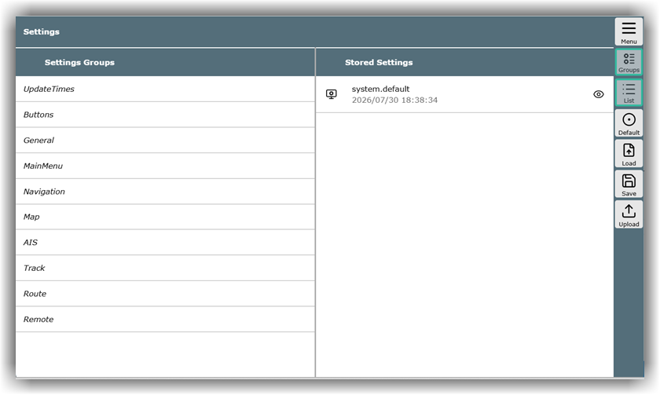
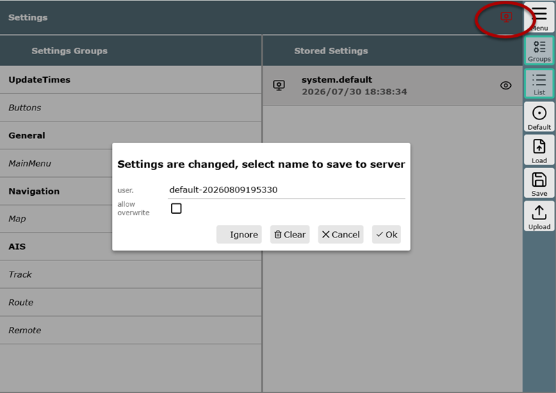
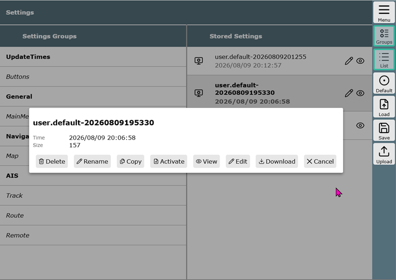

---
  tags:
    - Einstellungen
    - Settings
---

{{VIDEO("Here","settings")}} you can find the video that visualizes some points from this chapter.

## Display Settings vs. Layout

Display settings cover all settings that allow for the customization of the user interface and the appearance of AvNav. This starts with the size of the buttons and the font size on buttons or in other areas of the program. It continues with the colors of routes or tracks, distances, the length of the course vector, and much more.

[Layouts](layout.md), on the other hand, summarize how the [widgets](navpage.md#widgets) should be arranged on the navigation page, the route page, and the dashboard. In the layout, you can determine which widgets are displayed where and how they are configured.

## Display Settings

Access to the display settings is possible in several ways: firstly, via the {{BT('ShowSettings')}} button in the button bar of those pages that have their own settings, or alternatively via {{BT("ShowSettings",True)}} in the main menu of the respective section. To facilitate access and focus on the essentials, only the category (*Settings Group*) relevant to the current page is displayed in these cases.  

The central page can be reached in the main menu via {{MB("MMsettingspage")}}, which offers a complete overview of all available categories.

Two areas are visible: on the left the *Settings Groups* and on the right the *Stored Settings*. On small screens such as smartphones, the right area can be reached by swiping or clicking on {{BT('SettingsItems')}}.

The *Settings Groups* organize the categories within which adjustments can be made – a dialog box opens for each group. The fields within them largely have an explanatory help text. You can restore the default values via {{DB('DBReset')}}. Here is a rough overview of the contents:

| Settings Group | Contents |
| -------------- | ------- |
| Update Times | defines the intervals at which data such as position, AIS, or others are queried |
| Buttons | defines the icon set, as well as the appearance, system behavior, and labeling of the buttons. Here you can, for example, set whether the button bar hides when not in use or whether a tooltip should be displayed |
| General | defines the basic font sizes, the maximum number of dashboard pages, dimming at night, alarm volume, behavior of the red warning icon |
| Main Menu | defines the behavior and scope of the main menu |
| Navigation | defines navigation-relevant characteristics such as the length and color of courses and the motion vector, range rings, size of the boat icon, averaging for COG, SOG and position, parameters of the anchor watch |
| Map | defines various parameters for the behavior of the map display such as display of grid lines, compass, scale display, zoom levels, crosshair thickness and color. Some of these settings are explained in more detail in the [Maps](./charts.md) chapter |
| AIS | defines whether and how AIS objects are displayed, distances, intervals for warnings according to CPA and TPA. Some of these settings are explained in more detail in the [AIS](../special/ais.md) chapter |
| Track | defines how tracks are displayed |
| Route | defines how routes are displayed |
| Remote | defines how the AvNav remote control is set up. These settings are explained in the detailed chapter [Remote Control](../special/remotecontrol.md) |

## Saving Settings

As soon as a setting is changed, the group is highlighted in bold and a small red settings icon appears in the top right – as a constant reminder that changes need to be saved. After clicking on it, you can enter a name for the new setting directly or keep the suggested name and then click on {{DB('DBOk')}} to save:

**Note:** This icon also appears if the layout has been changed. The reason for this is that the saved settings contain information on both the display settings and the layout.

## Stored Settings

In the right column ('Stored Settings') of the settings page, all previously saved settings are listed. The pencil icon indicates that the respective setting can be edited or deleted. Further functions can be accessed in the dialog box and directly via the button bar on the right side.

The 'system.default' setting does not have a pencil icon; these are fixed default settings that cannot be changed. The reason for this is that AvNav always keeps a permanently functional set of settings available, which can be accessed at any time if a configuration has been incorrectly adjusted.