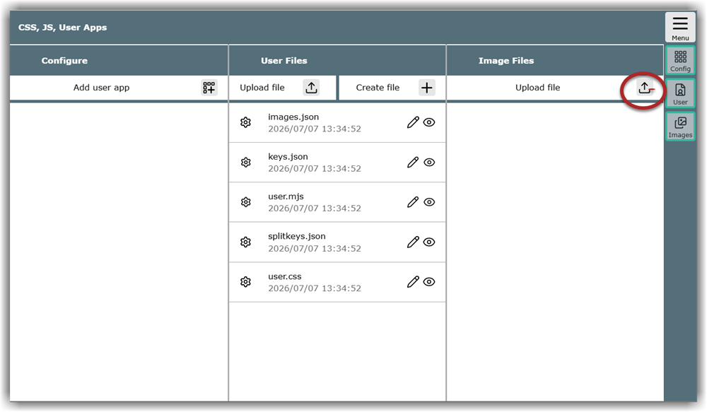
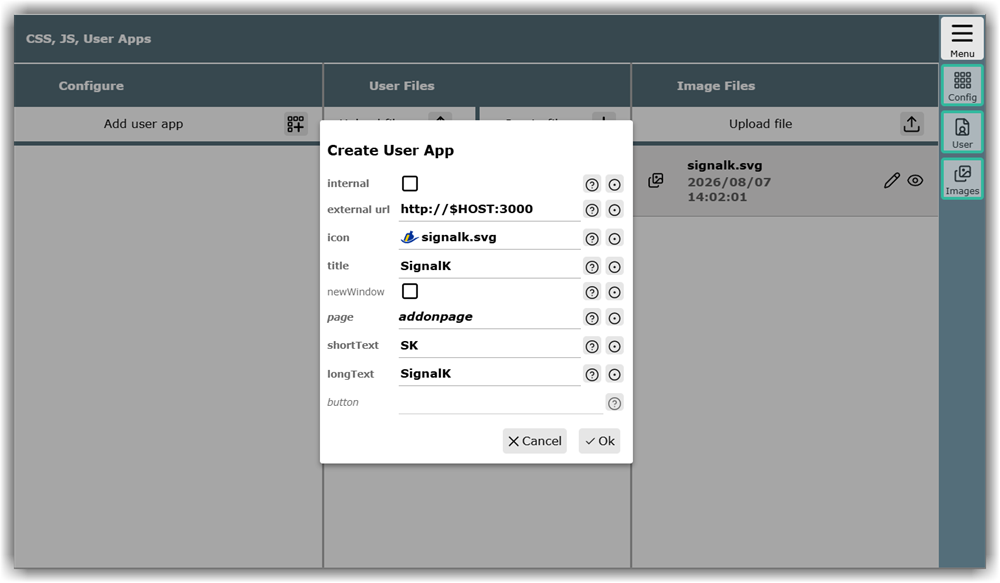

---
  tags:
    - Extensions
    - User Apps
---
Part of the content of this section is also introduced in the **{{VIDEO("Video here","userapps")}}**.

## User apps vs. plugins

AvNav can be customized and extended in many ways - these extensions include so-called User Apps. These are standalone applications whose user interface can be accessed via a web browser. Examples include the data server SignalK or AIS-Catcher. To avoid having to constantly switch between different browser tabs, these applications can be seamlessly integrated as buttons directly into the AvNav user interface.

For context: in addition to User Apps, AvNav also has plugins. These are programs that work independently and directly with internal AvNav data, such as the History, O-Charts, or Update plugins. Many of these plugins also come with their own web interface for operation. When this is the case, they behave like User Apps from the user interface's perspective and can be set up in the same way. More information about plugins and how they can be programmed can be found in a separate, more in-depth [chapter](../special/plugins-extensions.md).

The following describes how to define such a User App in AvNav and integrate it into the interface, using SignalK as an example.

## Preparing and uploading an icon

To ensure the new app is recognizable in the AvNav interface, you need to assign it a unique, meaningful icon. For this, a suitable image is required, ideally in SVG or PNG format at 50x50 px. Access the "CSS, JS, User Apps" page via {{MB("MMaddonconfigpage")}}.

If not all columns are visible on a smaller display, you can reach the "Image Files" column by swiping or by using the {{BT('AddonConfigImages')}} button in the button bar.

After clicking the Upload file button {{BT("Upload")}}, you can upload the desired icon so it is available to the system for configuration.

## Defining a user app

The actual definition of the User App takes place via the "Create User App" dialog. This can be opened using the {{BT("AddonConfigPlus")}} icon.

You can get a concise help text for the field contents via {{BT("Help")}}. The button {{BT("SettingsDefaults")}} resets the field content to the default value. Here are more detailed notes:

| Field | Meaning |
| ------ | -------- |
| internal | If the checkbox is **checked**, AvNav acts as a simple web server and displays an HTML page stored on the device. The [details](../special/userfiles.md#userappexample) section contains a description of how more advanced applications, such as your own PDF boat documents, can be displayed.  If the checkbox is **not checked**, web addresses are called. |
| internal url| Only displayed if the "internal" field is **checked**: Upon entering the field, a list of already uploaded HTML files is displayed. You must select one of them or upload a new one. |
| external url| Only displayed if the "internal" checkbox is **not checked**: Any web address for devices on the network or the internet. This must start with http:// or https://. If the service is on the AvNav server, $HOST should be used instead of the IP address. This is the only way to ensure that browsers can reach the destination even when accessing via a different network connection. |
| icon | The icon for the app is selected here. The number of list entries can be significantly reduced by deselecting the "builtin" option. If the desired image is not yet in the list, a new file can be uploaded via {{DB("Upload")}} at the end of the list. |
| title | This text is displayed in the title bar of the User App. |
| new window | Only displayed if the "internal" checkbox is **not checked**: If this checkbox is checked, the User App is opened in a new browser window or tab. |
| page| By default, User Apps are displayed on the "User Apps" page in the button bar. However, it is also possible to place the button on other pages, where it may be easier to find depending on the context. The most common pages are based on the menu entries:  navpage - Navigation page gpspage - Dashboard pages aispage - AIS page addonpage - User App page serverpage - Server page |
| short text| This is the text displayed by the button in the button bar. Naturally, only a few characters fit here. |
| long text | This is the text displayed by the entry in the respective main menu section. |
| button | This field cannot be changed. It is filled automatically by the system and contains an identifier that allows for advanced adjustments via CSS. |