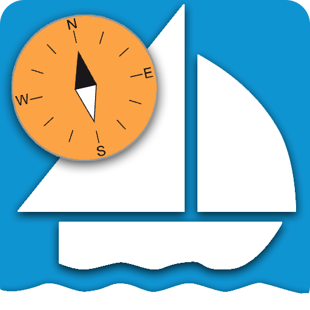

# AvNav documentation
Here you can find the AvNav documentation for version {{config.extra.version}}.

For other versions, please select the appropriate version in the header.


{.small}

[Demo](special/demo.md)

## Authors

[Andreas(Wellenvogel)](https://www.segeln-forum.de/cms/user/14117-wellenvogel)

Contact via the [Segeln Forum](https://www.segeln-forum.de/board/195-open-boat-projects-org/) or via [mail](mailto:avnav@wellenvogel.de).

A big thank you goes to the diligent helpers who make AvNav and this documentation possible:

* [Moeritsen](https://www.segeln-forum.de/cms/user/20863-moeritsen/) - especially for the videos and icons
* [NoStress](https://www.segeln-forum.de/cms/user/31846-nostress/) - especially for the contributions to the basic functions and the intensive tests and review comments
* [BlackSea](https://www.segeln-forum.de/cms/user/27970-blacksea/) - especially for providing the various operating system integrations, the package repositories and the images

## Dealing with the documentation

The new AvNav documentation has a new structure in addition to updated content. Here are a few notes to help users find their way around more quickly:

* **Introduction:** This section serves as initial information and basic orientation regarding AvNav.

* **Installation:** This section contains all the information needed to install AvNav on various operating systems and environments and to prepare it for the first start.

* **Basic functions:** This section should be the central part of the documentation for most users to familiarize themselves with the functions of AvNav. The section is based on videos that visualize the essential areas of AvNav in a beginner-friendly way. It also contains explanatory texts aimed at users who want to gain a quick insight into working with AvNav.

* **Details:** This part of the documentation contains a large number of special topics and in-depth explanations. It is aimed at more tech-savvy users. Therefore, this part is not set up as running text, but as a glossary. This allows requested topics to be reached more quickly via keywords or a convenient search.

## Access from AvNav

This documentation can be installed directly in AvNav as a plugin and is then accessible from within the program. This is described under [Plugins](special/plugin-list.md#documentation).

## Note

The translations (except German) were created using AI tools.