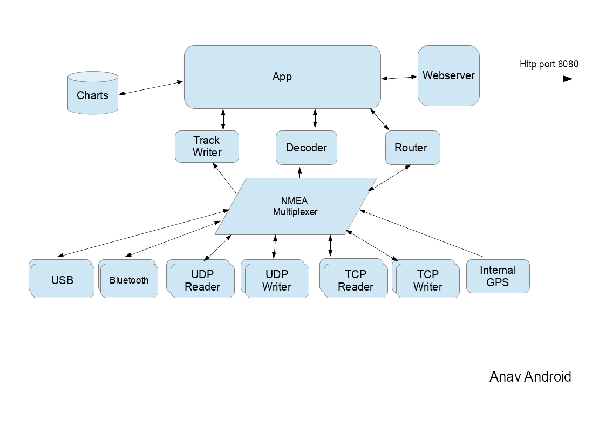
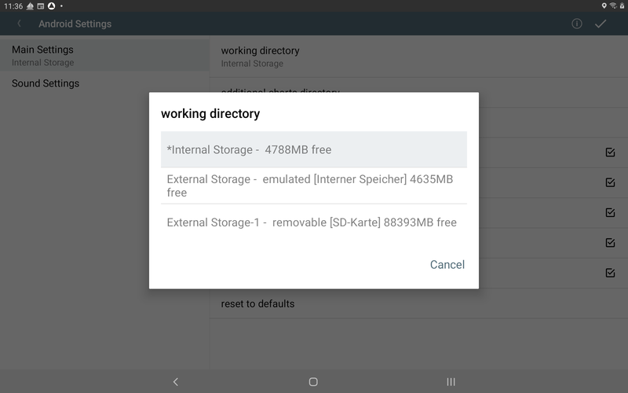
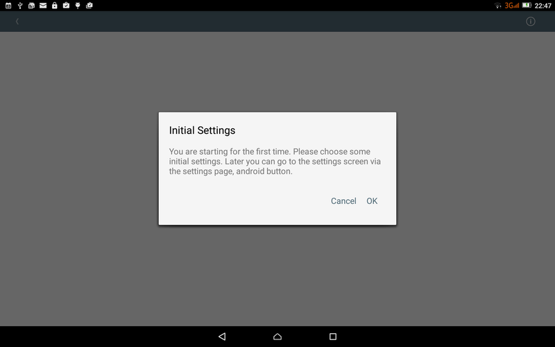
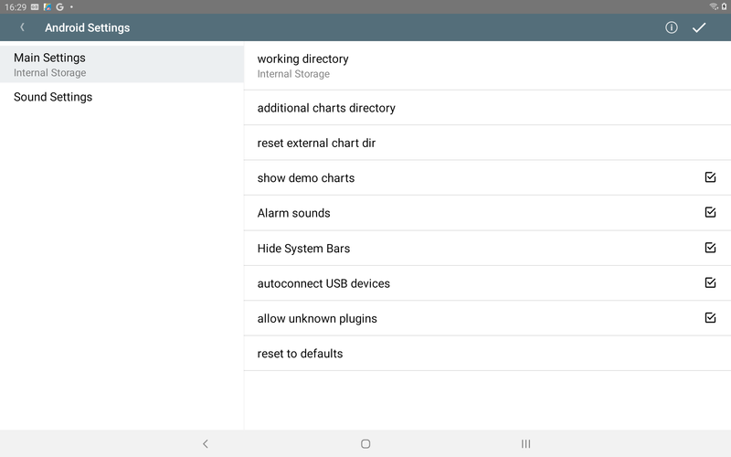

---
  tags:
    - Installation
    - Android
---

# Android

This page describes how to install AvNav as an Android app. It also covers some special features of this AvNav variant.

## Overview

As an alternative to installing the AvNav server on a [Linux](linux.md)/[Raspberry](raspberry.md) or [Windows](windows.md) system and using an Android device for display, you can also install AvNav as an app on an Android device. This allows you to run both the server part and the display part directly on the device.

For starters, this might be simpler than the other variants.

You can download and install the app as an `.apk` file via the AvNav releases webpage - or install it directly from the [Google Play Store](https://play.google.com/store/apps/details?id=de.wellenvogel.avnav.main&hl=en). <!--@@linkchanged-->

## Essential features

Internally, the app essentially consists of the same functional blocks as the other AvNav versions.

The NMEA multiplexer processes NMEA0183 data from various sources. In addition to the internal device GPS, data can come from sources such as TCP connections, UDP ports, USB devices, or Bluetooth connections. Most sources support simultaneous sending and receiving of data. Several sources of the same type can be configured in each case. In the app configuration, there is a so-called "handler" for each source.
Configuration is performed, just like in the other AvNav variants, via

{{MM("MMchannelspage")}}

or via

{{MM("MMserverpage")}}

[Under this link](../special/configfile.md#android) you will find the description of the configurable values.

The actual [display with the map view and widgets](../base/navpage.md) can be used normally in the app. In parallel, other devices can access it via browser - see the [notes](#external) on what needs to be configured for this.

Since the server part of the Android app is a separate implementation, [plugins](../special/plugins.md) that contain Python components cannot be used on Android. The [list of plugins](../special/plugin-list.md) indicates whether they can also be used on Android.

The display part of the app can be closed, allowing the multiplexer to continue running in the background alone. This means AvNav can also be used to provide NMEA data for other Android apps. To do this, configure a *TcpWriter* in AvNav and connect to it from the accessing apps using the address 127.0.0.1 and the port configured in the *TcpWriter*.

## Maps and storage locations (working directory) {: #workingdirectory}

AvNav saves all its data and maps in a working directory.

In the Android settings

{{MM("MMserverpage")}} -> {{BT("StatusAndroid")}}

you can select the working directory.

Depending on the device, you can select different storage locations for the data. Technical information on this can be found in the [Android documentation](https://developer.android.com/training/data-storage/app-specific?hl=en). <!--@@linkchanged-->

If the device has an SD card, the selection shown above appears:

| Name | Explanation |
| --- | --- |
| Internal Storage | This is a storage location in the device's internal flash memory. It is completely private and, unless the device is rooted, not accessible to other apps such as a file manager. This is the default setting. It is also available in versions prior to 20250822. The "\*" before the entry indicates that this directory has already been used as a working directory and contains data. |
| External Storage | This storage is still located in the internal flash memory but is handled differently by the Android system and is therefore referred to as "external - emulated". Other apps can access this location. You can select this location if other apps (e.g., a file manager) need to access the data. The path for a file manager is typically [internal storage]/Android/data/de.wellenvogel.avnav.main/files (or [internal storage]/Android/data/de.wellenvogel.avnav.main.beta/files for a beta version). |
| External Storage-1 | This path is only visible if the device has an SD card installed. "removable [SD card]" is also displayed as an explanation. If available, this directory is actually located on an external SD card. If you want to use it, the SD card must always be installed while AvNav is running. If the SD card is removed while AvNav is running, it may crash. Other apps like a file manager can access the data. The storage location is [SD card]/Android/data/de.wellenvogel.avnav.main/files (or [SD card]/Android/data/de.wellenvogel.avnav.main.beta/files). |

If you change the working directory, all data in the old working directory becomes invisible to AvNav. However, it remains available, and you can return to the old directory at any time.

When AvNav starts, it checks whether the selected working directory is still available. If not, you will be prompted to select another one.

For external directories, you can generally use a file manager to copy data to and from them. However, AvNav may not recognize this data if it is already running. Therefore, it is recommended to upload the data directly in the app. However, you can create a zip file with this data as a backup.

All *WorkDir* directories are cleared when you uninstall AvNav or clean up the data.

**Important note:** Settings, such as the configuration of the multiplexer and other Android settings, are not saved in the *WorkDir*.

If you choose an additional chart directory, it is located outside of AvNav. You can save charts in Gemf or XML format there. This directory can be created and accessed outside of AvNav. It is not affected when uninstalling AvNav or removing the data.

To use O-Charts or S57 charts, you must install the separate [avocharts](../special/ochartsng.md#android) app and install the charts there.

## First start

After starting the app for the first time, you are on an introductory page:

After clicking, you reach the settings page:

Here, in addition to other settings, you can, for example, select the internal or external working directory and set the external chart directory.
You can also reset all settings here.
A list of all Android-specific settings can be found [here](#Settings).

The "Settings" page can be exited via the "OK" button (top right) or the "Back" button.
Whenever you exit the settings, AvNav checks whether the necessary permissions have been granted.
AvNav requires the following permissions:

* precise location (GPS) while using the app
* notifications to display that AvNav is running, even when in the background

Additionally, AvNav checks whether battery saving mode is active. If so, AvNav cannot use the device's internal GPS in the background. AvNav then displays a warning.

Subsequently, the [navigation page](../base/navpage.md) of the app is opened.

After the first start, the app directly launches the navigation page.

## External access {: #external}

The app allows you to connect with a browser from other devices. To do this, the web server must be activated in the app:

{{MM("MMserverpage")}} -> WebServer -> {{SB("Edit")}}

When activating the web server, `external` must be enabled. `mdnsEnabled` ensures that a Bonjour-capable app (e.g., [BonjourBrowser](https://play.google.com/store/apps/details?id=de.wellenvogel.bonjourbrowser&hl=en)) can connect to the app's server. <!--@@linkchanged-->

This also allows, for example, access from a laptop or computer - this can simplify uploading and editing files or adjusting the layout.

## Background

The NMEA multiplexer and the AvNav web server can also run in the background without a display. This can be used if the display should be on another device - or if another app is used for navigation and only the AvNav multiplexer is needed.

To do this, after starting, go to the main page and via

{{MMA("MainExit")}}

call up the exit dialog and select "BACKGROUND" there.
In the background, track recording and the router remain active; a potential anchor watch also remains active and may trigger alarms.
You can bring the app back to the foreground or close it directly via the notification (in the Android notification bar).
A potentially triggered alarm can also be ended via the notification.

## Settings {: #Settings}

In addition to the normal settings accessed via

{{MM("MMsettingspage")}}

{{MM("MMchannelspage")}}

or

{{MM("MMserverpage")}}

there are Android-specific settings reached via

{{MM("MMserverpage")}} -> {{BT("StatusAndroid")}}

### Android main settings

| Name | Meaning | Default |
| --- | --- | --- |
| working directory | Selection of where the AvNav [working directory](#workingdirectory) should be created (internal storage or external storage) | internal storage |
| additional charts directory | an additional chart directory, which should sensibly be created on an external SD card | --- |
| reset external chart dir | Reset the additional chart directory | |
| show demo charts | Show demo charts. This requires an active internet connection | on |
| Alarm-Sounds | Here you can turn off the alarm sounds generated by the server. In the browser, these may additionally need to be turned off. | on |
| Hide System Bars | Hiding the Android status and navigation bars | on |
| autoconnect USB devices | If enabled, automatic detection of USB devices starts as soon as a supported USB device is connected. If this switch is turned off, you can also configure USB devices via the + button on the server/status page. | on |
| allow unknown plugins | AvNav has an (experimental) plugin interface that allows other apps to inform AvNav about provided functions (currently only charts). This switch also allows plugins that are not yet known to AvNav. Note: avocharts does not need this. | on |
| reset to defaults | Reset the multiplexer settings to default values | |

### Android sound settings

| Name | Meaning | Default |
| --- | --- | --- |
| Sound for XXX alarm | Here you can select the sound for the various alarms | |
| reset to defaults | Reset the sound settings to defaults | |

## Starting in the background

The AvNav app comes with an additional ["ShortCut"](https://support.google.com/android/answer/9450271?hl=en) that allows you to start the AvNav app directly in the background. This can be helpful if, for example, you only want to use AvNav as a multiplexer for another app - or if the display should run on another device and only the server part should be active. <!--@@linkchanged-->

Before you can use the shortcut, AvNav must have been started once normally so that you can make the necessary basic settings and have granted the permissions.

Afterwards, you can display the shortcut by long-pressing the AvNav icon {: .inline-image} and trigger it by clicking. AvNav will then start in the background (as if you had sent AvNav to the background via

{{MM("MM:actions")}})->{{BT("MainExit",True)}}

).

You can bring AvNav back to the foreground via the notification in the Android status bar.

This function is also helpful if you automate the background start of AvNav using special tools (e.g., [Samsung Modes and Routines](https://www.samsung.com/en/support/mobile-devices/modes-and-routines/)) or apps (like [MacroDroid](https://wiki.macrodroid.com/wiki/index.php?title=MacroDroid_Wiki) or [Tasker](https://tasker.joaoapps.com/)). <!--@@linkchanged-->

## AvNav and AndroidAuto

How to use AvNav under [Android Auto](https://en.wikipedia.org/wiki/Android_Auto) is described in a [separate article](../special/android-auto.md). <!--@@linkchanged-->