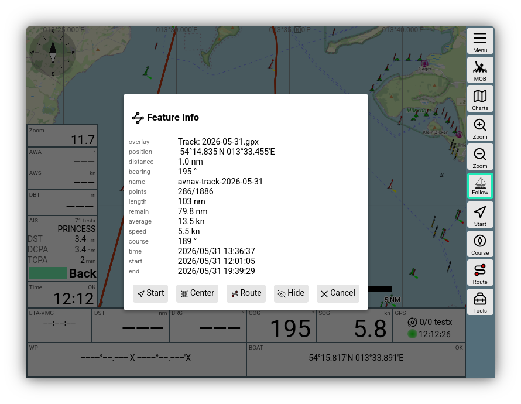
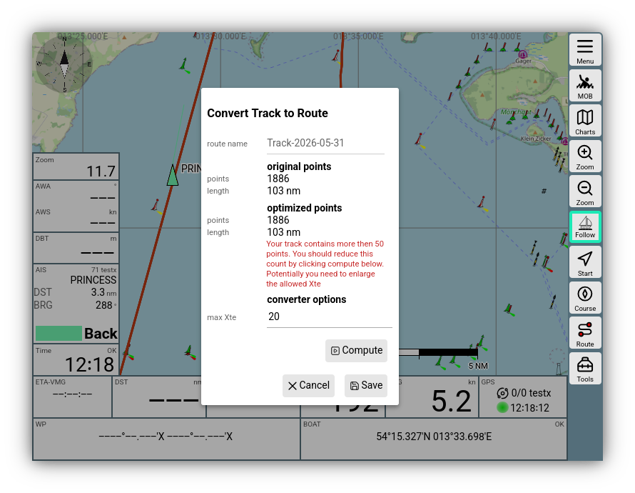
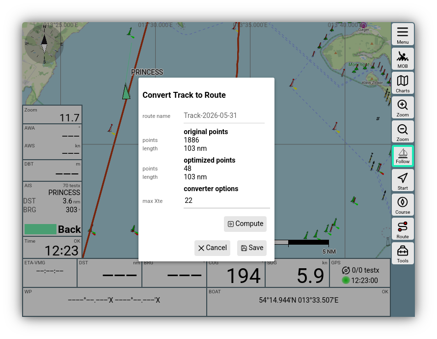
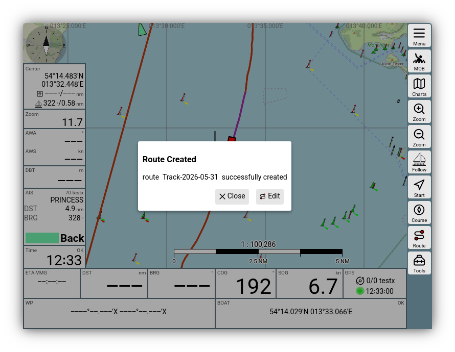
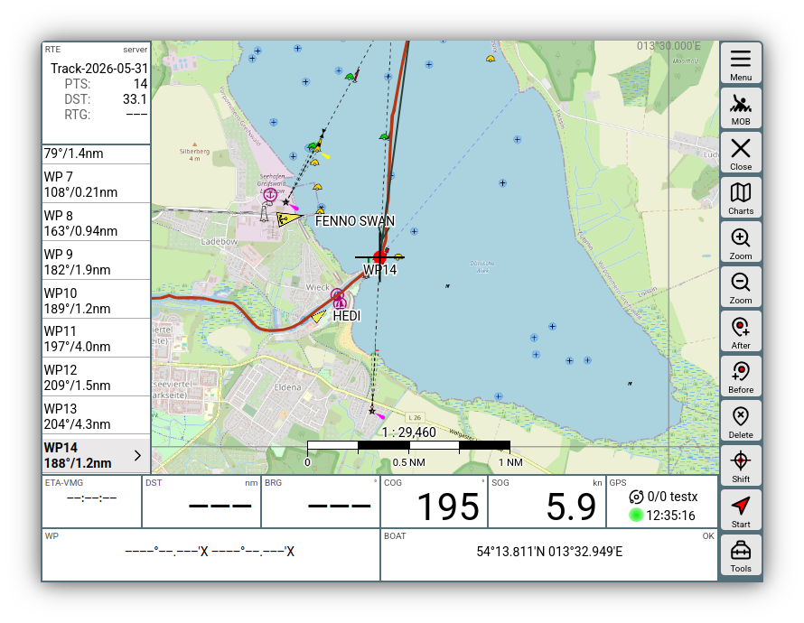

---
  tags:
    - Track
    - Route
---

Converting Tracks to Routes
===========================

AvNav permanently records [Tracks](tracks.md). For each day, a new gpx file
is written with the current date.

These tracks, or tracks that have been uploaded on the [Tracks page](tracks.md),
can be converted into routes to use them for navigation.

Procedure
---------

For this conversion, it is typically necessary to reduce the number of points
in the track (tracks often have well over 1000 points). Otherwise, using such
a route effectively is hardly possible.

AvNav uses a reduction method for this, which is based on [GPS
Babel](https://www.gpsbabel.org/htmldoc-development/filter_simplify.md). Points are
successively removed where the deviation from the newly created path between
neighboring points is the smallest.

You can specify a maximum deviation (XTE) for this process that you are willing
to tolerate. The larger you choose this allowable deviation, the fewer points
remain in the end. Typically, you should try to limit routes to approximately
50 points.

After the conversion, you can post-process the route in the [Route Editor](../base/routes.md)
if necessary.

Workflow
--------

You can open the dialog for the conversion either from the [Tracks page](tracks.md)
by clicking on a track via {{BT("ToRoute")}}, or from the info dialog if you have
a track as an [Overlay](../base/overlays.md) on the map and click on a point in it.
In the info dialog, use the button {{DB("ToRoute")}} again - see image.

After clicking the Convert button, you will be prompted for the name of the route
to be created, followed by the converter dialog.

As seen in the image, you will typically receive a warning that the number of
points exceeds 50.

Use *max Xte* to set the maximum allowable deviation and start a conversion
with *Compute*. If the result or the number of points is not yet suitable,
you can perform multiple passes, changing the deviation each time.

In the example, a sufficiently small route was created with a deviation of 22m.

In the dialog, you can also change the name of the resulting route and, if necessary,
decide whether an existing route with the same name should be overwritten.

After saving, you can directly edit the resulting route if desired.

It is advantageous if you had the track as an overlay on the map beforehand;
this makes it easy to compare whether the route contains all the important points.

