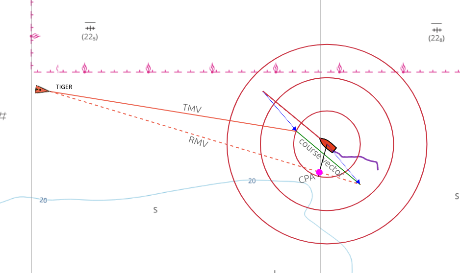
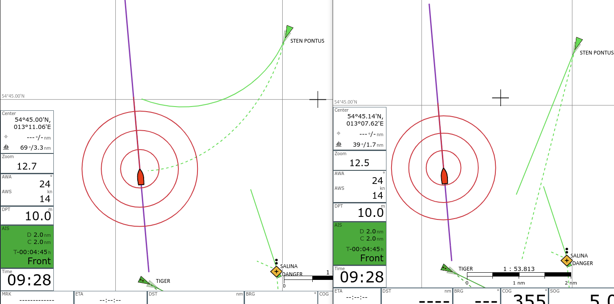
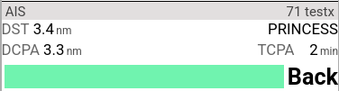

---
  tags:
    - AIS
    
---

# AIS details
AIS targets up to a certain distance from the current position are displayed on the map along with some information.
All settings that affect this display can be reached under

{{MM("MMsettingspage")}}->AIS

or under

{{MM("MMaiscfgpage")}} -> {{BT("ShowSettings")}}

In addition, some motion vectors and a calculated position based on the age of the AIS information, course, and speed (as a shadow) are displayed (settings "show estimated position").
The symbols for the AIS targets can be customized with [user-defined icons](usericons.md), if necessary differently depending on the AIS ship class or *navigational status*. For your own boat and for the AIS targets, a course vector is drawn, the end of which marks the position after 10 minutes (configurable).

AIS Atons are also displayed (to do this, "only show moving targets" must be switched off and "show other" must be switched on in the settings).

It can also be selected whether the alignment of the AIS target is based on HDG (if received - setting "use heading for direction") - otherwise on COG. The course vector of an AIS target is always aligned to COG.
There are different symbols for the AIS targets - for details see under "[User-defined icons](usericons.md)".
The size of the AIS symbols can be changed (settings "Icon Scale"), a border can also be added (settings "Border Width"). If the calculations of the AIS course vectors are too resource-intensive (browser becomes too slow), they can be switched off in the settings (settings "Use Course Vector").

By clicking on an AIS target (or on the display of the nearest target in the display areas), you get all [information](#aisinfo) about this target and can navigate to the [list of all AIS targets](#aislist).

## AIS motion vectors

A basic introduction to the topic of *true and relative motion vectors* and how they are used in navigation can be found under

* <https://msi.nga.mil/Publications/RNMB?lang=en> <!--@@linkchanged-->
  (page 59)
* <https://www.youtube.com/watch?v=8YUic4LdWFg>

True motion vectors
-------------------

AvNav displays the predicted track over ground for AIS targets if "use-course-vector" is activated in the settings. For this purpose, starting from the last known position of the target, a line is drawn in the direction of the "course over ground" (COG) of the target with a length of "speed over ground" (SOG) multiplied by "boat course vector length". This line is the so-called *true motion vector*, or TMV for short.

Relative motion vectors
-----------------------

Additionally, *relative motion vectors* can be displayed in AvNav. To do this, "relative motion vector range" must be set to a value greater than zero in the settings. Then, for targets that are within this distance, RMVs are additionally displayed as dashed lines.

The RMV shows the movement of the target *relative* to your own ship; it is the result of the difference between the TMV and your own course vector, so that the TMV, RMV, and your own course vector form a triangle. If the RMV of a target points directly at your own ship, there is a risk of collision. You can also read the position of the CPA directly from the RMV by dropping a perpendicular from your own ship onto the RMV.

The RMVs correspond to the tracks that the targets would leave on a radar screen.

Curved vectors
--------------

If you activate "curved vectors" in the settings, a potentially available "rate of turn" (ROT) is evaluated and the turn of the target is taken into account when displaying the vectors. The TMVs and RMVs are then displayed as curved lines. The curved vectors indicate a potential collision much earlier than the non-curved vectors.

## Calculation of CPA and motion vectors {: #aiscomputations}

To calculate CPA and motion vectors, AvNav uses the data received from an AIS target (position, COG, SOG) and the data from your own boat (position, COG, SOG).

AvNav calculates:

* The point where the two courses meet (course of your own boat and the course of the AIS target - both COG)
* The point where your own boat has the minimum distance to the AIS target - the CPA.

The times to reach these points are also calculated.
Negative times mean that your own ship has already passed the AIS target at this point.
Depending on this, it is decided how the target is passed:

* front = passing in front of the target
* back = passing behind the target
* pass = the target has already been passed - or there is no meeting point - e.g., for a stationary target
* done = the course has already been crossed, and the point with the smallest distance has also been passed

Based on the calculated DCPA (minimum distance at the CPA point) and TCPA (time to the CPA point), AvNav sets a warning for the target if the values are below the configured thresholds.

### Priority {: #aispriority}

For the decision of which target is displayed in the *Ais Target Widget* and for sorting in the [AIS list](#aislist), a priority is calculated for each target.
The priority from high to low:

1. Targets with warning (i.e., CPA < warning CPA and TCPA < warning TCPA but > 0)
   These are sorted by TCPA, lowest TCPA at the top.
2. Other targets sorted by smallest (dx)²+(dy)² .
   For TCPA < 0 (i.e., smallest distance already in the past) dx=dy=distance/warningDistance.
   For TCPA >= 0 dx=tcpa/warningTime, dy=cpa/warningDistance

In this way, the targets can be sorted according to their importance for navigation.

## Calculation options

Before version 20250723, the calculation used the data of the AIS targets as they are displayed on the maps, and the boat data from the time when the calculation took place.

This calculation has some disadvantages:

An AIS target is usually in motion and AIS messages are only sent or received at relatively large intervals. In addition, the display part of AvNav only loads the AIS data in the browser at certain intervals (Settings > AIS > UpdateTimes - Default: 5 seconds). This means that the AIS symbols on the map are displayed at a position they were in some time in the past. And the (*CPA/Distance*) calculations based on this are also not quite correct - they use the boat's *position/course/speed* at the time of the calculation and the AIS target's *position/course/speed* from a time when the message was sent by the target.

If you have a typical situation with a target that you are approaching, you will therefore experience a constant change in the calculated CPA values - even if the boat and the target maintain course and speed.

As of version 20250723, AvNav offers the option to calculate CPA and motion vectors from an estimated position of the AIS target (setting "CPA/BRG from estimated", "active" as default). This position is the same as that displayed as a shadow symbol on the map. The calculation assumes that the AIS target maintains course and speed and takes into account the age of the AIS information.

This age takes into account the following times:

1. The time an AIS message spends in the AvNav server from reception to retrieval by the browser. If the data comes from [SignalK](signalk.md), the time the data has already spent in SignalK is also taken into account.
2. The time from reception in the browser to the calculation (Maximum: AIS update time - settings/UpdateTimes/AIS - 5s).

If you use this calculation, you will usually get a constant CPA if boat course/speed and AIS target course/speed remain the same. In most cases, this provides a better result.

However, there are 2 problems that cannot be solved with this:

1. If the calculation of the time between receiving the AIS message and the retrieval by the browser is not correct (e.g., missing time synchronization between AvNav and SignalK), you will always get incorrect results. The problem is that you might not notice this, as the error remains constant over time.
2. If the AIS target changes course or speed, the estimated position is wrong. However, this is usually only a temporary problem as long as this change lasts.
   In principle, one could also take into account the ROT (rate of turn) of a target - however, it is not very likely that ROT is constant over a long period of time - therefore, it is not used.

Since both calculations have their limitations, the user can decide at the end which one should be used.

All AIS calculations are now carried out in a separate thread (worker) in the browser; they are repeated with every position change. In older versions, the calculations were only performed when new AIS data was retrieved.

## Widgets

In addition to the display on the map, there is the "Ais Target Widget", which displays either the AIS target with the highest priority or a selected target, namely the one that was selected in the [AIS Dialog](#aisinfo) via {{DB("AisInfoLocate")}}.

{.small}
///caption
Navigation page.
///

{.small}
///caption
Dashboard.
///

The display of the next AIS target (smallest current distance) turns red if a CPA of 500m (configurable) is fallen below. Yellow means that not the next target, but a separately selected target (see below AIS Locate) is displayed.

## AIS info dialog { #aisinfo }

A click on the AIS widget or an AIS target in the [Feature List](featureinfo.md) (after clicking on the map) displays detailed information about the AIS target.

///caption
AIS info dialog
///

| Button | Function |
| --- | --- |
| {{DB("AisNearest")}} | Resets the widget to display the target with the highest [priority](#aispriority) and centers the map on this target, unless the {{BT("LockPos")}} mode is active. |
| {{DB("AisInfoLocate")}} | Sets the widget to follow mode. This constantly displays the values for this target, the target on the map is colored orange (color: Settings "Tracking"). The map is centered on this target. |
| {{DB("AisInfoHide")}} | Hide this AIS target for a certain time (setting: "hide time") |
| {{DB("AisItems")}} | Show the [list](#aislist) of all found AIS targets |

## List of AIS targets { #aislist }

By clicking on {{DB("AisItems")}} in the [AIS Info Dialog](#aisinfo) or on the AIS page

{{MM("MMaiscfgpage")}}-> {{BT("AisItems")}}

you get the list of AIS targets.

///caption
AIS targets
///
By clicking on the "sorted by..." line, you can change the sorting order. The number of values to be displayed per target can be reduced under settings "reduce details in list".
A click on a target in the list opens the [AIS Info Dialog](#aisinfo) again.

| Button | Function |
| --- | --- |
| {{BT("AisNearest")}} | Resets the AIS widget to display the target with the highest [priority](#aispriority) and centers the map on this target, unless the {{BT("LockPos")}} mode is active. |
| {{BT("AisSort")}} | Changes the sorting order in the list |
| {{BT("AisLock")}} | Pauses the automatic update of the list |
| {{BT("AisSearch")}} | Searches in the targets. The entered text is searched for in MMSI, Name, Callsign, and Shipname. Only the found targets are displayed. A repeated click ends the filtering. |