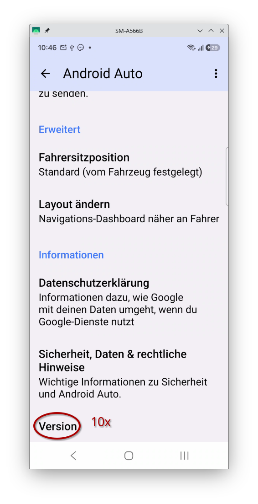
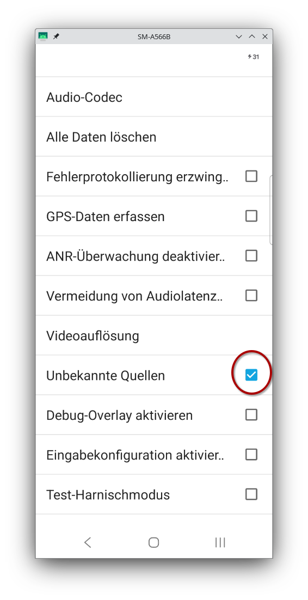
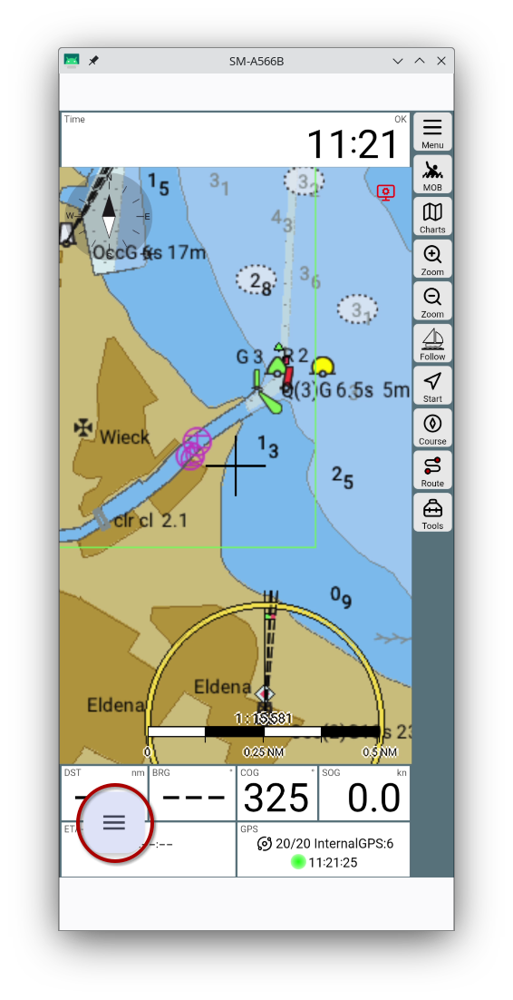
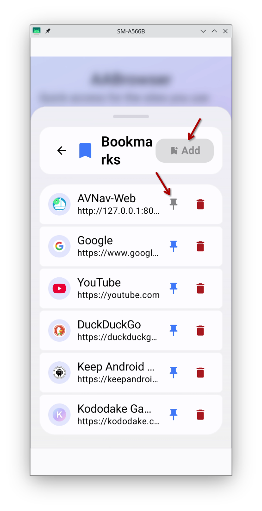

---
  tags:
    - Android
    - AndroidAuto
---

# AvNav on Android Auto

For using AvNav on a boat, you typically need a display that is as bright as possible ("sunlight-readable") and at least 8 inches in size. Due to the increasing popularity of modern navigation and entertainment systems in cars, there are more and more inexpensive displays (< €100) that offer high brightness and are intended for use in cars. These displays often do not have their own navigation or display software but rely on [Android Auto](https://en.wikipedia.org/wiki/Android_Auto) <!--@@linkchanged--> or [Apple CarPlay](https://en.wikipedia.org/wiki/CarPlay) <!--@@linkchanged-->.

This requires a corresponding mobile device (Android or iOS) with the appropriate software. These displays usually support a connection via USB - and in newer versions, also via Bluetooth and Wi-Fi.

Since there is also an Android version of AvNav, you can set it up for display on an Android Auto-capable screen. You can then leave the mobile device protected in the cabin, and only the display needs to be visible and accessible outside if necessary.

This guide describes how to achieve this.

## Prerequisites

[Android Auto](https://play.google.com/store/apps/details?id=com.google.android.projection.gearhead&hl=en) <!--@@linkchanged--> must be installed on the mobile device—this is usually pre-installed on modern devices.

In addition, an app that is to be used under Android Auto must be prepared accordingly.
Google sets strict standards for which apps are permitted to use which functions within Android Auto.

An app like AvNav cannot directly meet these standards, but the following guide describes how you can use it regardless.

The solution described below requires a mobile device with at least Android 15.

## Preparations

The work described here must be performed once to prepare for use.

Since AvNav itself cannot run directly under Android Auto, the server function of AvNav is used. This means you only need a browser that is capable of running under Android Auto.

For this purpose, there is the [AABrowser](https://github.com/kododake/AABrowser). Since it is not available in the Play Store, you must download the APK directly from the [GitHub release page](https://github.com/kododake/AABrowser/releases/) and then install it on the mobile device. To do this, you must allow installation from unknown sources.

As described on the GitHub page, you must also allow the use of apps that do not meet the strict Google standards within Android Auto on the mobile device.

To do this, open Android Auto on the mobile device and activate developer mode by tapping "Version" 10 times.

Via the menu (3 dots), go to developer settings and enable "Unknown sources".

Afterwards, you can use "Customize launcher" in Android Auto to ensure that the AABrowser appears in the Android Auto launcher.

This completes the first part—if you connect the mobile device to the Android Auto display now, you can launch the AABrowser there.

Now, a bookmark for AvNav is created in the AABrowser to be able to open the display quickly.

To do this, start AvNav and check once more whether the web server is active under {{MM("MMserverpage")}}.

Afterwards, you can send AvNav to the background (do not terminate it!) via {{MM("MM:actions")}}-> {{BT("MainExit",True)}}.

Now open the AABrowser directly on the mobile device and enter the address `http://127.0.0.1:8080` (the port must, of course, match the port configured in the AvNav web server—8080 is the default). AvNav should now be displayed.

Via the AABrowser menu button, you can now set this page up for startup.

First, create a bookmark for the page ("Bookmarks").

In the image, the bookmark has already been created; otherwise, you must first click "Add". Using the pin button, you can now place this bookmark into a so-called "slot"—this is a list of bookmarks displayed directly on the home page.

After that, you can close and restart the AABrowser to test it. The browser always remembers the last displayed page and will normally open AvNav directly again.

You can hide the AABrowser menu button by switching to fullscreen mode in AvNav:

{{MM("MM:actions")}}-> {{BT("FullScreen",True)}}

## Normal Use

To use AvNav in this configuration, you must start AvNav once after booting the mobile device and send it to the background. Unfortunately, Google's privacy settings prohibit the automatic startup of software that wants to access location data, making this manual step necessary.

However, some mobile devices or other apps offer functions to start specific apps automatically—in this case, you can also start AvNav automatically.

After that, you can connect the mobile device to the display (this should normally happen automatically) and start the AABrowser on the display.

### Automatic Start on Samsung

Samsung mobile devices offer a very convenient way to, for example, start an app when connecting to an Android Auto display using [Modes and Routines](https://www.samsung.com/en/support/mobile-devices/modes-and-routines/) <!--@@linkchanged-->.

To do this, you must create a routine that has "Connect to Android Auto" as a condition and an app launch action as the task. AvNav offers the action "AvNav Background" for this—you can select this from a list. It is done with just a few clicks. This will automatically start AvNav when Android Auto is connected. Of course, you can also have AvNav start directly—in that case, the normal AvNav screen will be visible on the mobile device.

### Other Mobile Devices

If the mobile device itself does not offer such automation possibilities, you can use an app like [MacroDroid](https://wiki.macrodroid.com/wiki/index.php?title=MacroDroid_Wiki) or [Tasker](https://tasker.joaoapps.com/).

## Safety Note

For the described use case, using the AABrowser on a display poses no danger.

**However, if you also use the same mobile device in a car and connect it to the display there, the use of the AABrowser is definitely not permitted. It is therefore the user's responsibility to observe this.**