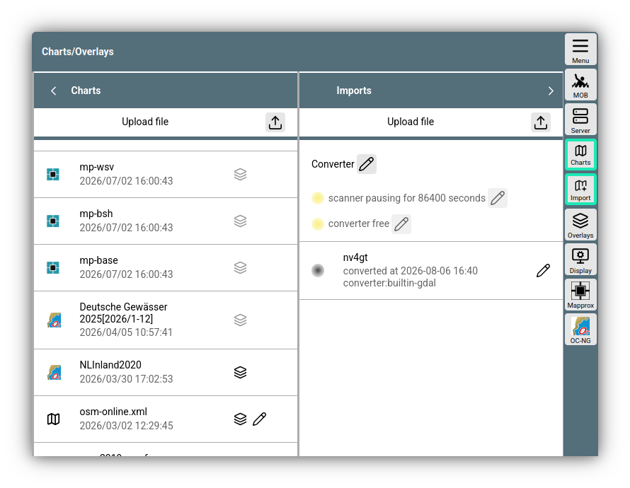
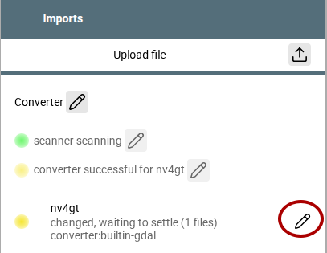

---
  tags:
    - Charts
    - Extensions
---
# Details on chart handling
This document describes some details explaining how AvNav handles charts, which types of charts exist, how to create new charts, and how to extend chart handling. The first part is aimed at all users and describes in a bit more detail which charts can be used and how to install, import, or convert them in AvNav. In the [second part](#definitions), the possibilities for creating your own chart sources and extending chart handling in AvNav are described. This part is aimed at advanced users.

## Basic structure
Charts in AvNav are either stored on the AvNav server or, depending on the type, can also be loaded directly from the internet during use. With the [mapproxy-plugin](https://github.com/wellenvogel/avnav-mapproxy-plugin), there is a hybrid form that loads charts from the internet, displays them, and simultaneously stores them on the AvNav server. On Android, the AvNav server is integrated directly into the app.

Charts are always displayed in a browser - just like the entire AvNav user interface. As described in the [Technical background](#background), corresponding JavaScript libraries are used for this.

## Charts and overlays {: #overlays }
Typically, for navigation, you need not only a chart but also various additional information on this chart. In addition to the information that AvNav provides itself - such as boat position, course lines, the current route, or AIS targets (see [Navigation page](../base/navpage.md)), you can also place so-called "overlays" over the chart.

A basic description can be found in the [Introduction](../base/overlays.md). Under [Overlay Details](overlays.md), you will find even more detailed information on this.


## AvNav chart types {: #owntypes }

AvNav can process several chart types directly. You only need to upload one of the supported chart file types to AvNav via

{{MM("MMchartspage")}}->"Charts"->{{SB("Upload")}}

AvNav supports the following chart types

| Type | File extension | Description |
| --- | --- | --- |
| [GEMF](http://www.cgtk.co.uk/gemf) | .gemf | A chart format optimized for reading, which internally contains a directory of existing tiles. This format is also generated from various other formats by the [AvNav Importer](#importer). This format can internally contain multiple layers with different resolutions. |
| [mbtiles](https://wiki.openstreetmap.org/wiki/MBTiles) | .mbtiles | A [sqlite](https://sqlite.org/) database that, in addition to the chart tiles, also contains metadata. Unfortunately, there are different encodings of the y-coordinate here - which are not always labeled correctly. Therefore, you can change this [manually](#scheme). |
| [PMTiles](https://docs.protomaps.com/pmtiles/) | .pmtiles | A modern, binary file format that is particularly optimized for use via simple web servers. When uploading *.PMTiles* files, AvNav initially only supports raster charts in this format. For this purpose, the information in the header of the *PMTiles* file is evaluated. The type of chart tiles is noted there. AvNav allows the types `Unknown(0), Png(2), Webp(4),Jpeg(3)` as raster types. Vector charts in *PMTiles* format can also be processed. However, this requires a special [chart definition](#vectorlayer) with the corresponding style document. |
| XML | .xml | As described [below](#exampledef), you can create a chart definition directly with XML files. The XML file does not yet contain the actual chart data, but only a reference to it - and information on its use |

## Plugin chart types

Plugins can, in principle, add any number of additional chart types to AvNav. The following chart plugins are available for AvNav by default:

| Plugin | Chart type | Description |
| --- | --- | --- |
| [ochartsng](ochartsng.md) | Vector charts | The ochartsng plugin is used to display [o-charts](https://o-charts.org/?lng=en) <!--@@linkchanged--> **vector charts**. These must be purchased in the o-charts shop and uploaded as described in the plugin. **Note**: Uploading cannot be done on the "Charts" page in AvNav. In addition, unencrypted ENC (S57) charts can also be displayed after [conversion](#converter). _Linux and Android only._|
| [ocharts]({{OLDLINK("hints/ocharts.html")}}) | Vector and raster charts | The ocharts (legacy) plugin is also used to display charts from the [o-charts shop](https://o-charts.org/?lng=en) <!--@@linkchanged-->. It can also use raster charts from the shop. It is no longer available on newer systems. _Linux only_ |
| [mapproxy](https://github.com/wellenvogel/avnav-mapproxy-plugin) | Online charts | The mapproxy plugin allows access to online chart services via custom definitions. The charts are cached on the AvNav server and are therefore available even without an internet connection. _For Linux only_ |

In addition, there may be other plugins for other chart types. See also the [list of plugins](plugin-list.md).

## Managing charts

The management of charts is already described in the [Introduction](../base/charts.md). It is performed via 

{MM("MMchartspage")}


///caption
Chart management 
///

In the "Charts" tab, all existing charts are listed, and new charts can be uploaded in the formats that AvNav [understands directly](#owntypes). Clicking on a chart opens a dialog that allows you to edit [Overlays](overlays.md), download, delete, or open the chart directly. Plugin charts are displayed here, but they usually cannot be deleted or downloaded here.

For MBTiles charts, you can change the scheme of the chart here. This describes how the y-coordinate counts. 
{: #scheme }

There are two options

| Name | Description |
| --- | --- |
| tms | y-coordinate 0 is south |
| zxy | y-coordinate 0 is north |

The default value is `tms`. Unfortunately, there are often MBTiles files that use `zxy` but do not note this in the file. In case of doubt, you therefore have to try it out and adjust the scheme if the chart is displayed incorrectly. AvNav writes its own information into the MBTiles file when you change it in the dialog. This allows this file to be used correctly immediately on other AvNav systems as well.

The middle tab "Imports" shows information about charts that have been loaded into the [converter](#converter) of AvNav. The converter is not available on Android.
{: #importer}

The "Overlay Files" tab lists the files that can be added to charts as [Overlays](overlays.md).

On the far left, there is another tab "Server" - it shows the status of the server functions for chart handling.


## Chart conversion {: #converter }

Some charts can only be displayed in AvNav after a conversion. These charts are usually converted into .gemf files so that they can subsequently be used efficiently.
Plugins can install additional converters.
The converter is only available for Linux and Windows, not on Android.
The following chart types can be converted:

| Chart type | File extension | Description |
| --- | --- | --- |
| [BSB](https://www.gisbox.com/en/articles/v1/25k7r9xewlwy/) | .kap | Raster charts. Typically many individual files. When uploading to the converter, you can specify a directory, which then becomes the name of the generated chart. For many charts, the process is lengthy - especially on a RaspberryPi |
| [BSB](https://www.gisbox.com/en/articles/v1/25k7r9xewlwy/) | .zip | A zip archive with BSB charts that are converted into a common chart |
| [S57 ENC](https://en.wikipedia.org/wiki/S-57) | .zip | With plugin [ochartsng](ochartsng.md). The S57 ENC are converted into an OpenCPN-specific binary format (senc) and passed directly to the ochartsng plugin. _On Linux and Windows_. Ochartsng itself does not run on Windows, but the converter is available and can be installed. This allows, for example, S57 charts for Android to be converted there (the converter is not available on Android) |

To upload charts to the converter, use

{{MM("MMchartspage")}}->"Imports"->{{SB("Upload")}}

The converter will recognize the uploaded files after some time (a wait occurs for individual files to allow for further uploads), then the conversion starts.

{.small}
///caption
Converter
///

Clicking the red marked {{ICON("Edit")}} icon opens a dialog to view the log, delete the import, restart it, or even download the converted charts again.

## Chart sources

* Download of ready-made raster charts (e.g., from [OpenSeamap](https://ftp.gwdg.de/pub/misc/openstreetmap/openseamap/charts/mbtiles/)
  , [NOAA](https://distribution.charts.noaa.gov/ncds/index.html)) - mbtiles
* Download with the [Mobile
  Atlas Creator](http://mobac.sourceforge.net/).
* Purchasing charts from [o-charts](https://o-charts.org/)
  and using them with the [ochartsng](ochartsng.md)
  plugin
* Download of S57 and conversion/use with the [ochartsng](ochartsng.md#chartconversions)
  plugin
* Use of charts from the [SignalK
  Chart Provider](https://github.com/SignalK/charts-plugin)   (if [SignalK integration](signalk.md) is active).
* Charts from [freenauticalchart.net](https://freenauticalchart.net/download/en/). <!--@@linkchanged-->
* Inland ENC from the [WSV (Elwis)](https://www.elwis.de/DE/dynamisch/IENC/) - conversion/use with the [ochartsng](ochartsng.md#chartconversions)
  plugin

**Note**: ENC are often provided as many individual ZIP files. If you want these to be converted and displayed as a single common chart in AvNav, you should pack the individual ZIP archives into one common archive before uploading to AvNav. 

In addition, there are many other chart sources on the internet that may provide charts usable in AvNav.


## Advanced chart definitions {: #definitions }

### Introduction
To use a chart, AvNav needs a so-called chart definition. For the [own chart types](#owntypes), AvNav generates these automatically. For other charts, this can be done by the user or by a [plugin](plugins-extensions.md).

Such a definition describes which layers this chart consists of, what type these layers have, and where the data for them comes from. See also [Technical background](#background).

The simplest case of such a definition in the form of an XML file for online access to [OpenStreetMap charts](https://www.openstreetmap.org/) can, for example, look like this:
{: #exampledef }

``` xml
<?xml version="1.0" encoding="UTF-8" ?>
 <TileMap 
    type="zxy"
    href="http://a.tile.openstreetmap.org"
    minzoom="4"
    maxzoom="20">
    <BoundingBox minlon="-20" minlat="10" maxlon="30" maxlat="70"/>
 </TileMap>
```
You can write this definition into an XML file (e.g., `SimpleOSM.xml`) and upload it to AvNav via

{{MM("MMchartspage")}}->"Charts"->{{SB("Upload")}}

The OpenStreetMaps chart is then available for display under the name SimpleOSM.xml.

This example contains exactly one chart layer; the chart tiles come from the server at `http://a.tile.openstreetmap.org` - and they have the default size of 256x256 pixels. 

The layer type is selected via "profile" - this determines how the URLs for the individual chart tiles are formed from the specified URL - and how they are displayed.

The description of a chart definition is either an XML representation as in the example or a JavaScript/JSON object. The above example as a JSON object:
``` json
[
    {
        "profile": "zxy",
        "href": "http://a.tile.openstreetmap.org",
        "minzoom": "4",
        "maxzoom": "20",
        "boundingbox": {
            "minlon": "-20",
            "minlat": "10",
            "maxlon": "30",
            "maxlat": "70"
        }
    }
]
```
Case sensitivity is irrelevant for the parameters.

### Inserting chart definitions {: #insertingdefs }

Chart definitions can be brought into AvNav in various ways.

**XML file**
{: #xmldef }

As described in the [example](#exampledef), chart definitions can be uploaded to AvNav as an XML file.

**plugin.json**
{: #pluginjsondef }

[Plugins](plugins-extensions.md) can include a [`plugin.json`](plugins.md#pluginjson) file. This must contain an object with various properties. Under the name "charts," a list of chart definitions can be registered here. 
``` json
{
  "charts": [
    {
      "layers": [
        {
          "url": "chart/base.pmtiles",
          "name": "main",
          "minzoom": 6,
          "maxzoom": 18,
          "profile": "PMTiles"
        }
      ],
      "name": "test-base",
      "icon": "compass.svg"
    }
  ]
}
```
Relative specifications for *url* or *icon* refer to the location of the plugin.json file.

**Plugin Python code**
{: #insertingpython }

_For Windows and Linux/Raspberry only_. In the [Plugin Python API](plugins.md#pluginpython), there is the function [`registerChartProvider`](https://github.com/wellenvogel/avnav/blob/e297382b2e849db9e1c4f18a0e22915083deb5aa/server/avnav_api.py#L285).

The callback passed there is called when AvNav wants to determine the list of its charts. It must return a list of chart definitions as described under [plugin.json](#pluginjsondef). 


??? "Dynamic layer list"
    
    For definitions via _plugin.json_ or _python_, the chart definition can also be generated in two steps.

    This can make sense in particular if the charts are provided by a separate server outside of AvNav.

    If the chart definition does not yet contain "layers," AvNav tries to load the final chart definition when opening the chart. This definition must again be a chart definition in [XML format](#xmldef). AvNav expects a URL in the definition from which this XML document can be loaded.
    
    If the chart definition contains an `overviewUrl` parameter, this is used; otherwise, the `url` parameter is used and `/avnav.xml` is appended.
    Such a two-step chart definition can, for example, look like this:

    ```
    {
        "charts": [
          {
            "name": "test-chart",
            "icon": "compass.svg"
            "url": "http://$HOST:8002/charts/testchart"
          }
        ]
    }    
    ```
    
    In this example, it is assumed that a server for the charts is running on the same computer as AvNav and providing its data on port 8082. The chart definition for the chart "test-chart" is then retrieved via the URL
    `http://nn.nn.nn.nn:8082/charts/testchart/avnav.xml`. The chart layers in the XML document then do not necessarily have to contain a URL anymore - the base URL `http://nn.nn.nn.nn:8082/charts/testchart` will be used.


### Layer types {: #layertypes }

AvNav has a number of built-in chart layer types. These expect the chart data in a specific format and load them via specific URLs. [Plugins](plugins-extensions.md) or [User JavaScript](userjs.md) can add further layer types.
These layers internally create a chart layer for [openlayers](http://www.openlayers.org/) or [MapLibre](https://maplibre.org/).
The implementation of the chart layers can be found in [chartlayers.js](https://github.com/wellenvogel/avnav/blob/master/viewer/map/chartlayers.js)

**Parameters**

Parameters that are understood by multiple layers:

  * url (alternatively, "href" can be used)

    This can be omitted if the chart data is found at the same base URL as the chart description. For details, see the JavaScript interface [description](#registerlayer).

  * minzoom - Integer, the minimum zoom level
  * maxzoom - Integer, the maximum zoom level
  * boundingbox - Object

    the area of the chart with the parameters minlat, maxlat, minlon, maxlon
    ```
    "boundingbox": {
        "minlon": "-180",
        "minlat": "-66.477366283",
        "maxlon": "179.955",
        "maxlat": "85.05112878",
        "title": "bounding"
    },
    ```

  * layerzoomboundings - Object or Array
    This value describes for the different zoom levels which x/y areas are available.
    Example:
    ```
    "layerzoomboundings": [
            {
                "zoom": "2",
                "boundingbox": {
                    "minx": "0",
                    "maxx": "3",
                    "miny": "0",
                    "maxy": "2"
                }
            },
            {
                "zoom": "3",
                "boundingbox": {
                    "minx": "1",
                    "maxx": "7",
                    "miny": "0",
                    "maxy": "4"
                }
            },
    ]
    ```
    
    The `boundingbox` entries at each zoom level can also be an array of objects if there are multiple, non-contiguous areas.
    This parameter is mostly only generated for charts that AvNav knows itself. The advantage of specifying it is that it does not attempt to load tiles that do not exist. 

  * upzoom 

    if no tiles are available for a zoom level, it attempts to use tiles from smaller zoom levels - down to a maximum of `zoom - upzoom`


**Layer zxy**

This is the default layer that is also used. The URLs are generated according to the [OSM scheme](https://wiki.openstreetmap.org/wiki/Slippy_map_tilenames).
`https://xxxxxx/zoom/x/y.png`. y starts with 0 in the north. The tile size is 256x256.


Parameters

| Name | Optional | Description |
| --- | --- | --- |
| profile | yes | zxy or empty |
| url | see above | The base URL for the chart data. `zoom/y/x.png` are appended for each tile. Alternatively, the URL can contain placeholders `{z} {x} {y}`, then the values are inserted there. |
| minzoom | yes | |
| maxzoom | yes | |
| boundingbox | yes | |
| upzoom | yes | |
| layerzoomboundings | yes | |

**Layer tms**

This layer is almost identical to the zxy layer - only the y coordinate is inverted. 0 is in the south.
The parameters are also identical to the zxy type; the type parameter must be set to `tms`.

**Layer wms**

This layer can be used to load chart tiles from a [Web Map Service](https://en.wikipedia.org/wiki/Web_Map_Service). Such a service does not address the tiles directly, but the corner coordinates and the size of the image to be loaded are specified. Usually, other parameters also belong to it.
The layer generates `GetMap` requests to the configured service.

Parameters

| Name | Optional | Description |
| --- | --- | --- |
| profile | no | wms |
| url | see above | The specified URL is supplemented with a series of [parameters](#wmsparameters). |
| minzoom | yes | |
| maxzoom | yes | |
| boundingbox | yes | |
| upzoom | yes | |
| layerzoomboundings | yes | |
| projection | yes | The projection the service uses. Default `EPSG:4326` |
| wmsparameter | yes | An array of objects: name, value `[{"name":"TRANSPARENT","value":"TRUE"}]`. These are added to the URL as [parameters](#wmsparameters). |
| layermapping | yes | An array of objects: zooms,layers, which allows querying different WMS layers depending on the zoom. Zooms and Layers can each contain "," separated values. Example: `[{"zooms":"1,2,3,4,5","layers":"Overview,Special"},{"zooms":"6,7,8","layers":"Details"}]` |

The final URL for querying the WMS is then formed by the URL specified in "url" as well as a list of parameters.
{ #wmsparameters }

| Parameter | Source |
| --- | --- |
| SERVICE | fixed: `WMS` |
| REQUEST| fixed: `GetMap` |
| FORMAT | fixed: `image/png` |
| SRS | parameter `projection` |
| WIDTH | fixed: tile size 256 |
| HEIGHT | fixed: tile size 256 |
| BBOX | the calculated bounding box for the tile |
| LAYERS | if the `layermapping` parameter was specified, this parameter is supplied depending on the zoom, otherwise not |
| XXX... | all name,value pairs specified in `wmsparameter` |

**Layer encrypt**

This layer is a special layer for the [ochartsng](ochartsng.md) and the ocharts plugin. The values `'encrypted-zxy','encrypted-zxy-mercator'` are accepted as "profile".

**Layer PMTiles**

This layer can be used for [PMTiles](https://docs.protomaps.com/pmtiles/) raster sources.

Parameters

| Name | Optional | Description |
| --- | --- | --- |
| profile | no | `PMTiles` |
| url | see above | The base URL for the chart data|
| minzoom | yes | |
| maxzoom | yes | |

An example of using PM raster sources:
```
<?xml version="1.0" encoding="UTF-8" ?>
 <TileMap 
   profile="PMTiles"
   href="https://pmtiles.io/stamen_toner(raster)CC-BY+ODbL_z3.pmtiles" 
    minzoom="2"
    maxzoom="4">
 </TileMap>

```

**Layer mapLibreVector**
{: #vectorlayer }

This layer can be used for vector charts. These are displayed with [MapLibre](https://maplibre.org/). 

Vector charts generally require at least 3 other data types in addition to the chart data:

  * a "style" document - generally a .json file. This describes in detail how the data should be displayed. For more precise information, see the description at [MapLibre](https://maplibre.org/maplibre-style-spec/).
  * the symbols to be displayed on the chart (sprites). The link to this is contained in the "style" document.
  * the fonts for text display. The links for this are also contained in the "style" document.

The chart data to be displayed (tiles) are usually described by links to one or more [TileJSON](https://docs.mapbox.com/help/glossary/tilejson/) APIs. The tiles themselves are usually used for vector charts in the [pbf](https://github.com/mapbox/pbf) format. They can be loaded from a server or, for example, from a PMTiles file.

In addition to this basic data, you can specify further configurations for this chart layer, which are then converted directly into parameters for [MapLibre](https://maplibre.org/maplibre-gl-js/docs/API/classes/Map/#properties).


Parameters

| Name | Optional | Description |
| --- | --- | --- |
| profile | no | `maplibreVector` or `maplibre``|
| style | no | see [below](#styleparameter) |
| maplibre | yes | an object that is passed directly as properties to the [MapLibre Map](https://maplibre.org/maplibre-gl-js/docs/API/classes/Map/) |
| useProxy | yes | If vector data is loaded from a server, this requires correct [CORS](https://developer.mozilla.org/en-US/docs/Web/HTTP/CORS) settings on this server. Otherwise, the browser refuses to load the data. Since you do not always have control over these servers, it is possible to route the requests via the AvNav server. Since the AvNav website also came from this server, the CORS problem does not occur. This, of course, only works if the AvNav server can also reach the chart server directly |

The **style** parameter can be specified in various ways:
{: #styleparameter }

  * as parameter `style` or `url` or `styleUrl`
  * as value `style` in the parameter `maplibre`

The value of the parameter can be a string - in this case, it is interpreted as a URL and the style document is loaded from this URL. Alternatively, the value can also be an object - in this case, the value is passed directly to MapLibre as the `style` parameter.

As an extension to MapLibre, the style document can also be a [yaml document](https://en.wikipedia.org/wiki/YAML). Through the use of anchors and other YAML functions, this can make the work of writing such documents easier. After loading, the document is converted to JSON and then passed to MapLibre.

## Extensions (custom chart layers) {: #extensions }

!!! Experts
    Creating custom chart layers requires JavaScript know-how and also a certain amount of familiarization with the handling of the chart libraries. Therefore, such an extension is usually built into [plugins](plugins-extensions.md).

Custom chart layers extend the existing chart layers. This allows, for example, communicating with the chart server before use (e.g., sending a [GetCapabilities](https://docs.geoserver.org/main/en/user/services/wms/reference/) request to a WMS server to determine the available layers), you can set user preferences, or, for example, retrieve and prepare chart information for the [FeatureList](featureinfo.md).

### Registration {: #registerlayer }

In the JavaScript API of AvNav (which is available for [plugins](plugins-extensions.md) and [user JavaScript code](userjs.md)), there is the function [`registerUserMapLayer`](https://github.com/wellenvogel/avnav/blob/66f12023f6f863fcbb24d18efe1ed40494421782/viewer/api/api.interface.ts#L684) for this purpose.

With this function, you register a new profile that can then be used in [chart definitions](#definitions).

The function has the following parameters:

| Name | Type | Description |
| --- | --- | --- |
| baseName | String | The chart layer that should be extended. One of the profile names as specified under [Layer types](#layertypes). |
| name | String | The profile name for the new layer. If the function is called in [user.mjs](userjs.md), `user_` is prepended to the name internally. If it is called in a plugin, `plugin_` is prepended. In a chart definition, you must therefore write `"profile":"user-myprofile"`. |
| callback | Function | A function that is called as soon as a chart layer with this profile is to be created. For the description, see [below](#usermaplayercallback) |

### Callback {: #usermaplayercallback }

In the [API](https://github.com/wellenvogel/avnav/blob/66f12023f6f863fcbb24d18efe1ed40494421782/viewer/api/api.interface.ts#L467), you can see the definition of the callback function that is called when a chart layer is created.

The `context` parameter allows for storing values that are specific to this call. It is also passed in all further callbacks.

The function may be *async* or return a *Promise*.

The return value of the function differs depending on whether you are extending a [vector layer](https://github.com/wellenvogel/avnav/blob/66f12023f6f863fcbb24d18efe1ed40494421782/viewer/api/api.interface.ts#L425) or a [raster layer](https://github.com/wellenvogel/avnav/blob/66f12023f6f863fcbb24d18efe1ed40494421782/viewer/api/api.interface.ts#L397).

In both cases, the result can return modified parameters (`options`) - these then replace those specified in the chart configuration.
In addition, various callback functions can be specified.

| Callback | Type | Description |
| --- | --- | --- |
| finalizeFunction | all | is called before the chart is closed |
| sequenceFunction | all | is called at regular intervals to check whether the chart has changed and needs to be reloaded. As soon as the returned string changes, the chart is reloaded |
| loadCallback | Vector | is called after the MapLibre map has loaded and allows direct access to the map object |
| **featureListFormatter** | Vector | is called when the user clicks on the map. A list of the vector objects in the click area is passed as a parameter. See [below](#featurelistformatter) |
| createTileUrlFunction | Raster | The raster layers generate the URL for loading a tile with a [URLFunction](https://openlayers.org/en/latest/apidoc/module-ol_Tile.html#~UrlFunction). This callback can be used to return your own URL function. This allows, for example, additional parameters required by the server to be inserted |
| tileLoadFunction | Raster | This function makes it possible to influence the loading of server data into a JavaScript image. |


A particularly interesting possibility is the preparation of vector chart data for the user with the `featureListFormatter` function.
{: #featurelistformatter }

The passed list contains objects that contain all properties of the respective [Open Layer Feature](https://openlayers.org/en/latest/apidoc/module-ol_Feature-Feature.html) ("get" method).
In addition, the following properties are present:

| Name | Description |
| --- | --- |
| `_gtype` | Geometry type (String) |
| `_lon` | Longitude |
| `_lat` | Latitude |
| `vectorTileFeature` |  the original MapLibre feature | 


These objects were created by parsing the GeoJSON representation of [MapLibre](https://maplibre.org/maplibre-gl-js/docs/API/type-aliases/MapGeoJSONFeature/) - and are therefore similar to the features that arise in a [GeoJSON overlay](overlays.md). 

The return of the formatter must be an array with objects of the type [FeatureInfoType](https://github.com/wellenvogel/avnav/blob/66f12023f6f863fcbb24d18efe1ed40494421782/viewer/api/api.interface.ts#L68).

The objects returned as a result are displayed in a [Feature List Dialog](featureinfo.md). For a good user experience, the return should only contain a single object with an accumulated representation of the most important features (e.g., type, top mark, and light of a buoy).

A prepared list with the information of all objects should be deposited HTML-formatted in the `htmlInfo` value of the object (or be accessible via `link` as a URL).

See also [FeatureFormatter](userjs.md#featureFormatter).

An example can be found in the [plugin for freenauticalcharts](https://github.com/wellenvogel/avnav-freenauticalcharts/blob/f9859b10d99cc77ec830b39d33b5da04b667e7dd/freenauticalcharts/plugin.mjs#L271).


## Technical background {: #background }

For charts to be displayed in the browser in AvNav, they must be in a
"tile format." This is the format used by services like
OpenStreetMap or GoogleMaps. A chart tile is usually 256x256 pixels in size. The world is projected onto a flat surface.
You can imagine this as a paper cylinder that stands vertically
and is wrapped around the earth at the equator. Every point with its coordinates
(longitude/latitude) is then projected onto this cylinder. The various projections describe how this is done, which units are used in the projection, and whether the earth is modeled as a sphere or an ellipsoid with different parameters. The WebApp uses the
so-called Google-Mercator-projection with the EPSG code 900913. The earth is considered a sphere. The units on the paper are meters, which can naturally be converted into the corresponding coordinates. Charts in a different format (e.g., WGS84 – earth as an ellipsoid,
always in degrees) may therefore need to be reprojected.

In the Google projection, the entire projection surface is divided into tiles.
The zoom level indicates how many tiles the surface is
divided into. Zoom level 0 means: the entire earth (from -85° to
+85° latitude – the projection is not defined above that) on one tile
of 256x256 pixels. With each further zoom level, the division becomes finer:
Zoom level 1: 2x2 tiles, 2: 4x4 tiles, etc. For work with AvNav, the
interesting zoom levels range from approx. 7 to 18..19. That means (level 19)
2^19x2^19 tiles.

For display, the library [openlayers](http://www.openlayers.org/)
is used. This loads the corresponding chart tiles from the server depending on the zoom level
and displays them. OpenStreetMap typically uses
this library.
It is possible to layer multiple so-called layers on top of each other within a chart - on these, for example, different resolutions can be used - or the base charts in one layer and the sea marks in another layer.
In addition, chart layers can also be used with [MapLibre](https://maplibre.org/). This allows, for example, vector charts to be displayed. However, this typically requires additional data and thus special [chart definitions](#definitions) or [plugins](plugins.md).

It is easy to imagine that large amounts of data quickly accumulate at high zoom levels. Therefore, one must proceed with chart tiles
similarly to how it is done with paper charts: a smaller zoom level for overviews, larger for detailed charts, and, for example, harbor plans then with
level 18 or 19 (60cm/pixel or 30cm/pixel). To be able to work with this, the various levels of detail are then layered on top of each other in layers. If there is a layer with a better
(larger) zoom level for an area, this is displayed - if not, the one with
the lower resolution (possibly enlarged). To not overload our display devices, one can typically work with 3-5 chart layers (depending on the device...).