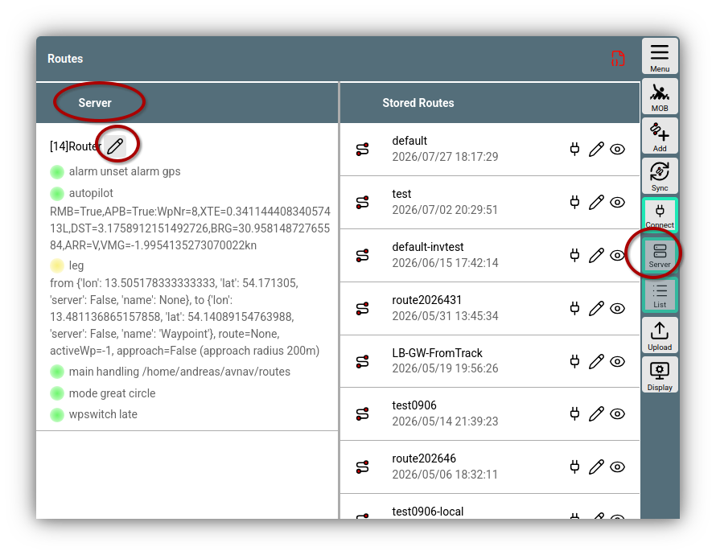
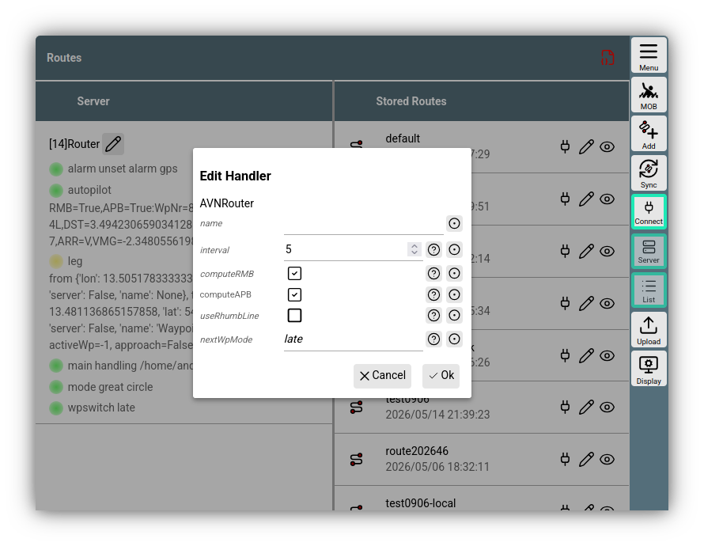
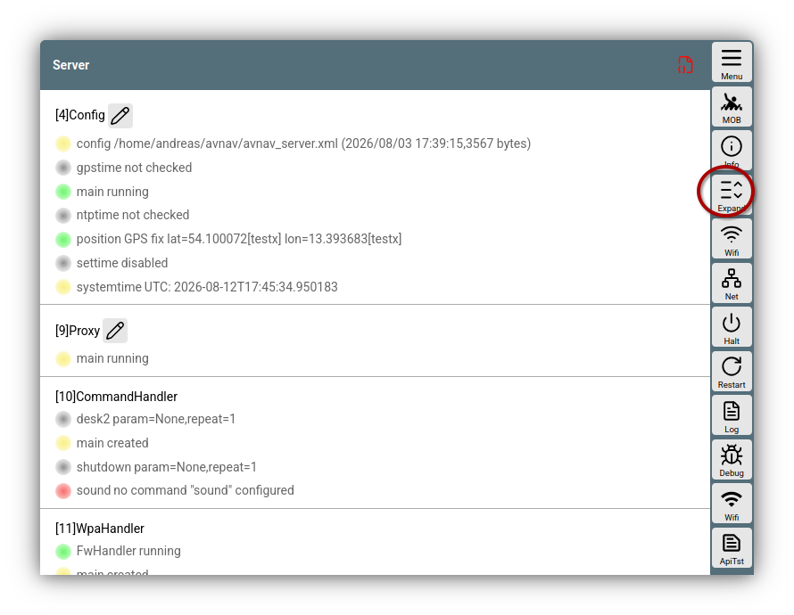

---
  tags:
   - Configuration
   - Server
   - Connections
---

# AvNav server configuration

## Introduction

### Linux/Raspberry/Windows

When starting up, the AvNav server reads its configuration from an XML file named `avnav_server.xml`.  
This file is typically located at `/home/pi/avnav/data` on the Raspberry Pi, or `$HOME/avnav` on other systems. On Windows, the file is located in the user profile folder named *avnav*.

The entries in this file allow for extensive customization of the AvNav server's behavior. In normal cases, you do not need to edit this file directly; instead, you can edit the [Server Configuration](#configure) within AvNav. Details regarding individual functional units can be found under [Configuration Linux/Windows](#linux).

### Android

On Android, the AvNav server configuration is stored in the app's user data. Generally, this cannot be viewed on Android – therefore, only the [Configuration within AvNav](#configure) is available for adjustments. In principle, the server in the Android version largely shares the same functions as the other versions. However, the names of the individual functional units may differ in some cases. Details regarding the functional units can be found under [Configuration Android](#android).

## Configuration within AvNav {: #configure }

In AvNav, the server's corresponding behavior can be adjusted in various sections.


///caption
Server Settings Routes
///

If the Server tab is not directly visible, you can access it via the {{BT("ServerView")}} button or by swiping.

In the server section, the server components (handlers) required for the respective function are listed (in the example: Router). If a handler can be edited, the corresponding {{SB("Edit")}} button is provided.

This opens a dialog for the settings.


///caption
Editing a handler
///

The parameters that can be edited here correspond to the properties of the nodes in the `avnav_server.xml` file on Linux and Windows.

When settings are saved using {{DB("DBOk")}}, they take effect immediately. On Linux/Raspberry/Windows, they are saved in the `avnav_server.xml` file, and on Android, they are saved in the user data.

## Connections page {: #channelspage}

All incoming and outgoing (NMEA) connections can be configured via 

{{MM("MMchannelspage")}}

New connections can also be created here. See also the [Details on Connections](connections.md).

## Server page {: #serverpage}

For an overview of all server functions, you can use the page 

{{MM("MMserverpage")}}


///caption
All server settings
///

After opening, only the functional units (handlers) that are not visible on other pages are displayed initially. You can display all of them using {{BT("StatusAll")}}.

Using {{BT("StatusAdd")}}, new handlers can be added if they support this. Usually, these are handlers for new connections.


## Description of functional units (Linux/Windows) {: #linux }

### Initial values and error handling

If the `avnav_server.xml` file does not exist during the first start, it is created from a template – suitable for the [Raspberry](https://github.com/wellenvogel/avnav/blob/master/raspberry/avnav_server.xml)
or [other
systems](https://github.com/wellenvogel/avnav/blob/master/linux/avnav_template.xml). This template is the file `/etc/avnav_server.xml` on the Raspberry Pi. If this file does not exist, a file from the package is used as a template.  
If AvNav is started from the command line using the "avnav" command, a template can be specified with the `-t` option.

Generally, this file is not modified during AvNav software updates. However, it may happen that new entries are required for new features. In that case, this will be noted in the [Release Notes](../installation/release.md).

With every successful start, AvNav writes a copy of this file with the extension *.ok*. If parsing the XML file fails during the next start, AvNav will read the *.ok* file instead. This function is designed to prevent a failed start after a change that AvNav might have made itself in certain situations.

If AvNav cannot start due to configuration errors, you should completely remove the `avnav_server.xml` and restart. AvNav will then start again from a "clean" template.

### Special values

In the following descriptions, the "online" column indicates whether parameters can be changed directly [within AvNav](#configure).

If parameters that are not directly editable need to be changed, the [avnav-update-plugin](https://github.com/wellenvogel/avnav-update-plugin) should be used to edit the file directly in the browser.  
The plugin can be reached on the {{MM("MMserverpage")}}.

If you make changes to the `avnav_server.xml` directly using an editor, AvNav must be restarted afterward.
If AvNav is running as a system service, you do this with the command

```
sudo systemctl restart avnav
```

However, it is recommended to start AvNav from the command line first after a change to see if there are any major errors. The command sequence is then:

```
sudo systemctl stop avnav  
avnav -e  
^C  
sudo systemctl start avnav
```

The `-e` option prevents the `avnav_server.xml.ok` from being loaded in case of an error. The key combination *^C* aborts the running AvNav instance.

### NMEA filter {: #filter}

Filters can be specified in various places to influence which NMEA data is allowed to pass through and which is not.

Comma-separated NMEA messages can be specified here. To make them independent of Talker IDs, the 2 characters after a `$` are ignored.

A filter for `$GPRMC` looks like this: `$RMC`. If a `^` is placed in front of the filter, it is negated; thus, `^$RMC` means: no RMC records. AIS data can be matched with the filter `!` or `!AIVDM`.

Examples:

* `!` - only all AIS messages
* `^!` - no AIS messages
* `$RMC,$RMB` - RMC and RMB records
* `!,$RMC` - all AIS messages and RMC records
* `^$APB,^$RMB` - no APB and no RMB records

### BlackList {: #blackList}

A blacklist contains the names of input channels (handlers) whose data should not be output on the respective interface. Multiple entries are separated by a comma.


### Functional units (handlers)

Inside the configuration, there are entries for individual handlers.

Basically, there are 3 categories of such handlers:

  1. Parts that may only appear exactly once, but must absolutely be in the `avnav_server.xml`  
  2. Parts that normally do not need to be in the `avnav_config.xml`, only if something special needs to be configured  
     Examples: AVNAlarmHandler, AVNChartHandler,...
  3. Parts that can appear once or multiple times in the `avnav_server.xml`.
     These are primarily the input and output channels. If no such entry exists, the function is not available.

There are some properties that appear in multiple components; here is an explanation for them.

| Name | Description | Example |
| --- | --- | --- |
| enabled | Many handlers can be switched on or off on the Server/Status page using this parameter | on |
| name | Name of an input or output channel. This is displayed on the status page and can also be used in the [blackList](#blackList) parameter for filtering | nmea0183tosignalk |
| filter | [NMEA filter](#filter) | |
| readFilter | For combined readers/writers: Filter for the input side. See [filter](#filter) | |
| blackList | List of channel names whose data should not be sent out. Observe spelling (capital L) | nmea0183tosignalk |
| priority (since 20220421) | All NMEA input channels have a *priority* field. This influences which value wins if the same values are decoded by multiple channels. The *default priority* is 50; it can be increased or decreased. The SignalK integration has a *default priority* of 40. | 50 |

Below are the most important components with their parameters. If parameters are not described here but might appear in a template, they should be left as they are.

### AVNConfig

Basic configuration and system time, Category 2 (1x, optional)

| Name | Online | Description | default/template |
| --- | --- | --- | --- |
| settimecmd | | A command called to set the system time. The parameter is a timestamp in UTC, as required for *date -u* | only set with the avnav-raspi package |
| settime (from 203304xx) | X | If on, set the system time (*settimecmd* must also be set) | on |
| maxtimeback | X | Maximum time the system time is set backward before all internal data is deleted (s) | 5 |
| systimediff | X | Maximum deviation of the system time from the GPS time before the system time is reset (s) | 5 |
| settimeperiod | X | Time (in s) before the system time is reset again | 3600 |
| ntphost (from 20220421) | X | An NTP server. This is queried if no valid GPS time is available and *settime* is active | pool.ntp.org |
| switchtime (from 20220421) | X | Time (in s) to wait at least after setting the time before switching from GPS to NTP or vice versa. This time is also used to wait for a valid GPS time after startup | 60 |
| expiryTime | X | Time (in s) for how long received NMEA data remains valid | 30 |


### AVNAisWorker

AIS configuration, Category 2 (1x, optional)

| Name | Online | Description | default/template |
| --- | --- | --- | --- |
| ownMMSI | X | MMSI of your own boat, this is filtered out from the AIS data | |
| aisExpiryTime | X | Time (in s) for how long received AIS data remains valid | 1200 |

### AVNDecoder
Decoder, Category 2 (1x, optional)

| Name | Online | Description | default/template |
| --- | --- | --- | --- |
| decoderFilter | X | Filter for the decoder | |


### AVNQueue

The internal NMEA queue. Category 2 (once, optional).

| Name | Online | Description | default/template |
| --- | --- | --- | --- |
| maxList | X | Max. number of NMEA records in the queue | 300 |
| maxAge | X | Max. age (in s) of an entry in the queue. Older entries are deleted. This prevents data from being sent out too slowly. | 3 |

### AVNHttpServer

The internal HTTP server. Category 2 (once, optional).

The parameters cannot be changed within AvNav.
In addition to the parameters for AVNHttpServer, there are some deeper entries that can repeat multiple times. Normally, no changes should be necessary here (Directory, MimeType).

Except for the HTTP port, no changes should normally be necessary.

#### Parameters for AVNHttpServer

| Name | Description | default/template |
| --- | --- | --- |
| httpPort | The port on which the HTTP server accepts requests | 8080 |
| httpHost | The bind address; you can restrict this to a specific network here | 0.0.0.0 |

#### Parameters for Directory

These values are usually overwritten by the call (parameter -u for avnav) and should not be changed.

| Name | Description | default/template |
| --- | --- | --- |
| urlpath | The URL (without /) | |
| path | The actual path on the system | |

#### Parameters for MimeType

Here, *mime types* are configured for file extensions. If your own application requires something special, you can add it here.

| Name | Description | default/template |
| --- | --- | --- |
| extension | File extension (e.g., .avt) | |
| type | Mime type (e.g., text/plain) | |

### AVNBlueToothReader

Reading from Bluetooth devices with serial profile. Category 3 (once possible, optional)  
Only possible if the device has a Bluetooth device.

| Name | online | Description | default/template |
| --- | --- | --- | --- |
| maxDevices | X | Maximum number of simultaneously connected Bluetooth devices | 5 |
| deviceList | X | Comma-separated list of Bluetooth device IDs. If set, only these devices will be connected. | |
| filter | X | [filter](#filter) for NMEA data | |
| name | X | | |
| enabled | X | | |
| priority | X | | |

### AVNSerialReader {: #AVNSerialReader}

Reading from serial devices. Category 3 (multiple, optional). This reader should only be used for devices connected directly via hardware (UART); for devices connected via USB, the [AVNUsbSerialReader](#avnusbserialreader) is responsible.

| Name | online | Description | default/template |
| --- | --- | --- | --- |
| name | X | Channel name for use in a BlackList and for display | internally generated name |
| port | X | Device name, e.g., /dev/ttyAMA0 | |
| baud | X | Baud rate. If minBaud is also specified, this is the maximum baud rate used for automatic baud rate detection | 4800 |
| minbaud | X | Minimum baud rate used for automatic detection. If not set or 0, automatic detection is switched off | |
| timeout | X | Timeout (in s) after which the device is closed and reopened without data | 2 |
| bytesize | X | Serial byte size | 8 |
| parity | X | Parity | N |
| stopbits | X | Number of stop bits | 1 |
| xonxoff | X | Usage of xon/xoff protocol (0: off) | 0 |
| rtscts | X | RTS/CTS usage (0: off) | 0 |
| numerrors | X | Number of errors after which the device is closed and reopened | 20 |
| autobaudtime | X | Time (in s) spent attempting to detect a newline in the data (during automatic baud rate detection) | 5 |
| filter | X | NMEA filter, see [filter](#filter) | |
| enabled | X | | |
| priority | X | | |

### AVNSerialWriter {: #AVNSerialWriter}

Output via a serial device. Also combined input and output.
Category 3 (optional)  
Only for direct serial devices, not for USB converters (use the [AVNUsbSerialReader](#avnusbserialreader) instead)

| Name | online | Description | default/template |
| --- | --- | --- | --- |
| name | X | Channel name | |
| combined | X | If "true", then both input and output simultaneously | false |
| readFilter | X | [Filter](#filter) for input direction. The parameter "filter" refers to the output direction! | |
| blackList | X | [blackList](#blackList), comma-separated list of channel names whose data should not be output. | |
| .... | | all parameters of [AVNSerialReader](#AVNSerialReader) | |

### AVNUsbSerialReader

Handles serial devices connected via USB. Category 3 (once, optional).  
This worker searches for all devices connected via USB. It attempts to open those with a serial profile, automatically set the baud rate, and then read NMEA data. Thus, such devices are usually recognized completely automatically by AvNav.  
You can define rules for individual devices to treat them specifically. An ID that identifies the corresponding USB port is used for device identification. The easiest way to determine this ID is to watch the [Connections Page](connections.md#channelspage) while plugging in the device.

The parameters are divided into 2 parts:

* Attributes for the entry itself
* Subordinate entries of type *UsbDevice*

Example:

```
<AVNUsbSerialReader maxDevices="5" allowUnknown="true" baud="38400" minbaud="4800">
<UsbDevice usbid="1-1.2.1:1.0" baud="38400" minbaud="4800" filter="$RMC"/>  
</AVNUsbSerialReader>
```

#### Parameters for AVNUsbSerialReader

| Name | online | Description | default/template |
| --- | --- | --- | --- |
| maxDevices | X | Maximum number of simultaneously connected USB devices | 5 |
| allowUnknown | X | Only if this entry is "true" are devices included that are not explicitly configured with *UsbDevice* | true |
| ... | X | All parameters of [AVNSerialReader](#AVNSerialReader) except for *port*. These are set for devices that are not explicitly configured. | |

#### Parameters for UsbDevice

| Name | online | Description | default/template |
| --- | --- | --- | --- |
| usbid | X | USB port identification e.g. "1-1.2.1:1.0", required | |
| type | X | Type of device: reader, writer, combined, ignore. Set to ignore if the device should not be used | reader |
| ... | | all parameters of [AVNSerialReader](#AVNSerialReader) if *type* = "reader" (except *port*, which is set internally) | |
| ... | | all parameters of [AVNSerialWriter](#AVNSerialWriter) if *type* is combined or writer (except *port*, which is set internally) | |

### AVNUdpReader

Opens a UDP port and processes incoming data.
Category 3 (optional, multiple).

| Name | online | Description | default/template |
| --- | --- | --- | --- |
| name | X | Channel name for use in [blackList](#blackList) and in the display | internally calculated |
| port | X | UDP port | |
| host | X | Bind address for the port. This allows limiting reception to localhost, for example. | 0.0.0.0 |
| minTime | X | If set: waiting time (in s) before another data record is received. This can be used to limit the data rate. | 0 |
| filter | X | [Filter](#filter) for NMEA data | |
| enabled | X | | |
| priority | X | | |
| stripLeading | X | Remove all characters before $ or ! in a line. | off |
| joinMulticast | X | Joins a [Multicast](https://en.wikipedia.org/wiki/Multicast) group, enabling the reception of multicast messages. | off |
| multicastAddr | X | Multicast address. This enables the reception of multicast messages on this address. | 224.0.0.1 |

### AVNUdpWriter

Sends NMEA data via UDP. Category 3 (optional, multiple)

| Name | online | Description | default/template |
| --- | --- | --- | --- |
| name | X | Channel name | internally calculated |
| port | X | UDP target port | 2000 |
| host | X | UDP target address | localhost |
| filter | X | [Filter](#filter) for NMEA data sent | |
| broadcast | X | Must be set to *true* if data should be sent as a broadcast | false |
| blackList | X | [BlackList](#blackList) for channel names whose data should not be sent | |
| enabled | X | | |

### AVNSocketWriter

An output that waits for connections on a port and outputs NMEA data to them (TCP server). Category 3 (multiple, optional).

| Name | online | Description | default/template |
| --- | --- | --- | --- |
| name | X | Channel name | internally calculated |
| port | X | The listener port | |
| address | X | If set, bind to this address (otherwise any: 0.0.0.0) | |
| filter | X | [Filter](#filter) for NMEA data | |
| read | X | If *true*, data is also read from the socket | false |
| priority | X | Only if *read* is active | |
| readFilter | X | If reading, NMEA-[Filter](#filter) for the input direction | |
| blackList | X | [BlackList](#blackList): Comma-separated list of channel names for which no data is output | |
| minTime | X | Minimum time (in s) between 2 sent messages. This can be used to limit the data rate. | 0 |
| avahiEnabled | X | If switched on, the service is advertised via avahi as *\_nmea-0183.\_tcp* | off |
| avahiName | X | The name for the Avahi service | avnav-server |
| enabled | X | | |
| sendOwn | X | send received data on the same connection | off |

### AVNSocketReader

An input that connects to a TCP server and reads data from there (TCP client). Category 3 (multiple, optional)

| Name | online | Description | default/template |
| --- | --- | --- | --- |
| name | X | Channel name | internally calculated |
| port | X | TCP port to which a connection is established | |
| host | X | TCP target address to which a connection is established | |
| timeout | X | Connection timeout in s | 10 |
| minTime | X | Minimum time between 2 received messages | 0 |
| filter | X | [Filter](#filter) for NMEA data | empty |
| writeOut | X | send NMEA data on this connection | off |
| writeFilter | X | [Filter](#filter) for sent NMEA data | empty |
| blackList | X | Comma-separated list of source names whose data is not sent | empty |
| enabled | X | | |
| priority | X | | |
| stripLeading | X | Remove all characters before $ or ! in a line. | off |
| sendOwn | X | send received data on the same connection | off |

### AVNNmea0183ServiceReader

This handler is very similar to the AVNSocketReader. However, instead of configuring *host* and *port*, the name of the service is configured here. AvNav searches the network for MDNS/Bonjour/Avahi services of type *\_nmea-0183.\_tcp*. If the entry is made via the web interface, AvNav offers a list of found services for selection. With this handler, a connection can be re-established even if, for example, IP addresses change.

| Name | online | Description | default/template |
| --- | --- | --- | --- |
| serviceName | X | The name of the service (AvNav offers a list) | -- |
| timeout | X | Connection timeout in seconds | 10 |
| minTime | X | Minimum time between 2 received messages. | 0 |
| filter | X | [Filter](#filter) for NMEA data | empty |
| writeOut | X | send NMEA data on this connection | off |
| writeFilter | X | [Filter](#filter) for sent NMEA data | empty |
| blackList | X | Comma-separated list of source names whose data is not sent | empty |
| sendOwn | X | send received data on the same connection | off |
| name | X | | |
| priority | X | | |
| enabled | X | | |

### AVNBME280Reader

Reader for the BME280 sensor via I2C. Category 3 (optional)  
Writes MDA and XDR data sets.  
Only visible if the *python3-smbus* package is installed.

| Name | online | Description | default/template |
| --- | --- | --- | --- |
| name | X | Channel name | internally calculated |
| addr | X | I2C address of the sensor | 0x77 |
| interval | X | Time between 2 NMEA data sets in s | 5 |
| writeXdr | X | Write XDR if true | true |
| writeMda | X | Write MDA if true | true |
| namePress | X | XDR transducer name for air pressure | Barometer |
| offsetPress | X | Add this value (in hPa) to the measured pressure | 0 |
| nameHumid | X | XDR transducer name for humidity | Humidity |
| nameTemp | X | XDR transducer name for temperature | TempAir |
| enabled | X | | |
| priority | X | | |

### AVNBMB180Reader

Reader for the BMP180 sensor via I2C. Category 3 (optional)  
Writes MDA and XDR data sets.

| Name | online | Description | default/template |
| --- | --- | --- | --- |
| name | X | Channel name | internally calculated |
| addr | X | I2C address of the sensor | 0x77 |
| interval | X | Time between 2 NMEA data sets in s | 5 |
| writeXdr | X | Write XDR if true | true |
| writeMda | X | Write MDA if true | true |
| namePress | X | XDR transducer name for air pressure | Barometer |
| offsetPress | X | Add this value (in hPa) to the measured pressure | 0 |
| nameTemp | X | XDR transducer name for temperature | TempAir |
| enabled | X | | |
| priority | X | | |

### AVNSenseHatReader

Reader for the "SenseHat" add-on board via I2C. Category 3 (optional)  
Writes MDA and XDR data sets.  
Requires the *python3-sense-hat* package.

| Name | online | Description | default/template |
| --- | --- | --- | --- |
| name | X | Channel name | internally calculated |
| interval | X | Time between 2 NMEA data sets in s | 5 |
| writeXdr | X | Write XDR if true | true |
| writeMda | X | Write MDA if true | true |
| namePress | X | XDR transducer name for air pressure | Barometer |
| offsetPress | X | Add this value (in hPa) to the measured pressure | 0 |
| nameHumid | X | XDR transducer name for humidity | Humidity |
| nameTemp | X | XDR transducer name for temperature | TempAir |
| nameRoll (from 20220421) | X | XDR transducer name for roll | Roll |
| namePitch (from 20220421) | X | XDR transducer name for pitch | Pitch |
| enabled | X | | |
| priority | X | | |

### AVNTrackWriter

Writing tracks in GPX format and a simple ASCII format.
Category 2 (once, optional)

| Name | online | Description | default/template |
| --- | --- | --- | --- |
| interval | X | Minimum distance in s between writing 2 entries | 10 |
| mindistance | X | Minimum distance in m between 2 track points | 50 |
| trackdir | X | Directory for tracks | <datadir>/tracks |
| cleanup | X | Maximum length of the internally stored track in hours. Track data continues to be written to files, but the app can receive a maximum of this time (backwards) as a track. | 25 |
| writeFile | X | Write a track file. If switched off, recording only in memory. | on |

### AVNRouter

Managing routing data (waypoints, routes, anchor alarm). Calculation of data for autopilots. Category 2 (once, optional).

| Name | online | Description | default/template |
| --- | --- | --- | --- |
| name | X | Channel name (used for AP data) | internally calculated |
| routesdir | | Directory for routes | <datadir>/routes |
| interval | X | Interval (in s) between RMB data sets | 5 |
| computeRMB | X | Calculate an RMB data set when a waypoint is active | true |
| computeAPB | X | Calculate an APB data set | false |
| useRhumbLine | X | Use the [rhumb line mode](../base/routes.md#mode) for routes | false |
| nextWpMode | X | Selection of the [next waypoint advance mode](../base/routes.md#nextwp) in a route (late, 90, early) | late |
| nextWpTime | X | The waiting time after the waypoint alarm (in seconds) until advancing to the next waypoint (only nextWpMode = early) | 10 |

### AVNNmeaLogger

Writes NMEA logs into the track directory. Category 3 (once, optional).

| Name | online | Description | default/template |
| --- | --- | --- | --- |
| maxfiles | X | Number of files (1 per day) kept | 100 |
| filter | X | [Filter](#filter) for NMEA data | "$RMC,$DBT,$DBP" |
| interval | X | Minimum time in s before a set of the same type is written again | 5 |
| enabled | X | | |

### AVNImporter

Imports charts that still need to be converted. Category 2 (once, optional)

| Name | online | Description | default/template |
| --- | --- | --- | --- |
| filesettle | X | Time in s waited after finding a file in the import directory before the converter starts | 30 |
| dirsettle | X | Time in s waited after finding a directory in the import directory before the converter starts | 10 |
| scanInterval | | Time (in s) between 2 automatic scans of the import directory. 0: no automatic scan (triggered when uploading) | 0 |
| enabled | X | | |

### AVNWpaHandler

Configuration of external WLAN connections to the Raspberry Pi. (Legacy: not for versions after Debian Trixie). Category 3 (once, optional)

| Name | Description | default/template |
| --- | --- | --- |
| wpaSocket | The control connection to wpa\_supplicant | /var/run/wpa\_supplicant/wlan-av1 |
| ownSsid | Own SSIDs; these are hidden | avnav,avnav1,avnav2 |
| firewallCommand | If configured, external access can be enabled via a WLAN | sudo -n $BASEDIR/../raspberry/iptables-ext.sh wlan-av1 |

### AVNCommandHandler

Executing commands, e.g., for alarms. Category 2 (once, not necessary).

The AVNCommandHandler itself has no parameters. However, various commands can be configured and then addressed by name. The default configuration is:

```
<AVNCommandHandler>
<Command name="sound" command="mpg123 -q" repeat="1"/>
</AVNCommandHandler>
```

#### Parameters for Command

| Name | Description | default/template |
| --- | --- | --- |
| name | Name of the command | |
| command | Command to be executed | |
| repeat | Number of repetitions | 1 |

### AVNCanboatHandler

This handler controls the connection to [canboat](nmea2000.md#canboat).
When starting AvNav on older images (< trixie), it is checked whether `canboat-rust` is installed or only `canboat`. If only `canboat` is available, the configuration for canboat must partially take place outside of AvNav (see the [legacy documentation]({{OLDLINK("hints/CanboatAndSignalk.html:h2:CanboatNMEA2000")}})). In this case, the default for the canboatType parameter is set to `legacy`.

In the AvNav interface, some parameters are hidden in this case – these are marked with an *.

| Name | Description | default/template |
| --- | --- | --- |
| canboatType | `rust` or `legacy`. This value cannot be changed in AvNav (only in avnav_server.xml). | rust |
| canboatKind * | The parameter --kind for [canboat](https://canboat.github.io/canboat/server.html) | socketcan |
| canboatDevice * | The parameter --device for [canboat](https://canboat.github.io/canboat/server.html). The value depends on the kind, e.g., can0 | |
| canboatParam * | Free parameters for [canboat](https://canboat.github.io/canboat/server.html) | |
| canboatNMEA * | Open a connection and receive NMEA0183 data | on |
| nmeaPort * | The port used for NMEA0183 data | 2607 |
| filter * | An [NMEAfilter](#filter) for the received NMEA0183 data. | |
| readN2K | Open a connection and read NMEA2000 data directly in JSON format. | off |
| port | The port for the NMEA2000 JSON connection | 2598 |
| autoSendRMC | If not 0, AvNav generates RMC data sets if no such sets are already present in the NMEA data | 5 |
| timeInterval | Time interval in seconds for reading time from NMEA2000. This is also the interval for the generated RMC data. | 0.5 |
| timePGNs | The PGNs used for time | 129029, 126992 |
| priority | The priority for the injected data. Data received via readN2K uses priority + 1 | 40 |


### AVNAlarmHandler

Management of alarms. Category 2 (once, not necessary).

The default configuration is:

```
<AVNAlarmHandler>
<Alarm name="waypoint" category="info" repeat="1"/>  
 <Alarm name="connectionLost" category="info" repeat="1"/>
<Alarm name="anchor" category="critical" repeat="20000"/>
<Alarm name="gps" category="critical" repeat="20000"/>
<Alarm name="mob" category="critical" repeat="2"/>  
</AVNAlarmHandler>
```

Starting from version 20220421, existing alarm entries in `avnav_server.xml` should be deleted unless a special command is to be entered there.  
This allows sounds to be defined via sound selection for the category.

If special commands are to be triggered with alarms, these can be explicitly set in the `avnav_server.xml`.

```
<AVNAlarmHandler>  
 <!-- legacy way of configuring alarms - still supported but not recommended, use category at least and optionally parameter -->
<Alarm name="gps" category="critical" command="gpsAlarm" parameter="$BASEDIR/../sounds/anchorAlarm.mp3" repeat="20000"/>  
 <!-- with the next line we configuer a special command that will be called when we receive a "sinking" notification from SignalK  
 the sound is determined by the category - and this is also the parameter that the command will receive -->
<Alarm name="sk:sinking" command="sinkingAlarm" category="critical" repeat="2"/>  
</AVNAlarmHandler>
```

#### Parameters for Alarm

| Name | Description | default |
| --- | --- | --- |
| name | Name of the alarm | empty, required |
| category | Category (info, critical) | empty |
| command | Command to be executed (must be configured in AVNCommandHandler) | empty |
| autoclean | Switch off the alarm when the command has finished | off |
| sound | The name of a sound file – if specified, this is used (relative names refer to the internal sound directory or the user directory). If not set, the sound is determined from the category or, if not set, from the 'parameter' | empty |
| repeat | Number of command (and sound) repetitions | 1 |
| parameter | If specified, this parameter is passed to the command. If neither *sound* nor *category* are set, the name is interpreted as the path to a sound file. | |

#### Parameters for AlarmHandler

| Name | online | Description | default/template |
| --- | --- | --- | --- |
| infoSound | X | Name of an MP3 file for the sound in the *info* category. Can be selected from a list of built-in sounds and files in the user directory (uploadable via the download page) | waypointAlarm.mp3 |
| criticalSound | X | Name of an MP3 file for the sound in the *critical* category. Can be selected from a list of built-in sounds and files in the user directory | anchorAlarm.mp3 |
| defaultCommand | X | Command for alarms that do not have an explicitly defined command. This command must be configured in *AVNCommandHandler*. | sound |
| stopAlarmPin | X | Only on Raspberry Pi: If set (board numbering), a *low* on this GPIO pin turns off alarms. Starting with version 2025xxxx, there is a separate plugin "[resetAlarm](#pluginResetAlarm)"; configuration must be performed there. An existing setting is migrated during installation. | empty |

### AVNPluginHandler {: #plugins}

Management of plugins. Category 2 (once, optional).  
The AVNPluginHandler manages [plugins](plugins.md), which can be installed in different directories. There are 3 directories where plugins are searched:

* builtin: /usr/lib/avnav/server/plugins
* system: /user/lib/avnav/plugins
* user: $DATADIR/plugins

In addition to the parameters for the plugin handler itself, the respective plugins can expect parameters. The name for the plugin results from the category and the plugin directory. Example:

```
<AVNPluginHandler>
<builtin-canboat enabled="true" allowKeyOverwrite="true" autoSendRMC="30" sourceName="canboatgen"/>
</AVNPluginHandler>
```

#### Parameters for AVNPluginHandler

| Name | Description | default/template |
| --- | --- | --- |
| builtinDir | Directory for built-in plugins, cannot be changed | /usr/lib/avnav/server/plugins |
| systemDir | Directory for plugins installed as separate packages | /usr/lib/avnav/plugins |
| userDir | Directory for user plugins | $DATADIR/plugins |

#### Parameters for [builtin-canboat](nmea2000.md)

| Name | online | Description | default/template |
| --- | --- | --- | --- |
| enabled | X | Only active if true | off |
| allowKeyOverride | X | Must be set if date and time are to be read from canboat | off |
| port | X | canboat json port | 2598 |
| host | X | Host for the n2kd | localhost |
| autoSendRMC | X | If no RMC is seen in the NMEA data stream for this time (in s), but valid position data + time from canboat are available: send RMC (is important for date/time on NMEA0183) | 0 (off) |
| readPos | X | Read position from PGN 129025 and COG/SOG from PGN 129026 | on |
| sourceName | X | Channel name used for RMC | plugin-name |
| timeInterval | X | Minimum time between 2 NMEA2000 time values before they are saved (seconds) | 0.5 |
| timePGNs | X | PGNs used for setting the time | 126992,129029 |

#### Parameters for system-resetAlarm (only with the avnav-raspi-base package) {: #pluginResetAlarm}

| Name | online | Description | default |
| --- | --- | --- | --- |
| gpio | X | GPIO pin (board numbering) where a button to reset alarms is connected | -- |
| lowActive | X | If set, the input is L-active, i.e., alarms are reset with a *low* at this input | true |
| pullUpDown | X | If set, a pull-up or pull-down resistor is activated for the input so that only an external button needs to be connected. | true |

### AVNChartHandler

Management of charts. Category 2 (once, does not have to be included)

| Name | Description | default/template |
| --- | --- | --- |
| period | Time interval between 2 read processes for the chart directory (seconds) | 30 |
| upzoom | Number of zoom levels above the highest available level | 2 |

### AVNUserHandler

Management of user files. Category 2 (once, does not have to be included)

| Name | Description | default/template |
| --- | --- | --- |
| interval | Time interval between 2 read processes for the directory (seconds) | 5 |

### AVNImagesHandler

Management of user images. Category 2 (once, does not have to be included)

| Name | Description | default/template |
| --- | --- | --- |
| interval | Time interval between 2 read processes for the directory (seconds) | 5 |

### AVNUserAppHandler

Management of the configured [UserApps](../base/userapps.md). Category 2 (once, does not have to be included)

This handler is somewhat special. Initially, no configurations can be found here, but configurations can be created via the WebApp. Manual changes are not recommended.

### AVNAvahiHandler

Controls the registration of AvNav with Avahi (MDNS/Bonjour).

| Name | online | Description | default/template |
| --- | --- | --- | --- |
| serviceName | X | The name that becomes visible in *Tools*. This is not the host name that you use in *avnav.local*! | avnav |
| maxRetries | X | Number of repetitions if the selected name is already taken. Repetitions append a "-nn" suffix to the name. | 20 |
| timout | X | Timeout when connecting to the *avahi daemon* (in s) | 10 |
| enabled | X | | |

### AVNSignalKHandler

For a description, see the [SignalK documentation](signalk.md).

## Description of functional units (Android) {: #android }

Some parameters appear in multiple handlers:

| Name | Description | default |
| --- | --- | --- |
| enabled | activates/deactivates this handler | depends on handler |
| name | name for the handler. This can be used in blacklists. | empty |
| port | TCP or UDP port | |
| filter/readerFilter/ sendFilter | This is an NMEA filter. Here it can be defined which NMEA data is passed through. Multiple filters are separated by a comma (,). For data sets starting with the dollar sign ($), the next two characters are ignored (the Talker-Id). A filter for all RMC sets looks like this: $RMC. For all AIS data: !. All RMC and RMB sets: $RMC,$RMB. If the filter should be negated, a ^ must be placed in front of the expression. ^$RMB,^$APB | empty |
| blacklist | a comma-separated list (,) of names. NMEA data from these sources are not sent out. | |
| priority | If this handler reads (or generates) data, it is potentially read by the decoder and written to AvNav's internal memory. If multiple handlers provide the same data (e.g., position), it must be decided which should be written to the internal memory. This setting is used for this. Data with higher priority wins. | |
| queueAge | AvNav has an internal queue that picks up received data and passes it on to the outputs. If an output is too slow, it may not be able to forward all incoming data immediately, and they remain in the queue for a longer period. If the data is older than the time set here (in ms), they are deleted from the queue. | 3000 |

The existing "handlers" and their parameters are described below. Only the specific parameters are described.

### Decoder

| Parameter | Description | default |
| --- | --- | --- |
| ownMMSI | own MMSI, this is hidden in the AIS display | empty |
| posAge | allowed age for the GPS position (in sec); after this time, the entry is deleted if no new GPS data has been received | 10 |
| nmeaAge | allowed age for NMEA data (in sec) that does not contain position data | 600 |
| aisAge | allowed age for AIS data (in sec) | 1200 |

### Route

| Parameter | Description | default |
| --- | --- | --- |
| computeRMB | generate NMEA-RMB data sets when routing is active. | on |
| computeAPB | generate NMEA-APB data sets when routing is active | on |
| useRhumbLine | set the [routing mode](../base/routes.md#mode) to *rhumbLine* | off |
| nextWpMode | set the [mode for waypoint advancement](../base/routes.md#nextwp) - late/early/90 | late |
| nextWpTime | in "early" mode, the time (in s) after the waypoint alarm until advancing to the next waypoint | 10 |

### Track

| Parameter | Description | default |
| --- | --- | --- |
| interval | Interval (in sec) for writing the track as a "gpx" file. | 300 |
| distance | Minimum distance (in m) before a new track point is written | 25 |
| minTime | Minimum time (in sec) before a new track point is written | 10 |
| length | Length of the displayed track in hours (h). | 25 |

### Logger

NMEA-Logger

### WebServer

| Parameter | Description | default |
| --- | --- | --- |
| port | the TCP port on which the server accepts connections. | 8080 |
| external | If active, other devices can also connect (otherwise only on the own device). Note: This parameter should be enabled with caution and only in trusted networks. There is no further protection within the app! | off |
| mdnsEnabled | makes the service known via "mDNS" (Bonjour). | on |
| mdnsService | The name under which the app is accessible via mDNS/Bonjour. | avnav-android |

### InternalGPS

The GPS of the device.

### MDNSResolver

The handler for resolving and advertising "mDNS" (Bonjour/Avahi) services.

### Remote Channel

The handler for [remote control](remotecontrol.md).

### TcpReader

| Parameter | Description | default |
| --- | --- | --- |
| ipAddress | The IP address or the hostname for the server to be contacted. This can also be an mDNS name such as avnav.local. | --- |
| port | The IP port to which a connection should be established. | --- |
| sendOut | If active, NMEA data is also sent. Otherwise, only received. | off |
| readTimeout | Mark the connection as inactive if no data has been received after the set time (sec). | 10 |
| writeTimeout | Close the connection if an NMEA data set could not be written within the set time (sec). | 5 |
| connectTimeout | Timeout for connection establishment (in sec, 0 = System-default) | 0 |
| closeOnTimeout | Close the connection and open it again if *readTimeout* is reached. | on |
| stripLeading | removes all characters in a received line before a ! or $ | off |

### TcpWriter

A TCPWriter provides NMEA data to other applications.

| Parameter | Description | default |
| --- | --- | --- |
| port | The port on which the server accepts connections | --- |
| externalAccess | If active, other devices can also connect. Otherwise, only apps on the same device can connect. | off |
| writeTimeout | Close the connection if an NMEA data set could not be written within the set time (sec). | 5 |
| readData | If active, AvNav also receives NMEA data via an established connection | off |
| stripLeading | removes all characters in a received line before a ! or $ (only if readData is active) | off |
| sendOwn | Send data received on the same connection (only visible if *readData* is active). Normally you should not turn this on because it is very easy to create loops. | on |
| mdnsEnabled | advertise the service in the network via mDNS (type: \_nmea-0183.\_tcp) | off |
| mdnsService | The name under which this server is accessible via mDNS | |

### UdpReader

A UDP reader receives data from other apps/systems.

| Parameter | Description | default |
| --- | --- | --- |
| port | the UDP port on which data is received | --- |
| externalAccess | if active, data from other devices can be received, otherwise only within the same device. | off |
| readTimeout | show the connection as inactive if no data has been received for the set time (sec). | 10 |
| stripLeading | removes all characters in a received line before a ! or $ | off |

Important note: Due to restrictions of the Android system, UDP messages to a broadcast address cannot be received if the device goes into standby mode (screen off). Messages sent directly to the device's IP address continue to be received even in standby. If such broadcast UDP senders are to be used, the device must remain active. You can, however, use the {{BT("Dim")}} button in AvNav to dim the backlight and reduce power consumption.
See also [GitHub Issue #510](https://github.com/wellenvogel/avnav/issues/510).

### UdpWriter

A UDP writer sends NMEA data via UDP to another app.

| Parameter | Description | default |
| --- | --- | --- |
| ipaddress | the IP address or the hostname of the target computer. An mDNS name like "avnav.local" can also be used. | --- |
| port | The target port to which data should be sent | --- |
| broadcast | Send the data as a broadcast; the IP address must then be a valid broadcast address. | off |

### NMEA0183Service

An NMEA0183 service works essentially like a TcpReader. However, the target address and port are not specified here. Instead, the name of a (mDNS) service (type: \_nmea-0183.\_tcp) is selected from a list of available services. If, for example, a SignalK server or an AvNav server (> 20210415) is present in the network, they announce their NMEA outputs in the network in this way.  
The advantage is that even when changing the network, access will normally work again, and connections can be automatically re-established.

| Parameter | Description | default |
| --- | --- | --- |
| service | the name of the service (selection from the list of found ones) | --- |
| sendOut | send NMEA data on this connection | |
| readTimeout | Mark the connection as inactive if no data has arrived after the set time (sec). | 10 |
| writeTimeout | Close the connection if a sentence could not be written within the set time (sec) | 5 |
| connectTimeout | Timeout for connection establishment (in sec, 0 = System-default) | 0 |
| closeOnTimeout | Close the connection and open it again if readTimeout is reached. | on |

### UsbConnection

AvNav becomes active when a USB device is connected if this is activated in the settings. It is therefore useful to start AvNav first and then connect the USB device. The device can then be configured directly so that AvNav is always allowed to access it. AvNav will then immediately start the dialog for configuring the device.

| Parameter | Description | default |
| --- | --- | --- |
| device | The connected USB device, more precisely: the connection of the device, selection from a list | --- |
| baud rate | The baud rate | 9600 |
| flowControl | none|xon/xoff|rts/cts - selection of flow control (must be supported by the adapter) | none |
| sendOut | send NMEA data on this connection | off |
| readTimeout | Mark the connection as inactive if no data has arrived after the set time (sec). | 10 |

### Bluetooth

For connecting to, for example, a Bluetooth GPS. The device must first be connected via the Android device's Bluetooth settings ("pairing").  

| Parameter | Description | default |
| --- | --- | --- |
| device | The Bluetooth device. During setup, all devices that are already known are offered; only then is an attempt made to reach the device. | --- |
| sendOut | send NMEA data on this connection | off |
| readTimeout | Mark the connection as inactive if no data has arrived after the set time (sec). | 10 |