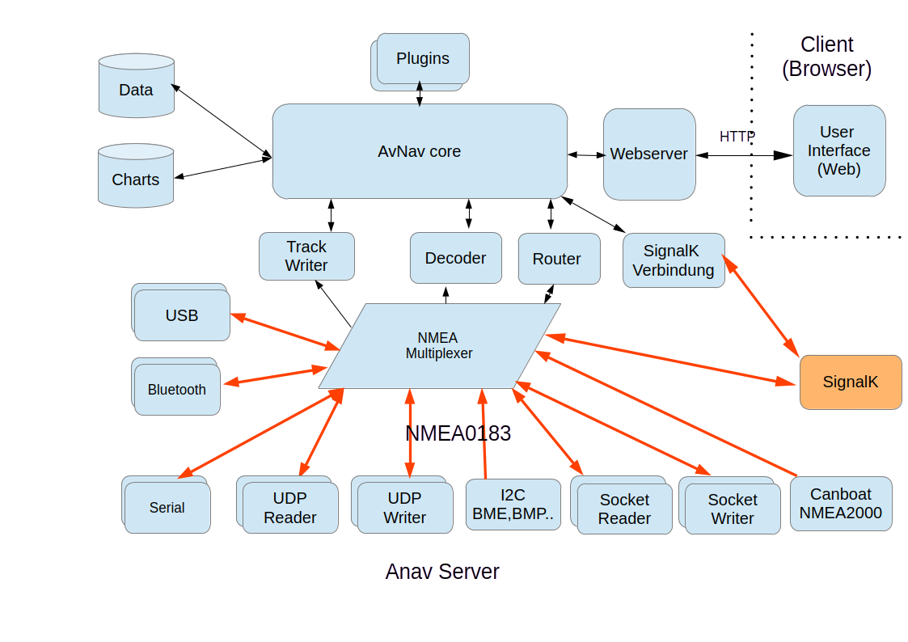

---
  tags:
    - Connections
    - Multiplexer
    - NMEA
    - NMEA0183
---

# Connections

To enable AvNav to process data from instruments, connections to onboard networks can be established. An introduction to this can be found under [Data flow](../base/dataflow.md).

This chapter describes some further details.

## Structure {: #structure}

As briefly described in the [introduction](../concept/clientserver.md), AvNav consists of a server part that processes and stores navigation data and charts, and a display part (client) that runs in a browser. The connections to the onboard networks are established in the server part.

///caption
Server structure
///

The image shows a rough structure of the components that make up the server software. For understanding the connections, the "NMEA Multiplexer" is particularly important. This component receives and distributes NMEA0183 data to and from various inputs and outputs. This distribution occurs regardless of whether AvNav itself can process this data.

This multiplexer works together with the "AvNav Core" - the part that decodes and stores the NMEA data, and performs routing functions as well as other navigation functions.

The multiplexer provides a range of filter functions.

To make data from the onboard networks available in AvNav, or to feed data generated by AvNav into them, connections must be configured (marked in red in the image above).

AvNav itself can only process NMEA0183 data. For connections to NMEA2000 bus systems, you can find further information under [NMEA2000](nmea2000.md).

Special notes on working with SignalK can be found in a [separate description](signalk.md).

## Connections page {: #channelspage}

The configuration of connections in AvNav is done via

{{MM("MMchannelspage")}}

///caption
Connections page
///

On this page, you can view, edit, delete, and add new connections.

The names of the connections differ slightly between Android and Linux/Windows, but the functions are largely identical.

In addition to connection-specific parameters such as the port for a TCP connection, you can also define a number of parameters that influence the handling of the data. This especially concerns the filter functions that the multiplexer possesses.

| Parameter | Description |
| --- | --- 
| name | A name for this connection. This name can be used if you do not want data received via this connection to be output on certain other connections (blacklist) |
| filter, readFilter | A filter that only allows certain messages through. See [Filter](configfile.md#filter)|
| priority | If, for example, position data is received via multiple connections, the values would overwrite each other in AvNav's internal data storage. If these differ, it leads to jumps in the display. With the priority, you can control which data wins (higher priority). Only when no such data has been received for some time will data with lower priority be used. The multiplexer passes the data on in any case. |

## Connection types

In the following table, you can click on the type name to get to the description of the configurable parameters.
Note: In some places under Linux/Windows, the names have a prefixed "AVN" - this has been omitted in the table.

| Name Linux/Windows| Name Android | Description |
| --- | --- | --- |
| [USBSerialReader](configfile.md#avnusbserialreader) | --- | Linux only. The management of detected USB devices with a serial profile. AvNav automatically detects such devices and configures them for data reception with automatic baud rate detection. You can also define special parameters for individual devices |
| --- | [UsbConnection](configfile.md#usbconnection) | Android only. When a USB device with a serial profile is connected, AvNav offers to use it. For this, permissions must be granted. Subsequently, the device can be configured in AvNav and used as an input or output |
| [BluetoothReader](configfile.md#avnbluetoothreader)| [Bluetooth](configfile.md#bluetooth)| Linux: Similar to USB devices, Bluetooth devices with a serial profile are detected and configured for data reception. Android: If a Bluetooth device is to be used, it must first be "paired". Afterwards, a connection to such a device can be created |
| [SocketWriter](configfile.md#avnsocketwriter)|[TcpWriter](configfile.md#tcpwriter)| A TCP server is configured. The port on which AvNav should accept connections must be specified. Additionally, it can be selected whether access is only possible locally or also from other computers (Android: `externalAccess`, Linux/Windows: `host 0.0.0.0`). Sending and receiving are possible - the default entry is: `send`.|
| [SocketReader](configfile.md#avnsocketreader) | [TcpReader](configfile.md#tcpreader) | A TCP client connection is configured to another system that is configured as a server. The IP address and port must be specified. Instead of the IP address, a host name can also be specified. In particular, a name of the form `name.local` - i.e., an mDNS address - can be used. Data can be received and sent. The default entry is: `receive`|
| [Nmea0183ServiceReader](configfile.md#avnnmea0183servicereader) | [NMEA0183 service](configfile.md#nmea0183service)| The same function as a SocketReader. Instead of an IP address and port, however, the name of a Bonjour service is specified (selection from a list). The advantage of this configuration is that the connections are automatically re-established, even if, for example, the Wi-Fi network being used changes. |
| [UdpReader](configfile.md#avnudpreader)|[UdpReader](configfile.md#udpreader)| AvNav opens a UDP socket and receives messages. It can be decided whether only messages from the own computer or also from other computers are received.(Android: `externalAccess`, Linux/Windows: `host 0.0.0.0`) |
| [UdpWriter](configfile.md#avnudpwriter) | [UdpWriter](configfile.md#udpwriter)| AvNav sends UDP messages to another system. IP address and port must be specified.|
| [SignalKhandler](configfile.md#avnsignalkhandler)| --- | A special connection to [SignalK](signalk.md). The data received from there does **not** go into the multiplexer, but only into the internal data storage|

## Sensor connections

Under Linux on the [AvNav Images](../installation/raspberry.md#images), some I2C sensors can also be configured.
These feed specific NMEA telegrams into the multiplexer.
See the description of the respective configuration for this.

* [BME280](configfile.md#avnbme280reader)
* [BMP180](configfile.md#avnbmb180reader)
* [SenseHat](configfile.md#avnsensehatreader)