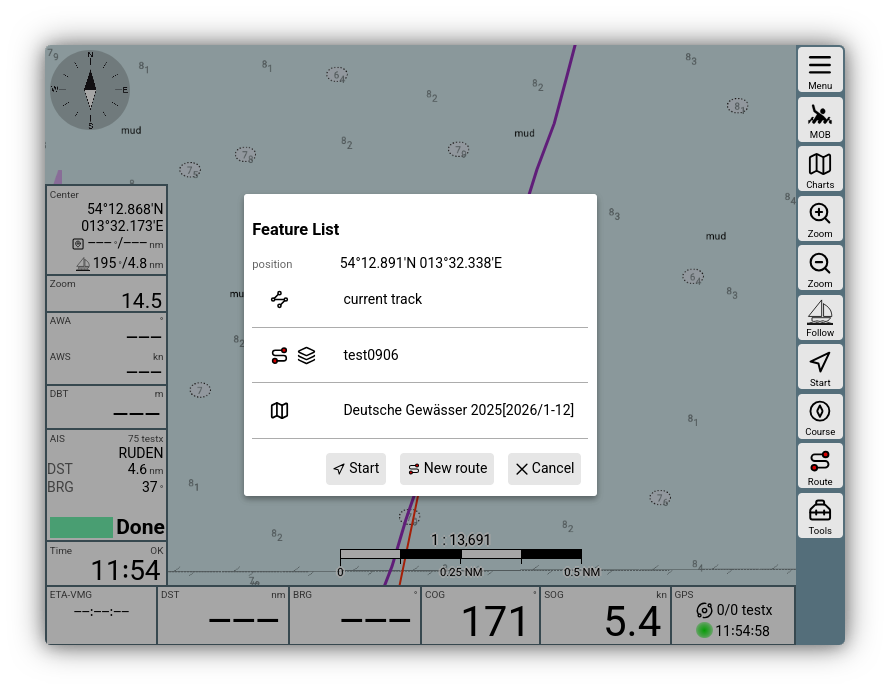
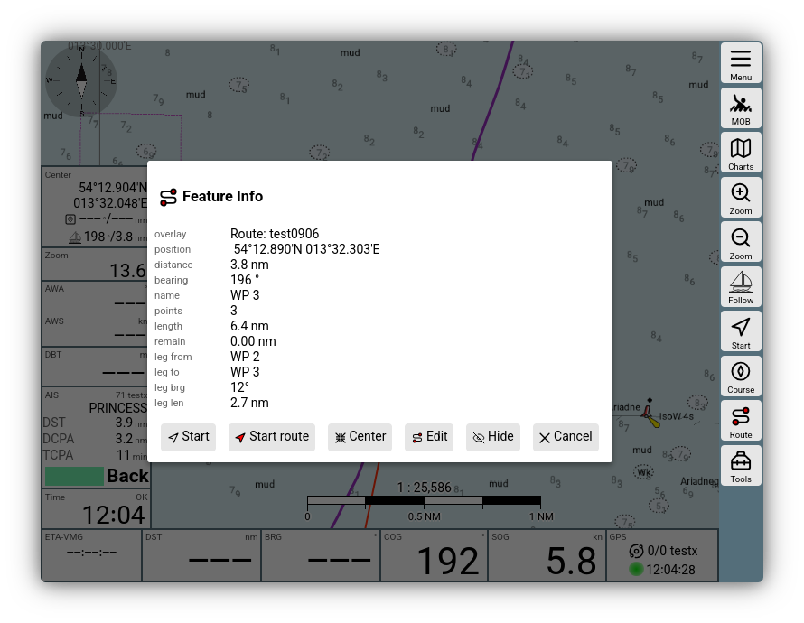
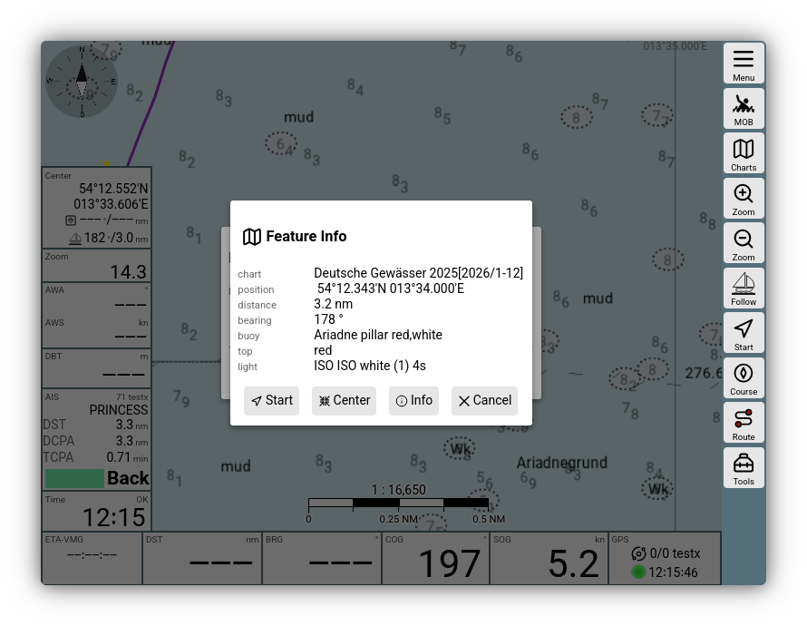

---
  tags:
    - Feature List
    - Feature Info
---

# Feature List and Feature Info

## Feature List

Clicking on the [map view](../base/navpage.md) opens a dialog with an overview of the map objects located in the vicinity.

.
///caption
Feature List
///

In this list, you will find all display layers that have objects at the clicked position. Clicking on one of these layers opens a second dialog with the details.

## Feature Info

The content of the detailed information depends on the display layer, e.g., the [overlay](overlays.md#featureInfo).

///caption
Feature Info Route
///

Here, the route "test0906", which is set up as an overlay on the map, was clicked. The dialog shows information about the route and a series of possible actions. These again depend on the selected object. All feature info dialogs offer a 

{{BT("WpGoto")}}

button, which starts immediate waypoint navigation to the selected object.

If you click on an [O-Charts](ochartsng.md) vector map, you get further information about the map objects directly.

///caption
Feature Info vector map
///

Via {{DB("DBInfo")}}, you can obtain complete information about the map objects here as well. See also the [O-Charts description](ochartsng.md#featureinfo).

## Customizations

The information displayed in a feature info can be customized by both [user JavaScript](userjs.md#featureFormatter) and [plugins](plugins.md). 

[Additional chart types](charts.md#owntypes) can also influence the display in the feature info. Using the {{DB("DBInfo")}} function, websites or external links can also be stored.