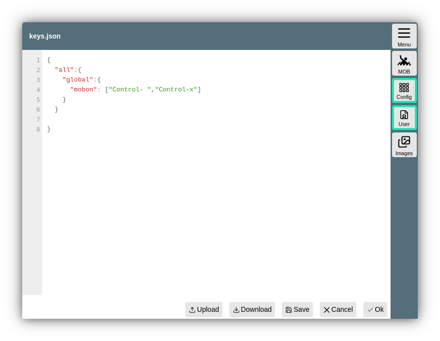

--- 
  tags:
    - Keyboard
    - Configuration
---
Keyboard support
================

AvNav provides support for operating important functions via keyboard shortcuts.
The mapping between keys and functions can be configured relatively freely.

Principle
-------

The mapping is handled via 3 levels:

1. Page  
   This is the page currently displayed in AvNav. A list of pages in AvNav can be found [in the code](https://github.com/wellenvogel/avnav/blob/master/viewer/util/pageids.ts).
   Using the special name "all", the function can be mapped to all pages.
2. Group  
   Here the functions are grouped again - e.g., "button".
3. Function  
   The actual function to be triggered, e.g., clicking a button.

One or more keys can be assigned to the respective functions. A more specific configuration takes precedence. For example, if there is a mapping for the page "all" and another for, e.g., the page "navpage", the latter wins.

Configuration
-------------

The mapping of keys is done via a file *keys.json* in the [user directory](userfiles.md).
This file can be edited directly there. There is also an [in-built file](https://github.com/wellenvogel/avnav/blob/master/viewer/static/keys.json) in AvNav with the default mappings.

In the file in the user directory, the values from the default file can be overridden.



With this example, the keys Ctrl-Space and Ctrl-x are assigned to the "Man Over Board" button on all pages.  
If only one key is to be assigned, no square brackets need to be specified. After saving the changes, the AvNav page must be reloaded, e.g., via 

{{BT("MainNav")}}->Actions->{{BT("ReloadUI",True)}}

Page groups and functions
-----------------------------

The list of pages, groups, and functions here is only the current state as of the time the documentation was created. More will be added bit by bit.

The names for the keys correspond to the values according to the [documentation](https://developer.mozilla.org/en-US/docs/Web/API/KeyboardEvent/key)<!--@@linkchanged-->.
If the Control key is pressed together with a key, a "Control-" is placed before the name.  
The names of the functions in the group "button" are the names of the buttons as they are documented in the [button list](../../buttons/buttons.md).  
A click on a widget can be achieved via the group "widgets" and the name of the widget. The names can be seen in the [layout editor](layout.md). An SOG widget, for example, would be clickable on all pages with the key "s" using:

```
"all":{  
 "widgets": {  
 "SOG": "s"  
 }  
}
```

The buttons in dialogs are accessible via the group "dialogButton" and the name of the button. This can be easily read from the HTML code, for example, using the browser's developer tools. However, one should only assign specific keys to "dialogButtons", as otherwise, normal value entry may potentially no longer be possible.

The following table lists the groups and functions that either already have a key assigned in the default settings or are neither a button, "dialogButton", nor a widget. Texts in parentheses in the table are notes on the function.

Assignments
-----------

| Page | Group | Function | Default Keys | Function |
| --- | --- | --- | --- | --- |
| all  | map | zoomIn | ["+","PageUp"] |
|  |  | zoomOut | ["-","PageDown"] |
|  |  | up | "ArrowUp" |
|  |  | down | "ArrowDown" |
|  |  | left | "ArrowLeft" |
|  |  | right | "ArrowRight" |
|  |  | lockGps (Map center to position) | "l" |
|  |  | unlockGps | "u" |
|  |  | toggleGps | ["t","Control-a"] |
|  |  | toggleCourseUp | "b" |
|  |  | centerToGps (one-time boat to map center) |  |
|  | alarm | stop | "a" |
|  | global | mobon | ["Control- "] |
|  |  | moboff |  |
|  |  | mobtoggle |  |
|  |  | anchoron (Anchor alarm on at current position, since 20220421) | "i" |
|  |  | anchoroff(since 20220421) | "Control-i" |
|  |  view | Cancel | "Escape" | goes back to the previous page |
|  |  | gpspage | "d" | goes to the dashboard page |
|  |  | navpage | "n" | goes to the map view |
|  |  | ... | ... | other pages can also be reached directly here if keys are configured for them |
|  | addon | signalk | "Control-0" | the group must display the name of the addon as it can be seen on the [UserApp configuration page](../base/userapps.md) |
|  |  | system-ochartsng-ui | "Control-1" |
|  |  | system-history-ui | "Control-2" |
|  |  | system-mapproxy-ui | "Control-3" |
|  | chartSelectList | previous | "ArrowUp" | select previous chart |
|  |  | next | "ArrowDown" | select next chart |
|  |  | select | "Enter" | choose selected chart |
|  | mainMenu | previous | "ArrowUp" | previous entry |
|  |  | next | "ArrowDown" | next entry |
|  |  | select | "Enter" | choose selected entry and close menu |
|  |  | Cancel | "x" | Close menu |
|  |  | page:navpage |  "n" | Open map view |
|  |  | page:gpspage |  "d" | Open dashboard view |
|  | multiview | left | "ArrowLeft" | Scroll display so that a new column is shown on the left |
|  |  | right | "ArrowRight" | Scroll display so that a new column is shown on the right |
|  |  | first | "Control-ArrowLeft" | Show first column (left) |
|  |  | last | "Control-ArrowRight" | Show last column (right) |
| gpspage (Dashboard) | button | Cancel | ["d","Escape"] |
|  |  |  Gps1 | "1" | Dashboard #1 |
|  |  |  Gps2 | "2" | Dashboard #2 |
|  |  |  Gps3 | "3" | Dashboard #3 |
|  |  |  Gps4 | "4" | Dashboard #4 |
|  |  |  Gps5 | "5" | Dashboard #5 |
|  |  |  Gps6 | "6" | Dashboard #6 |
|  |  |  Gps7 | "7" | Dashboard #7 |
|  |  |  Gps8 | "8" | Dashboard #8 |
|  |  |  Gps9 | "9" | Dashboard #9 |
|  |  |  Gps10 | "0" | Dashboard #10 |
| navpage (Navigation page) | widget | AisTarget | "a" | goes to [Ais Info](ais.md#aisinfo) |
|  |  | COG | "d" |goes to [Dashboard](../base/navpage.md#dashboards), with "d" you can toggle between navigation page and dashboard |
|  | button | LockMarker  | "g" | start navigation to map center |
|  |  | StopNav | "s" |
|  |  | ShowRoutePanel  | ["Control-r","r"] | go to [Route Editor](../base/routes.md) |
|  | map | centerToGps  | "c" | one-time boat to map center |
|  | page | centerToTarget  | "w" | current waypoint in map center |
|  |  | navNext  | ["n","Control-n"] | Navigation to next point in route |
|  |  | toggleNav  | ["Control-g"] | Navigation on/off |
|  | dialogButton | Cancel | "Escape" |