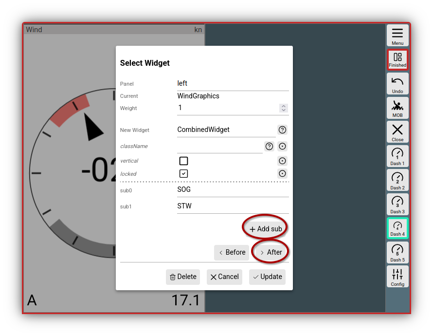
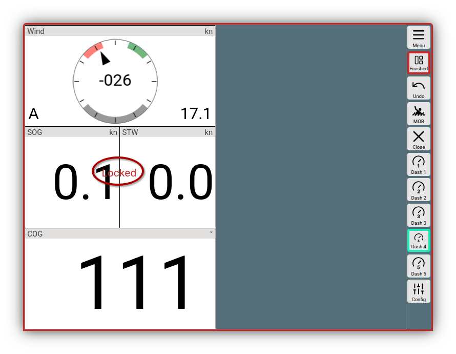
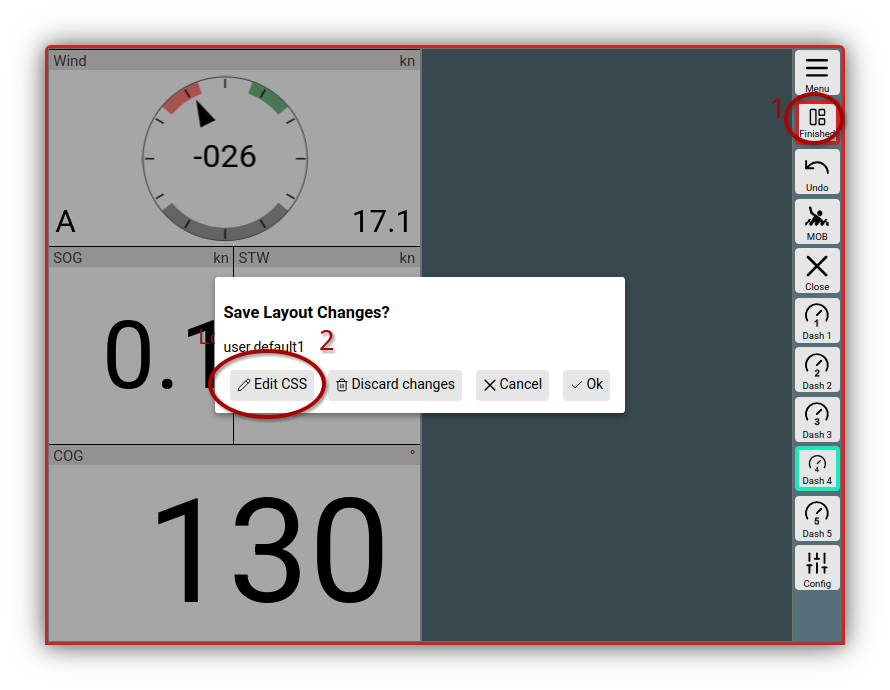
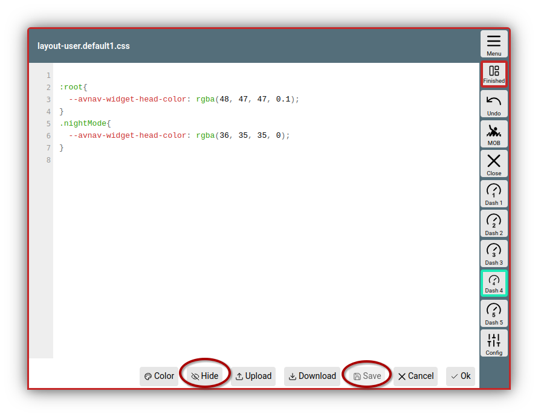
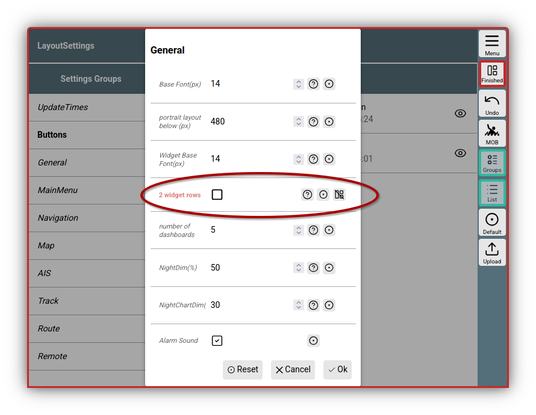

---
  tags:
    - Layout
    - CSS
---

# Details on layouts

An introduction to layouts including a video can be found [here](../base/layout.md). This document describes some further details regarding the layouts.

## Formatter {: #formatter}

Most widgets require a formatter for display, which converts the internal value into the desired representation. Usually, this is fixed for the widget. Some formatters accept parameters to adjust their behavior (e.g., m/s instead of kn).

The parameters for a formatter are visible in the dialog with the prefix "fmt:" - "fmt:unit" in the example.  
The list of available parameters is defined in the implementation of the formatter (see [User Formatter](userjs.md#formatter)).

If a formatter has a "unit" parameter, the value of this parameter is used to display it as the "unit" in the view. Some displays allow overriding this value in the dialog.

The following formatters are available:

|  |  |  |
| --- | --- | --- |
| Name | Description | Parameters |
| formatDecimal | Simple formatting as a decimal number | *fix*: minimum number of integer digits. *fract*: number of digits after the decimal point. *addSpace*: add a space before positive numbers. *prefixZero*: add 0 as a prefix to reach the number of digits before the decimal point. |
| formatDecimalOpt | Formatting of a decimal number. Decimal places are only displayed for non-integer values. | same as *formatDecimal* |
| formatDistance | Distance in nm|m|km | unit: nm - Distance in nm, m - Distance in m instead of nm, km - Distance in km instead of nm |
| formatSpeed | Speed in kn|m/s|km/h | unit: kn - knots, ms - m/s instead of kn, kmh - km/h instead of kn |
| formatDirection | Format a degree value | *inputRadian*: input in rad instead of degrees. *range180*: show +/- 180° instead of 0...360°. *leadingZero*: always show 3 digits |
| formatDirection360 | Format a degree value | *leadingZero*: always show 3 digits |
| formatTime | Format a time value (value must be a Date object internally) (`hh:mm:ss`) |  |
| formatClock | Format a time value (value must be a Date object internally) (`hh:mm`) |  |
| formatDateTime | Format date and time (value must be a Date object internally) |  |
| formatDate | Format date (value must be a Date object internally) |  |
| formatString | Passes the input through unchanged |  |
| formatTemperature | Format a temperature (since 20210106), input in Kelvin | unit: celsius, kelvin |
| formatPressure | Format a pressure (since 20210106), input in Pa | unit: pa, hpa, bar |

[Plugins](plugins.md#jscode) or custom [Extensions](userjs.md) may add further formatters if necessary.

## Changing system layouts

System layouts cannot be changed directly. However, you can create a copy of these layouts and adjust them. This can be done in two ways:

  1. If you have a system layout currently loaded:
     Under {{MM("MMlayoutspage")}} you can see the currently active layout in the top area under "Current". If you click the {{SB("Layout")}} button, you can start the layout editor via {{DB("DBEditLayout")}}.

     You will be asked for a new name for the layout to be edited. Once you have chosen a name, a copy of the system layout with this name is created and the layout editor is started.

  2. You can click on a system layout in the list of layouts and create a copy with {{DB("DBCopy")}}. This can then be loaded and edited directly.

## Combined widget {: #combinedwidget }

With the possibilities already shown in the [introduction](../base/layout.md), you can flexibly arrange displays to suit your needs. Sometimes, however, you may want to break the simple multi-column layout on the dashboard pages, for example, and distribute widgets across a different number of columns. The `Combined Widget` can help with this. It acts as a container in which you can arrange any number of "children" horizontally or vertically.

///caption
Combined Widget
///

In the picture, the Combined Widget was selected as a new widget, and `SOG` and `STW` were added via {{DB("DBAddSub")}}. With {{DB("DBAfter")}}, the `Combined Widget` is inserted.

///caption
Combined Widget inserted
///

This has achieved that the widgets for `STW` and `SOG` only take up half a column width each - but the `WindGraphics` and `COG` widget use the full width.

The `Combined Widget` is currently in the _Locked_ state - you can now move it as a whole and all contained children move with it. If you unlock the _Locked_ state in the dialog, the children can be moved individually and you can also move other widgets into it directly. 

In principle, you can even nest multiple `Combined Widgets` within each other - this does, however, become a bit confusing during configuration.

## CSS {: #layoutcss }

For adjustments using [CSS](usercss.md), it can sometimes make sense to include them directly in a layout - they will then only be effective when this layout is loaded. Different displays can, of course, use different layouts. For this, a CSS editor can be called up via:

{{BT("LayoutFinished")}}->{{DB("DBEditCss")}}

///caption
Call Layout CSS Editor
///

It is recommended to perform this call on the page where you want to see the layout adjustments. Unlike the handling of [User CSS](usercss.md), changes to the CSS after saving are **only** effective in the current AvNav window.

///caption
Layout CSS Editor
///

As described under [User CSS](usercss.md), you can make the desired adjustments here. After saving, you can make the editor window transparent with {{DB("DBHide")}} to directly verify your CSS changes.

You can, for example, also adjust the width (`--avnav-left-widgets-width`) (or height - `--avnav-horizontal-widgets-height`) of the widget containers on the navigation page - and then design them very flexibly with the [Combined Widget](#combinedwidget).

The CSS data is stored directly in the layout and is not visible as separate files in AvNav.

All changes are only permanently saved when the layout is saved at the end of the editing process.

## Display settings {: #display-settings}

There are some [settings](../base/settings.md) that may significantly influence a layout. A typical candidate is the "2 widget rows" setting under "General". This determines whether two rows of widgets are displayed at the bottom of the navigation page if there is not enough space otherwise. If you want to prevent this for a specific layout, you can call the settings while **editing the layout**, e.g., with:

{{MM("MMsettingspage")}}

and change the desired value.

///caption
Layout Display Settings
///

If you now save the settings with {{DB("DBOk")}}, they are saved directly in the layout. They are displayed in red during editing. If you click {{SB("SettingsLayoutOff")}}, the setting is removed from the layout again - and the setting chosen by the user applies.

You should use this function very sparingly and only set settings directly in the layout that are absolutely necessary. When you leave the layout editor, these settings can no longer be changed via the normal menus - only by calling the layout editor again.

## Loading and saving to/from the server {: #save}

When you edit a layout, it is changed locally and also saved on the server. You have already chosen the layout name when starting the layout editor. However, it does **not** immediately take effect on all other display devices. It only takes effect there if the AvNav page is reloaded with: 

{{MMA("ReloadUI")}} 

- or the layout is explicitly selected and activated again:

{{MM("MMlayoutspage")}}

{{DB("DBActivate")}} after clicking on the layout in the list.

The other display devices still have their layout stored in the browser's [localStorage](https://developer.mozilla.org/en-US/docs/Web/API/Window/localStorage) <!--@@linkchanged-->.

If a layout is deleted on the server, the display devices will continue to work with the locally stored layout. Only if such a layout is no longer present will they revert to the `system-default` layout.

If such a still-existing layout is edited on a display device after deletion (layout editor), it will be saved on the server again.

To back up the layouts, you can download them as a JSON file after clicking on a layout. You can also import such a locally stored layout back into AvNav, i.e., upload it to the server, via the {{BT("Upload")}} button.