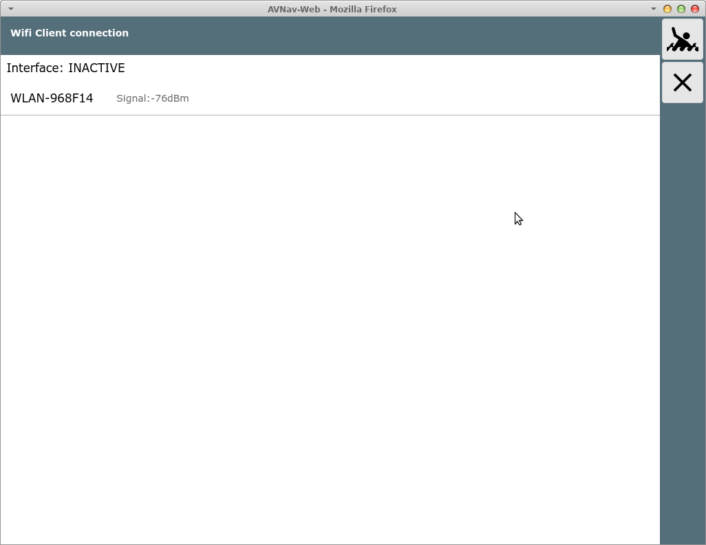
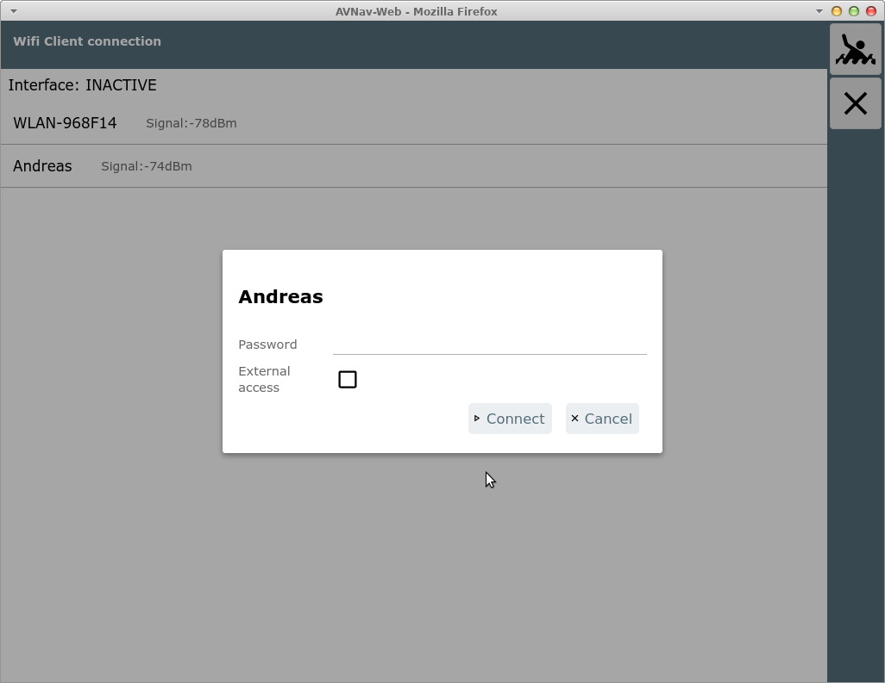

---
  tags:
    - Configuration
    - Wifi
    - Bookworm
---

The legacy wifi configuration page
==================================
__Attention:__
This page describes the AvNav wifi configuration on [AvNav Bookworm images](../installation/raspberry.md#images). On images for Trixie (and newer), there is a [new configuration](serverpage.md#wifi).


From the [server page](serverpage.md) you can reach this page using the
button {{BT("StatusWpa")}}.



This page is only displayed if the wifi client handling is configured in the *avnav_server.xml* (the default entry is *on*). You can only configure connections if a WLAN adapter has been plugged into the correct USB socket or if *InternalWifi as Client* has been set to "yes" in the [*avnav.conf*](../installation/raspberry.md#preparation).


The image shows a Raspberry Pi 3. On newer Raspis with USB 3.0 (blue sockets), the adapter must be plugged into the blue USB 3.0 socket on the circuit board side.

At the system level, a WLAN "wlan-av1" must be visible. In the configuration in the *avnav_server.xml* file, an entry in the form

```
<AVNWpaHandler wpaSocket="/var/run/wpa_supplicant/wlan-av1">
</AVNWpaHandler>
```

must be present.

On the wifi client connection page, all WLANs within range or configured are displayed.

By clicking on a displayed WLAN, a connection can be established.



If external access to the Raspberry is required, "External Access" can be switched on here.

**Attention: This should not be activated in public WLANs, as AvNav does not offer any special protection and anyone in the same WLAN can access it unhindered.**   

However, it can be used, for example, if you use an LTE router and your own devices are to be connected directly to it.

When the connection has been established, this is indicated accordingly; the connected network is then highlighted in gray.


During the connection process, status information is displayed under "Interface".

If you want to disconnect the WLAN, you can disconnect, deactivate, or completely remove the network from the configuration by clicking on the network again.


The WLAN information is stored in the file
/etc/wpa_supplicant/wpa_supplicant.conf.