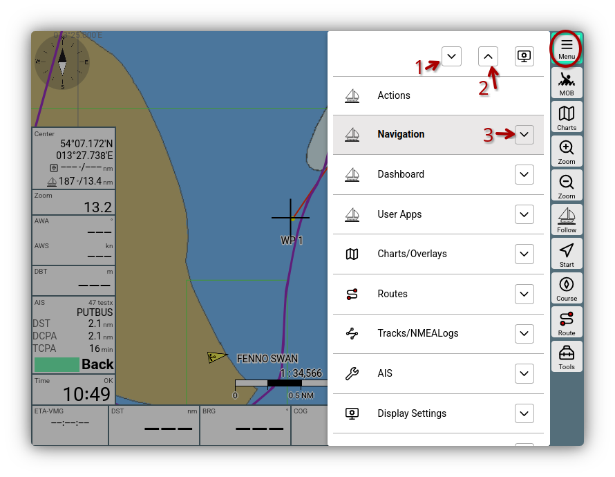
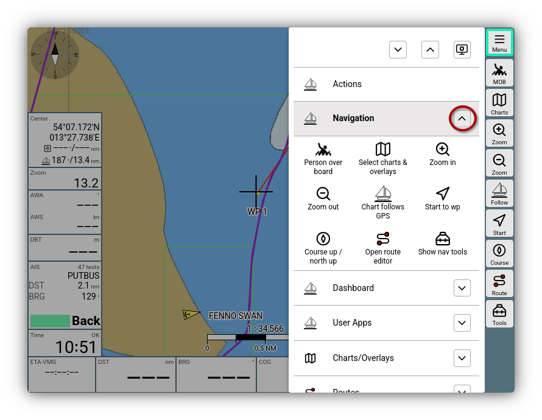

---
  tags:
    - Main Menu
    - Pages
---

# Main Menu

On all pages in AvNav, you can access the main menu using the {{BT("MainNav")}} button.

///caption
Main Menu
///

## Buttons

The main entries can be scrolled. You can trigger further functions via the buttons marked in the image:

  * (1) {{ICON("MNCollapsed")}}: Open the extended view for all entries. It displays the most important buttons for each page for quick access.
  * (2) {{ICON("MNExpanded")}}: Close all extended views.
  * (3) {{ICON("MNCollapsed")}}: Open the extended view for this page.

The {{ICON("Settings")}} button allows you to adjust the [Display Settings](../base/settings.md) for the main menu.

## Extended View

After opening the extended view, you get the most important buttons of the page along with a longer description text - just as shown in a tool tip.

///caption
Main menu extended view
///

By clicking on the respective button, the corresponding page in AvNav is opened and the button function is executed.

## Entries

| Entry | Description |
| --- | --- |
| {{MB("MM:actions")}} | Open the [Action Menu](../base//navpage.md#actions-buttons) |
| {{MB("MMnavpage")}} | Open the [Navigation Page](../base/navpage.md) |
| {{MB("MMgpspage")}} | Open the [Dashboard Pages](../base/navpage.md#dashboards) |
| {{MB("MMaddonpage")}} | Open the [User App Page](../base/userapps.md) |
| {{MB("MMchartspage")}} | Open the [Chart Management](../base/charts.md#management) |
| {{MB("MMroutepage")}} | Open the [Route Management](../base/routes.md#management) |
| {{MB("MMtrackspage")}} | Open the [Management of Tracks and NMEA Logs](tracks.md) |
| {{MB("MMaiscfgpage")}} | Open the [AIS Configuration and Display](ais.md) |
| {{MB("MMsettingspage")}} | Open the [Display Settings](../base/settings.md) |
| {{MB("MMlayoutspage")}} | Open the [Layout Management](../base/layout.md) (also starts the Layout Editor) |
| {{MB("MMpluginspage")}} | Open the [Plugin Management](plugins.md#installation) | 
| {{MB("MMaddonconfigpage")}} | Open the configuration page for [User Apps](../base/userapps.md), for [User CSS](usercss.md), for [User JavaScript](userjs.md), and the configuration of [Keyboard Shortcuts](keyboard.md) or [Icons](usericons.md) |
| {{MB("MMchannelspage")}}| Open the [Management of (NMEA) Connections](connections.md) |
| {{MB("MMserverpage")}} | Open the [Server Management](serverpage.md) |
| {{MB("MMremotepage")}} | Open the [Management for Remote Control](remotecontrol.md) |