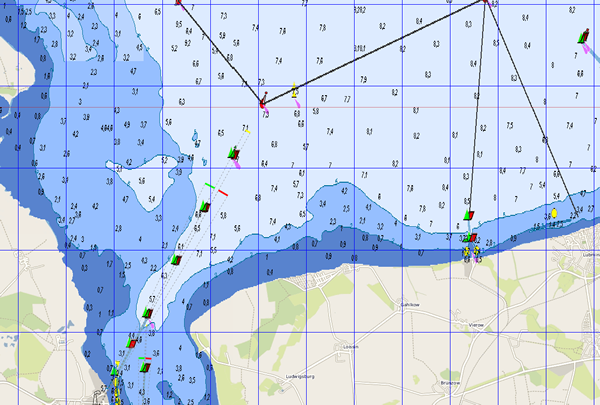

---
  tags:
    - Maps
---
Mobile Atlas Creator Mapsources {: #Mobac}
==========================================

2022/04/17  
Adjustments for mobac 2.2.2

2021/08/22  
Adjustments for mobac 2.2x, adjustment for new BSH layers

2020/01/26  
Further minor modifications to the map sources so that access
to the BSH servers works again.

Sources
-------

For the [Mobile Atlas Creator](https://mobac.sourceforge.io/)
I have created some map sources that allow defining access to map services
more flexibly via *XML*. To do this, unzip the file [avnav-mapsources.zip]({{DLLINK("avnav-mapsources.zip")}})
in the "mapsources" directory of the Mobile Atlas Creator.   
For Mobac version 2.2.1 please use the file [avnav-mapsources-before222.zip]({{DLLINK("avnav-mapsources-before222.zip")}}).  
For Mobac versions < 2.2.1 please use the file [avnav-mapsources-before22.zip]({{DLLINK("avnav-mapsources-before22.zip")}}).

This provides, among other things, a "MeshUp" of the BSH map services - see also [bsh-viewer]({{HPLINK("../bshviewer/bshviewer.html")}}) and OpenSeaMap
("BSH OpenSeaMap 2021 Extended"), as well as BSH alone ("BSH 2021
Extended") or OpenSeaMap + OpenStreetMap ("OWS OpenSeaMap 2021"). 

If anyone wants to "play around," you can adjust the **.exml* files accordingly.
The layers for the BSH query are particularly exciting. You can try them out
with my [BSH-Viewer]({{HPLINK("../bshviewer/bshviewer.html")}}): Edit the source on the right! You can also adjust the colors if necessary - I tried to
create a bit more contrast. If you want to change something - open one of the maps
with *paint.net*, for example, then look up the hex values for the colors
and enter them in the *.exml* file.

The download usually takes quite a long time - often the BSH server is very
slow or prone to crashing. If that happens, just try again:
To do this, set the cache settings in Mobac so that maps are kept in the cache for, e.g.,
1 month - eventually they will all be downloaded. Always choose "OsmdroidGEMF" as the format now. By the way, you can also use this in
other programs...

If you change the **.exml* files, especially the layers, you
must delete the corresponding caches under *Tilestore* - otherwise
the changes will not take effect.

Source files on [github](https://github.com/wellenvogel/avnav/tree/master/mobac/testsrc).

The result looks like this, for example. The map shows the entrance to Greifswald:

Here are the files again:

* [avnav-mapsources.zip]({{DLLINK("avnav-mapsources.zip")}})
  (the mapsources BSH, BSH+OpenSeaMap)