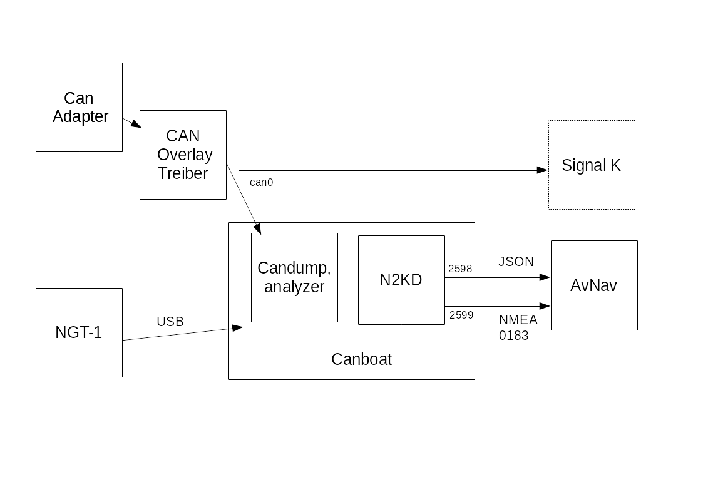

---
  tags:
    - Canboat
    - Nmea2000
---
# AvNav and NMEA2000
AvNav cannot process NMEA2000 data directly on its own. To work together with NMEA2000 systems, there are several possibilities:

| Variant | Description | System |
| --- | --- | --- |
| [Canboat](#Canboat) | AvNav can **receive** NMEA2000 data via [canboat](https://github.com/canboat/canboat). Sending is not possible. | [RaspberryPi](../installation/raspberry.md), [Linux](../installation/linux.md) |
| [SignalK](#SignalK) | AvNav can receive all data from [SignalK](https://signalk.org/). Data coming from AvNav (e.g. waypoints) can also be sent in NMEA2000 format via SignalK. | [RaspberryPi](../installation/raspberry.md), [Linux](../installation/linux.md), [Windows](../installation/windows.md) (if SignalK is running on an accessible system) |
| [External conversion](#extern)| An external converter can translate NMEA2000 data to NMEA0183 (and usually back), it can be connected via TCP, UDP or USB| all systems |

Canboat {: #Canboat}
-------------------------------

With [canboat](https://github.com/canboat/canboat), you can use CAN adapters connected to the Raspberry Pi or another Linux system (e.g. with [MCP2515](https://www.reichelt.de/entwicklerboards-can-modul-mcp2515-mcp2562-debo-can-modul-p239277.md) or a [Waveshare RS485 CAN-HAT](https://www.waveshare.com/wiki/RS485_CAN_HAT)) or adapters connected via USB (e.g. Actisense NGT-1). For simple CAN adapters, make sure they have two power supplies (3.3V and 5V) - many very simple ones do not!



The image shows the basic setup as provided by the [headless images](../installation/raspberry.md#images).

For a [CAN adapter](https://www.raspberrypi.org/forums/viewtopic.php?t=141052) connected via [SPI](https://www.raspberrypi.org/documentation/hardware/raspberrypi/spi/README.md), an overlay usually still needs to be enabled in the */boot/config.txt* file. Corresponding entries are already prepared for the MCP2515 and just need to be uncommented. If necessary, the clock frequency and the GPIO pin used for the interrupt must be changed.

This CAN adapter then appears as a network interface. It may need to be configured accordingly - this is already prepared in the images.

The interface should be visible with the command:

```
ip link show can0
```

For an Actisense NGT-1 connected via USB, see the [description at Canboat](https://github.com/canboat/canboat/wiki/actisense-serial).

AvNav communicates with the [*n2kd*](https://github.com/canboat/canboat/wiki/n2kd). This converts received NMEA2000 data into NMEA0183 (not entirely complete). The configuration for n2kd is done via the file

```
/etc/default/n2kd
```

A connection to *can0* is prepared here in the images. For an adapter connected via USB, this file must be changed. If such a USB adapter for NMEA2000 is connected, it should be set to "ignore" in the configuration for the USBSerialReader so that it is not used there - observe the [Connection/Devices page](connections.md) when plugging it in and configure accordingly.

If everything is configured correctly, NMEA data or JSON data should be visible on ports 2599 and 2598 if there is NMEA2000 traffic on the bus.

This can be checked, for example, with the command:

```
nc localhost 2599
```

Otherwise, check the status of Canboat with

```
sudo systemctl status canboat
```

Two connections to the *n2kd* should be configured for AvNav. The server receives the NMEA0183 data via one connection (port 2599) and some JSON data directly via the other connection (port 2598). This is necessary because *n2kd* does not output an NMEA data record with a date (e.g. RMC). To obtain the date, AvNav can directly read the PGNs 126992, 129029 to set the date and time internally. AvNav can also generate an RMC data record from this if valid position data is received via NMEA.

The direct query of the NMEA2000 data is carried out via a plugin, so the *builtin-canboat* plugin must be *enabled* under "Plugins". The plugin is already available in the images. For receiving NMEA data, an *AVNSocketReader* must be created in the *Connections/Devices* area - "localhost" should be entered as the host and "2599" as the port. A name for the reader such as "canboatnmea" or similar should be assigned.

This is already preconfigured in the [images](../installation/raspberry.md#images). If the NMEA2000 data is also sent directly to SignalK, a blacklist with the names of the socket reader on port 2599 and the *builtin-canboat* plugin should potentially be created for the SocketWriter on port 34568, so that the NMEA2000 data is not also sent to SignalK via NMEA0183.

Sending data via NMEA2000 is not currently planned; this can possibly be configured via SignalK.

SignalK {: #SignalK}
--------------------
The Linux and Windows versions of AvNav can also receive data from a SignalK server. This can run on the same system or on another system that is accessible via the network. For details, see the description of the [SignalK Integration](signalk.md).

External Converters {: #extern}
-------
There are various products with which NMEA2000 data can be converted into NMEA0183 data (and back). Depending on the product, they are connected via the WiFi network (via UDP or TCP) or via USB or NMEA0183 serial.

In addition to commercial solutions, there are also open-source projects for this purpose. An example is the [NMEA2000 Gateway on ESP32](https://github.com/wellenvogel/esp32-nmea2000). With this project, you can assemble an NMEA2000 <-> NMEA0183 converter with just a few components without any soldering. This system has been explicitly tested with AvNav. You can connect the converter to AvNav via WiFi as well as, for example, via USB. This is a simple solution, especially for the AvNav Android app.