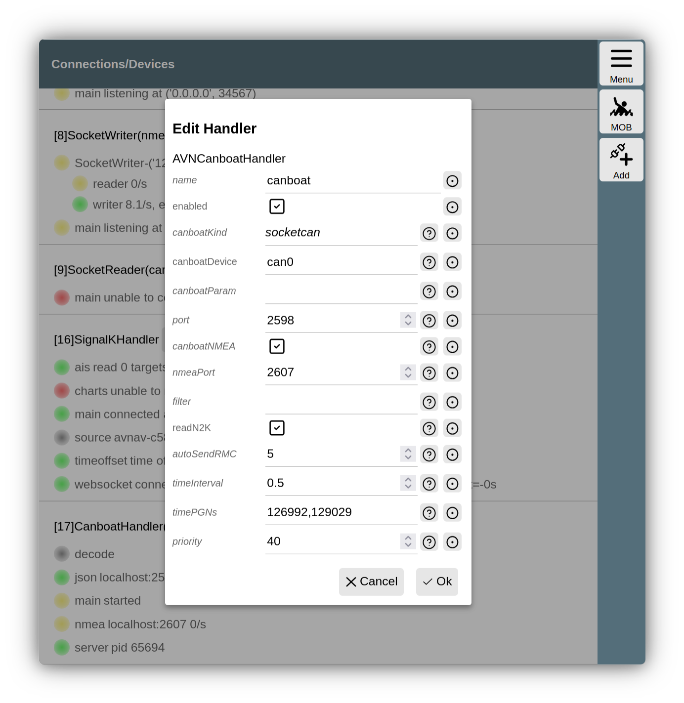

---
  tags:
    - Canboat
    - Nmea2000
---
# AvNav and NMEA2000
AvNav cannot process NMEA2000 data directly on its own. To work together with NMEA2000 systems, there are several options:

| Variant | Description | System |
| --- | --- | --- |
| [Canboat](#Canboat) | AvNav can **receive** NMEA2000 data via [canboat](https://github.com/canboat/canboat). Sending is not possible. | [RaspberryPi](../installation/raspberry.md), [Linux](../installation/linux.md) |
| [SignalK](#SignalK) | AvNav can receive all data from [SignalK](https://signalk.org/). Via SignalK, data originating from AvNav (e.g., waypoints) can also be sent in NMEA2000 format. | [RaspberryPi](../installation/raspberry.md), [Linux](../installation/linux.md), [Windows](../installation/windows.md) (if SignalK is running on an accessible system) |
| [External conversion](#extern)| An external converter can translate NMEA2000 data to NMEA0183 (and usually back), it can be connected via TCP, UDP, or USB | all systems |

## Canboat {: #Canboat}

With [canboat](https://github.com/canboat/canboat), CAN adapters connected to the Raspberry Pi or another Linux system (e.g., with [MCP2515](https://www.reichelt.de/entwicklerboards-can-modul-mcp2515-mcp2562-debo-can-modul-p239277.md) or a [Waveshare RS485 CAN-HAT](https://www.waveshare.com/wiki/RS485_CAN_HAT)) or USB-connected adapters (e.g., Actisense NGT-1) can be used. For the simple CAN adapters, it is important to ensure that they have two power supplies (3.3V and 5V) - many very simple ones do not have this!


The image shows the basic setup as provided by the [headless images](../installation/raspberry.md#images).

For a [CAN adapter](https://www.raspberrypi.org/forums/viewtopic.php?t=141052) connected via [SPI](https://www.raspberrypi.org/documentation/hardware/raspberrypi/spi/README.md), an overlay usually still needs to be enabled in the */boot/config.txt* file. Corresponding entries are already prepared for the MCP2515; these just need to be uncommented. If necessary, the clock frequency and the GPIO pin used for the interrupt must be changed.

This CAN adapter then appears as a network interface. It may need to be configured accordingly - this is already prepared in the images.

The interface should be visible with the command:

```
ip link show can0
```

### CanboatHandler {: #handler}

In the current versions, AvNav uses [canboat-rust](https://canboat.github.io/canboat/server.html). Normally, the corresponding package is installed for this.

If you still want to work with the legacy canboat [*n2kd*](https://github.com/canboat/canboat/wiki/n2kd), please refer to the [legacy documentation]({{OLDLINK("hints/CanboatAndSignalk.html:h2:CanboatNMEA2000")}}). However, the configuration must be done via the AVNCanboatHandler as described here.

The connection to canboat is provided by the AVNCanboatHandler. It is accessible via the page

{{MM("MMchannelspage")}}

By default, it is initially disabled.
To activate it, edit the handler.


///caption
Canboat handler configuration
///

Important values here are `canboatKind` and `canboatDevice`. These define which device is addressed with which protocol.
A description of all parameters can be found in the [server configuration](configfile.md#avncanboathandler).
If required, parameters for the used command [`canboat server`](https://canboat.github.io/canboat/server.html) can also be specified directly.

The AVNCanboatHandler starts the canboat server directly and monitors whether it is running. In case of problems, you can search for the output from the canboat command in the AvNav log file via the page

{{MM("MMserverpage")}}->{{BT("StatusLog")}}

Depending on the configuration, the handler establishes a connection to the NMEA port of canboat to receive NMEA0183 data from there. This is the standard configuration and should suffice in most cases.

If the NMEA0183 data should not reach AvNav or does not contain position or time data, you can also activate the direct decoding of some NMEA2000 data (`readN2K`). When activated, AvNav can also generate RMC records if necessary, provided no RMC is present in the NMEA data available in AvNav.

### Interaction with SignalK

If the NMEA2000 data is also routed directly to SignalK, a blacklist with the name of the AVNCanboatHandler (default: `canboat`) should be entered for the SocketWriter used for this purpose (default on port 34568) so that the NMEA2000 data is not sent to SignalK via NMEA0183 a second time.

Sending data via NMEA2000 is not currently provided; this can potentially be configured via SignalK.

## SignalK {: #SignalK}
The Linux and Windows versions of AvNav can also receive data from a SignalK server. This can run on the same system or on another system that is accessible via the network. For details, see the description of the [SignalK integration](signalk.md).

## External converters {: #extern}

There are various products with which NMEA2000 data can be converted into NMEA0183 data (and back). Depending on the product, they are connected via the Wi-Fi network (via UDP or TCP) or via USB or NMEA0183 serial.

In addition to commercial solutions, there are also open-source projects for this purpose. One example is the [NMEA2000 Gateway on ESP32](https://github.com/wellenvogel/esp32-nmea2000). With this project, one can assemble an NMEA2000 <-> NMEA0183 converter with just a few components and no soldering required. This system has been explicitly tested with AvNav. You can connect the converter to AvNav via Wi-Fi as well as, for example, via USB. This is a simple solution, especially for the AvNav Android App.