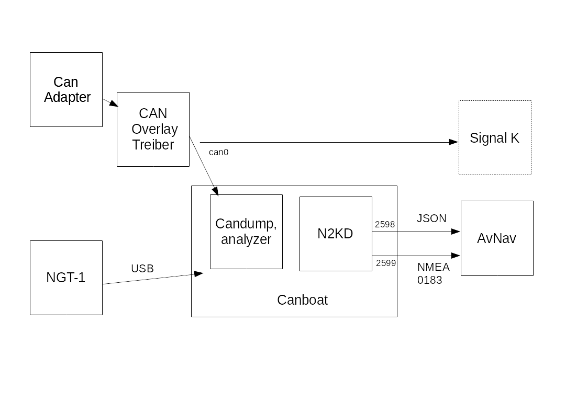
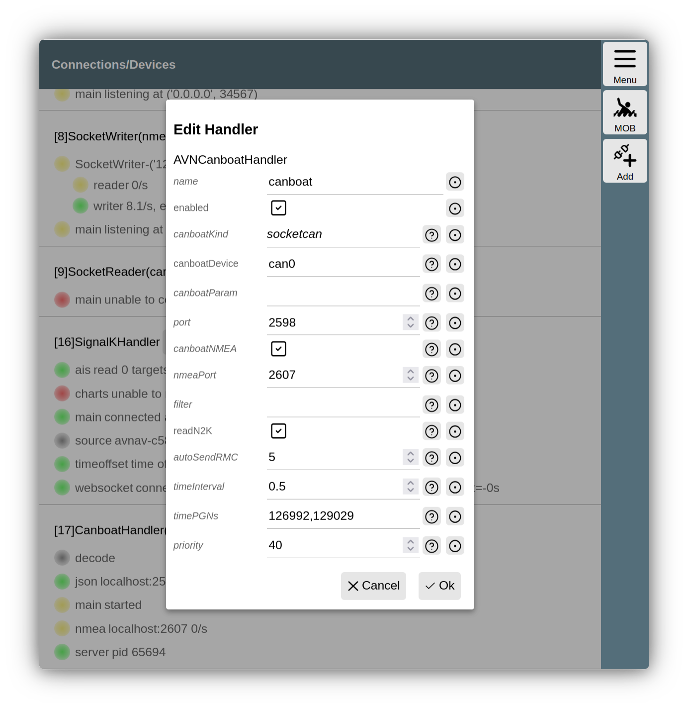

---
  tags:
    - Canboat
    - Nmea2000
---
# AvNav and NMEA2000
AvNav cannot natively process NMEA2000 data directly. To work in conjunction with NMEA2000 systems, there are several options:

| Variant | Description | System |
| --- | --- | --- |
| [Canboat](#Canboat) | AvNav can **receive** NMEA2000 data via [canboat](https://github.com/canboat/canboat). Sending is not possible. | [RaspberryPi](../installation/raspberry.md), [Linux](../installation/linux.md), [Windows](#windows) |
| [SignalK](#SignalK) | AvNav can receive all data from [SignalK](https://signalk.org/). Via SignalK, data originating from AvNav (e.g., waypoints) can also be sent in NMEA2000 format. | [RaspberryPi](../installation/raspberry.md), [Linux](../installation/linux.md), [Windows](../installation/windows.md) (if SignalK is running on an accessible system) |
| [External conversion](#extern)| An external converter can translate NMEA2000 data to NMEA0183 (and usually back); it can be connected via TCP, UDP, or USB | all systems |

## Canboat {: #Canboat}

With [canboat](https://github.com/canboat/canboat), you can use CAN adapters connected to the Raspberry Pi or another Linux system (e.g., with [MCP2515](https://www.reichelt.de/entwicklerboards-can-modul-mcp2515-mcp2562-debo-can-modul-p239277.md) or a [Waveshare RS485 CAN-HAT](https://www.waveshare.com/wiki/RS485_CAN_HAT)) or adapters connected via USB (e.g., Actisense NGT-1). For simple CAN adapters, ensure they have two power supplies (3.3V and 5V) - many very simple ones do not!



The image shows the basic setup as provided by the [headless images](../installation/raspberry.md#images).

For a [CAN adapter](https://www.raspberrypi.org/forums/viewtopic.php?t=141052) connected via [SPI](https://www.raspberrypi.org/documentation/hardware/raspberrypi/spi/README.md), an overlay usually needs to be enabled in the */boot/config.txt* file. Corresponding entries are already prepared for the MCP2515 and simply need to be uncommented. You may need to change the clock frequency and the GPIO pin used for the interrupt.

This CAN adapter then appears as a network interface. It might need to be configured accordingly - this is already prepared in the images.

The interface should be visible with the command:

```
ip link show can0
```

### CanboatHandler {: #handler}

In the current versions, AvNav uses [canboat-rust](https://canboat.github.io/canboat/server.html). Normally, the corresponding package is installed for this purpose. 

If you still want to work with the legacy canboat [*n2kd*](https://github.com/canboat/canboat/wiki/n2kd), please read the [legacy documentation]({{OLDLINK("hints/CanboatAndSignalk.html:h2:CanboatNMEA2000")}}). However, the configuration must be carried out as described here via the AVNCanboatHandler.

The connection to canboat is provided by the AVNCanboatHandler. It can be accessed via the page:

{{MM("MMchannelspage")}}

By default, it is initially disabled. To activate it, edit the handler.


///caption
Canboat handler configuration
///

Important values here are *canboatKind* and *canboatDevice*. These define which device is addressed with which protocol. A description of all parameters can be found in the [server configuration](configfile.md#avncanboathandler). If necessary, parameters can be passed directly to the [`canboat server`](https://canboat.github.io/canboat/server.html) command used.

If you specify `actisense` as *canboatKind*, you must specify a serial device for *canboatDevice*. Typically, you should specify a device using `/dev/serial/by-path/...` so that it is reliably recognized even after a restart.

If this is a device connected via USB, you must ensure that the [AVNUSBSerialReader](configfile.md#avnusbserialreader) does not also attempt to access this device. The simplest way to do this is to open the page:

{{MM("MMchannelspage")}}

observe the entry for AVNUSBSerialReader, and plug in the device. Once the AVNUSBSerialReader has recognized the device, click {{ICON("Edit")}} next to the device and set the *type* to `ignore`. The USBSerialReader will then no longer consider this device.

After saving the settings, the AVNCanboatHandler starts the canboat server directly and monitors whether it is running. In case of problems, you can search for the output of the canboat command in the AvNav log file via the page:

{{MM("MMserverpage")}}->{{BT("StatusLog")}}

Depending on the configuration, the handler establishes a connection to the NMEA port of canboat to receive NMEA0183 data from there. This is the standard configuration and should be sufficient in most cases.

If the NMEA0183 data should not reach AvNav or does not contain position or time data, you can also activate direct decoding of some NMEA2000 data (`readN2K`). When enabled, AvNav can also generate RMC data records if no RMC is present in the NMEA data available in AvNav.

### Windows

To use canboat on Windows, you must first install it. You can download the appropriate Windows program (e.g., `canboat-rust-windows-x86_64.exe`) from the [GitHub release page](https://github.com/canboat/canboat/releases/). After downloading, copy it to a directory that is in your search path and rename it to `canboat.exe`.

If you do not know your search path, you can find it by opening a command prompt (`cmd`) and typing:
```
echo %PATH%
```

Alternatively, you can check the environment variables under System/Edit System Environment Variables (PATH).

You can also create a new directory (e.g., under AppData\Local), copy the file there, and then adjust your search path. After such an adjustment, the [avnavservice](../installation/windows.md) must be restarted once.

Under Windows, `socketcan` will typically not work - but `actisense` will, for example. For *canboatDevice*, you would enter something like `COM5` - you can find this in the Device Manager after plugging in the USB stick.

### Interaction with SignalK

If the NMEA2000 data is also sent directly (outside of AvNav) to SignalK, you should add a blacklist with the name of the AVNCanboatHandler (default: `canboat`) to the SocketWriter used for sending NMEA0183 data to SignalK (default on port 34568) so that the NMEA2000 data is not sent to SignalK again via NMEA0183.

Sending data via NMEA2000 is not currently supported; this may be configured via SignalK if necessary.

## SignalK {: #SignalK}
The Linux and Windows versions of AvNav can also receive data from a SignalK server. This can run on the same system or on another system accessible via the network. For details, see the description of the [SignalK integration](signalk.md).

## External converters {: #extern}

There are various products with which NMEA2000 data can be converted into NMEA0183 data (and back). Depending on the product, they are connected via the Wi-Fi network (via UDP or TCP) or via USB or NMEA0183 serial.

In addition to commercial solutions, there are also open-source projects for this purpose. One example is the [NMEA2000 Gateway on ESP32](https://github.com/wellenvogel/esp32-nmea2000). With this project, you can assemble an NMEA2000 <-> NMEA0183 converter with a few components without any soldering. This system has been explicitly tested with AvNav. You can connect the converter to AvNav via Wi-Fi as well as, for example, via USB. This is a simple solution, especially for the AvNav Android app.