---
  tags:
    - Charts
    - Vector charts
    - S57
    - ocharts
    - Plugin

---

# Avnav Ocharts(NG)

*AvNav O-ChartsNG* is a new implementation replacing the legacy *AvNav
O-Charts* plugin.  
The plugin comes with a series of new features:

* It now also runs on [Android](#android)
* There is a direct online connection to the O-Charts shop
* Unencrypted S57 charts can now also be used
  (after a one-time [conversion](#chartconversions))
* The display can be customized even more precisely
* Large disk caches are no longer created. This reduces write load
  on the SD card and CPU load.
* No restart is required when new charts are added.
* More processor cores can be utilized, so it should run faster on
  most systems.
* Significantly fewer external packages are required, specifically
  no X11 environment is needed.
* Less memory is required.

Compared to the old O-Charts plugin, there are the following
limitations:

* **oeRNC charts (raster charts from O-Charts) cannot be read**
* Charts from OpenCPN cannot be used directly. Since OpenCPN
  does not provide a defined structure for its configuration, the charts
  must be installed again in parallel within the plugin. However, except for Android, the same key is used.

## Overview

AvNav can process charts in various raster formats directly. For official vector format nautical charts, there is the company [O-Charts](https://o-charts.org/),
which provides charts for many areas of the world for OpenCPN.

After some agreements with the company, these charts can now also be used for
AvNav using this plugin.

oeSENC vector charts can be used.   
In addition, the plugin can use free S57 charts after a [conversion](#chartconversions).

The conversion into the raster charts required by AvNav happens during
operation whenever the charts need to be displayed. A certain portion of the chart tiles is kept in the server's memory, so they can be provided again very quickly.
This speeds up the display when switching between different zoom levels
or when multiple displays are connected.

Handling of the charts is done entirely by the plugin - this also
applies to installation.

Charts must be installed via

{{MM("MMchartspage")}} -> {: .inline-image }

and thus via the plugin interface described here. Uploading under `Charts` or `Import` does not work!

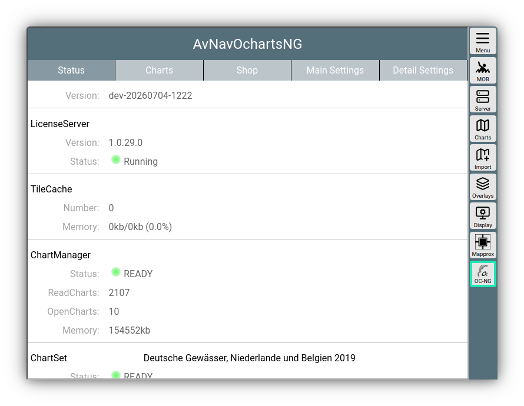
///caption
OchartsNG interface
///

## Introduction

Important basic functions are already explained in the introduction to the [navigation page](../base/navpage.md) and the video there. This chapter supplements and details this information.
  

## Chart Types

AvNav O-ChartsNG can display O-Chart vector charts (oeSENC) - as
described in this document.  
In addition, unencrypted vector charts (S57) can be used. These
are available for free download for various regions.  
To use such S57 charts, they must first be converted into the used
OpenCPN SENC format.  
For instructions on the conversion, see [Chart Conversions](#chartconversions).

## Purchase and Installation of Charts {: #Charts}

**Important Note**: If you do not have an O-Charts dongle, the charts are bound to the system. Therefore, if there are problems when installing or using the charts, **do not** reset the system - try a repair instead. If you
reset the system, the licenses may become invalid. I am happy to
help with problems - contact e.g. via [email](mailto:andreas@wellenvogel.net).

Only when using AvNav images is an update of the images also possible.
Please test in case of doubt beforehand.

To buy charts in the O-Charts shop, you must first create an account [there](https://o-charts.org/shop/en/autenticacion?back=my-account). <!--@@linkchanged-->
Subsequently, you must register your systems on which you want to use the charts [on the o-charts page](https://o-charts.org/shop/en/8-oesenc). <!--@@linkchanged-->

There are two ways for the entire process - the "[Online Process](https://o-charts.org/manuals/?lng=en) " and the ["Offline Process"](https://o-charts.org/manuals/offline.php?lng=en) . <!--@@linkchanged--> <!--@@linkchanged-->
The online process requires that the system on which the AvNav server
runs is connected to the internet. This does not have to be the system on which the browser runs.
For Android, registering a new system is only possible via the online process.

### The Offline Process {: #offlineprocess}

**Not for Android - please use the [Online Process](#onlineprocess) there**

This consists of the following steps:

1. Generating a "fingerprint" for the system on which the charts
   are to be used. This can be generated and downloaded in AvNav via the
   plugin's user interface.
2. Uploading this fingerprint to O-Charts and creating a system
   (essentially assigning a name)
3. Purchasing charts
4. Assigning them to the created system
5. After a short time, you will receive an email from O-Charts with a
   download link for the charts (zip file)
6. Uploading the charts to AvNav again via the plugin's user interface.

For updates, steps 4, 5, and 6 are repeated (for 4, only requesting the update).

For additional chart sets, steps 3-6 are sufficient.

For steps 2, 3, 4, and 5, you naturally need a system with an
internet connection. This can be, for example, a laptop or an Android
tablet.  


**Important note for Android**: Registering a system (steps 1 and 2) can only be done in the [Online Process](#onlineprocess).

I have made a [video](https://www.youtube.com/watch?v=q24VRAtbbEE) for the flow of the offline process to clarify it. Here is a brief description
again.

**Note**: If the charts are already registered for OpenCPN on the same system, you can start directly with step 6. This does not apply to Android - there, the same license cannot be used for OpenCPN and AvNav.

#### Generating the Fingerprint

Via 

{{MM("MMchartspage")}} -> {: .inline-image }

go to the plugin's interface, select the "Charts" tab there.

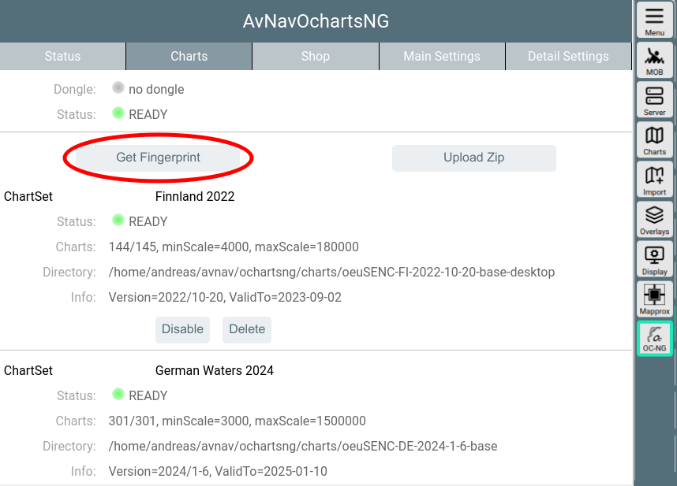

Initiate fingerprint generation with "Get Fingerprint". If you are using
an O-Charts dongle, generate the fingerprint via "Get
Fingerprint(Dongle)". This only becomes visible if a dongle has been
detected (dongle line is green).

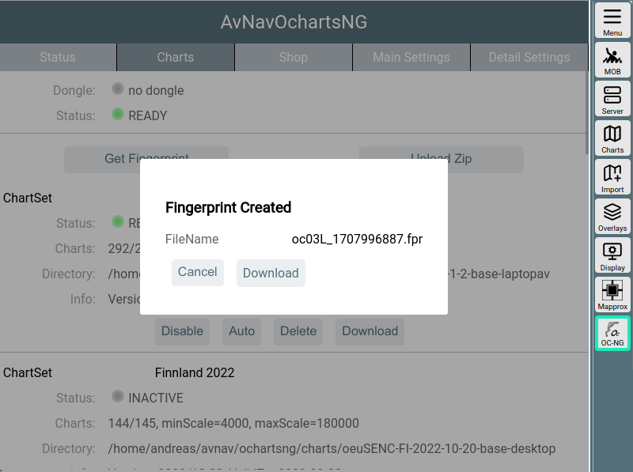

Save the generated file on your device in the dialog.

#### Uploading the Fingerprint to O-Charts

Go to the [O-Charts page](https://o-charts.org/shop/en/8-oesenc) <!--@@linkchanged-->
and upload the fingerprint.

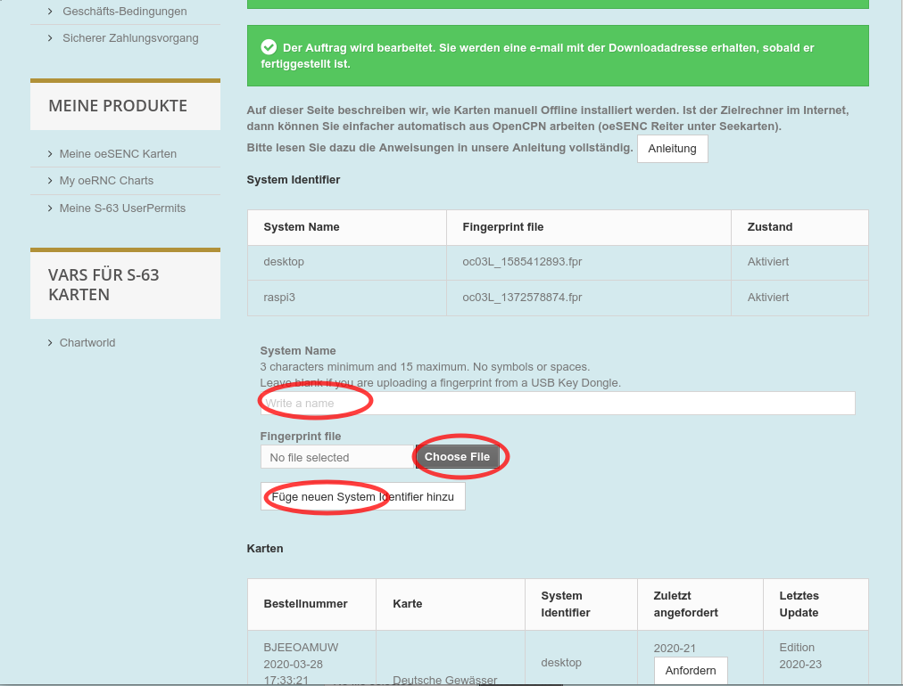

Choose the file saved in step 2 with "Choose File". Assign a
meaningful name (this will be found later in the emails with the
download links).

#### Purchasing Charts

Buy the desired ones from the [oeSENC charts](https://o-charts.org/shop/en/8-oesenc) available at O-Charts. <!--@@linkchanged-->

#### Assigning to the Created System

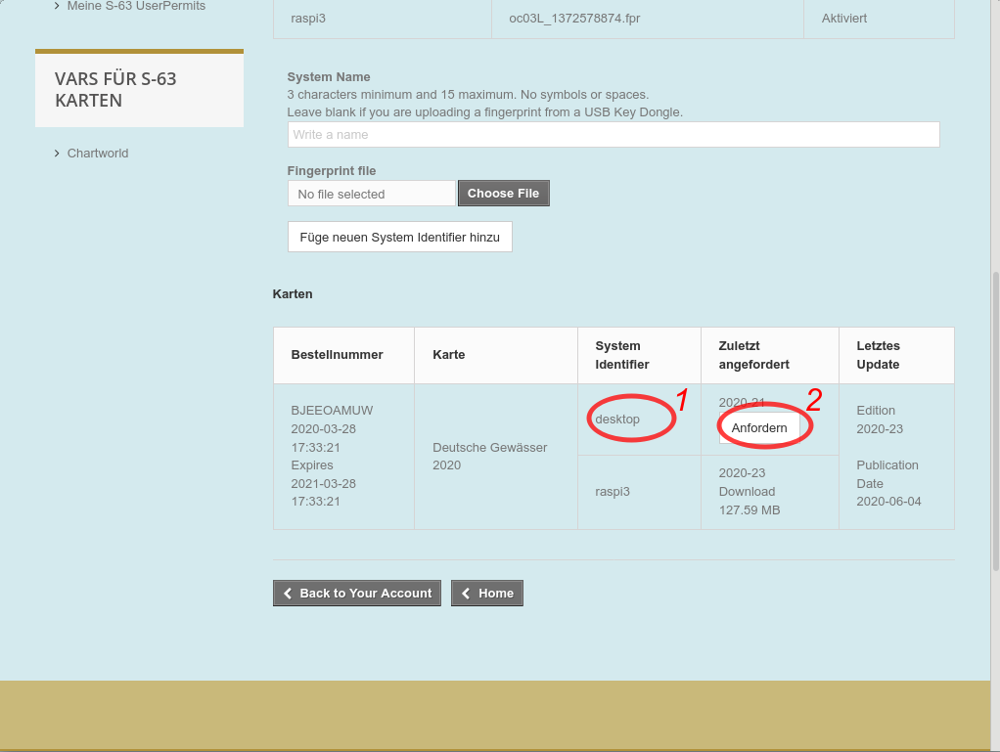

At 1, you can assign it to an already created system (not possible here, because
the charts are already assigned to the 2 maximum available systems). At 2,
the email with the download link is then requested. This also applies to
updates - see in the picture: The last version retrieved is 21, version 23
is available.

#### Downloading the Charts

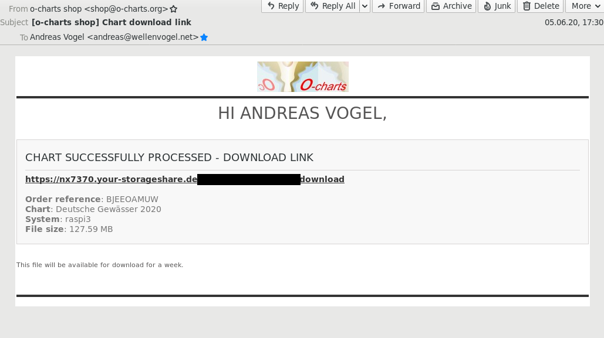

After a short time, you will receive an email from O-Charts with the
download link for the purchased chart.
Download this file (zip).

#### Uploading the Zip File to AvNav

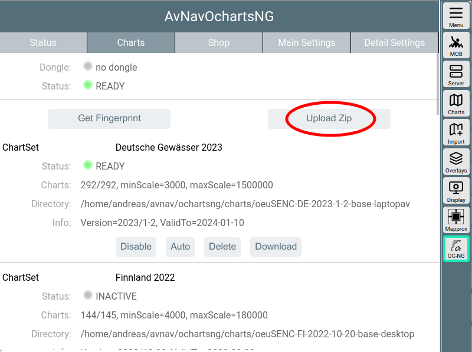

Upload the file downloaded in step 5 to AvNav in the O-Chart plugin's
interface via "Upload Zip".
A progress bar is shown during the upload.

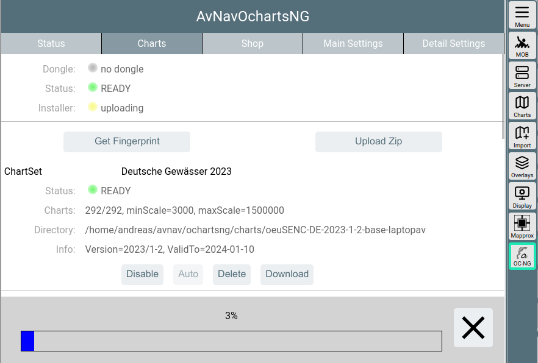

At the end of the upload, the file is unpacked on the AvNav server,
and some checks are performed. This can take a few seconds.

Unless configured otherwise, the charts are uploaded to the directory
*/home/pi/avnav/data/ocharts/charts*.

If the newly uploaded charts contain an update for an already
existing chart set, the existing set is deactivated. You can change this
later with *Enable/Disable/Auto*.
Chart sets that are no longer needed can be deleted.

Important note: The charts are only available for download in your own
account on the O-Charts page during their validity period (1 year).
Therefore, the zip file should be kept in a safe place. You can also upload
it to AvNav and use it after the validity period has expired. You will,
however, no longer have updates.

Once all charts have been successfully read in, the status will change to
green (READY).

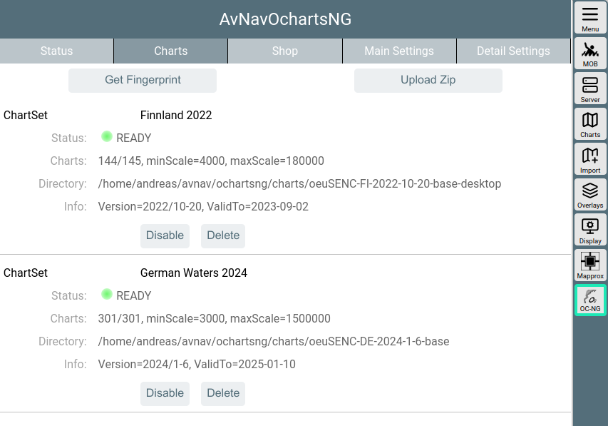

If the status changes to "ERROR" (red), you might have uploaded a zip
file that was assigned to another system. Details can be seen in the log
file (/home/pi/avnav/data/ocharts/provider.log).

After successful loading, the charts are available and appear on the navigation page in the chart selection list.

{{MM("MMnavpage")}}->{{BT("NavSelectChart")}}

### The Online Process {: #onlineprocess}

**For Android, the AvOcharts app must be installed first - see the [notes for Android](#android)**

To use the online process, the system on which AvNav
runs (the server, not just a client in the browser!) must be connected to
the internet.

The process allows you to register a system, check if the current
system is known to the shop, and view the charts assigned to this system.
You can then download and install them directly.
The actual purchase of the charts and assignment to the system must be
done via the O-Charts shop website. In the O-ChartsNG web interface,
there is a link button that connects directly to the shop.
AvNav O-ChartsNG does not save login data for the shop. However, since the
application runs in the browser, the login data can be saved there just
like for any other website.

**Security Warning**: The communication between AvNav O-ChartsNG and the O-Charts shop is encrypted. However, the communication between the browser and the AvNav server is not. Therefore,
the online process should only be used if you are in a secure WLAN,
e.g., behind an LTE router or a mobile hotspot - but never directly in a
public WLAN if the browser and the server are not running on the same
computer.

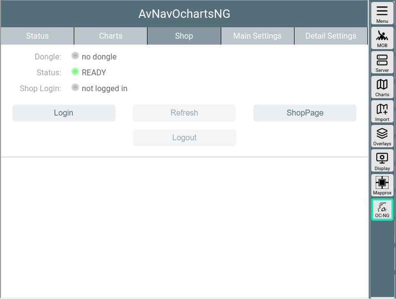

When you open the "Shop" tab, you are not initially logged into the shop.
You can see if a dongle is currently active or not. The "ShopPage" button
takes you directly to the O-Charts website, but it makes more sense to log
in first.

Log in to the O-Charts shop by clicking on "Login" and entering your
username and password.

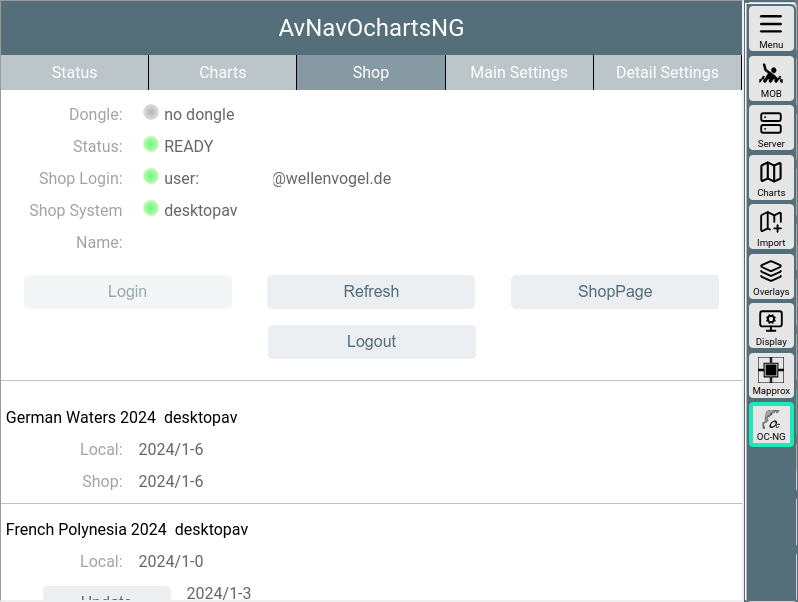

If the system has already been registered in the shop, the "Shop name",
i.e., the name used there for the system, is displayed. The list of
charts/updates assigned to the system is also displayed (see [Offline Process](#offlineprocess)).
If the version of a chart in the shop is newer than the local one, or if a
chart is not yet available locally, you can install it directly.

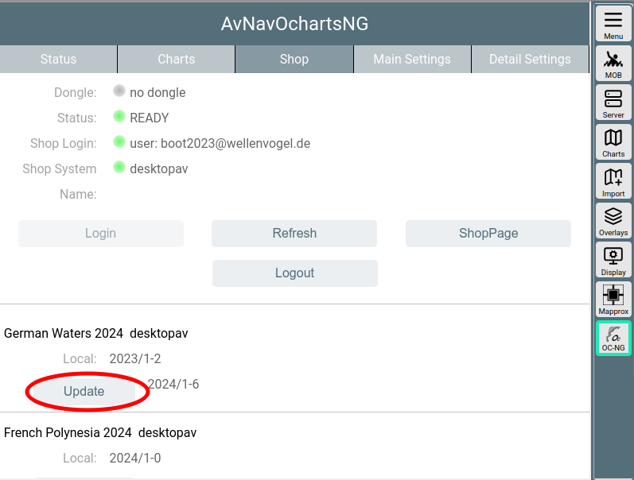

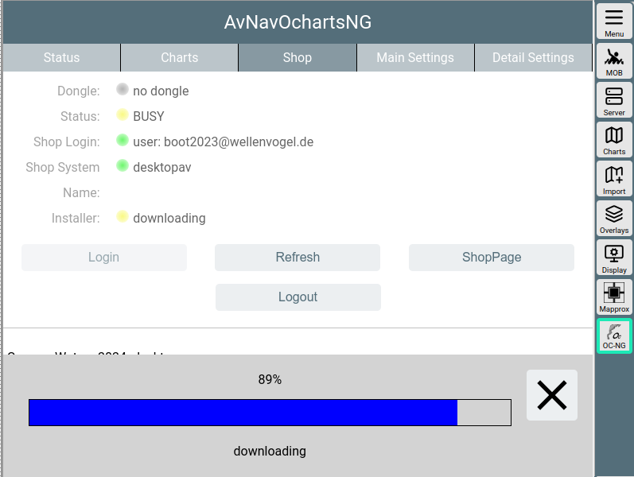

After downloading, the chart is unpacked and can be used immediately.
If it is an update for an existing chart, the new version becomes active
and the old one is "disabled". This corresponds to the behavior as when
uploading a chart. On the "Charts" tab, you can delete the old version
later if you no longer need it.

**Important Note**:  
The charts in the shop remain available only during their validity
period (1 year). Please keep the charts locally in a safe place.
You can do this either by requesting them on the shop website (as in the
offline process) or you can download the ZIP file directly from the
"Charts" tab.

If the system is not yet known in the shop, you can register it here:

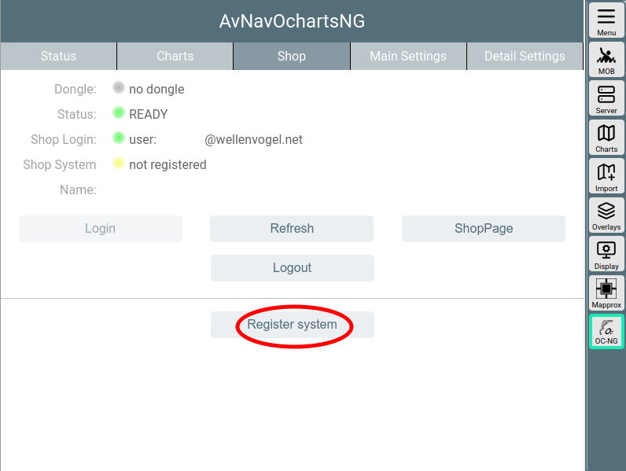

On a Linux system, you will be asked for a name for the system; on
Android, the name is predefined and cannot be changed.

Once you have registered the system, you can go directly to the shop
website via "ShopPage" and purchase or assign charts. When you return from
there, you must refresh the list of assigned charts via "Refresh".

## Customizing the Appearance {: #MainSettings}

Since O-Charts are available as vector charts, their appearance can be
customized in many areas. However, some limitations must be considered:

1. The customization happens on the server side and is therefore equally
   effective for all connected displays
2. When the appearance is changed, the chart tiles stored in the
   internal cache are deleted, so there may be slight delays on slow
   systems afterward.

Parameter changes are made via the plugin's interface

{{MM("MMchartspage")}} -> {: .inline-image }

"Main Settings" tab.

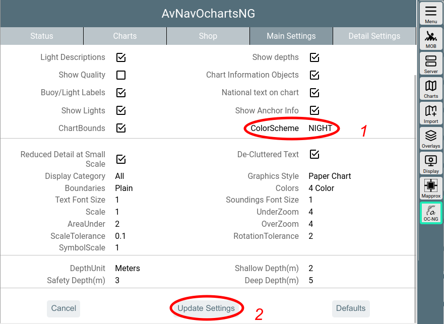
When a setting is changed (1), the parameter is displayed in bold. The changes
only become effective when "Update Settings" (2) is clicked.

With *Cancel*, the changes can be undone; the *Defaults* button sets the
settings to their default values. The parameters largely correspond to
the [settings available in OpenCPN](https://opencpn.org/wiki/dokuwiki/doku.php?id=opencpn:opencpn_user_manual:options_setting).

The following table lists the settings.

| Name | Meaning | Default |
| --- | --- | --- |
| Show Text | Show text for objects on the chart | on |
| Important Text Only | Hide less important text | off |
| Light Descriptions | Descriptions for lights | on |
| Show Depths | Show depth values | on |
| Show Quality | Show extra objects for chart quality | off |
| Chart Information Objects | Special objects on the chart | on |
| Buoy/Light Labels | Labels for lights/buoys | on |
| National text on chart | National texts | on |
| Show Lights | Show lights | on |
| Show Anchor Info | Show anchor ground information | on |
| Color Scheme | The color scheme for display | DAY\_BRIGHT |
| Chart Bounds | Show chart borders | on |
| Reduced Detail at Small Scale | Reduce details at low zoom levels | on |
| De-Cluttered Text | Better arrangement of texts | on |
| Display Category | Display type (Base, Standard, All, User Standard) | Standard |
| Graphics Style | Graphical display (Paper Chart, Simplified) | Paper Chart |
| Boundaries | Type of boundaries (Plain, Symbolized) | Plain |
| Colors | 4Color, 2 Color | 4 Color |
| Text Font Size | Scaling for text size | 1 (approx. 12px) |
| Soundings Font Size | Scaling for depth values | 1 (approx. 12px) |
| Scale | Base scaling. Higher values provide more detail at smaller zoom levels | 1 |
| UnderZoom | Number of zoom levels a higher-resolution chart is downscaled if no chart exists at the desired level | 4 |
| AreaUnder | If no chart is found for the area even in the "UnderZoom" range, use further (higher) zoom levels. For these charts, only environmental outlines (land, depth) are displayed - no further information. Be careful with this setting, it can significantly affect display performance. | 2 |
| OverZoom | Number of zoom levels a lower-resolution chart is upscaled if no better-resolution chart exists. **Note**: UnderZoom, AreaUnder, and OverZoom significantly determine how intensive the rendering process is, i.e., how many charts must be involved in creating a tile. Smaller values lead to fewer charts (faster) but can lead to white areas between chart parts in certain regions. The defaults should be a good compromise. | 4 |
| Scale Tolerance | If symbols are needed in different sizes or the chart is scaled, new symbols must be calculated internally. With a tolerance, you can slightly reduce the number of these recalculations. | 0.1 |
| Rotation Tolerance | Many objects (especially lines) are needed on the chart in different rotation angles. To reduce the number of objects to be created, a certain tolerance for the angle makes sense. | 2 |
| SymbolScale | Scaling of symbol sizes. Since some symbols are based on raster images, a scaling > 2 usually does not make sense. | 1 |
| Depth | Unit for depth values (Meters, Feet, Fathoms) | Meters |
| Shallow Depth | Depth for shallow water | 2 |
| Safety Depth | Depth for safety contour | 3 |
| Deep Depth | Depth for deep water | 5 |

Under the "Detail Settings" tab, individual chart features can be
specifically enabled or disabled. These settings only take effect in the
"User Standard" display mode.

## Feature Info (Object Query) {: #featureinfo}

If you click on the chart, you get the [Feature Info](featureinfo.md) from AvNav. If you use an O-Charts chart and click on the chart symbol in the list, you get the currently most important information near the click point (buoy, light).

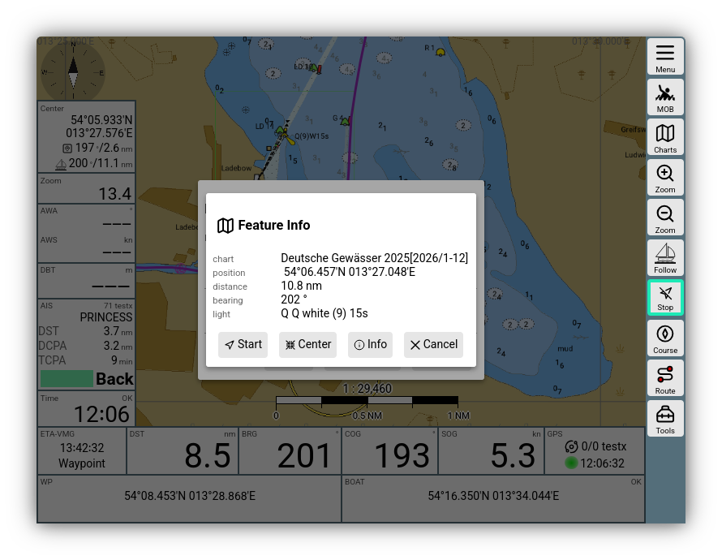

Via "Info", the raw information of the charts can be displayed.

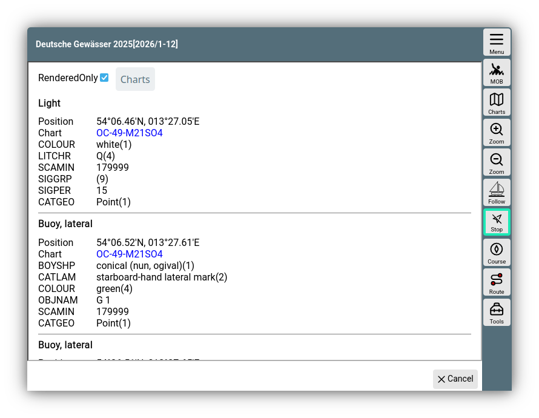

By clicking on the (blue) chart name, you get some more information about the chart.

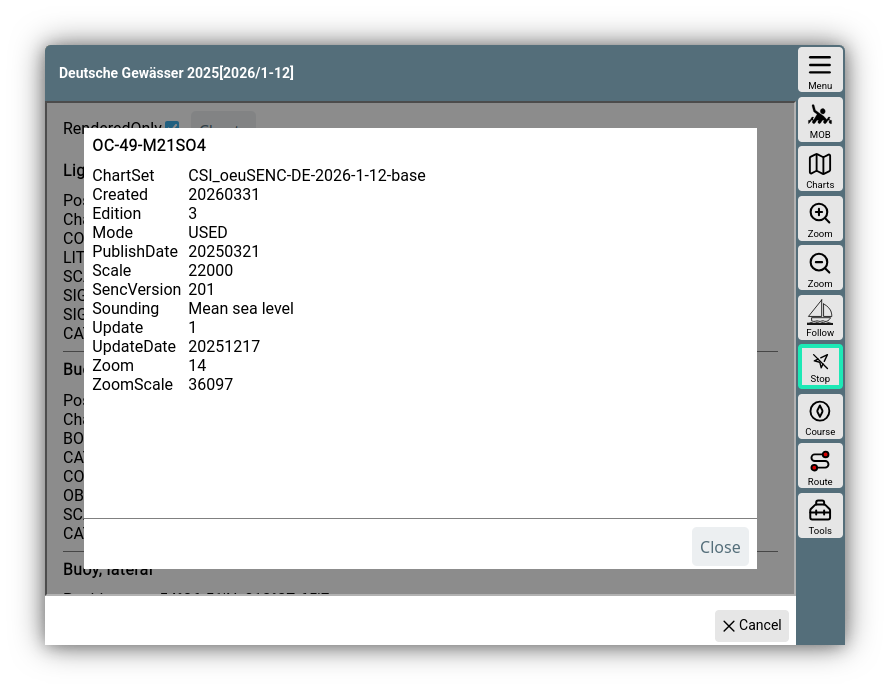

With the "Charts" button, you can display a list of the charts used at this location.  
With the "RenderedOnly" switch, only the objects from the charts in the list that are currently displayed in the image are shown. Otherwise, all objects near the click are displayed.  

## Installation {: #Installation}

### Linux/Raspberry

The plugin is available as a Debian package.  
It is present in the normal repositories.

For the [AvNav Images](../installation/raspberry.md) the package

* avnav-ochartsng

is already installed.

If you want to do it directly from the command line, you can do so with
the following commands:


```
sudo apt-get update  
sudo apt-get install avnav-ochartsng  
sudo systemctl restart avnav
```
For general instructions on installing AvNav packages, see the [Installation Description](../installation/linux.md).

Alternatively, you can download and install the packages from the [Daily
Builds Directory]({{DLLINK("daily-ochartsng")}}) or [Release
Directory]({{DLLINK("release-ochartsng")}}).

You can do this, for example, with the following commands (replace the version with the desired one):

```
cd /home/pi/avnav  
wget -O avnav-ochartsng_20260703-raspbian-trixie_arm64.deb https://www.wellenvogel.net/software/avnav/downloads/daily-ochartsng/20260703/avnav-ochartsng_20260703-raspbian-trixie_arm64.deb  
sudo apt install  ./avnav-ochartsng_20260703-raspbian-trixie_arm64.deb
sudo systemctl restart avnav
```

You can, of course, also download the packages to a PC first,
transfer them from there to the Raspberry Pi, e.g., with WinSCP, and then
install them there.

#### AvNav-ocharts and AvNav-ochartsng together

If you install the O-ChartsNG plugin, it initially uses a
different port (8083) than the old plugin (ocharts), so there are no
conflicts.
If you are updating on an older system where the ocharts plugin is still installed, you should disable it under

{{MM("MMpluginspage")}}

In the new plugin, you can activate the "useLegacy" switch (in the [Plugin
Configuration](#PluginConfig)). If this switch is activated, the new
plugin also uses all charts that were previously installed with the old one.
Alternatively, you can re-upload the charts to the new plugin or download them directly from the shop if they are still valid.

If you want to use both plugins in parallel, the system should have sufficient RAM (2GB).

### Android 

For Android, there is a separate app (avocharts) that contains O-ChartsNG.
This must be installed separately.

See [AndroidApp](#android) below..

## Releases {: #Releases}

All releases and all beta versions (developer versions or daily
builds) can be found at:

* [Releases]({{DLLINK("release-ochartsng")}})
* [Daily Builds]({{DLLINK("daily-ochartsng")}})


### Release Versions

20260703 [link]({{DLLINK("release-ochartsng/20260703")}})

Preparation for new AvNav versions

Notes on older versions can be found in the [old documentation]({{OLDLINK("hints/ochartsng.html#Releases")}}).


## License Notes {: #License}

The use of charts for AvNav with the oeSENC-pi plugin has been discussed and coordinated with O-Charts and is therefore legal in terms of the licenses.  
The [license terms](https://o-charts.org/manuals/docs/EN_rrc_eula_ChartSetsForOpenCPN.md) <!--@@linkchanged-->
of [O-Charts](https://o-charts.org/shop/en/content/3-our-conditions) <!--@@linkchanged-->
must be strictly observed. In particular, it is not permitted to copy the
charts or use them on systems other than the licensed ones.

Access to the charts within AvNav is only possible from the local
network; a maximum of 5 devices (clients) can use the O-Charts from one
AvNav server simultaneously.

For software licenses, see the [Readme.](https://github.com/wellenvogel/ochartsng/blob/master/Readme.md)

## Plugin Configuration {: #PluginConfig}

**Only under Linux.**
 For Android, see [Android/Settings](#androidsettings).  
Some settings for the plugin can be adjusted under

{{MM("MMpluginspage")}}

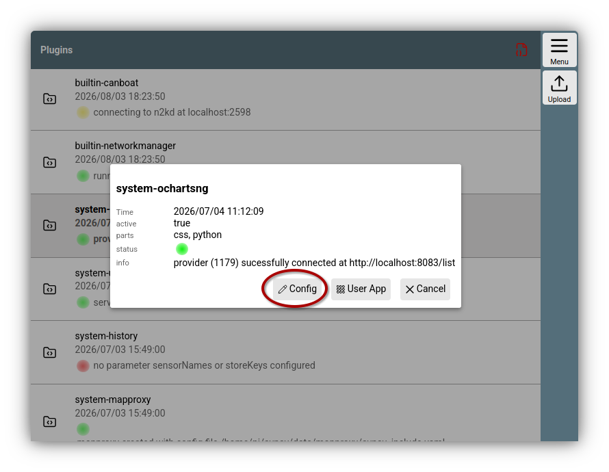

Via "Config", you can adjust the plugin settings.

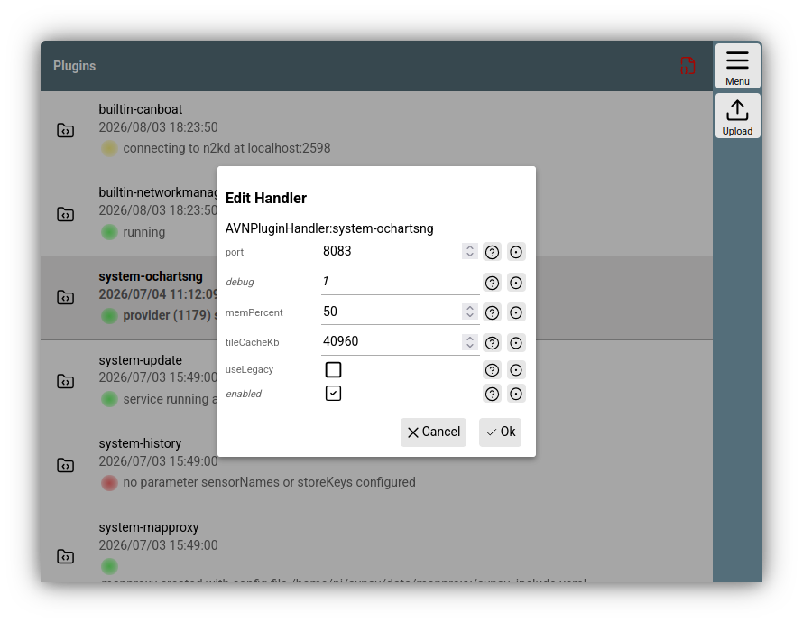

| Name | Meaning | Default |
| --- | --- | --- |
| port | Http Port | 8083 |
| debug | Level for logging, 0-ERROR, 1-INFO, 2-DEBUG | 1 |
| memPercent | The percentage of system memory that the provider should use at most. If you do not set this or set it too low, the provider calculates a minimum value internally and uses that. This may be very small, especially when using raster charts, forcing the computer to constantly open and close chart files - which can significantly reduce speed. If you have sufficient memory (e.g. > 2GB), work is accelerated if you set the memory to 1GB. | 50 |
| tileCachekb | Memory in KB for storing already generated chart tiles (with 0, no internal storage occurs) | 40960 |
| useLegacy | Also use charts that were installed with the old avnav-ocharts-plugin. | off |

## Android App {: #android}

AvNav OchartsNG is also available for Android and provides
charts for the [AvNav Android App](../installation/android.md)
.  
To do this, you must install the separate Android app ["avocharts"](https://play.google.com/store/apps/details?id=de.wellenvogel.ochartsprovider).

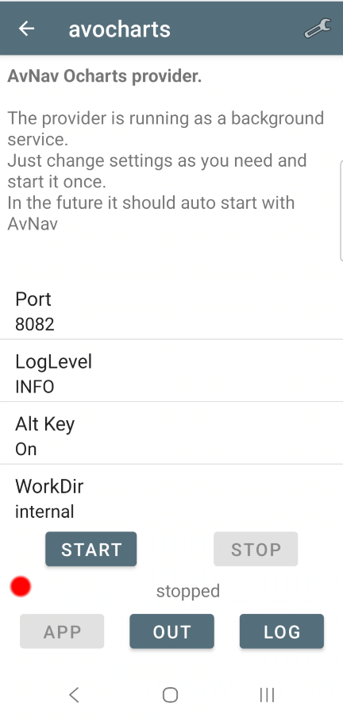

When you start the app, you can first adjust some settings.  
When you see this image (status red), the actual chart server
is not yet running. It is only started by clicking "Start".

Later, it will usually not be necessary to start the avocharts app
separately. This will happen automatically as soon as AvNav starts. But with a direct start, you can sometimes identify errors by looking at the output ("OUT") or the log file ("LOG").  
**Please note**: Automatic startup only works for apps of the same type - i.e., an AvNav release app can only start an avocharts release app, an AvNav beta app an avocharts beta app.  
So if you install the avocharts beta app and want to use it with AvNav (release - from the store), you must start avocharts by hand and also click "START" once.
{: #androidstartup}

### Settings {: #androidsettings}

To adjust settings, you can click on the displayed settings or on the settings icon (top right).

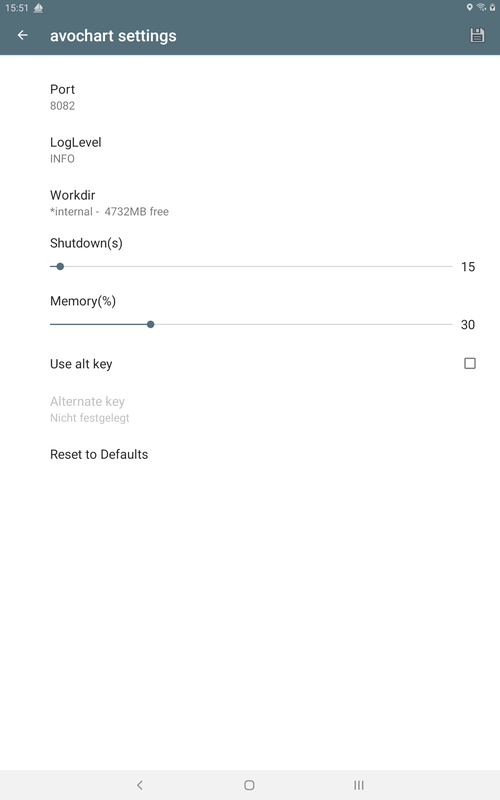

  
| Name | Meaning | Default |
| --- | --- | --- |
| Port | The HTTP port that the chart server will use. If you get error messages at startup and see something like "address already in use" under "OUT", you must change this port. | 8083 |
| LogLevel | 0 - errors, 1- info, 2- debug | 1 |
| Workdir | The [working directory](#workingdirectory) for charts, logs, and settings | internal |
| Shutdown | Time (in s) that the chart server waits for a signal from AvNav (heartbeat) before it stops automatically (this is only active if avocharts was started automatically by AvNav) | 30 |
| Memory | Permitted memory usage (in %) of system memory (RAM) | 50 |
| Testmode | for internal tests | off |
| Use alt key | See below [Notes](#androidbetarelease) on release/beta versions |  |
| Disk symbol (upper right) | Save key (See below [Notes](#androidbetarelease) on release/beta versions) |  |

When you have finished adjusting the settings, use the back arrow to return to the main page.

### Working Directory {: #workingdirectory}

AvOcharts saves charts, logs, and the settings of *Main Settings*
and *Detailed Settings* in a directory on the device. (Working
Directory). This directory is independent of the [AvNav working directory](../installation/android.md#android-main-einstellungen).

You have the following selection:

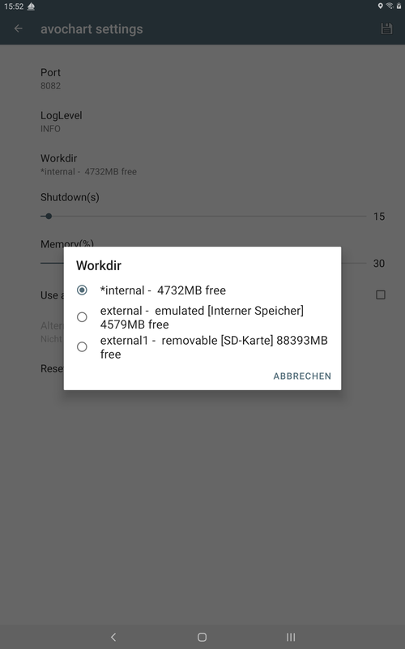

Depending on the device, you can select different storage locations for your data (technical information can be found in the [Android documentation](https://developer.android.com/training/data-storage/app-specific)).
If your device has an SD card, there is the selection shown above:

| Name | Meaning |
| --- | --- |
| Internal Storage | This is a location in the device's internal flash memory. It is completely private and (unless your device is rooted) not accessible to other apps like a file manager. This is the default. The string "\*" before the entry shows that the directory is already used as a working directory and contains data. |
| External Storage | This storage is still in the internal flash memory, but is handled differently by the Android system and is therefore referred to as "external - emulated". Other apps can access this location. The path for a file manager is typically [internal storage]/Android/data/de.wellenvogel.ochartsprovider.main/files (or [internal storage]/Android/data/de.wellenvogel.ochartsprovider.main.beta/files for a beta version). |
| External Storage-1 | This path is only visible if your device has an SD card installed. "removable [SD card]" is also displayed as an explanation. If available, this directory is actually on an external SD card. If you want to use it, the SD card must always be installed when avocharts (or AvNav) is running. If the SD card is removed while avocharts is running, it may crash. Other apps like a file manager can access the data. The storage location is [SD card]/Android/data/de.wellenvogel.ochartsprovider/files (or [SD card]/Android/data/de.wellenvogel.ochartsprovider.beta/files). |

When you change the working directory, all data in the old
working directory becomes invisible to avocharts. They remain, however,
available, and you can return to the old directory at any time.

When starting avocharts, it is checked whether the selected
working directory is still available. You will be prompted to select a
different directory if not.  
If avocharts is started by autostart from AvNav, it tries to fallback to
the internal working directory if the selected one is not available, e.g.,
because the SD card was removed.

For external directories, you can generally use a file manager to
copy data to and from there. However, avocharts potentially does not
recognize this data if it is currently running. Therefore, it is
recommended to upload data directly in the app. But you can, for example,
create a zip file with this data as a backup. And you can very easily
see the log files of avocharts.

All (potential) working directories are deleted if you uninstall
avocharts or clear its data.

Note: Settings (from the table above) are not saved in the working directory.

### First Start

You can let the chart server run with "START".

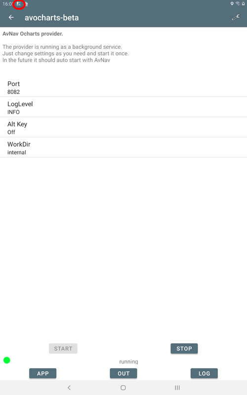

When the server is running, this is indicated in the notification bar.
If the start is not successful (status turns red again), you can look
in the output ("OUT") and in the log ("LOG").

A click on "APP" opens a browser window with the O-ChartsNG page -
the same view that you also get from within AvNav. But this is only intended
to check if everything is running correctly. The actual use should occur
from within AvNav.


### Beta and Release Versions {: #androidbetarelease}

Due to the way the O-Charts license server works, you cannot use charts
that you bought in the beta version in the release version and vice
versa.  
To avoid this, you can export the required license information (key)
from the app and import it again in the other version. 

Note: You can still only use the license on the respective device!  
To export the key, click on the disk icon at the top right on the settings
page and save it. Also, think about a backup; without this key, you
cannot use the charts later in the other app version. 

If you later use the other version of the app, activate "use alternate key" there, click on the *alternate key*, and find an "Import" button there.  
You can easily check if you have the correct license by logging into the
shop and checking if the system is correctly recognized - see [Online Process](#onlineprocess).

Please also note the information on [automatic startup](#androidstartup).

## Technical Details

The charts are provided by a server (separate program).  
Communication with AvNav is realized under Linux by an AvNav [plugin](plugins.md)
, and on Android by the avocharts app.

The web interface is a Reactjs app and is also provided by the server.
In AvNav, it is integrated as a User App.

The complete code can be found on [GitHub](https://github.com/wellenvogel/ochartsng).

Installation (under Linux) is in /usr/lib/avnav/plugins/ochartsng. The data directory is /home/pi/avnav/data/ochartsng. You can set some additional parameters for the plugin directly in the [avnav_server.xml](configfile.md). This should normally not be necessary.

You can, for example, set the data directory.

```
<AVNPluginHandler>  
...  
<system-ochartsng dataDir="$DATADIR/ochartsng"/>  
</AVNPluginHandler>
```


### Chart Conversions {: #chartconversions}

Unencrypted vector charts like S57 must be converted to the used internal "SENC" format before use.  
There are 2 options for this:

#### Conversion with AvNav

The Avnav O-ChartsNG plugin adds a converter to the [AvNav importer](charts.md#converter). This converter contains a Python script to convert S57 to a zip archive that can be uploaded.  
To use S57 charts, you can simply upload a zip with the S57 charts to the [AvNav importer](charts.md#converter) after O-ChartsNG has been installed.  
If you use AvNav and O-ChartsNG under Linux, the charts will automatically become available in O-ChartsNG once the conversion is complete.

If you want to use O-ChartsNG on a different system (e.g., Android), you additionally need an installation of AvNav under Linux
or under [Windows](../installation/windows.md).

O-ChartsNG itself does not run under Windows, but the converter
is also available for Windows. After you have installed AvNav for Windows,
you must activate the "Update" dialog there and specify the URL for the
O-ChartsNG S57 converter for Windows:

- Release: <https://www.wellenvogel.de/software/avnav/downloads/release-ochartsng/latest/ochartsng-latest.zip>
- Daily: <https://www.wellenvogel.de/software/avnav/downloads/daily-ochartsng/latest/ochartsng-latest.zip>

Then you upload the S57 charts to the converter, and after the conversion is complete, you download the zip file with the converted charts. This zip file can then be installed directly in O-ChartsNG (Linux and Android).

#### Conversion with OpenCPN

If you already have a computer with OpenCPN, you can convert the charts
there.   
To do this, activate the charts in OpenCPN. In the OpenCPN
settings/"chart files" tab, click on "Prepare all ENC
Charts".

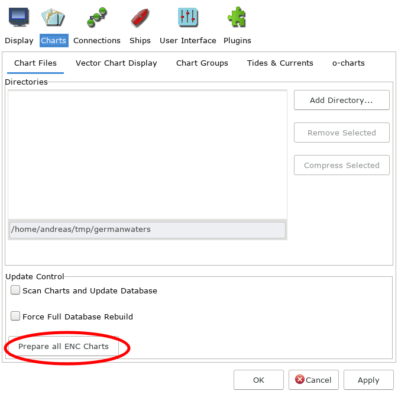

This creates a series of files with the extension **.s57* in the OpenCPN directory (under Linux: ~/.opencpn/SENC). From this directory, copy all files with the same names as the S57 files into a new, empty directory. This should have a "descriptive" name -
this will be displayed later. Then create a text file "Chartinfo.txt" in this directory with exactly one line of text:

ChartInfo: -name of the chart-

Then create a zip archive that contains the chart directory as a
subdirectory. You can then upload this archive to AvNav
O-ChartsNG.  
For Linux, there is a [script](https://github.com/wellenvogel/ochartsng/blob/master/tools/collectS57.sh) to automate the collection of the charts.