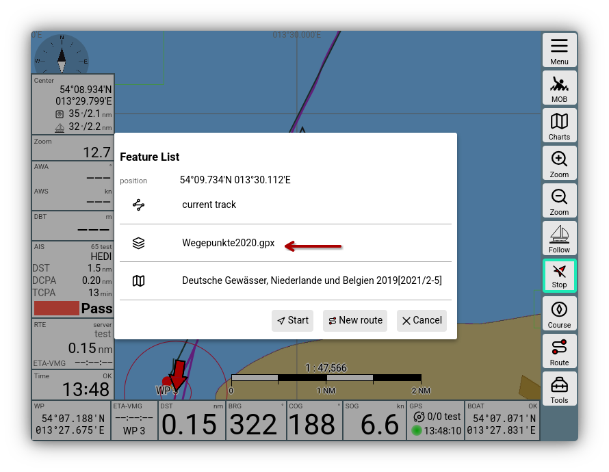
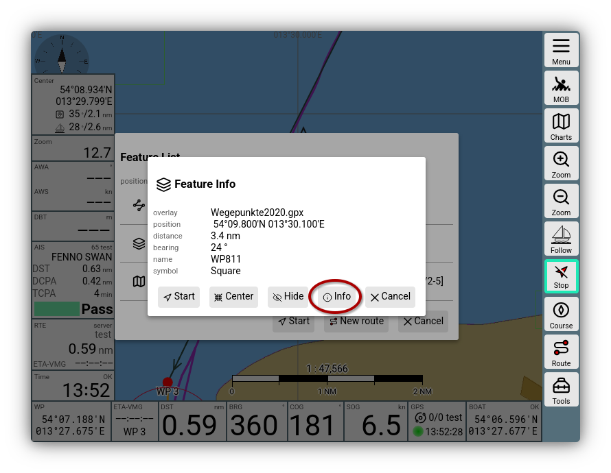

---
  tags:
    - Overlays
    - Maps
---
# Overlay details

As described in the [introduction to overlays](../base/overlays.md), you can add additional display layers (overlays) to a map.

These overlays are normally files that contain geographic information as well as information about their presentation. AvNav can process data in [GPX format](https://en.wikipedia.org/wiki/GPS_Exchange_Format), [GEOJSON format](https://geojson.org/), or [KML/KMZ format](https://en.wikipedia.org/wiki/Keyhole_Markup_Language). In addition, existing data in AvNav, such as tracks and routes, can be used as overlays.
To be completely flexible, you can also add other maps as an overlay to a specific map. This can be very helpful if the maps cover separate areas, allowing for a seamless display.

The [introduction](../base/overlays.md#parameters) explains how to edit overlay settings. Some details are described here.

## Overlay geometries and properties {: #geometry}

All overlay files contain so-called geometry objects. These are, for example, points, lines, lines made of several segments like tracks or routes, or areas described by polygons.
Such geometry objects have properties that describe how they should be displayed on the map. These include colors, point sizes, line widths, text, text sizes, etc.

Depending on the overlay type, these properties have fixed values or the values must be defined by the user.

In the [properties dialog](../base/overlays.md#parameters), only the values for all objects of a type in an overlay file can be set, e.g., the line width or color for all lines. However, in the files themselves, these properties can vary for each individual object (e.g., KML files).

In addition to properties that directly influence the display, geometry objects can have other properties, such as an explanatory text or entire HTML pages. These are usually not displayed on the map, but can be viewed after clicking on the map via the [feature info](#featureInfo). See also [feature formatter](#featureFormatter).

## Display properties

In the [introduction](../base/overlays.md#parameters), some display properties have already been explained. Further properties appear in the overlay dialog if the overlay file contains geometry objects with a corresponding type. The property `line width`, for example, is only displayed if there are also line objects. The parameters each have a short help text.

## Icons

Some overlay file types (e.g., KML/KMZ) support specifying an icon URL for points. These URLs can either be absolute external URLs or relative/absolute internal URLs, which point to the AvNav server.

For these icons to be displayed, they must, of course, exist. For external URLs, `allow online` must be set in the dialog for them to be displayed. For relative URLs, the icons must either be uploaded to the overlay directory as an overlay file or packed into a ZIP file with the path structure as it appears in the overlay file. This ZIP file must then also be uploaded to AvNav as an overlay file and specified as the `icon file` parameter in the dialog.

The object property that describes the icon is `sym`. Under [feature formatter](#featureFormatter), it is further described how to influence the determination of the icon URL.

## Feature info {: #featureInfo }

When you click on a displayed overlay object on the map, it will appear in the [feature info list](featureinfo.md).

///caption
Overlay Feature Info
///

After clicking on the overlay, you receive information about the object just clicked from the overlay.

///caption 
Overlay Detail
///
Here, some of the [properties](#geometry) of the object are displayed. 
Which properties are displayed depends on the overlay type and the [feature formatter](#featureFormatter).

The default properties are:

  * `name`
  * `desc` (displayed as `description`)
  * `time`
  * `sym` (displayed as `symbol`)

In addition, [feature formatters](#featureFormatter) can set further properties:

  * `buoy`
  * `top`
  * `light`
  * `link`: 
    a URL. If this value is set, the button {{DB("DBInfo")}} is displayed as shown in the image, which opens a dialog with the HTML page
  * `htmlInfo`: 
    also displays the button {{DB("DBInfo")}} and opens a dialog that displays the value of the parameter as HTML
  * `linkText` - a title for the HTML display

## Feature formatter {: #featureFormatter}

Since AvNav cannot know all conceivable formats and special contents of overlays, there is the possibility to influence the display of information from the overlays.

This requires writing a few lines of Java-Script code and making it known to AvNav.

Such a formatter is a Java-Script function that receives the properties of the geometry object as a parameter and returns modified properties.
These returned properties can then influence both the display on the map (`sym` for the icon URL, `name`) and the display in the [feature info](#featureInfo).

Essentially, you have to edit the `user.mjs` file:

{{MM("MMaddonconfigpage")}}->"User Files" -> "user.mjs" -> {{DB("Edit")}}

and add an entry for the formatter there, as described under [User Java-Script](userjs.md#featureFormatter).

[Plugins](plugins.md) can also provide such feature formatters.

The name of the feature formatter must then be selected from the displayed list in the overlay dialog under `feature formatter`.