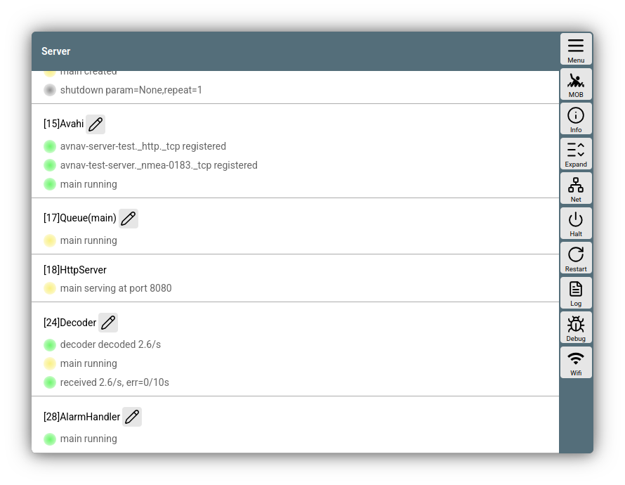
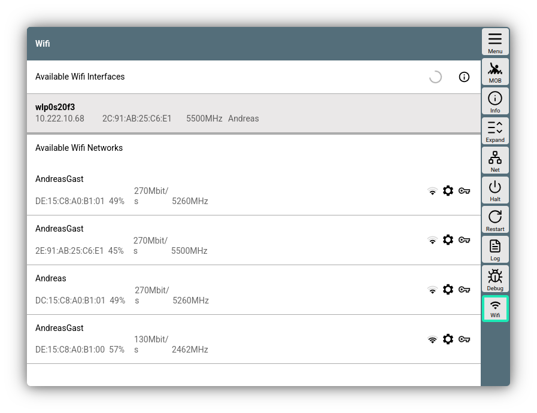
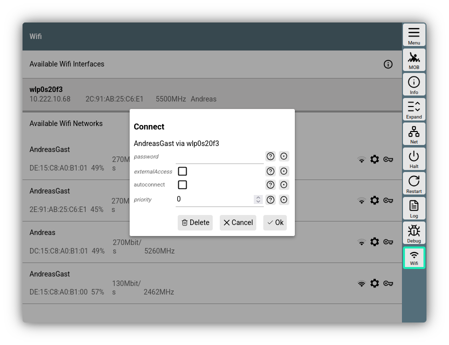

---
  tags:
    - Server
    - Configuration
    - Network
    - Wifi
---
# Server page

Via 

{{MM("MMserverpage")}} 

you can reach a page that summarizes the settings of the AvNav server.

///caption
Server page
///

## Settings
On the left side, the various components of the server can be configured. For a description, see the chapter [Configuration](configfile.md).

Normally, only the server components that are not configured on any of the other pages (e.g., connections, routes, etc.) are displayed here. Using the button
{{BT("StatusAll")}}, the view can be expanded to show all functional units.

## Buttons

Using the buttons on the right side, a number of functions or subpages can be accessed. The displayed functions depend on the system—whether Android, Windows, or Linux/Raspberry.

| Button | System | Function |
| --- | --- | --- |
| {{BT("MainInfo")}} | all | Display a page with version and license information |
| {{BT("StatusAll")}} | all | Show all server functions |
| {{BT("StatusAddresses")}}| all | Show a page with the server's IP addresses |
| {{BT("StatusAndroid")}}| Android | Open the [Android settings](../installation/android.md#Settings) |
| {{BT("AndroidBrowser")}} | Android | Open the AvNav interface in the system browser (only if the [WebServer](configfile.md#webserver) has been enabled) |
| {{BT("StatusShutdown")}} | Linux/Raspberry | Stops the AvNav server computer. Only if a `shutdown` command is set up in the [CommandHandler](configfile.md#avncommandhandler) - as is the case, for example, on the [AvNav images](../installation/raspberry.md#images). |
| {{BT("StatusRestart")}} | Linux/Raspberry/Windows | Restarts the AvNav server, not the computer - just the AvNav server software. |
| {{BT("StatusLog")}} | Linux/Raspberry/Windows | Displays the log file of the AvNav server and offers the option to download it. |
| {{BT("StatusDebug")}}| Linux/Raspberry/Windows | Displays a dialog to enable the AvNav debug mode for a certain amount of time. This makes the log output much more detailed and can help identify potential errors. |
| {{BT("StatusAdd")}} | all | Set up a new connection. Only in the extended view. |
| {.inline-image}| [AvNav images](../installation/raspberry.md#images) (trixie) | Show a [configuration page](#wifi) for Wifi client connections |

## Wifi client configuration {: #wifi }

This function is only available on [AvNav images](../installation/raspberry.md#images) or if the `avnav-raspi-network` package has been installed.

To connect AvNav to another Wifi network, the AvNav server must have an additional network adapter (USB Wifi stick) (in addition to the adapter used for the AvNav access point). See also the [notes on connecting](connecting-pi.md).

In the [image configuration](../installation/raspberry.md#preparation), you can decide which of the available network adapters is used for the access point. All others are available here.

Network configuration is managed via the [Network Manager](https://networkmanager.dev/).

By clicking on {.inline-image}, you will receive a configuration dialog.

///caption
Wifi configuration
///

In the upper area, all available network interfaces that are not used for the internal access point are displayed. If a connection to a Wifi network already exists, it is displayed with its IP address under the interface.

By clicking on it, you can call up a dialog to disconnect.

Clicking on one of the displayed networks will open a connection dialog.

///caption
Wifi connection dialog
///

You can set (or change) the parameters for the connection here.

| Name | Description |
| --- | --- |
| password | The Wifi password for the network |
| externalAccess | If set, the AvNav server can also be accessed via this network. **Attention: This is a security risk. The AvNav server is not protected against unauthorized access. Therefore, only activate this in trusted networks - not in a public Wifi network** |
| autoConnect | If enabled, it will attempt to automatically reconnect to this network |
| priority | If multiple networks are configured with *autoconnect*, they are used according to the priority specified here. "0" is the lowest priority.|

With {{DB("DBOk")}}, the dialog is closed and the connection is established. The progress is displayed.

Using the (i) button at the top right, you can view the entire network configuration of the server.