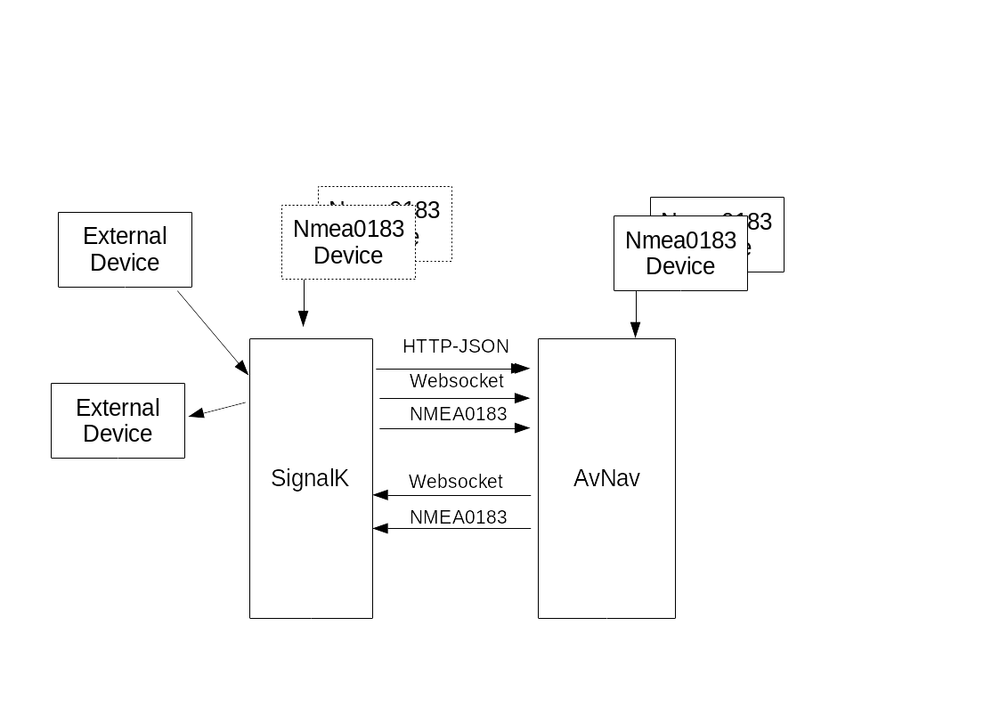

---
  tags:
    - Nmea2000
    - SignalK
---
Interaction with SignalK
==========================




## SignalK data in AvNav
The Raspberry, Linux, and Windows versions of AvNav can directly receive data from [SignalK](https://signalk.org/en/) <!--@@linkchanged--> and also send data there.

All versions of AvNav can receive NMEA0183 data from [SignalK](https://signalk.org/en/) <!--@@linkchanged--> and send data to it.

There are various options for how the data from SignalK is processed and used in AvNav.

### NMEA0183 data
This data passes through the [multiplexer](connections.md#structure) and [decoder](connections.md#structure) in AvNav as usual. The decoded data can be used for navigation and display—just like all other received NMEA data.

Since AvNav also provides all NMEA data to interfaces (TCP, UDP, serial, etc.), data can also be sent to SignalK this way.

### Direct SignalK data
AvNav can also directly use the interfaces of the SignalK server in the Raspberry, Linux, and Windows versions to receive and send data. AvNav includes a SignalK handler for this, which can be [configured](#configuration). It is accessible via {{BT("MainNav")}} -> Connections/Devices. 
The received data can be used in different ways, depending on the configuration:

1.  "decodeData" switched off:
    All SignalK data from `vessels.self` (own ship) is provided in AvNav as __additional__ data under `nav.gps.signalk...` and can only be used in [displays](../base/layout.md). It cannot be used for navigation. This only makes sense, of course, if the data required for navigation reaches AvNav through other [channels](#dataflow).
    {: #addon}

2. "decodeData" switched on:
   The SignalK data is additionally used for navigation and converted to the corresponding data in AvNav [mapping](#mapping). 
   {: #decode}

For further details, see [Configuration](#configuration).

## Data flow {: #dataflow}
Depending on user preferences and existing system configurations, there are several ways data can flow between AvNav and SignalK. To avoid problems, especially loops where data comes from SignalK and is then sent back there via another path, you should decide on a fundamental data flow:

1. NMEA data first arrives in AvNav and is forwarded from there to SignalK. This setup is used in the [AvNav Headless Images](../installation/raspberry.md#images). 
   SignalK data that is not yet available in AvNav, e.g., from sensors, can be sent back to AvNav via the SignalK handler as [additional data](#addon) and then displayed there.  
   The data that AvNav uses for navigation (including AIS data) is decoded directly by AvNav from the NMEA data here.  
   NMEA2000 data will normally always be sent directly to SignalK as well, so that it can be decoded there. AvNav can receive this data via [Canboat](nmea2000.md) - or obtain it from SignalK. However, this creates a mixed data flow, and you must ensure that you do not create loops.

2. NMEA data first arrives in SignalK and can be forwarded from there to AvNav via the [SignalK Handler](#decode).  
   This is the setup used, for example, in OpenPlotter.

For both variants, AvNav can also send its own data to SignalK. At the moment, this includes routing data to the next waypoint, either as RMB/APB NMEA0183 data or as a SignalK update - see below.

Furthermore, notifications (alarms) from SignalK can be read and sent there.


### 1. NMEA to AvNav and from there to SignalK {: #flow1}

The configuration is pre-configured in the [AvNav Headless Images](../installation/raspberry.md#images).

For this configuration, an AVNSocketWriter is provided in AvNav that forwards received NMEA data (default port: 34568). Data from *canboat* (NMEA2000) is not sent out via blacklist entries.

```
<AVNSocketWriter port="34568" maxDevices="5" filter="" read="true" minTime="50" name="nmea0183tosignalk" blackList="canboatnmea0183,canboatgen"/>
```

In SignalK, a corresponding *Data Connection* for NMEA0183 must be created as a TCP client to port 34568 (already created in the images).

The AVNSignalKHandler is configured by default to reach SignalK via the address *localhost:3000* and read all data from *vessels.self*. These are then stored under *gps.signalk. ...* in AvNav and can thus be used in [displays](../base/layout.md).  
A mixture of polling via HTTP-JSON and a websocket connection is used. The polling ensures secure updates, while the websocket connection ensures timely updates.

On the above SocketWriter connection, AvNav also sends its routing data as RMB or APB sentences to SignalK.  
Additionally, the integration of alarms (SignalK: Notifications) can be activated in the SignalKHandler.

Data that arrives directly in SignalK via other paths is forwarded to AvNav as described, **but is not directly usable there for navigation**.

If you want data to arrive in SignalK first and then go to AvNav, you should consider whether the other signal flow (2) is better suited.

The advantage of signal flow 1 (NMEA to AvNav first) is that even if SignalK is unavailable or causing problems, the navigation functions of AvNav can still work.

### 2. NMEA data first to SignalK {: #flow2}

In this signal flow, which is the default for OpenPlotter (from AvNavInstaller version xxxx), NMEA data is first received and stored in SignalK. For this, the corresponding *Data Connections* must be configured in SignalK.

In AvNav, the AVNSignalKHandler is configured to fetch data from SignalK in a combination of HTTP-JSON and a websocket connection.  
The flags "decodeData" and "fetchAis" (see [Configuration](#configuration)) are set. This means received data is stored internally in AvNav for navigation. Additionally, as with [(1)](#flow1), it is stored again under gps.signalk.... so that displays function identically.  
For the mapping of the data, see [Mapping](#mapping).

Sending data ("sendData") is also activated in the AVNSignalKHandler. Data for the current waypoint as well as alarms are sent to SignalK.  
Additionally, notifications are received from SignalK.  
For writing data to SignalK, a user available in SignalK with write permissions must be configured (see [Configuration](#configuration)).


### Selecting the data flow

For the decision of whether to use [data flow 1](#flow1) (first to AvNav) or [data flow 2](#flow2) (first to SignalK), one can start with the defaults based on the foundation you are using.

You should only deviate from this if there are good reasons.
By configuring on the page ({{BT('MainNav')}} -> Connections/Devices), you can set each of these flows; even mixed forms are possible.

You only need to ensure that you do not create loops—e.g., sending data from AvNav via NMEA0183 to SignalK and then fetching it back again.  
AvNav tries to avoid such problems with a "sourcePriority" on every connection. All NMEA connections have a default priority of "50", the AVNSignalKHandler 40—thus, directly received NMEA data always "wins" over data fetched from SignalK.

### Configuration {: #configuration}

The AVNSignalK handler has the following configurations.

|  |  |  |
| --- | --- | --- |
| Name | Description | Default |
| name | A name for the handler. Displayed on the status page and used in logs. | empty (signalk) |
| enabled | If disabled, the SignalK integration is deactivated. Any configured NMEA connections are not affected by this. | on |
| decodeData | If enabled, the received SignalK data is also used for navigation functions in AvNav. See [Mapping](#mapping). | off (on in OpenPlotter) |
| fetchAis | If enabled, AIS data is fetched from SignalK every 10s (aisQueryPeriod) and stored in AvNav as AIS data. | off (on in OpenPlotter) |
| priority | The priority of the decoded SignalK data | 40 |
| port | The SignalK HTTP port. | 3000 |
| host | The SignalK server hostname/IP address. | localhost |
| aisQueryPeriod | Interval (in s) for fetching AIS data | 10 |
| period | Period in ms for the HTTP-JSON query to SignalK. If Python websocket libraries are available (normal case), this interval is increased to nearly the *expiryTime* of the data in AvNav. | 1000 |
| fetchCharts | Fetches information about charts installed in SignalK. This requires the SignalK Chart Provider to be installed there. | on |
| chartQueryPeriod | Interval (in s) for fetching charts. | 10 |
| chartProxyMode | If SignalK is running on a different computer than AvNav, the browser might not be able to reach that computer directly. Therefore, there is an option to load charts via a proxy in AvNav. However, this creates some additional load and can therefore be disabled. *sameHost*: proxy only if SignalK is not running on the same server as AvNav *never*: no proxy (can be used if the SignalK server is reachable from the browser at the address entered here) *always*: always proxy. Can be used if the SignalK port (3000) is not directly reachable from outside. | sameHost |
| ignoreTimestamp | Normally, the handler evaluates the timestamp of the SignalK data and ignores data that is too old (*expiryPeriod* in AVNConfig). A potential time difference between your own server and the SignalK server is taken into account. However, SignalK sometimes does not use its local time as the basis for this timestamp but takes the timestamp from received data. This can, especially when using simulation data, lie far in the past—and AvNav would ignore such data. By setting this flag, AvNav ignores these timestamps and uses its local time of the last value change as the timestamp. This is, of course, not as accurate as the original timestamp in SignalK, but it allows older simulation data to be used. | off |
| sendData | Send data to SignalK. It can be configured whether alarms and/or waypoint data can be sent. These settings only become visible once sendData is activated. This does **not** control the sending of NMEA data to SignalK! | off (on in OpenPlotter) |
| userName | The name of a SignalK user with write permissions on the SignalK server. This user must have been created beforehand with corresponding rights in SignalK. Unfortunately, SignalK has no interface to directly check if a specific user can write to the desired paths; only for "localhost" is it checked if write permissions exist. | admin |
| password | The password for the configured user. This password is normally not required for a SignalK installation on the same server, provided the configuration is located at the standard path $HOME/.signalk/security.json. If an error occurs under "authentication" in the status display, setting the password locally can possibly solve the problem. Attention: The password is saved in plain text in the avnav_server.xml. | <empty> |
| sendWp | Send waypoint data to SignalK. See also [Mapping](#mapping). | on |
| legPaths | Paths for waypoint data (only with sendWp). *v1*: navigation.courseGreatCircle/courseRhumbline, *v2*: navigation.course (SignalK 2.x Course API), *both*: both. | both |
| sendNotifications | Send AvNav alarms as notifications to SignalK - see [Mapping](#mapping). | on |
| receiveNotifications | Receive notifications from SignalK as alarms. | off |
| notifyWhiteList | A comma-separated list of SignalK notifications that should be received. Provide paths without "notification." - e.g., navigation.arrivalCircleEntered,mob,fire,sinking. If the list is empty, all notifications are received—but the notificationBlacklist is still considered. | <empty> |
| notifyBlackList | A comma-separated list of SignalK notifications that should not be received. | server.newVersion |
| webSocketRetry | Interval (in s) at which reconnection attempts are made if the previous websocket connection was closed. | 20 |


Some of the parameters only become visible once the "parent" parameter has been activated.

  

### Mapping {: #mapping}

The SignalK paths are mapped to AvNav data paths as follows:

/vessels/self/... => gps.signalk....

These paths are not used internally in AvNav but can be displayed.

If "decodeData" is activated, mapping occurs as follows (see [in code](https://github.com/wellenvogel/avnav/blob/c67ee491bc19d579f379eb78bcde149282806ab2/server/avnav_nmea.py#L122)).

Note: Courses/angles are stored internally in AvNav in °, in SignalK in rad. If multiple SignalK paths are specified, the first one present in SignalK is used.

|  |  |
| --- | --- |
| SignalK under /vessels/self/ | AvNav |
| navigation.headingCompass | gps.headingCompass |
| navigation.headingMagnetic | gps.headingMag |
| navigation.headingTrue | gps.headingTrue |
| environment.water.temperature | gps.waterTemp |
| navigation.speedThroughWater | gps.waterSpeed |
| environment.wind.speedTrue | gps.trueWindSpeed |
| environment.wind.speedApparent | gps.windSpeed |
| environment.wind.angleApparent | gps.windAngle |
| environment.wind.angleTrueWater (since 20240520) | gps.trueWindAngle |
| navigation.position.latitude | gps.lat |
| navigation.position.longitude | gps.lon |
| navigation.courseOverGroundTrue | gps.track |
| navigation.speedOverGround | gps.speed |
| environment.depth.belowTransducer | gps.depthBelowTransducer |
| environment.depth.belowSurface | gps.depthBelowWaterline |
| environment.depth.belowKeel | gps.depthBelowKeel |
| navigation.datetime | gps.time |
| navigation.gnss.satellitesInView.count | gps.satInview |
| navigation.gnss.satellites | gps.satUsed |
| navigation.magneticDeviation (since 20240520) | gps.magDeviation |
| navigation.magneticVariation (since 20240520) | gps.magVariation |
| environment.current.setTrue (since 20240520) | gps.currentSet |
| environment.current.drift (since 20240520) | gps.currentDrift |

AIS data is mapped as follows ("fetchAis" on):

|  |  |  |
| --- | --- | --- |
| SignalK vessels/\*/ | AvNav ais | Remark |
| mmsi | mmsi | data is only adopted if MMSI is set |
| name | shipname |  |
| navigation.speedOverGround | speed |  |
| navigation.courseOverGroundTrue | course |  |
| communication.callsignVhf | callsign |  |
| design.aisShipType | shiptype |  |
| navigation.position.longitude | lon |  |
| navigation.position.latitude | lat |  |
| navigation.destination | destination |  |
| sensors.ais.class | type | Class A -> type 1 / Class B -> type 18 / Other -> type other |
| design.beam | beam |  |
| design.length | length |  |
| design.draft | draught |  |
| navigation.state | status |  |
| navigation.headingTrue | heading |  |
| atonType | aid\_type |  |

If "sendWp" is active, the data is mapped as follows:

|  |  |
| --- | --- |
| AvNav | SignalK vessels/self/ |
| currentLeg.to.lon | navigation.courseGreatCircle.nextPoint.position.longitude and navigation.courseGreatCircle.nextPoint.longitude |
| currentLeg.to.lat | navigation.courseGreatCircle.nextPoint.position.latitude and navigation.courseGreatCircle.nextPoint.latitude |
| currentLeg.from.lon | navigation.courseGreatCircle.previousPoint.position.longitude |
| currentLeg.from.lon | navigation.courseGreatCircle.previousPoint.position.latitude |
| currentLeg.distance | navigation.courseGreatCircle.nextPoint.distance |
| currentleg.dstBearing | navigation.courseGreatCircle.nextPoint.bearingTrue and navigation.courseGreatCircle.bearingToDestinationTrue |
| currentLeg.xte | navigation.courseGreatCircle.crossTrackError |
| currentLeg.approachDistance | navigation.courseGreatCircle.nextPoint.arrivalCircle |
| currentLeg.bearing | navigation.courseGreatCircle.bearingTrackTrue and navigation.courseGreatCircle.bearingOriginToDestinationTru |

With *legPaths* *v2* or *both*, the paths of the SignalK 2.x Course data structure are additionally sent as deltas (only with SignalK server from version 2.0):

* navigation.course.nextPoint and 
* navigation.course.previousPoint (each with position and type=Location, *previousPoint* is the start point of the AvNav leg).
* navigation.course.arrivalCircle as well as - if no active *course-provider* was found -
   * navigation.course.calcValues.(calcMethod, distance, bearingTrue, bearingTrackTrue, crossTrackError, velocityMadeGood).

**Attention:** If AvNav sends the waypoint (sendWp), the SignalK plugin "course-provider" should be deactivated, as it would otherwise calculate the calcValues itself.

However, this only works if the current position is also available in SignalK. Potentially, restarting routing would not correctly reset the XTE calculation by the plugin.

AvNav checks regularly if the plugin is running. In this case, AvNav does not send *calcValues* and the "courseProvider" status display turns red; if the plugin is not present or deactivated, it is green.
These values are used, for example, by the plugins *signalk-to-nmea2000* and *signalk-to-nmea0183* for autopilots.
If a course is set in SignalK that does not originate from AvNav while a leg is active in AvNav, this is reset via REST (DELETE on `/signalk/v2/api/vessels/self/navigation/course`) before sending—the active leg in AvNav takes priority. This requires write permissions. Querying the SignalK Course API (`/signalk/v2/api/vessels/self/navigation/course`) does not return the sent values—AvNav does not set a destination there.

If the AvNav routing mode is "Rhumbline", "courseGreatCircle" is replaced by "courseRhumbline". Sending some values multiple times with different paths is a workaround for some SignalK errors (like <https://github.com/SignalK/signalk-to-nmea2000/issues/94>).

There are a few mappings for notifications; unmapped notifications are handled in AvNav with their name prefixed with "sk:". For example, "notifications.sinking" becomes "sk:sinking".

|  |  |  |
| --- | --- | --- |
| AvNav | SignalK vessels/self/notifications | Value |
| mob | mob | state:emergency, method:visual,sound, message:man overboard |
| waypoint | arrivalCircleEntered | state: normal, method: visual,sound, message: arrival circle entered |
| anchor | navigation.anchor | state:emergency, method: visual,sound, message: anchor drags |

SignalK notifications without a direct mapping are assigned to a category based on their status (*state*). This can be used to define the command to be executed and the sound in the AVNCommandHandler.

emergency -> critical

alert -> info

warn -> alarm

alarm -> alarm

In the AVNAlarmHandler, further alarms can also be [configured](configfile.md#avnalarmhandler). The *sk:name* must be used as the name. These will then be handled according to their configuration.

### SignalK - Charts {: #SignalKCharts}

From version 202011xx onwards, the [SignalK Chart Provider](https://github.com/SignalK/charts-plugin) is also integrated. Charts offered from there can also be selected on the entry page. To do this, the corresponding plugin must of course be installed and activated within SignalK - and charts must be available there.

Normally, AvNav only provides information about the charts; access to the charts occurs directly from the browser to SignalK.

If this is prevented, e.g., by firewall settings, you can also route all chart accesses via AvNav (proxy) - see [Configuration](#configuration).