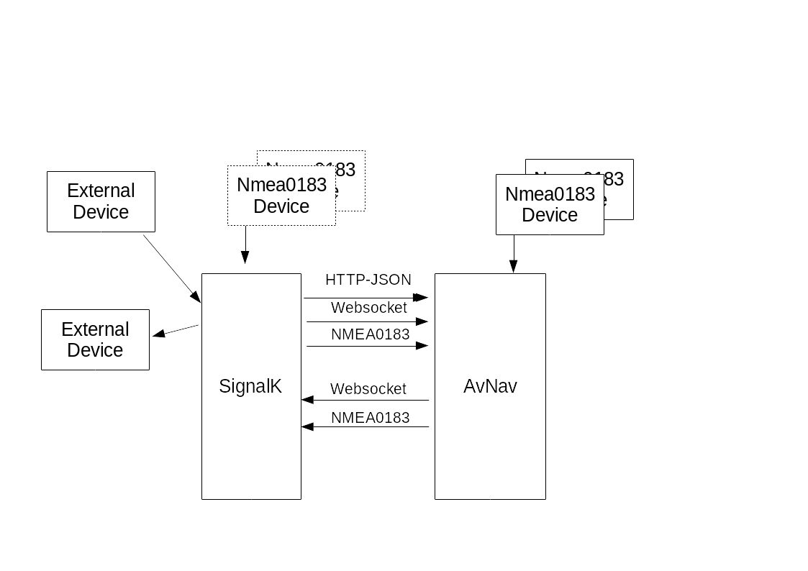

---
  tags:
    - Nmea2000
    - SignalK
---
Interacting with SignalK
==========================




## SignalK data in AvNav
The Raspberry Pi, Linux, and Windows versions of AvNav can directly receive data from [SignalK](https://signalk.org/) <!--@@linkchanged--> and also send data there.

All versions of AvNav can receive NMEA0183 data from [SignalK](https://signalk.org/) <!--@@linkchanged--> and send data back there.

There are various options for how data from SignalK is processed and used within AvNav.

### NMEA0183 data
This data normally passes through the [multiplexer](connections.md#structure) and [decoder](connections.md#structure) in AvNav. The decoded data can be used for navigation and display—just like any other received NMEA data.

Since AvNav also provides all NMEA data to interfaces (TCP, UDP, serial, etc.), data can also be sent to SignalK via this route.

### Direct SignalK data
In the Raspberry Pi, Linux, and Windows versions, AvNav can also directly use the interfaces of the SignalK server to receive and send data. AvNav includes a SignalK handler for this purpose, which can be [configured](#configuration). It can be accessed via 

{{MM("MMchannelspage")}} -> SignalKHandler

The received data can be used in different ways depending on the configuration:

1.  "decodeData" disabled:
    All SignalK data from `vessels.self` (own vessel) is provided in AvNav as __additional__ data under `nav.gps.signalk...` and can only be used in [displays](../base/layout.md). It cannot be used for navigation. Of course, this only makes sense if the data required for navigation reaches AvNav via other [paths](#dataflow).
    {: #addon}

2. "decodeData" enabled:
   The SignalK data is additionally used for navigation and [converted](#mapping) to the corresponding data in AvNav. 
   {: #decode}

For further details, see [configuration](#configuration).

## Data flow {: #dataflow}
Depending on user preferences and existing system configurations, there are several ways data can flow between AvNav and SignalK. To avoid problems—especially loops where data comes from SignalK and is then sent back there via another route—you should decide on a fundamental data flow:

1. NMEA data first arrives in AvNav and is forwarded from there to SignalK. This setup is used in the [AvNav headless images](../installation/raspberry.md#images). 
   SignalK data that is not yet present in AvNav, e.g., from sensors, can be sent back to AvNav as [additional data](#addon) via the SignalK handler and then displayed there.  
   The data that AvNav uses for navigation (including AIS data) is decoded directly by AvNav from the NMEA data here.  
   NMEA2000 data will normally always be sent directly to SignalK so that it can be decoded directly there. AvNav can receive this data via [Canboat](nmea2000.md) or receive it from SignalK. However, doing so creates a mixed data flow, and you must ensure that you do not produce any loops.

2. NMEA data first arrives in SignalK and can be forwarded from there to AvNav via the [SignalK handler](#decode).  
   This is the setup used in OpenPlotter, for example.

For both variants, AvNav can also send its own data to SignalK. Currently, this includes routing data to the next waypoint either as RMB/APB NMEA0183 data or as a SignalK update (see below).

Additionally, notifications (alarms) from SignalK can be read and sent there.


### 1. NMEA to AvNav and from there to SignalK {: #flow1}

The configuration is prepared in the [AvNav headless images](../installation/raspberry.md#images).

For this configuration, an `AVNSocketWriter` is provided in AvNav, which forwards received NMEA data (default port: 34568). Data from *canboat* (NMEA2000) is not sent out via blacklist entries.

```
<AVNSocketWriter port="34568" maxDevices="5" filter="" read="true" minTime="50" name="nmea0183tosignalk" blackList="canboatnmea0183,canboatgen"/>
```

To do this, a corresponding *data connection* for NMEA0183 as a TCP client to port 34568 must be created in SignalK (already created in the images).

The `AVNSignalKHandler` is configured by default to reach SignalK via the address *localhost:3000* and reads all data from *vessels.self*. This is then saved under *gps.signalk. ...* in AvNav and can thus be used in [displays](../base/layout.md).  
A mixture of HTTP-JSON polling and a WebSocket connection is used for this. Polling ensures reliable updates, while the WebSocket connection provides timely updates.

On the socket writer connection mentioned above, AvNav also sends its routing data as RMB or APB sentences to SignalK.  
Additionally, the integration of alarms (SignalK: notifications) can be activated in the SignalK handler.

Data that arrives directly in SignalK via other routes is forwarded to AvNav as described, but **is not directly usable for navigation there**.

If you want data to arrive in SignalK first and go from there to AvNav, you should consider whether the alternative data flow (2) is better suited.

The advantage of data flow 1 (NMEA to AvNav first) is that even if SignalK is unavailable or experiencing issues, AvNav's navigation functions can still operate.

### 2. NMEA data to SignalK first {: #flow2}

In this data flow, which is the default under OpenPlotter, NMEA data is first received and stored in SignalK. To do this, the corresponding *data connections* must be configured in SignalK.

In AvNav, the `AVNSignalKHandler` is configured to fetch data from SignalK using a combination of HTTP-JSON and a WebSocket connection.  
The flags "decodeData" and "fetchAis" (see [configuration](#configuration)) are set. This means received data is stored internally in AvNav for navigation. Additionally, as in [(1)](#flow1), it is stored again under `gps.signalk....` so that the displays function identically.  
For data mapping, see [mapping](#mapping).

Data sending ("sendData") is also activated in the `AVNSignalKHandler`. Data for the current waypoint as well as alarms are sent to SignalK.  
Furthermore, notifications are received from SignalK.  
To write data to SignalK, a user with write permissions available in SignalK must be configured (see [configuration](#configuration)).


### Selecting the data flow

To decide whether to use [data flow 1](#flow1) (to AvNav first) or [data flow 2](#flow2) (to SignalK first), you can initially start with the defaults depending on the base system you are using.

You should only deviate from this if there are good reasons to do so.
You can configure each of these flows on the page ({{BT('MainNav')}} -> Connections/Devices); even mixed forms are possible.

You only need to ensure that you do not create any loops—for example, sending data from AvNav via NMEA0183 to SignalK and then fetching it back from there.  
AvNav tries to prevent such problems using a `sourcePriority` on each connection. All NMEA connections have a priority of "50" by default, and the `AVNSignalKHandler` has "40"—meaning directly received NMEA data always "wins" over data fetched from SignalK.

## Configuration {: #configuration}

The `AVNSignalK` handler has the following configurations.

|  |  |  |
| --- | --- | --- |
| Name | Description | Default |
| name | A name for the handler. Displayed on the status page and used in the log. | empty (signalk) |
| enabled | When disabled, SignalK integration is deactivated. Any configured NMEA connections are not affected. | on |
| decodeData | When enabled, received data from SignalK is also used for navigation functions in AvNav. See [mapping](#mapping). | off (on in OpenPlotter) |
| fetchAis | When enabled, AIS data is fetched from SignalK every 10s (`aisQueryPeriod`) and saved in AvNav as AIS data. | off (on in OpenPlotter) |
| priority | The priority of the decoded SignalK data | 40 |
| port | The SignalK HTTP port. | 3000 |
| host | The SignalK server hostname/IP address. | localhost |
| aisQueryPeriod | Interval (in s) for querying AIS data | 10 |
| period | Period in ms for HTTP-JSON polling on SignalK. If Python WebSocket libraries are available (the normal case), this interval is increased to nearly the `expiryTime` of the data in AvNav. | 1000 |
| fetchCharts | Fetches information about the charts installed in SignalK. The SignalK chart provider must be installed there for this. | on |
| chartQueryPeriod | Interval (in s) for querying charts. | 10 |
| chartProxyMode | If SignalK runs on a different computer than AvNav, the browser may not be able to reach that other computer directly. Therefore, loading charts can optionally be handled via a proxy in AvNav. However, this generates some additional load and can be disabled. *sameHost*: proxy only if SignalK is not running on the same server as AvNav; *never*: no proxy (can be used if the SignalK server can also be reached by the browser under the address entered here); *always*: always use proxy. Can be used if the SignalK port (3000) is not directly reachable from outside. | sameHost |
| ignoreTimestamp | Normally, the handler evaluates the timestamp of the SignalK data and ignores data that is too old (`expiryPeriod` in `AVNConfig`). A potential time difference between your own server and the SignalK server is taken into account. However, SignalK sometimes does not use its local time as the basis for this timestamp, but rather takes the timestamp from received data. Especially when using simulation data, this can be far in the past—and AvNav would ignore such data. By setting this flag, AvNav ignores these timestamps and enters its local time of the last value change as the timestamp. This is naturally not as accurate as the original timestamp in SignalK, but it allows older simulation data to be used. | off |
| sendData | Send data to SignalK. You can separately configure whether alarms and/or waypoint data can be sent. However, these settings only become visible once `sendData` is activated. This **does not control the sending of NMEA data** to SignalK! | off (on in OpenPlotter) |
| userName | The name of a SignalK user with write permissions on the SignalK server. This user must have been previously created with the appropriate permissions in SignalK. Unfortunately, SignalK has no interface to directly check whether a specific user can write to specific paths; checks for write permissions are only performed for "localhost". | admin |
| password | The password for the configured user. This password is normally not required for a SignalK installation on the same server, provided the configuration lies in the standard path `$HOME/.signalk/security.json`. If an error occurs under "authentication" in the status display, setting the password locally may occasionally solve the problem. Caution: The password is saved in plain text in `avnav_server.xml`. | <empty> |
| sendWp | Send waypoint data to SignalK. See also [mapping](#mapping). | on |
| legPaths | Paths for waypoint data (only with `sendWp`). *v1*: `navigation.courseGreatCircle`/`courseRhumbline`, *v2*: `navigation.course` (SignalK 2.x Course API), *both*: both. | both |
| sendNotifications | Send AvNav alarms as notifications to SignalK - see [mapping](#mapping). | on |
| receiveNotifications | Receive notifications from SignalK as alarms. | off |
| notifyWhiteList | A comma-separated list of SignalK notifications to be received. Specify paths without "notification."—e.g., `navigation.arrivalCircleEntered,mob,fire,sinking`. If the list is empty, all notifications are received, but `notifyBlackList` is still considered. | <empty> |
| notifyBlackList | A comma-separated list of SignalK notifications that should not be received. | `server.newVersion` |
| webSocketRetry | Interval (in s) in which AvNav attempts to re-establish a WebSocket connection if the previous one was closed. | 20 |


Some of the parameters only become visible once their respective "parent" parameter has been enabled.

  

## Mapping {: #mapping}

SignalK paths are mapped to AvNav data paths as follows:

`/vessels/self/...` => `gps.signalk....`

These paths are not used internally in AvNav, but can be displayed.

If `decodeData` is enabled, mapping is performed as follows (see [in code](https://github.com/wellenvogel/avnav/blob/c67ee491bc19d579f379eb78bcde149282806ab2/server/avnav_nmea.py#L122)). <!--@@linkchanged-->

Note: Courses/angles are stored internally in AvNav in degrees (°), and in SignalK in radians. If multiple SignalK paths are specified, the first one available in SignalK is used.

|  |  |
| --- | --- |
| SignalK under `/vessels/self/` | AvNav |
| `navigation.headingCompass` | `gps.headingCompass` |
| `navigation.headingMagnetic` | `gps.headingMag` |
| `navigation.headingTrue` | `gps.headingTrue` |
| `environment.water.temperature` | `gps.waterTemp` |
| `navigation.speedThroughWater` | `gps.waterSpeed` |
| `environment.wind.speedTrue` | `gps.trueWindSpeed` |
| `environment.wind.speedApparent` | `gps.windSpeed` |
| `environment.wind.angleApparent` | `gps.windAngle` |
| `environment.wind.angleTrueWater` (since 20240520) | `gps.trueWindAngle` |
| `navigation.position.latitude` | `gps.lat` |
| `navigation.position.longitude` | `gps.lon` |
| `navigation.courseOverGroundTrue` | `gps.track` |
| `navigation.speedOverGround` | `gps.speed` |
| `environment.depth.belowTransducer` | `gps.depthBelowTransducer` |
| `environment.depth.belowSurface` | `gps.depthBelowWaterline` |
| `environment.depth.belowKeel` | `gps.depthBelowKeel` |
| `navigation.datetime` | `gps.time` |
| `navigation.gnss.satellitesInView.count` | `gps.satInview` |
| `navigation.gnss.satellites` | `gps.satUsed` |
| `navigation.magneticDeviation` (since 20240520) | `gps.magDeviation` |
| `navigation.magneticVariation` (since 20240520) | `gps.magVariation` |
| `environment.current.setTrue` (since 20240520) | `gps.currentSet` |
| `environment.current.drift` (since 20240520) | `gps.currentDrift` |

AIS data is mapped as follows ("fetchAis" on):

|  |  |  |
| --- | --- | --- |
| SignalK `vessels/\*/` | AvNav `ais` | Remark |
| `mmsi` | `mmsi` | Data is only adopted if the MMSI is set |
| `name` | `shipname` |  |
| `navigation.speedOverGround` | `speed` |  |
| `navigation.courseOverGroundTrue` | `course` |  |
| `communication.callsignVhf` | `callsign` |  |
| `design.aisShipType` | `shiptype` |  |
| `navigation.position.longitude` | `lon` |  |
| `navigation.position.latitude` | `lat` |  |
| `navigation.destination` | `destination` |  |
| `sensors.ais.class` | `type` | Class A -> type 1 / Class B -> type 18 / Other -> type other |
| `design.beam` | `beam` |  |
| `design.length` | `length` |  |
| `design.draft` | `draught` |  |
| `navigation.state` | `status` |  |
| `navigation.headingTrue` | `heading` |  |
| `atonType` | `aid\_type` |  |

When `sendWp` is active, data is mapped as follows:

|  |  |
| --- | --- |
| AvNav | SignalK `vessels/self/` |
| `currentLeg.to.lon` | `navigation.courseGreatCircle.nextPoint.position.longitude` and `navigation.courseGreatCircle.nextPoint.longitude` |
| `currentLeg.to.lat` | `navigation.courseGreatCircle.nextPoint.position.latitude` and `navigation.courseGreatCircle.nextPoint.latitude` |
| `currentLeg.from.lon` | `navigation.courseGreatCircle.previousPoint.position.longitude` |
| `currentLeg.from.lon` | `navigation.courseGreatCircle.previousPoint.latitude` |
| `currentLeg.distance` | `navigation.courseGreatCircle.nextPoint.distance` |
| `currentleg.dstBearing` | `navigation.courseGreatCircle.nextPoint.bearingTrue` and `navigation.courseGreatCircle.bearingToDestinationTrue` |
| `currentLeg.xte` | `navigation.courseGreatCircle.crossTrackError` |
| `currentLeg.approachDistance` | `navigation.courseGreatCircle.nextPoint.arrivalCircle` |
| `currentLeg.bearing` | `navigation.courseGreatCircle.bearingTrackTrue` and `navigation.courseGreatCircle.bearingOriginToDestinationTrue` |

With `legPaths` `v2` or `both`, paths of the SignalK 2.x course data structure are additionally sent as deltas (only with SignalK Server version 2.0 and above):

* `navigation.course.nextPoint` and 
* `navigation.course.previousPoint` (each with position and type=Location; `previousPoint` is the starting point of the AvNav leg).
* `navigation.course.arrivalCircle` as well as—if no active `course-provider` was found—
   * `navigation.course.calcValues` (`calcMethod`, `distance`, `bearingTrue`, `bearingTrackTrue`, `crossTrackError`, `velocityMadeGood`).

**Caution:** If AvNav sends the waypoint (`sendWp`), the SignalK plugin `course-provider` should be deactivated, otherwise it will calculate `calcValues` itself.

However, this only works if the current position is also present in SignalK. Potentially, restarting routing would not correctly reset the XTE calculation by the plugin.

AvNav regularly checks whether the plugin is running. In this case, AvNav does not send `calcValues` and the "courseProvider" status display turns red; if the plugin is missing or deactivated, it is green.
These values are used, for example, by the plugins `signalk-to-nmea2000` and `signalk-to-nmea0183` for autopilots.
If a course is set in SignalK that does not originate from AvNav while a leg is active in AvNav, it is reset via REST (DELETE on `/signalk/v2/api/vessels/self/navigation/course`) before sending—the active leg in AvNav takes precedence. Write permissions are required for this. Querying the SignalK Course API (`/signalk/v2/api/vessels/self/navigation/course`) does not return the sent values—AvNav does not set a destination there.

If the AvNav routing mode is "Rhumbline", `courseGreatCircle` is replaced by `courseRhumbline`. Sending some values multiple times with different paths is a workaround for certain SignalK bugs (such as <https://github.com/SignalK/signalk-to-nmea2000/issues/94>). <!--@@linkchanged-->

For notifications, there are a few mappings; unmapped notifications are handled in AvNav with their name prefixed by "sk:". For example, `notifications.sinking` becomes `sk:sinking`.

|  |  |  |
| --- | --- | --- |
| AvNav | SignalK `vessels/self/notifications` | Value |
| `mob` | `mob` | `state: emergency`, `method: visual,sound`, `message: man overboard` |
| `waypoint` | `arrivalCircleEntered` | `state: normal`, `method: visual,sound`, `message: arrival circle entered` |
| `anchor` | `navigation.anchor` | `state: emergency`, `method: visual,sound`, `message: anchor drags` |

SignalK notifications without a direct mapping are assigned to a category based on their status (`state`). The command to execute and the sound can be defined via this in the `AVNCommandHandler`:

`emergency` -> `critical`

`alert` -> `info`

`warn` -> `alarm`

`alarm` -> `alarm`

Additional alarms can also be [configured](configfile.md#avnalarmhandler) in the `AVNAlarmHandler`. The name must be used as `sk:name`. These are then handled according to their configuration.

## SignalK - Charts {: #SignalKCharts}

The [SignalK Chart Provider](https://github.com/SignalK/charts-plugin) <!--@@linkchanged--> is also integrated. Charts offered from there can also be selected on the landing page. Naturally, the corresponding plugin must be installed and activated within SignalK for this—and charts must be available there.

Normally, AvNav only provides information about the charts; access to the charts occurs directly from the browser to SignalK.

If this is prevented, e.g., by firewall settings, you can also route all chart accesses through AvNav (proxy)—see [configuration](#configuration).