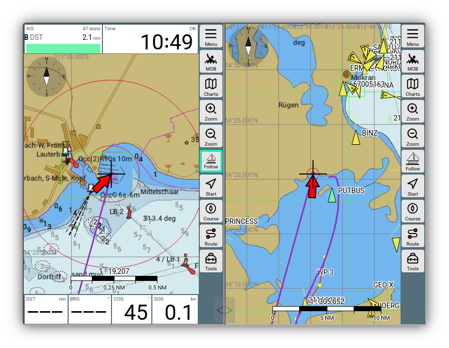
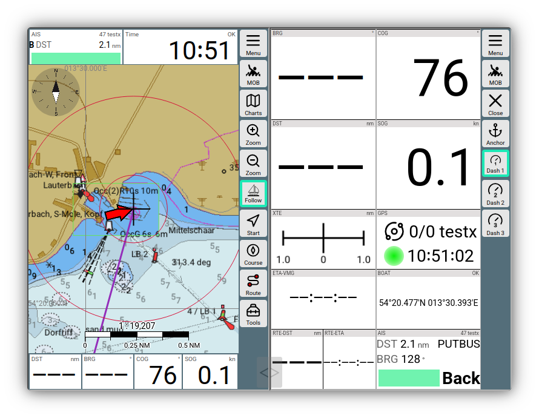

---
  tags:
    - Split mode
    - Tabs
---

# 2-window mode (split mode)

## Usage

Using

{{MM("MM:actions")}}->{{BT("Split",True)}}

you can split the screen into two AvNav windows.

///caption
2 window map
///

///caption
2 window dashboard
///

The two windows operate largely independently of each other. This allows you to display different views side-by-side as desired. In the example, you can see either two map views—even with different zoom levels—or different maps. A combination of a map view and a dashboard is also possible.

Using

{{MM("MM:actions")}}->{{BT("Split",True)}}

you can exit the 2-window mode.

You can adjust the screen split between the windows using the semi-transparent slider.

## Special features

### Alarms

In 2-window mode, alarms are only displayed in the right-hand window.

### Display settings

Most [settings](../base/settings.md) apply to both windows simultaneously in 2-window mode and take effect immediately. However, some settings can be configured separately for each window. These are marked with an `*` on the settings pages.

These specifically include the settings for the [remote control](remotecontrol.md).

Loading and saving settings is also handled separately for each window.

If you would like to configure further settings separately per window, you can modify the `splitkeys.json` file in the user files. You can access this via

{{MM("MMaddonconfigpage")}}

where you can edit it. After making changes, you must reload AvNav in the browser.

With the setting

{{MM("MMsettingspage")}}->General->"start with last split mode"

you can ensure that AvNav restarts in split mode if it was active previously. This is particularly helpful for Android.

### Layouts

Layouts can be selected separately for each window. This allows you to customize the map display differently, as shown in the example. A layout loaded in split mode will not remain active once you exit split mode.