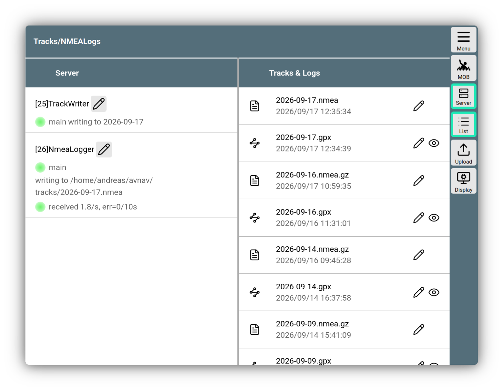

---
  tags:
    - Track
    - Server
    - NMEA
    - NMEALogger
---

# Tracks and NMEA Logs

When AvNav is running, it constantly records the current track. This captures the current position, time, speed, and course.

Recording takes place on the server; it is independent of whether a display device is currently connected. On [Android](../installation/android.md), recording also occurs when AvNav is running in background mode.

The track data is written into [GPX](https://en.wikipedia.org/wiki/GPS_Exchange_Format)<!--@@linkchanged--> track files. A new file is created for each day.

In the Linux/Windows version, data is initially written in an internal format, which is then periodically converted into a GPX file.

On Android, the current GPX file is written directly at periodic intervals.
To limit the amount of data, a new track point is only written if either a minimum distance or a minimum time from the previous track point has been reached - see [Settings](#settings).

On the [Navigation Page](../base/navpage.md), the current track is displayed with an adjustable length. In addition, further tracks can be displayed as [Overlays](../base/overlays.md) on the map.

Furthermore, AvNav also enables the recording of received NMEA data - see [NMEA Logs](#logs).

## Management and Configuration

Management of tracks and NMEA logs can be accessed via

{{MM("MMtrackspage")}}

///caption
Tracks and NMEA Logs
///

On the left side, you can set the server-side parameters for the track writer and the NMEA logger.

The parameters to be set are explained in the configuration description.
{: #settings}

| System | Unit |
| --- | ---|
| Windows/Linux | [Track Writer](configfile.md#avntrackwriter)|
| Android | [Track Writer](configfile.md#track) |
| Windows/Linux | [NNMEA Logger](configfile.md#avnnmealogger) |
| Android | [NMEA Logger](configfile.md#logger)|

Via {{BT("ShowSettings")}}, you can adjust the parameters for track display on the navigation page.
This includes:

| Name | Description |
| --- | --- |
| `Point Dist(s)`| Distance between 2 track points. This must, of course, be at least as large as the corresponding parameter in the server settings - points closer together will not be recorded. |
| `Length(h)` | Length of the displayed track in hours |

## NMEA Logs {: #logs}

AvNav uses its NMEA Logger to write all NMEA data it sees in the multiplexer to log files. Here too, by default, one log file is written per day. To limit the amount of data, filters can be defined in the [Settings](#settings). To analyze problems, you would normally remove the filters so that all NMEA data is recorded. For normal operation, however, you should use filters, as the amount of data can become quite large otherwise.

The log files can also be found in the same directory as the track files via

{{MM("MMtrackspage")}}

There, they can also be viewed, downloaded, or deleted.

Log files from past days are compressed using "gzip"; they are automatically decompressed when viewed.