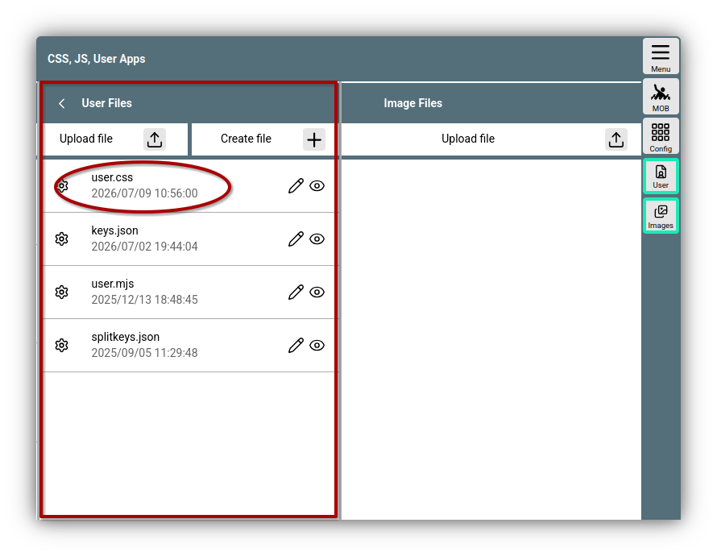
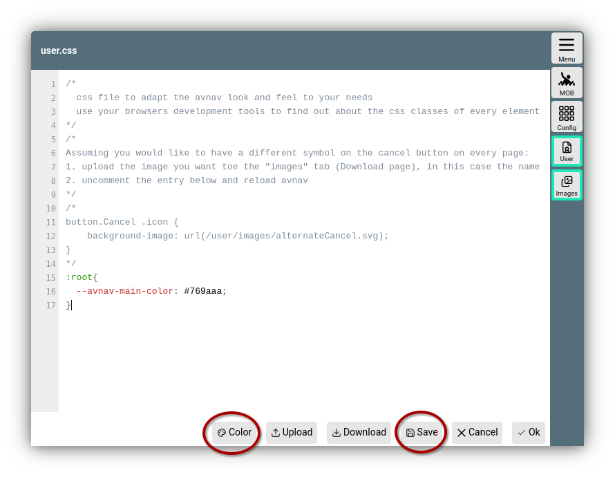
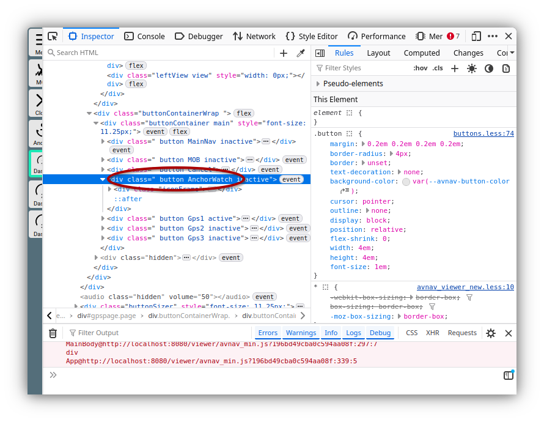

---
  tags:
    - CSS
---
Customization with CSS
======================

Since AvNav is a web application,
you can largely customize its appearance using CSS.

The designated file *user.css* is located in the directory for user files: *BASEDIR/user/viewer*. On [Raspberry Pi images](../installation/raspberry.md#images), "BASEDIR" stands for */home/pi/avnav/data*, otherwise it is *$HOME/avnav*.

You can use 

{{MM("MMaddonconfigpage")}}->{{BT("AddonConfigUser")}}

to list, edit, create, or upload files in the user directory. The *user.css* file can also be found there.


///caption
User files - user.css
///

By clicking on the file and selecting "Edit", you can edit the file. During installation, a template is provided that contains an example.

## Editor


///caption
user.css - Editor
///

The editor features syntax highlighting, which can help in generating correct CSS syntax.
As soon as you click the {{DB("DBSave")}} button, the file is saved and the changes become visible on all connected screens. This makes it quite easy to work with two browser windows or tabs - you can have the editor open in one window and the view you want to change in the other.

## Variables {: #variables }

For a wide range of display properties, AvNav uses [custom properties](https://developer.mozilla.org/en/docs/Web/CSS/Guides/Cascading_variables/Using_custom_properties) <!--@@linkchanged-->.

The values set by AvNav can be found in [properties.less](https://github.com/wellenvogel/avnav/blob/master/viewer/style/properties.less).

In the example image, the color for the page titles (*--avnav-main-color*) was set to a slightly lighter value.

## Color editor

To edit colors easily, you can highlight a color value in the CSS and then invoke the color editor via {{DB("DBColor")}}. When closing, the new color value is inserted.

## Finding properties

The fastest way to adjust properties is by using the browser's developer tools (often accessible via F11 or a similar combination - or via the menu).
For this, you should use a desktop/laptop browser - this is usually not possible with browsers on mobile devices.


///caption
Developer tools
///

Circled in the example is the button for the anchor watch on the dashboard pages. The element clicked in the developer tools is usually highlighted on the webpage.

## Buttons and icons {: #buttons-icons }
To customize buttons or icons, you must determine the name of the button/icon.
With the display in the image, we found that the button has the name [AnchorWatch](../../buttons/buttons.md#AnchorWatch) - we can compare it again with the button list.
If we now want to replace the image with another image, we must first upload the image as an **.svg* file. This is done in the {{BT("AddonConfigImages")}} area of the page where we also edit *user.css*.

We can now insert the following CSS code; the image is named "alt-anchor.svg":
```
.button.AnchorWatch .icon{
    background-image: url(/user/images/alt-anchor.svg);    
}
```

If we want a different icon for the *legacy* icon set, we can additionally insert:

```
.icon-legacy .button.AnchorWatch .icon{
    background-image: url(/user/images/alt-anchor-legacy.svg);    
}
```
For changed text, we can use the following CSS:
```
.button.AnchorWatch:after{
    content: 'ANCHR'
}
```
If one of the long texts is to be changed, this requires:
```
.button.AnchorWatch.longText:after{
    content: 'ANCHR'
}
```

## Specificity

If there are multiple CSS rules for the same element, which is usually the case, [specificity](https://developer.mozilla.org/en/docs/Web/CSS/Guides/Cascade/Specificity) is taken into account. <!--@@linkchanged--> If there are multiple rules with the same specificity, the last read rule wins. AvNav ensures that the rules from *user.css* are always read last - and thus override other rules with the same specificity.
However, if the specificity is lower, it will not work. In the example above, `AnchorWatch .icon{` would therefore not work, as AvNav already uses `button.AnchorWatch .icon{`.

## Other CSS sources

The functions described here also apply to other sources of CSS - i.e., layouts and plugins.