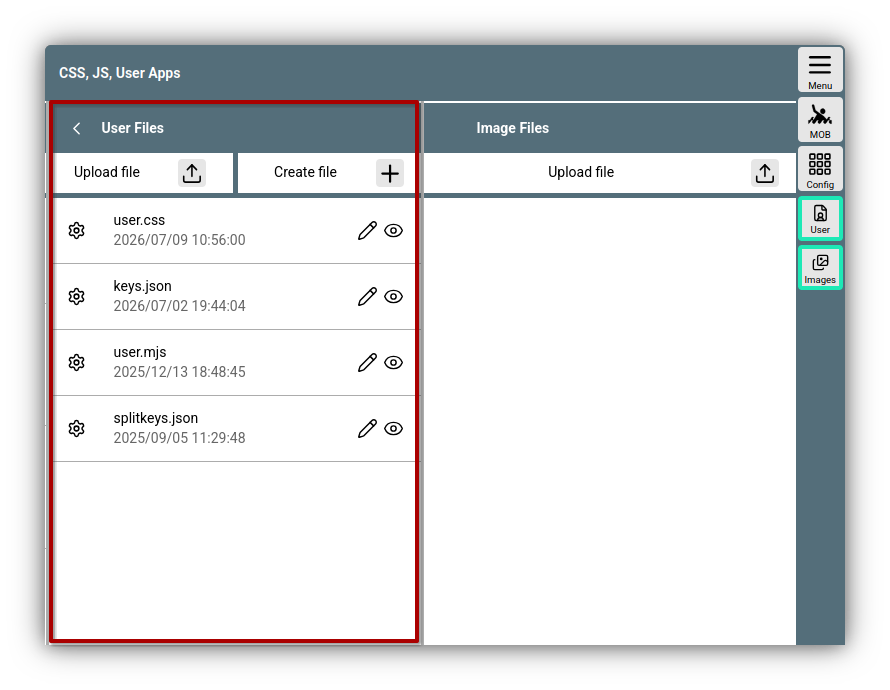
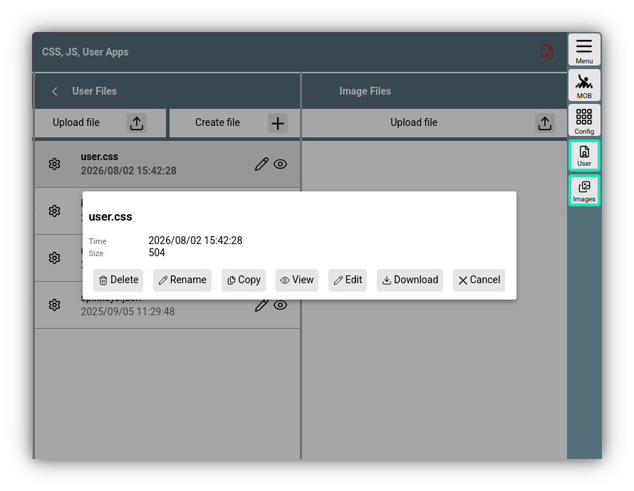
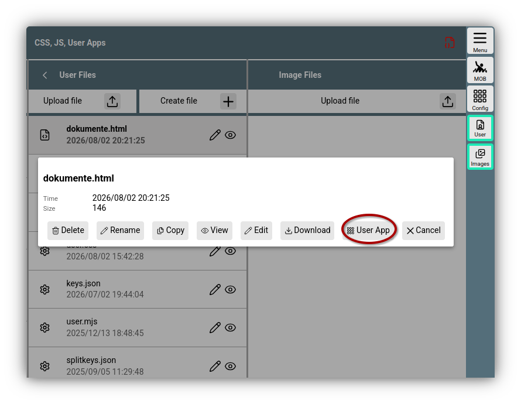
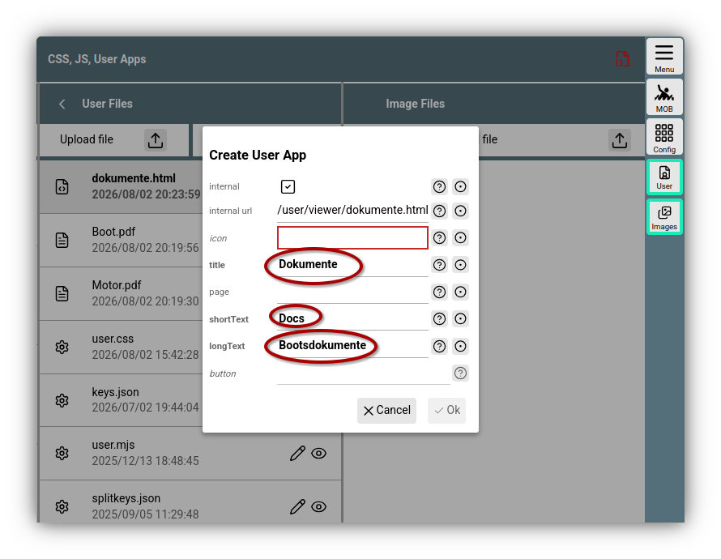

---
  tags:
   - User files
   - Extensions
   - User Apps
---

# User files

AvNav can store files for the user that can be created, uploaded, edited, viewed, and downloaded directly via the web interface.
These files are stored in the AvNav data directory under *.../user/viewer*. The data directory is normally found in the user's home directory under *avnav*. On the [Raspberry Pi images](../installation/raspberry.md#images) it is located at */home/pi/avnav/data*, and on Android, it is defined in the Android settings.

## Display and actions

You can reach the user file view under

{{MM("MMaddonconfigpage")}}->{{BT("AddonConfigUser")}}


///caption
User files
///

Initially, only a few template files are present there:
{ #specialfiles }

* [user.css](usercss.md): Customization via CSS
* [user.mjs](userjs.md): User JavaScript
* [keys.json](keyboard.md): Keyboard shortcuts
* [splitkeys.json](splitmode.md): Adjustments for split mode

After clicking on a file, you will receive a dialog with some additional information and various possible actions.


///caption
Actions
///

### Actions { #fileactions }

The possible actions depend on the file type. For known types like in the example, there are:

| Button | Function |
| --- | --- |
| {{DB("DBDelete")}} | Delete the file |
| {{DB("DBRename")}} | Assign a new name to the file. *Note*: If you rename *user.css*, for example, it will no longer take effect, and the AvNav server will create a new template file for it upon the next start. |
| {{DB("DBCopy")}} | Copy the file on the server. |
| {{DB("DBView")}} | View the file. For most supported files, this is a simple text view. |
| {{DB("Edit")}} | Edit the file in a built-in editor. Normally, this is a text editor with syntax highlighting for known file types. |
| {{DB("DBDownload")}} | Download the file from the server and save it on the device currently being used for display. | 

## Creating and uploading

If you want to create a new file, use the {{SB('CreateFile')}} button above the file list. After selecting a name, an editor dialog will open for editable files; for some file types, template text is inserted. With {{DB("DBSave")}} or {{DB("DBOk")}}, the file is saved (only active if the file has been changed).

To upload from the device on which the browser is running, use the {{SB("Upload")}} button above the file list. If a file with the same name already exists, you can assign a new name for the file.

## Images { #images }

Image files can also be stored as user files. To obtain a better overview, these can also be saved under {{BT("AddonConfigImages")}}. The functions are the same.

## Use of files

In addition to the [special files](#specialfiles) described above, any files can be stored in the user directory.

HTML files can be particularly useful. Since all files from this directory can be reached by a web browser via the URL
```
  http://nn.nn.nn.nn:8080/user/viewer/xxx
```
you can very easily create additional pages that can be displayed both inside and outside of AvNav. For this purpose, on the same page under {{BT("AddonConfigAddOns")}}, the option is available to set up the files as so-called "[User App](../base/userapps.md)" or AddOn.

## Example of an HTML file { #userappexample }

With an HTML file and other uploaded files, you can, for example, build a very simple document list that you can then use in AvNav with a click.
Assume you have two documents `Boot.pdf` and `Motor.pdf`. These are uploaded as user files via {{SB("Upload")}} as described.
With {{SB('CreateFile')}}, you create an HTML file `dokumente.html` with the following content:
```
<html>
<head>
 <style>
   li{
    line-height: 1.5em;
   }
 </style>
</head>
<body>
<h1>Dokumente</h1>
<ul>
  <li><a href="Boot.pdf">Boot</li>
  <li><a href="Motor.pdf">Motor</li>
</ul>
</body>
</html>
```

Now you just need an image file for the button that will be used to call up this list in the future. Icons can be found, for example, at [material icons](https://fonts.google.com/icons?icon.query=document&icon.size=24) <!--@@linkchanged-->.
As an example, take an icon and save it under the name "dokumente.svg" in the [Images](#images) section.

When you click on the file "dokumente.html", you get an extended dialog.


///caption
Example HTML file
///

By clicking on {{DB("DBUserApp")}}, a dialog opens with which the documents are set up as a [User App](../base/userapps.md).


///caption
Setup User App
///
Fill in the marked values, select the uploaded icon under *icon*, and save with {{DB("DBOk")}}.

In the {{BT("AddonConfigAddOns")}} tab, you will now be able to see the new User App with the selected icon. With a click on the icon, you can display the newly built page.

You will find the newly created button later under 
{{MM("MMaddonpage")}}.