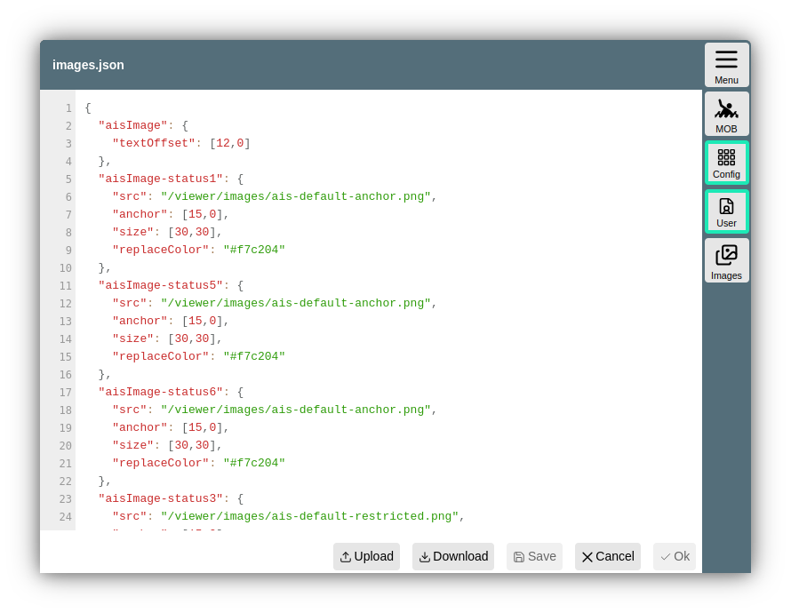

---
  tags:
    - Configuration
    - Icons
---

User Symbols
============

Available since version 20201030.

Many of the symbols used in AvNav can be customized to suit your needs. You can change the size of existing symbols, set various properties, or replace them with your own custom symbols.

If you want to use your own symbols, they must be uploaded as .png files into the images directory - see the [description of user files](userfiles.md).

Which symbols should be changed (and how) is defined in a JSON file within the user directory - `images.json`.

This file has the following structure (example):

```
{
"boatImage": {
"anchor": [20,0],
"size":[40,71]
},  
 "boatImageHdg:{  
 "src": "/user/images/SpecialBoat.png",
"anchor": [15,15],   
 "size":[30,70]  
 }
"markerImage":{
"src": "/user/images/Marker.png",
"anchor": [15,15],
"size":[30,30]
},
"aisNormalImage-Sail":{
"src": "/user/images/Sail-Boat-40.png",
"anchor": [15,15],
"size":[30,30],
"courseVectorColor": "#ff00ff",
"rotate":false
},
"aisNormalImage-Military":{
"anchor": [32,0],
"size":[64,120]
}
}
```

Since 20230614, there is a [base configuration](https://github.com/wellenvogel/avnav/blob/master/viewer/static/images.json) <!--@@linkchanged--> that the system uses. Entries can be overridden in the user file.

For every symbol that is to be replaced, an entry with the corresponding name must exist.

General images
-----------------

|  |  |
| --- | --- |
| boatImage | The symbol for the boat on the navigation page |
| boatImageHdg  (20220421) | The symbol for the boat when hdm or hdt are used for display |
| boatImageSteady  (20220421) | The symbol for the boat when zero SOG detect is enabled and the boat is not moving |
| markerImage | The symbol for the current destination waypoint |
| anchorImage | The symbol for the anchor when the anchor alarm is enabled |
| measureImage | The symbol for the starting point of the current measurement |

AIS images
----------

There are a whole range of options for AIS images. Every AIS target can be in a specific state (indicated by a corresponding color).

|  |  |
| --- | --- |
| State | Meaning |
| Normal | AIS target |
| Warning | The closest AIS target that falls below the minimum set CPA |
| Tracking | The AIS target selected via the AIS info page |
| Nearest | The nearest AIS target |

In addition, AIS images can be distinguished based on the type (Normal/Aton) and various parameters (ship type, navigation status, aid type).

In principle, it is possible to define a unique icon for every possible combination. However, it is easier (since 20230614) to let AvNav handle the state (color). To do this, the icons must contain a color that is then replaced by the corresponding color of the state during rendering. To achieve this, AvNav must be informed of this color via the "replaceColor" parameter (see the [defaults](https://github.com/wellenvogel/avnav/blob/master/viewer/static/images.json) <!--@@linkchanged--> for examples).

Essentially, the following icon definitions are possible (examples):

|  |  |  |
| --- | --- | --- |
| Key | Meaning |  |
| aisImage | default Ais icon |  |
| aisImage-status1 | Icon for AIS targets with navigational status 1 (At Anchor), for a list of values see the [source code](https://github.com/wellenvogel/avnav/blob/d8fcbdc34841b45581596b790f55be08010cbaa9/viewer/nav/aisformatter.ts#L170). <!--@@linkchanged--> |  |
| aisImage-Fishing | Icon for AIS targets with ship type 30 (Fishing), [see the code](https://github.com/wellenvogel/avnav/blob/d8fcbdc34841b45581596b790f55be08010cbaa9/viewer/nav/aisformatter.ts#L140) <!--@@linkchanged--> for the values |  |
| aisImage-Fishing-status1 | Icon for AIS targets with navigational status 1 (At Anchor) and type 30 (Fishing) |  |
| aisatonImage | default AIS icon for atons |  |
| aisatonImage-type9 | AIS icon for atons with type 9 (Beacon, Cardinal N), [see the code](https://github.com/wellenvogel/avnav/blob/d8fcbdc34841b45581596b790f55be08010cbaa9/viewer/nav/aisformatter.ts#L264) <!--@@linkchanged--> for the values. |  |

Setting the images follows these priorities:

1. aisImage-Fishing-status1
2. aisImage-Fishing-status* (since 20250812)
3. aisImage-status1
4. aisImage-Fishing

You must therefore note that you may need to make multiple entries if, for example, you want a specific icon for a type (especially before version 20250812) - the defaults already contain entries for status values 1, 2, 3, 4, 5, 6, 7 - you must then, for example, create entries for the Passenger type for:

* aisImage-Passenger-status1
* aisImage-Passenger-status2
* aisImage-Passenger-status3
* aisImage-Passenger-status4
* aisImage-Passenger-status5
* aisImage-Passenger-status6
* aisImage-Passenger-status7

As of version 20250812, the definition also allows a "wildcard" status. For the example, you can specify:

* aisImage-Passenger-status*

If you do not want to work with "replaceColor", you can specify different icons for the states:

aisWarningImage, aisNormalImage, aisWarningImage-status1, ...

Icon parameters
--------------

The following parameters can be defined for every symbol:

|  |  |  |
| --- | --- | --- |
| src | The URL for the image file. Typically /user/images/XYZ.png for a file that was uploaded via the download page. If this parameter is not specified, the symbol existing in AvNav is used - but you can, for example, change the size using the other parameters. The image files should be a bit larger than what is specified in size - e.g., factor 2 (but not too large, as performance will suffer). If you have vector graphics, you can use [inkscape](https://inkscape.org), for example, to generate pngs from them. <!--@@linkchanged--> |  |
| size | [width,height] - must be specified as an array (see example). This describes the size of the symbol (the image file is scaled to this size). If you do not specify an src parameter, you can change the size of the internal symbol here. |  |
| anchor | [x,y] - the point of the symbol (relative to width and height) that should be placed on the current position on the map. |  |
| rotate | true or false - if set to false, the symbol is not rotated according to the current heading | not for markerImage |
| courseVector | true or false - if set to false, no course vector is drawn for this symbol (even if it is active via settings) | not for markerImage |
| courseVectorColor | the color for the course vector. Here you can choose a color that matches the images used. | not for markerImage |
| replaceColor (since 20230614) | The color to be replaced depending on the state | only ais...Image |
| textOffset (since 20230614) | An array [x,y] for the base text offset. Additionally, another offset is calculated depending on the course (primarily y). The X value must be oriented to the size of the icon (size parameter) | only ais...lImage |

Parameters that are not specified are replaced by default values. It is also possible to specify only parameters for certain combinations and no custom icon - this allows you to, for example, make the AIS symbols different sizes. Typically, when changing size, the anchor must also be changed.

When editing the images.json, care must be taken to create valid JSON. Within AvNav, the file can be edited under [User files](userfiles.md).



After changing images.json, AvNav must be reloaded - e.g., via

{{BT("MainNav")}}-> Actions -> {{BT("ReloadUI",True)}}.