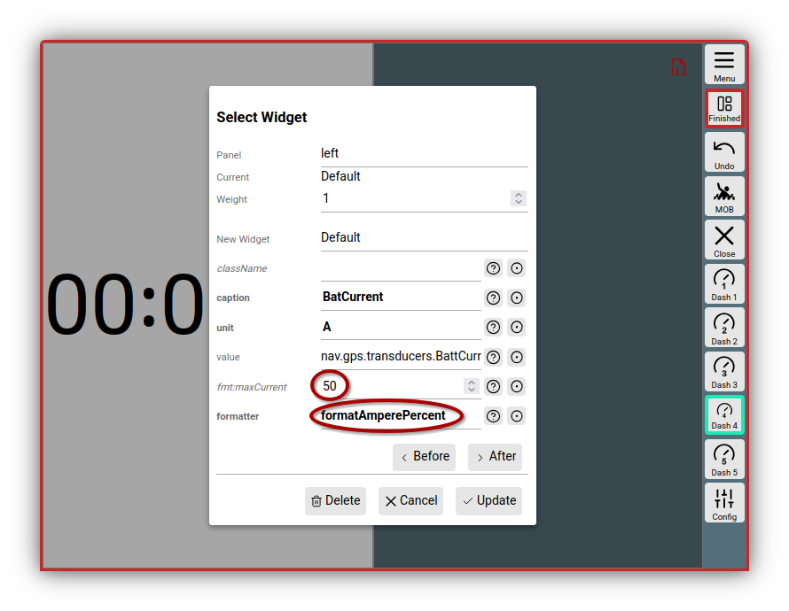
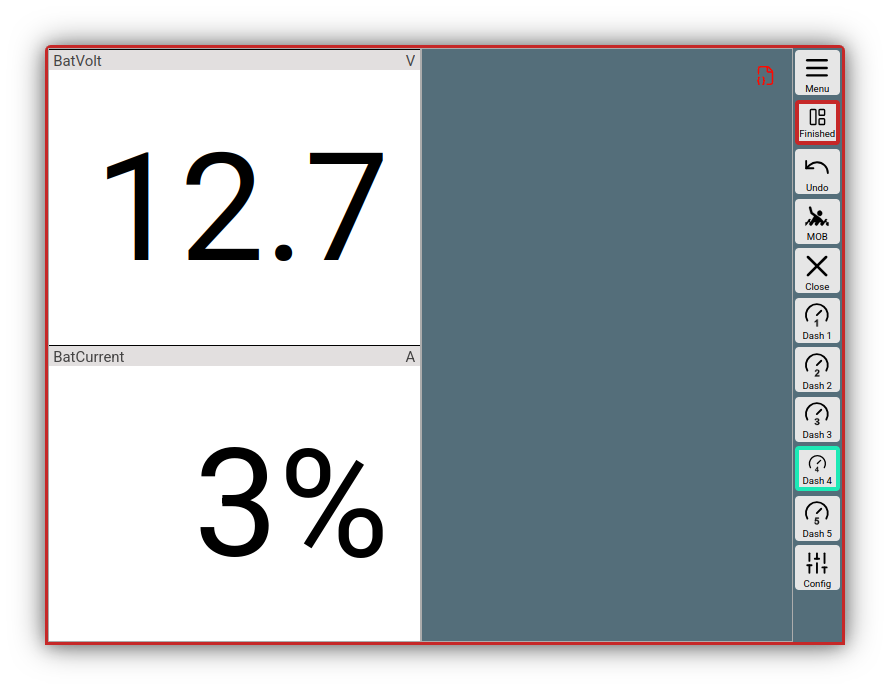

---
  tags:
    - Extensions
    - JavaScript
---

# User JavaScript code

To provide an easy way to customize AvNav to your needs, you can extend AvNav relatively easily with a little bit of JavaScript code.
The possible extensions are described in the following chapters.
In principle, you can execute arbitrary JavaScript code - but you must, of course, ensure that you do not interfere with AvNav's functions.

The functions described in this document are available both to the user JavaScript code and to the JavaScript code in plugins.

The JavaScript code is located with the [user files](userfiles.md) in the file **user.mjs**. This file is a [JavaScript module](https://developer.mozilla.org/en-US/docs/Web/JavaScript/Guide/Modules) and is loaded by AvNav at the end of its startup process. 
The main content of this file is an exported function that is called by AvNav after loading. The "api" parameter is the [AvNav interface](https://github.com/wellenvogel/avnav/blob/master/viewer/api/api.interface.ts) that can be used by the code.

A minimal content of the file could look like this:

``` js
export default (api)=>{
    api.log("Hello world);
}
```
## Cleanup {: #cleanup }
To ensure that reloading the JavaScript code works (especially important for plugins as well), care must be taken to release all global resources when the module is no longer needed. What does this mean?
Global resources are, for example, timers that have been started directly on the window object. If these are not already stopped elsewhere, a "cleanup function" should be written to stop them.

Such a cleanup function can be returned as the result of the default export function.

Example:

``` js
export default (api)=>{
    //start a timer (global resource)
    const timer=window.setInterval(()=>console.log("timer"),1000);
    //a cleanup function to stop the timer
    //or free other global resources
    const cleanup=()=>{
        if (timer) window.clearInterval(timer);
    }
    //return the cleanup function
    return cleanup;
}
```
If the code does not use such global resources, no cleanup function needs to be returned. Calls to the AvNav API are not global resources - the cleanup for these happens internally within AvNav.


??? "Compatibility with previous versions - user.js"
    In previous versions, the JavaScript code was located in a file named user**.js**. This was a simple JavaScript file (not a module). 
    The new handling with user.mjs has several advantages:
    
    * Automatic reloading upon changes
    * Extended API (more functions possible)
    * Additional modules can be loaded.
    
    If AvNav was installed via an update and an old user.js file exists, it will continue to be used. However, the available API only contains a subset of the functions of the current API.
    Since this file is also loaded via a JavaScript module in the current version, and modules require stricter JavaScript code, loading errors may occur. In that case, you may need to [adapt](https://developer.mozilla.org/en-US/docs/Web/JavaScript/Guide/Modules#other_differences_between_modules_and_classic_scripts) your code.
    The old description for user.js is available [here](userjs-legacy.md).
    If both a user.mjs (new) and a user.js (old) are present, only the user.mjs will be loaded.

## Editing the file user.mjs
Via 

{{MM("MMaddonconfigpage")}}->{{BT("AddonConfigUser")}}

you reach the list of files in the user directory. After clicking on the file "user.mjs" and {{DB("Edit")}}, an editor window opens where you can edit the code.
To work effectively, it is recommended to use two browser windows or tabs - have the editor open in one window, and in the other, have AvNav open in the area you want to test. When saving the file in the editor window, it is immediately reloaded in the background in all open AvNav windows and takes effect directly.

The editor has syntax highlighting for JavaScript, so you can already see the correctness of the code to a certain degree.

For working on the file, you should open the developer tools in the browser window you are testing in and keep the "console" visible. Errors in the JavaScript code will be output there.

When you have finished editing, you should reload AvNav in all browser windows (you will get a hint about this through the red icon {{ICON("JSChanged")}} in the title line - a click on it leads to a dialog for reloading).

The user.mjs file created by the system already contains some examples that can be activated by removing comment characters.

The current template can also be found [on github](https://github.com/wellenvogel/avnav/blob/release-{{config.extra.version}}/viewer/static/user.mjs).

## Formatter { #formatter }

A typical use case for a new formatter is displaying a previously unknown value via the default widget (see [Layouts](layout.md)).
This could, for example, be a charging or discharging current received via an XDR data set. In the data, the value is in A, but we would like to display the value as a % of a maximum value.
To do this, you can use the following code:
``` js
const formatAmperePercent=(val)=>{
  const max=50; //fix max
  if (isNaN(val)) return "-----";
  const percent=Number(val)*100/50;
  return percent.toFixed(0)+"%";
}
api.registerFormatter("formatAmperePercent",formatAmperePercent);
```
Once you have written this formatter into the user.mjs, you can now immediately use the formatter in the layout editor by selecting the default widget, selecting the value to be displayed under "value", and selecting the inserted "formatAmperePercent" under "formatter".

Of course, this is not very comfortable yet - the maximum value is hard-coded. If you want the maximum value to be selectable in the layout editor, you have to define parameters for the formatter.
You define only one parameter "maxCurrent".

``` js
const formatAmperePercent=(val,max)=>{
  if (isNaN(val)) return "-----";
  if (! max) max=50;
  const percent=Number(val)*100/max;
  return percent.toFixed(0)+"%";
}
formatAmperePercent.parameters=[
  {
    name: "maxCurrent",
    type: "FLOAT",
    default: 50,
    description: "Maximal current for computing the percentage"
  }
]
api.registerFormatter("formatAmperePercent",formatAmperePercent);
```
The parameters for a formatter are described similarly to [widget parameters](#widgetparameter), except that they are specified as an array with an additional "name" field.
If you now use the new formatter in the layout editor, the screen looks like this:


///caption
Formatter with parameters
///

And the result then (lower widget):


///caption
Formatter result
///
If you are not satisfied with the simple JavaScript "toFixed" function, you can of course use one of the already [existing formatters](layout.md#formatter) instead.
For example, if you want 3 decimal places, you can use "formatDecimal".
``` js
...
return api.formatter.formatDecimal(percent,3)+"%";
```

## Widgets {: #widgets}

You can add the following types of displays:

* Widgets with their own [formatter](#formatter) (and optionally fixed values) based on the default widget (Example 1 - [user.mjs](https://github.com/wellenvogel/avnav/blob/master/viewer/static/user.mjs): rpmWidget)
* Customization/extension of graphic widgets with [canvas gauges](https://canvas-gauges.com/) (Example 2 - [user.mjs](https://github.com/wellenvogel/avnav/blob/master/viewer/static/user.mjs) rpmGauge)  
  With this, it is also possible to make parameters accessible that are not contained in the existing widgets
* Widgets with own HTML code (Example 3 - [user.mjs](https://github.com/wellenvogel/avnav/blob/master/viewer/static/user.mjs): userSpecialRpm)
* Widgets with graphics in a canvas element (Example in the [TestPlugin:](https://github.com/wellenvogel/avnav/blob/master/server/plugins/testPlugin/plugin.js) testPlugin\_courseWidget)
* Widgets with own HTML that interact with the server part of a plugin ([TestPlugin](https://github.com/wellenvogel/avnav/blob/master/server/plugins/testPlugin/plugin.js): testPlugin\_serverWidget)
* Widgets that display graphics on the map (type: `map`) e.g. [SailInstrument](https://github.com/kdschmidt1/Sail_Instrument/blob/e1d87186138e5a3ac894916e9b7e85a3218a4c9a/Sail_Instrument/plugin.js#L223)

The interface used to communicate with AvNav can be found [on github](https://github.com/wellenvogel/avnav/blob/master/viewer/api/api.interface.ts).
For map widgets, the [underlying libraries](https://www.movable-type.co.uk/scripts/geodesy-library.md) for geographical calculations can be accessed via the API (function LatLon and Dms).

### Canvas gauges

For [Canvas Gauge](https://canvas-gauges.com/) widgets, certain parameters (see [Canvas Gauges description](https://canvas-gauges.com/documentation/user-guide/configuration)) can either be set to fixed values (then they must be present in the widget definition - see the values in the [example](https://github.com/wellenvogel/avnav/blob/master/viewer/static/user.mjs)) or they can be made adjustable for the user in the layout editor (then they must be set as [WidgetParameter](#widgetparameter)).

Furthermore, a [custom formatter](#formatter) can potentially be defined and set as the default for the widget.

If you want to avoid certain [predefined parameters](#predefinedparameters) becoming visible to the user in the layout editor, they must be set to false in the editable parameters.

``` js
var rpmGaugeUserParameter = {
...
formatter: false,
formatterParameters: false
};
```

For every gauge widget, the "type" parameter must be specified - either "radialGauge" or "linearGauge".  
In addition, they have the extra parameter

``` js
drawValue (boolean)
```

This parameter controls whether a numerical display of the value should also occur. The original "valueBox" parameter of the canvas gauges is ignored!

Besides the parameters, a translateFunction can also be defined. This receives an object with the current values of all parameters as a parameter and can modify it before it is passed to canvas gauges.
This function must be "stateless", i.e. the return values must only depend on the passed values (and other immutable values). Otherwise, changes will potentially not be visible in the display.

### Custom widgets

For a self-written widget, the following functions/properties can be implemented:

| Name | Type | Usable with type | Description |
| --- | --- | --- | --- |
| name | String | all | the name of the widget |
| type | String (optional) | all | Determines which widget should be created. Values: radialGauge, linearGauge, map. If the type is not set, either the default widget is used (no renderHtml and no renderCanvas function specified) - or a user-defined widget (userWidget) |
| renderHtml { #renderhtml } | Function (optional) | userWidget | This method must return [HTML](#htmlcode) which is then built into the widget. The object passed as a parameter to renderHtml contains the values defined under storeKeys and parameters. The function is called again every time the values have changed. The "this" variable inside renderHtml points to an object that is specific to the widget ([context](#widgetcontext)). |
| renderCanvas | Function (optional) | userWidget, map | With this function, you can draw in the passed canvas object. The object passed as a second parameter to renderCanvas contains the values defined under storeKeys and parameters. The function is called again every time the values have changed. The "this" variable inside renderCanvas points to an object that is specific to the widget ([context](#widgetcontext)). For map widgets, this canvas is an overlay that is placed over the map. Functions for converting coordinates to canvas pixels are available on the widget context. It is important to describe the canvas correctly with save/restore, as all map widgets share the same canvas. |
| storeKeys | Object | all | Here, the data that should be read from the central store and passed to the renderXXX functions as parameters must be specified. See [Store](#store) |
| caption | String (optional) | all | A default label |
| unit | String (optional) | all | A default unit |
| formatter | Function (optional) | defaultWidget, radialGauge, linearGauge | A formatter for the value. For the defaultWidget, this function must be specified. |
| translateFunction | Function (optional) | all except map | This function is called with the current values as a parameter (as specified with storeKeys) and must return the values calculated from them. If no custom renderXXX function is to be used, a conversion of values can take place here before rendering. |
| initFunction { #initfunction } | Function (optional) | userWidget, map | If present, this function is called once when the widget is created. The widget context is available as a parameter (and as this). This object has an eventHandler property - functions used in renderHTML must be registered here. With the triggerRedraw function on the widget context, a renewed call of the renderXXX functions can be forced. The 2nd parameter contains the properties of the widget. These are in particular all editable widget parameters that have been defined. |
| finalizeFunktion | Function (optional) | userWidget, map | If present, this function is called before the widget is no longer used. The "this" variable points back to the widget context. In addition, the context is also available as the first parameter - as with the initFunction. |

After the definition, the widget must be made known to AvNav
(api.registerWidget).

### Widget Context { #widgetcontext }

User widgets and map widgets receive a WidgetContext. This is created for each widget and passed to the functions:

* initFunction (this and first parameter)
* finalizeFunction (this and first parameter)
* renderHtml (this)
* renderCanvas (this)

passed.  
So that the context can be used as a this parameter, the functions must be defined "classically" using function and not as an "arrow function".

Correct:

``` js
let userWidget={  
 renderHtml: function(context,props){  
 return "<p>Hello</p>";  
 }  
}
```

User data can be stored in the WidgetContext, which is required in successive calls.  
Furthermore, it contains some functions that can be called by the widget code.

| Name | Widget | Parameter | Description |
| --- | --- | --- | --- |
| eventHandler | userWidget | --- | eventHandler is not a function but an array. If event handlers are specified in [renderHtml](#htmlastext), then a function with this name must be registered here in the initFunction. |
| triggerRedraw | userWidget | --- | This function must be called if the widget (e.g. after communication with the server) wants to be redrawn. |
| lonLatToPixel | map | lon,lat | Converts the coordinates into pixel coordinates for drawing in renderCanvas. Returns an array with x,y coordinate. |
| pixelToLonLat | map | x,y | Calculates longitude and latitude from the canvas coordinates x,y. Returns an array with lon,lat. |
| getScale | map | --- | Returns the scaling factor for the display. High-resolution displays have a scaling factor > 1. Drawn objects (especially text) should be adjusted in their dimensions. |
| getRotation | map | --- | Returns the rotation of the map (in radians!) |
| getContext | map | --- | Returns the renderingContext2D of the canvas (only active within the renderCanvas function) |
| getDimensions | map | --- | Returns the size of the canvas [width,height] |
| triggerRender | map | --- | Same function as triggerRedraw for the user widget |

### Widget parameters {: #widgetparameter}

Besides the widget definition, parameters can be specified when registering the widget, which are then displayed for the widget in the layout editor.

Examples can be found in the [user.mjs template](https://github.com/wellenvogel/avnav/blob/master/viewer/static/user.mjs). The values specified in the layout editor for these parameters are later available in the renderHtml and renderCanvas functions (exception: type KEY, here the value read from the store is made available). 


For each parameter, you can specify the following values:

| Name | Type | Description |
| --- | --- | --- |
| type | String | `STRING, NUMBER,FLOAT, KEY, SELECT, ARRAY, BOOLEAN, COLOR` The type for the parameter. Depending on the type, it is displayed differently to the user. For COLOR, a color picker; for SELECT, a selection list; and for KEY, the list of currently available values in the store. For an array, a comma-separated list can be specified. |
| default | depends on type | The default value. For COLOR, a color css property - e.g. "rgba(200, 50, 50, .75)" |
| list | Array (only for type SELECT) | An array of strings or of objects {name:'xxx',value:'yyy'} - these values are displayed for selection. Instead of an array, a function can also be specified that returns an array - or a function that returns a Promise, whose resolve function then delivers the array. |
| description | string | A description of the value for the user |
| condition | Object or Array of objects | An object with values for other parameters. The parameter is only displayed if the other parameters have the corresponding value. If an array is specified, the individual elements are OR-linked. Example ` condition:{kind:'all'}`. The parameter is only displayed if the "kind" parameter has the value "all".


There are a number of predefined parameters for the layout editor. For these, instead of an object with properties, only true or false is specified for the description (this indicates whether they should be offered for editing or not).
{: #predefinedparameters}

These are:

* caption (STRING)
* unit (STRING)
* formatter (SELECT)
* formatterParameters (ARRAY)
* value (KEY)
* className (STRING)

An example of a definition:
``` js
var exampleUserParameters = {
//formatterParameters is already well known to avnav, so no need for any definition
//just tell avnav that the user should be able to set this
formatterParameters: true,
//we would like to get a value from the internal data store
//if we name it "value" avnav already knows how to ask the user about it
value: true,
//we allow the user to define a minValue and a maxValue
minValue: {type: 'NUMBER', default: 0},
maxValue: {type: 'NUMBER', default: 4000},
};
```

## Libraries and images

If your own JavaScript code is to access libraries or images, these can be uploaded to the same directory - images also in the images {{BT("AddonConfigImages")}} directory.

Libraries located in the user data directory can simply be loaded with
``` js
import './libtest.js';
```
If the libraries offer their functions as modules, you will find in the description which imports can be used.
``` js
import test from './libtest.js';
```
For a default export.

It is recommended to assign CSS classes to all widgets so that you can then customize them with [user-specific CSS](usercss.md). IDs should not be used, as the elements can potentially appear multiple times on the page.

If data is to be loaded from the server, it is recommended to use [fetch](https://developer.mozilla.org/en-US/docs/Web/API/Fetch_API/Using_Fetch).
All files in the user directory (or in the plugin directory for plugin.js) can be retrieved according to the scheme `api.getBaseUrl()+"/"+name`.


## Feature formatter (featureFormatter) {: #featureFormatter }

There is the possibility to register your own functions that prepare the display of data from [overlays](overlays.md#featureFormatter).  
Such functions can be implemented in the user.mjs or in plugins.

With

``` js
api.registerFeatureFormatter('myHtmlInfo',myHtmlInfoFunction);
```

they are registered.
This JavaScript function receives as parameters the properties of the clicked point available in the overlay file and can return changed/new properties, which are then displayed by the FeatureInfo dialog.

The following properties can be returned:

| Name | Meaning |
| --- | --- |
| sym | the URL for an icon to be displayed. This can be a relative URL, which is then an icon file within the [configured](../base/overlays.md#parameters) userIcons file, an absolute path such as /user/images/myImage.png, or an external URL starting with http: (of course, then only usable with an internet connection). |
| name | the name to be displayed |
| desc | the text to be displayed under "description" |
| htmlInfo | an html string, which is then displayed when clicking on the {{DB("DBInfo")}} button. |
| time | a time specification (string or JavaScript date) |
| link | a URL that should be displayed when clicking on the {{DB("DBInfo")}} button (alternative to htmlInfo). The same rules apply as for "sym". |

The passed parameters depend on the overlay file. In addition, the values "lat" and "lon" are present in any case.

An example of the [built-in genericHtmlInfo](https://github.com/wellenvogel/avnav/blob/master/viewer/util/featureFormatter.js) function, which writes all available values as HTML into the value htmlInfo.

``` js
let genericHtmlInfo=function(properties,extended){
if (! extended) return {};
let htmlInfo='<div class="featureInfoHtml">';
for (let k in properties){
if (!properties[k]) continue;
if (htmlInfo !== "") htmlInfo+="<br/>";
htmlInfo+=avnav.api.escapeHtml(k)+"="+avnav.api.escapeHtml(properties[k]);
}
htmlInfo+='</div>';
return {htmlInfo:htmlInfo};
}
```

The second parameter passed to the function indicates whether all parameters should be generated or only the "sym" parameter. If extended is set to "false", the function should not perform time-consuming operations, as it is potentially called for every element from the overlay.

After such a function has been registered, it can be selected for an overlay in the [configuration](../base/overlays.md#parameters).


## Map layer (User Map Layer) {: #usermaplayer }

Via the function
``` js
api.registerUserMapLayer(baseName,name,callback)
```
your own map layer types can be registered. A description can be found under [chart details](charts.md#extensions).

## HTML code { #htmlcode }

In various places (with [widgets](#widgets), [dialogs](#dialogs)), HTML code can be passed to the API. For this, there are the following possibilities:

### Text { #htmlastext }
This is the variant that is also already available in all older AvNav versions. Here, the HTML code is simply passed as text.
` <div class="test">Test</div>`.
In JavaScript, you can use [template strings](https://developer.mozilla.org/en-US/docs/Web/JavaScript/Reference/Template_literals) quite well for this.

``` js
const v=99:
return `<div class="value">${v}</div>`
```
If you want to integrate interactive elements, this is only possible with [custom widgets](#renderhtml).
Event handlers for elements must be registered beforehand (see [initFunction](#initfunction)) and are simply specified in the HTML code with ``` <button onclick="myHandler">Click!</button> ``` (this is not exact HTML syntax, as only the name of the event handler is specified, no JavaScript code). When the event handler is called, this points to the widget context.

### ReactJs { #htmlreact }
AvNav itself is written using [ReactJS](https://react.dev/). To offer the user extended possibilities when introducing their own code, HTML can also be returned as a [ReactNode](https://github.com/DefinitelyTyped/DefinitelyTyped/blob/9a3935d14fd94421a5c599b968365543c4f1fb2f/types/react/v18/index.d.ts#L486).
Since no JSX parser is available for user JavaScript code, and creating React objects in pure JavaScript code is tedious, AvNav offers support for [HTM](https://github.com/developit/htm) here.
To use this, you have to import the corresponding modules at the beginning of the user.mjs file.
``` js
import html from '/modules/htm.js';
```
A simple widget that uses a reusable component Value for display can then look like this:
``` js
//a simple React component that will render a div with the class "value"
//and display the parameter "v" inside
const Value=({v})=>html`<div class="value">${v}<//>`

//a simple widget that will render the value of the selected
//store key using the Value component
const HTMWidget={
  name:'HTMWidget',
  renderHtml:(props)=>{
    return html`<${Value} v=${props.value}><//>`
  }
}
const HTMParameters={
  value:{
    type:"KEY",
  }
}
api.registerWidget(HTMWidget,HTMParameters);
```
Using React functions, it is also much easier, e.g., to integrate a click handler.

``` js
const Value=({v})=>{
   const clickHandler=(ev)=>alert("Value:"+v);
   return html`<div class="value" onClick=${clickHandler}>${v}<//>`
}
```
All ReactJS functions are available. The necessary modules can be added via corresponding imports. In addition, some AvNav GUI elements are also available via imports. 
The provided modules can be found in the [code](https://github.com/wellenvogel/avnav/tree/master/viewer/exportmodules).
If you want to import, for example, [ListItem](https://github.com/wellenvogel/avnav/blob/66f12023f6f863fcbb24d18efe1ed40494421782/viewer/exportmodules/avnavui.js#L36) from the AvNav modules, you write in the code
``` js
import {ListItem} from '/modules/avnavui.js`;
```

Some examples of usage can be seen in an [AvNav-own plugin](https://github.com/wellenvogel/avnav/blob/master/raspberry/network-nm/plugin/plugin.mjs) for network management. 

## AvNav navigation data (Store) {: #store }

To dynamically adapt displays to changed values, AvNav follows a "store" concept. In this store, data is stored with a structured key and its value. Such a key is, for example, `nav.gps.lat` for the current latitude of the GPS position. The keys used within AvNav can be found in [keys.ts](https://github.com/wellenvogel/avnav/blob/4ba19d53196a35ac46c0c38daebd1f59112981a9/viewer/util/keys.ts#L161).

The AvNav store can be used in various ways:
  
  1. For dynamic displays

     In some places (e.g. for widgets or buttons), you can specify a parameter `storeKeys`. This selects some of the values in the store that should be monitored for changes. Whenever these change, the corresponding element (e.g. the widget) is redrawn. At the same time, the entries translate the structured keys into simple ones.
     ``` js
     const storeKeys={
        lat:'nav.gps.lat',
        lon: 'nav.gps.lon'
     }

     const testWidget={
        name: 'testWidget',
        renderHtml: (props)=>return `<span>lat=${props.lat}, lon=${props.lon}</span>`,
        storeKeys: storeKeys
     }
     ```

     The values `nav.gps.lat` and `nav.gps.lon` are monitored, and the properties `lat` and `lon` are passed to the widget.
     The elements that accept storeKeys also have a parameter `updateFunction`. This receives the currently read values as a parameter and can return changed values.
     
     ``` js
     const testWidget={
        ...
        updateFunction=(current)=> return {...current, valid: current.lat != null && current.lon != null}
     }
     ```

     This example also returns an additional value `valid` if `lat` and `lon` have valid values.
     With this concept, the existing elements can be used dynamically in a relatively flexible way.

  2. Direct access
     
     The [API functions](https://github.com/wellenvogel/avnav/blob/66f12023f6f863fcbb24d18efe1ed40494421782/viewer/api/api.interface.ts#L702)

     ``` ts
     getStoreBaseKey():string;
     getStoreData(key:string,defaultv?:StoreData):StoreData;
     setStoreData(key:string,data:StoreData):void;
     ```
     enable access to the store. Reading access to the store data is possible for any key, writing access only for keys starting with the prefix returned by `getStoreBaseKey()`. This ensures that plugins and user code can only write their own data into the store and do not interfere with the basic functions of AvNav.

     In principle, any data can be written to the store, but you must be careful if, for example, you write objects into the store and want to change them. When changing, you must first copy such an object and then write the copy into the store, otherwise AvNav cannot recognize that the value has changed.

     A use case for a custom value in the store can be, for example, controlling the visibility or the "disabled" state of a [user button](#dialogs).

     Of course, it can also be used for displays in a [widget](#widgets) - for example for values that are loaded via fetch from a server.

     ``` js
     const SKEY=api.getStoreBaseKey()+".TestButton";
     //initially hide the button
     api.setStoreData(SKEY,false);
     api.registerUserButton({
        name: 'test',
        shortText: 'Test',
        storeKeys: {
            visible: SKEY
        }
        ...
     });
     //call this to show/hide the button
     const showOrHideButton=(show)=>{
        api.setStoreData(SKEY,show)
     }
     ```
  3. In [React HTML code](#htmlreact)

     Here a helper function is available that links the AvNav store values with the React state, so that the component is also redrawn when changes occur.

     ``` js
     import {useStoreState} from '/imports/avnavui.js';
     ....
     const StoreValue=({vkey})=>{
        const [current]=useStoreState(vkey,'not set');
        return html`<div className="value">${current}</div>`
     }

     ....
     const SKEY=api.getStoreBaseKey()+".TestValue";
     api.setStoreData(SKEY,1)
     const TestComp=()=>{
        return html`${StoreValue} vkey=${SKEY} <//>`
     }

     window.setInterval(()=>{
        api.setStoreData(SKEY,api.getStoreData(SKEY)+1);
     },1000)
     ```
     This example displays the value from the store with the component StoreValue upon every change.

## Dialogs and buttons {: #dialogs }

AvNav offers the possibility to integrate HTML pages or external websites as [User Apps](../base/userapps.md). Besides that, there is also the option to place buttons on specific pages and use these buttons to trigger actions - e.g. to start dialogs or also actions in a plugin.

The [API](https://github.com/wellenvogel/avnav/blob/master/viewer/api/api.interface.ts) offers some functions for this.

| Function | Description |
| --- | --- |
| [registerUserButton](https://github.com/wellenvogel/avnav/blob/66f12023f6f863fcbb24d18efe1ed40494421782/viewer/api/api.interface.ts#L669) | Register a button with a callback function that is called on click. |
| [showDialog](https://github.com/wellenvogel/avnav/blob/66f12023f6f863fcbb24d18efe1ed40494421782/viewer/api/api.interface.ts#L721) | Show a dialog. |

### Buttons {: #userbutton }

A button that is made known with `registerUserButton` has the following properties (details can be found in the [API](https://github.com/wellenvogel/avnav/blob/66f12023f6f863fcbb24d18efe1ed40494421782/viewer/api/api.interface.ts#L525)): 

| Name | Type | Description |
| --- | --- | --- |
| name | String | Name of the button. The name is also set as a CSS class on the button and can be used to customize the icon or the texts in the [CSS](usercss.md#buttons-icons) |
| iconClass | String | Optional. See API |
| shortText | String | Optional. If not set, the text should be set via CSS. |
| longText | String | Optional. Text for the tool-tip or for the button if it is visible in the main menu. Alternatively via CSS. |
| icon | URL | Optional. Relative icon URL. Alternatively via CSS. |
| storeKeys | Object | Optional. See [Store](#store). | 
| updateFunction | Function | Optional. See [Store](#store). | 
| visible | Boolean | Optional. If false, the button is not displayed. |
| disabled | Boolean | Optional. If true, the button is set to disabled. |
| toggle | Boolean | Optional. If true, the button is set to active. (Green border) |
| onClick | Function | The function that is called on click. |

The `page` parameter in `registerUserButton` is the page on which the button should be displayed. The list of page names can be found in the [code](https://github.com/wellenvogel/avnav/blob/master/viewer/util/pageids.ts) - or if you select the "page" in the dialog for creating a [User App](../base/userapps.md).

The `onClick` function receives the ReactJS click event as a parameter.

### Dialogs {: #dialogs }

One of the functions that can be triggered by a button is the display of a dialog.

AvNav offers the API function [showDialog](https://github.com/wellenvogel/avnav/blob/66f12023f6f863fcbb24d18efe1ed40494421782/viewer/api/api.interface.ts#L721) for this. The passed parameter of type `DialogConfig` describes the dialog that should be displayed. The function works asynchronously (i.e., it returns a promise). The resolve value (or the async return value) is a function with which you can close the dialog again. For many scenarios, you will not need this. The dialog is closed in any case when the page in AvNav is left.

The parameters of the [DialogConfig](https://github.com/wellenvogel/avnav/blob/66f12023f6f863fcbb24d18efe1ed40494421782/viewer/api/api.interface.ts#L490) object are described in the API code.

Parameters that have the type `string|React.ReactNode` can be filled with a string or as described under [ReactJS](#htmlreact). If the dialog is primarily intended to display a form with value inputs, an array of parameter definitions can be passed in the `parameters` field. The syntax corresponds to the [widget parameters](#widgetparameter). Initial values are set in `values` (an object whose keys are the parameter names). If the user changes a value, the `onChange` callback is called.

A list of buttons to be displayed is specified via the `buttons` parameter. The elements largely correspond to the description under [buttons](#userbutton). The `onClick` function receives the current values and a function to close the dialog as additional parameters. If it returns an object (optionally async - i.e. as a promise), this is interpreted as new parameter values. 
If the parameter `close` on a button is not set (or true), the dialog is closed.

``` js
const INITIALVALUES={
    testvalue:'to be changed'
}
let ivalues={...INITALVALUES}
api.showDialog({
    title: 'Test',
    parameters:[
        name: 'testvalue',
        type: 'STRING'
    ],
    buttons: [
        {
            name: 'reset',
            shortText: 'Reset',
            //do not close the dialog when clicked
            close: false,
            //return an object with the new values to be set
            onClick:(ev,values)=> return INITIALVALUES
        },
        {
            name:'cancel',
            shortText:'Cancel',
        }
        {
            name:'ok'
            shortText:'Ok',
            onClick:(ev,values)=>{
                alert("testvalue="+values.testvalue);
            }
        },
    ]
})
```